# UD4 · CSS3 Moderno, Layout (Flexbox/Grid), Container Queries y Responsive :fontawesome-brands-css3-alt:

<div class="presentacion" markdown>
:material-presentation-play:{ .presentacion__icono } **Presentación de clase** · 38 diapositivas para seguir la unidad

[:material-file-pdf-box: Abrir o descargar el PDF](../assets/presentaciones/DIW-UD4.pdf){ .md-button .md-button--primary target="_blank" }
</div>

## Resultado de aprendizaje y criterios cubiertos :material-school:

Esta unidad continúa **RA2 — Crea interfaces Web homogéneas definiendo y aplicando estilos**.

| Criterio | Enunciado | Cobertura |
|---|---|---|
| **RA2.b** | Se han definido estilos de forma directa. | ✅ Completa |
| **RA2.c** | Se han definido y asociado estilos globales en hojas externas. | ✅ Completa |
| **RA2.d** | Se han definido hojas de estilos alternativas. | ✅ Completa (equivalente actual: `prefers-color-scheme` y `@media print`) |
| **RA2.e** | Se han redefinido estilos. | ✅ Completa (cascada, especificidad y herencia) |
| **RA2.f** | Se han identificado las distintas propiedades de cada elemento. | ✅ Se cierra aquí |

---

## 1. Dónde estamos: AURIA ya tiene esqueleto, hoy le ponemos la piel :material-map-marker-path:

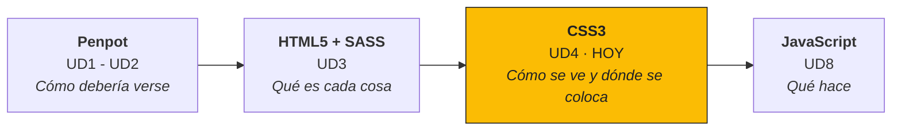

Partimos del HTML semántico de la UD3 y de la carpeta `scss/` que dejamos preparada (tokens, mixins y parciales). Si la estructura está bien hecha, **el HTML casi no se toca**: en esta unidad solo escribimos estilos.

!!! question "La pregunta de la unidad"
    **¿Quién decide cómo se ve y dónde va cada cosa, en cualquier pantalla?** La contestamos en tres partes y en este orden, porque cada una necesita la anterior:

    1. **¿Quién gana?** Cascada, especificidad, herencia y modelo de caja (secciones 2–4).
    2. **¿Dónde va cada cosa?** Flexbox y Grid (secciones 5–6).
    3. **¿Y en otra pantalla?** Media queries, unidades fluidas y container queries (secciones 7–9).

### 1.1 Por qué importa en el mundo real

No existe "la pantalla del usuario". Estos son anchos reales en píxeles CSS, **y entre ellos, todos los intermedios**, porque una ventana de navegador se puede estrechar a cualquier tamaño:

| Dispositivo | Ancho típico (px CSS) |
| --- | --- |
| Móvil pequeño | 360 |
| Móvil | 390 – 430 |
| Tablet en vertical | 768 – 820 |
| Tablet en horizontal | 1024 – 1180 |
| Portátil | 1366 – 1536 |
| Escritorio | 1920 |

- **Más de la mitad del tráfico web es móvil.** Una web que solo funciona en escritorio pierde a la mayoría de sus visitas.
- **Google indexa la versión móvil** (*mobile-first indexing*): para posicionar una web, Google la mira como la ve un móvil.
- **Flexbox y Grid son el estándar.** Ya no se maqueta con `float` ni con tablas.
- **Cualquier proyecto profesional trae requisitos responsive desde el primer día**, y parchearlo al final cuesta mucho más que planificarlo.

!!! tip "Dato clave"
    No se diseña "para el iPhone": se diseña para un **rango continuo de anchos**.

---

## 2. Cómo llega el CSS a la página (RA2.b, RA2.c) :material-code-json:

| Método | Sintaxis | Características | Cuándo usarlo |
|---|---|---|---|
| **En línea** | `<p style="color: red;">` | Gana a cualquier selector y no se puede reutilizar | Casi nunca |
| **Interno** | `<style> … </style>` en el `<head>` | Solo sirve para esa página | Prototipos rápidos |
| **Externo** | `<link rel="stylesheet" href="css/main.css">` | El navegador lo descarga una vez, lo **cachea** y lo reutiliza en todas las páginas | **Siempre en proyectos reales** |

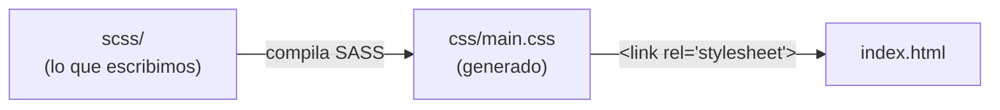

En AURIA escribimos en `scss/`, compilamos y enlazamos **un único** fichero externo, `css/main.css`, tal como dejamos preparado en la UD3.

!!! note "¿`style=""` en una web profesional?"
    Si lo ves en el HTML de una web real, casi siempre lo ha añadido JavaScript al vuelo, no una persona escribiéndolo.

---

## 3. ¿Quién gana? Cascada, especificidad y herencia (RA2.e) :material-layers-search-outline:

### 3.1 La cascada: tres filtros en orden

Cuando varias reglas asignan valores distintos a la misma propiedad del mismo elemento, el navegador aplica un algoritmo llamado **cascada**. Funciona como tres filtros, uno detrás de otro: **si un filtro decide, los siguientes ni se miran**.

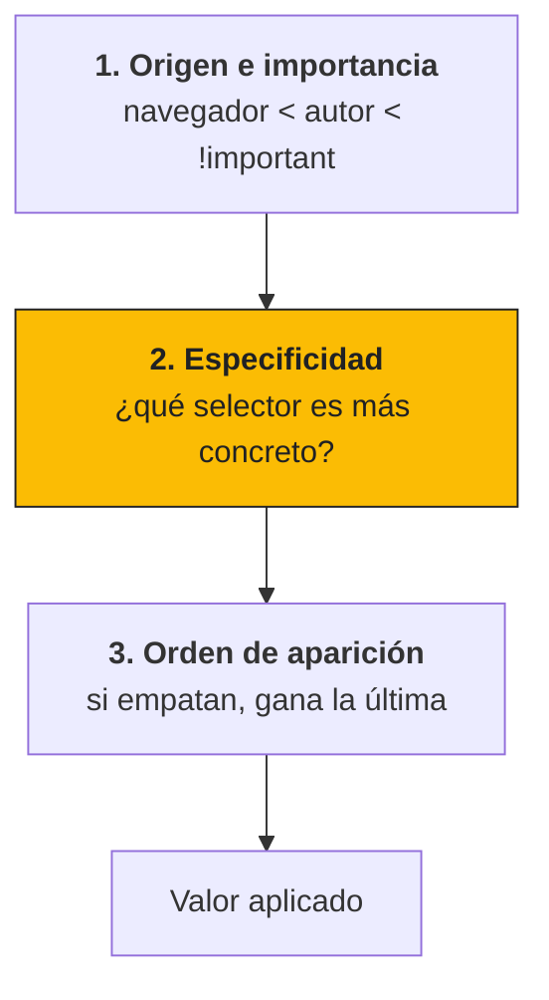

- **Origen**: el navegador trae sus propios estilos (por eso un `h1` sin CSS ya sale grande y en negrita). Encima van los del autor, los nuestros. Por encima de todo, las declaraciones con `!important`.
- **Especificidad**: cuál de los selectores es más concreto (sección 3.2).
- **Orden**: solo si todo lo anterior empata, gana la regla escrita más abajo.

**Ejemplo.** ¿De qué color sale `<p class="intro">`?

```css
p      { color: gray; }
.intro { color: blue; }
p      { color: red; }
```

??? success "Solución"
    **Azul.** Filtro 1: las tres reglas son del autor → empate. Filtro 2: `.intro` (una clase) es más específica que `p` (un elemento) → gana. El orden ni se llega a mirar, aunque `p { color: red; }` esté la última.

!!! warning "El error de concepto más frecuente"
    Pensar que "gana la última regla". El orden **solo decide cuando hay empate de especificidad**.

---

### 3.2 La especificidad es un marcador de tres cifras

La especificidad de un selector se expresa como **(A, B, C)**:

| Columna | Qué cuenta | Ejemplos |
| --- | --- | --- |
| **A** | Identificadores | `#cabecera` |
| **B** | Clases, atributos y pseudoclases | `.btn`, `[type="email"]`, `:hover` |
| **C** | Elementos y pseudoelementos | `p`, `div`, `::before` |

| Selector | A | B | C | Especificidad |
| --- | :-: | :-: | :-: | --- |
| `div` | 0 | 0 | 1 | (0, 0, 1) |
| `.btn` | 0 | 1 | 0 | (0, 1, 0) |
| `nav a:hover` | 0 | 1 | 2 | (0, 1, 2) |
| `#nav .btn` | 1 | 1 | 0 | (1, 1, 0) |
| `div#nav .btn:hover` | 1 | 2 | 1 | (1, 2, 1) |

**Se compara cifra a cifra, de izquierda a derecha, como el marcador de un partido**: en cuanto una columna es distinta, está decidido. Por eso **un solo id (1, 0, 0) gana a doce clases (0, 12, 0)**. No es un número que "se lleve una": son tres columnas independientes.

Fuera del marcador quedan:

- El **estilo en línea** (`style=""`), que gana a cualquier selector.
- **`!important`**, que gana incluso al estilo en línea.

!!! info "Lo que no suma"
    El selector universal `*` y los combinadores (espacio, `>`, `+`, `~`) valen **0**. La pseudoclase `:where()` vale siempre 0; `:is()`, `:not()` y `:has()` valen lo que su argumento más específico.

#### Ejercicio: ¿de qué color es el botón de AURIA?

```html
<button id="comprar" class="btn btn--primary">Añadir al carrito</button>
```

```css
button              { background: gray; }
.btn.btn--primary   { background: #1E88E5; }
#comprar            { background: green; }
.btn                { background: orange; }
```

??? success "Solución"
    | Regla | Especificidad |
    | --- | --- |
    | `button` | (0, 0, 1) |
    | `.btn.btn--primary` | (0, 2, 0) |
    | `#comprar` | **(1, 0, 0) → gana: verde** |
    | `.btn` | (0, 1, 0) |

    - ¿Y si quitamos el `id` del HTML? Gana `(0, 2, 0)`: **azul**.
    - ¿Y si `.btn` estuviera la última del fichero? Da igual: `(0, 1, 0)` pierde contra `(0, 2, 0)`. El orden solo desempata.

---

### 3.3 `!important`: la escalada que nadie gana

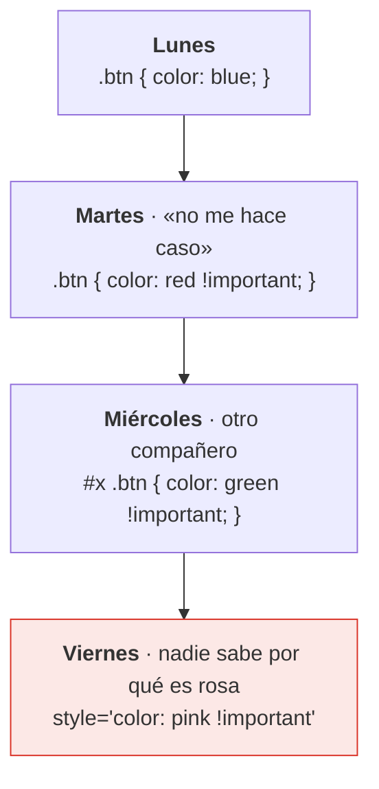

Cada `!important` obliga al siguiente a poner otro más fuerte. Es **deuda técnica**: un atajo que hoy ahorra cinco minutos y dentro de un mes cuesta horas.

| Cuándo SÍ es legítimo | La alternativa para todo lo demás |
| --- | --- |
| Clases de utilidad que deben ganar siempre (`.oculto`, `.sr-only`) | Que todos los selectores pesen lo mismo: **una sola clase, (0, 1, 0)**. Así decide el orden y nadie tiene que pelear. Es la idea de la metodología **BEM**, que veremos en la **UD5**. |
| Accesibilidad: respetar `prefers-reduced-motion` | |
| Sobrescribir CSS de terceros que no puedes editar | |

---

### 3.4 Herencia: lo que los hijos reciben sin pedirlo

Algunas propiedades pasan automáticamente de padres a hijos:

```scss
// _base.scss
body {
  color: #1a73e8;           // se hereda: todo el texto sale azul
  font-family: sans-serif;  // se hereda
  border: 3px solid black;  // NO se hereda: solo el body tiene borde
}
```

!!! tip "Regla de memoria"
    Lo que es de **texto** se hereda; lo que es de la **caja**, no.

| SÍ se heredan (texto) | NO se heredan (caja) |
| --- | --- |
| `color` | `margin`, `padding` |
| `font-family`, `font-size`, `font-weight` | `border` |
| `line-height`, `text-align` | `width`, `height` |
| `visibility`, `cursor` | `background`, `display`, `position` |

Para forzar el comportamiento existen cuatro palabras clave, válidas en cualquier propiedad:

| Palabra clave | Efecto |
| --- | --- |
| `inherit` | Copia el valor del padre (aunque la propiedad no sea heredable) |
| `initial` | Vuelve al valor inicial definido por CSS |
| `unset` | Si la propiedad es heredable, hereda; si no, `initial` |
| `revert` | Vuelve al estilo por defecto del navegador |

!!! note "¿Por qué los botones no heredan la fuente?"
    Porque el navegador les asigna su propia fuente, y eso gana a la herencia. Por eso los resets incluyen `button, input, select, textarea { font: inherit; }`.

---

## 4. El modelo de caja (Box Model) :material-vector-square:

En CSS **todo es una caja**: un párrafo, una imagen, un botón. Cada caja tiene cuatro capas, de dentro afuera:

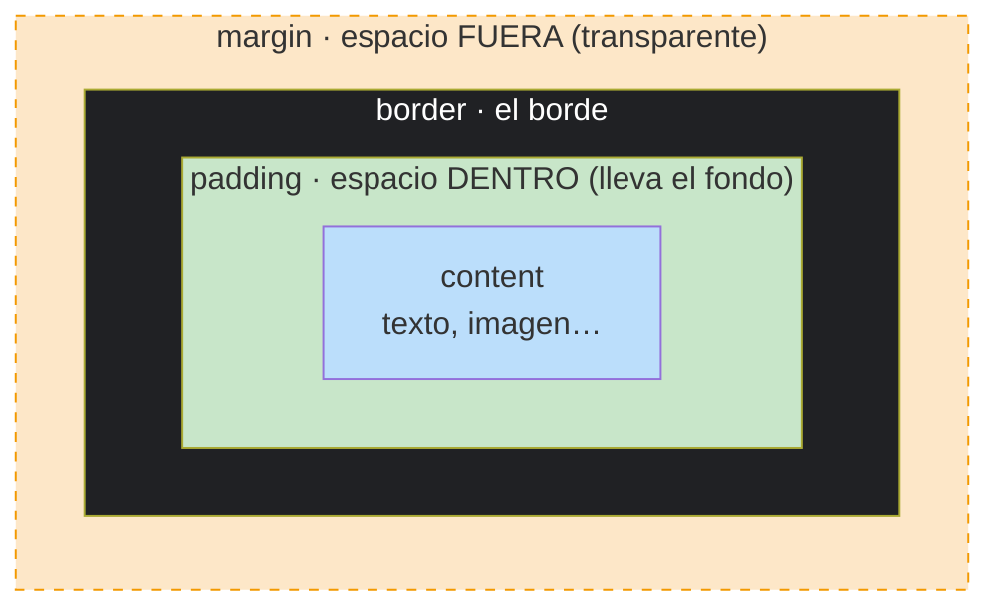

| Capa | Qué es |
| --- | --- |
| **content** | El contenido. Es lo que miden `width` y `height` por defecto. |
| **padding** | Separa el contenido del borde. Se pinta con el `background`. No admite valores negativos. |
| **border** | Línea alrededor del padding: grosor, estilo y color. |
| **margin** | Separa la caja de las demás. Es transparente. Admite `auto` (`margin: 0 auto` centra un bloque con ancho definido). |

!!! warning "Colapso de márgenes"
    Dos márgenes verticales seguidos **no se suman: se funden en el mayor**. Si una caja tiene `margin-bottom: 20px` y la siguiente `margin-top: 30px`, entre ellas hay 30 px, no 50. No ocurre dentro de contenedores flex o grid.

!!! example "Demo en DevTools"
    F12 → Elements → selecciona cualquier elemento → pestaña **Computed**: aparece el dibujo de la caja con sus números. Al pasar el ratón por él, se resalta cada capa en la página.

### 4.1 `box-sizing`: ¿cuánto mide de verdad una caja?

```scss
// _card.scss
.card {
  width: 300px;
  padding: 20px;
  border: 5px solid;
}
```

| `box-sizing` | Qué mide `width` | Ancho real en pantalla |
| --- | --- | --- |
| `content-box` (**por defecto**) | Solo el contenido | 300 + 2×20 + 2×5 = **350 px** |
| `border-box` (**recomendado**) | Contenido + padding + borde | **300 px** (el contenido se encoge a 250) |

Con `content-box`, el padding y el borde **se suman por fuera** y la caja ocupa más de lo que pone en `width`. Por eso todos los proyectos empiezan con este reset, al principio de `_base.scss`:

```scss
*, *::before, *::after {
  box-sizing: border-box;
}
```

Se incluyen `::before` y `::after` porque el selector `*` no selecciona los pseudoelementos. El margen **nunca** forma parte de `width`, en ningún modo.

---

## 5. Layout con Flexbox: una dimensión :material-view-parallel-outline:

### 5.1 Tres formas de colocar cajas

| Modo | `display` | Cómo coloca | Dimensiones |
| --- | --- | --- | --- |
| **Flujo normal** | `block` (por defecto) | Una caja debajo de otra (así está AURIA ahora) | — |
| **Flexbox** | `flex` | En una fila **o** en una columna | 1 |
| **Grid** | `grid` | En filas **y** columnas a la vez | 2 |

Al poner `display: flex` o `display: grid`, el elemento pasa a ser **contenedor** y sus **hijos directos**, **ítems**. No compiten entre sí: **Grid para el esqueleto de la página, Flexbox para colocar lo de dentro de cada pieza** (sección 6.3).

### 5.2 Los dos ejes

Flexbox se entiende con una sola idea: **tiene dos ejes**.

=== "flex-direction: row (por defecto)"

    ```mermaid
    flowchart LR
        A1["1"] -->|"eje principal → justify-content"| A2["2"] --> A3["3"]
    ```

    El eje principal es **horizontal** y el cruzado, vertical.

=== "flex-direction: column"

    ```mermaid
    flowchart TB
        B1["1"] -->|"eje principal ↓ justify-content"| B2["2"] --> B3["3"]
    ```

    El eje principal pasa a ser **vertical** y el cruzado, horizontal.

- **Eje principal**: la dirección en la que se colocan los ítems. La decide `flex-direction`.
- **Eje cruzado**: el perpendicular.
- `justify-content` alinea **en el eje principal**; `align-items`, **en el eje cruzado**.

!!! warning "Si cambias `flex-direction`, los ejes se giran"
    Con `column`, el eje principal pasa a ser vertical y `justify-content` mueve las cosas **arriba y abajo**. No es "justify = horizontal, align = vertical": es "justify = principal, align = cruzado".

### 5.3 Propiedades del contenedor

| Propiedad | Valores habituales | Efecto |
| --- | --- | --- |
| `display` | `flex` | Activa Flexbox **solo en los hijos directos** (no en los nietos) |
| `flex-direction` | `row` · `column` · `row-reverse` · `column-reverse` | Define el eje principal |
| `justify-content` | `flex-start` · `center` · `space-between` · `space-around` · `space-evenly` | Reparte los ítems en el eje principal |
| `align-items` | `stretch` (por defecto) · `center` · `flex-start` · `flex-end` | Alinea en el eje cruzado |
| `gap` | `16px`, `1rem`, `$space-md`… | Espacio **entre** ítems, sin márgenes |
| `flex-wrap` | `nowrap` (por defecto) · `wrap` | Si no caben, pasan a otra línea en lugar de aplastarse |

- `space-between`: el primero al principio, el último al final y el espacio sobrante **entre** ellos (el típico menú con el logo a un lado y los enlaces al otro).
- `space-around`: el espacio repartido **alrededor** de cada ítem; en los extremos queda medio hueco. `space-evenly`: huecos exactamente iguales, extremos incluidos.
- `align-items: stretch` es el motivo por el que, en una fila flex, **todas las tarjetas salen igual de altas** sin hacer nada.

!!! tip "El centrado clásico"
    ```scss
    .centrado { display: flex; justify-content: center; align-items: center; }
    ```
    Es el mixin `flex-center` que hiciste en la UD3. Para mover solo un ítem: `align-self` (eje cruzado) o `margin-left: auto` (lo empuja al final del eje principal).

!!! example "Practica jugando"
    [Flexbox Froggy](https://flexboxfroggy.com/#es): 24 niveles para practicar `justify-content`, `align-items` y compañía.

### 5.4 Propiedades de los hijos: cómo se reparten el espacio que sobra

| Propiedad | Qué decide | Por defecto |
| --- | --- | --- |
| `flex-grow` | Cuánto crece el ítem si **sobra** espacio | `0` (no crece) |
| `flex-shrink` | Cuánto encoge si **falta** espacio | `1` (todos encogen) |
| `flex-basis` | Tamaño de partida antes de repartir | `auto` |

| Situación | Resultado |
| --- | --- |
| `flex-grow: 0` en todos | Miden lo que miden; sobra espacio al final |
| `flex-grow: 1` en todos | El sobrante se reparte a partes iguales |
| `flex-grow: 2` en el del medio, `1` en el resto | El del medio se lleva **el doble del sobrante** (no mide el doble) |

!!! tip "El atajo que más usarás"
    `flex: 1` equivale a `flex: 1 1 0%`: "ocupa lo que sobre". Por ejemplo, el buscador de una cabecera que se estira entre el logo y el carrito. Y si una imagen se aplasta dentro de un flex, ponle `flex-shrink: 0`.

### 5.5 Ya lo habéis usado: el Flex Layout de Penpot es CSS

El panel **Flex Layout** de Penpot de la UD2 (dirección, alinear, justificar, gap y padding) se basa en Flexbox. En *Inspect → Code* puedes ver el CSS que genera:

| Penpot · Flex Layout | CSS |
| --- | --- |
| Dirección: → fila | `flex-direction: row` |
| Alinear: centro | `align-items: center` |
| Justificar: espacio entre | `justify-content: space-between` |
| Gap: 16 | `gap: 16px` |
| Padding: 24 | `padding: 24px` |

En el proyecto **no copiamos los valores a pelo**: los escribimos con las variables de los tokens, para que no queden valores "mágicos":

```scss
// components/_card.scss
.card__fila {
  display: flex;
  flex-direction: row;
  align-items: center;
  justify-content: space-between;
  gap: $space-md;      // 16px · token de la UD2
  padding: $space-lg;  // 24px
}
```

---

## 6. Layout con Grid: dos dimensiones :material-grid:

### 6.1 Vocabulario: líneas, pistas, celdas y `fr`

```scss
// _layout.scss
.rejilla {
  display: grid;
  grid-template-columns: 1fr 1fr 2fr;
  gap: 16px;
}
```

| Término | Qué es |
| --- | --- |
| **Línea** | Cada división de la rejilla, numerada desde 1. **Tres columnas tienen cuatro líneas.** También se cuentan desde el final con negativos: `-1` es la última. |
| **Pista** (*track*) | Una fila o una columna entera. |
| **Celda** | La intersección de una fila y una columna. |
| **Área** | Un rectángulo de varias celdas. |
| **`fr`** | Fracción del espacio **libre**. `1fr 1fr 2fr` = 1 + 1 + 2 = 4 partes → ¼, ¼ y ½. |

| Propiedad | Efecto |
| --- | --- |
| `grid-template-columns` / `grid-template-rows` | Número y tamaño de las columnas / filas |
| `repeat(3, 1fr)` | Atajo de `1fr 1fr 1fr` |
| `minmax(250px, 1fr)` | Pista con tamaño mínimo y máximo |
| `gap` | Espacio entre filas y columnas |
| `grid-column: 1 / 3` | El ítem ocupa **de la línea 1 a la 3**: dos columnas |
| `grid-column: 1 / -1` | El ítem ocupa todo el ancho |

!!! info "¿Por qué `fr` y no porcentajes?"
    El `%` no descuenta el `gap`: tres columnas de `33%` más dos huecos se salen del contenedor. `fr` reparte lo que queda **después** del `gap`.

!!! tip "Columnas automáticas sin media queries"
    ```scss
    .productos { grid-template-columns: repeat(auto-fit, minmax(250px, 1fr)); }
    ```
    Crea tantas columnas de al menos 250 px como quepan. Si no defines filas, Grid crea las que hagan falta automáticamente.

!!! example "Demo en DevTools"
    En Elements, junto a cada contenedor grid aparece una insignia **grid**. Al pulsarla, se dibujan las líneas numeradas y los huecos encima de la página. Para practicar: [Grid Garden](https://cssgridgarden.com/#es).

### 6.2 `grid-template-areas`: dibujar el layout con palabras

| `header` | `header` |
| :-: | :-: |
| **`main`** (3fr) | **`aside`** (1fr) |
| `footer` | `footer` |

```scss
// _layout.scss
.pagina {
  display: grid;
  grid-template-columns: 3fr 1fr;
  grid-template-areas:
    "header header"
    "main   aside"
    "footer footer";
}
header { grid-area: header; }
main   { grid-area: main; }
aside  { grid-area: aside; }
footer { grid-area: footer; }
```

**Cada cadena es una fila; cada palabra, una columna.** Un punto (`.`) marca una celda vacía. Las áreas tienen que ser **rectángulos** (no se puede hacer una "L").

En móvil, para pasar a una sola columna basta con **redibujar el mapa**; el HTML no se toca:

```scss
.pagina {
  grid-template-columns: 1fr;
  grid-template-areas: "header" "main" "aside" "footer";
}
```

!!! warning "El orden visual no debe contradecir al del HTML"
    El lector de pantalla y la tecla Tab siguen el **orden del HTML**, no el de la pantalla. Si el CSS recoloca las piezas en un orden sin sentido, una persona que navega con teclado salta de forma absurda (WCAG 1.3.2 y 2.4.3, lo vemos en la UD9).

### 6.3 ¿Flexbox o Grid? Grid fuera, Flexbox dentro

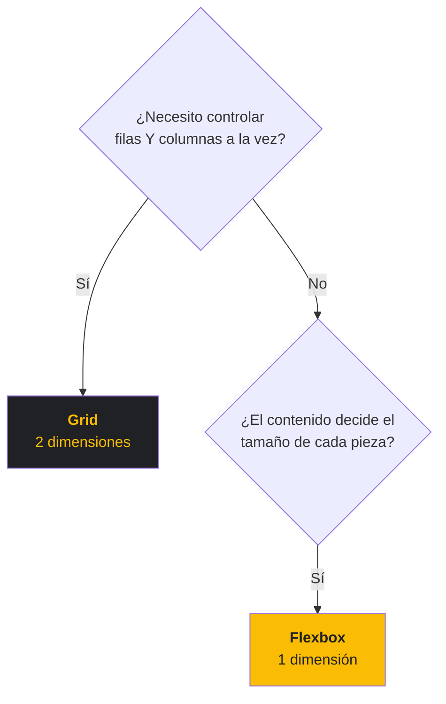

| Necesidad | Herramienta |
| --- | --- |
| Esqueleto de la página (header, main, aside, footer) | **Grid** |
| Rejilla de tarjetas de producto | **Grid** (todas respetan las mismas columnas, también la última fila) |
| Interior de una tarjeta (imagen, título, precio, botón) | **Flexbox** |
| Menú horizontal con enlaces de distinta longitud | **Flexbox** |
| Aplicación web completa | **Ambos**: Grid organiza la página; Flexbox, el interior de cada pieza |

!!! info "Para quien vaya rápido: `subgrid`"
    `grid-template-rows: subgrid` permite que los hijos de un ítem se alineen con las pistas del grid padre; por ejemplo, que los títulos y los precios de todas las tarjetas queden a la misma altura. Está soportado en todos los navegadores actuales.

---

## 7. Responsive: media queries y mobile-first :material-devices:

### 7.1 Paso 0: la etiqueta meta viewport

Antes de escribir una sola media query, esta línea tiene que estar en el `<head>`:

```html
<meta name="viewport" content="width=device-width, initial-scale=1">
```

| Sin meta viewport | Con meta viewport |
| --- | --- |
| El móvil **finge ser un escritorio de unos 980 px**, pinta la página a ese tamaño y la encoge | El ancho del layout es el ancho real del dispositivo |
| Texto diminuto: hay que hacer zoom con los dedos | Se lee sin zoom |
| Las media queries de móvil **nunca se activan** | Las media queries funcionan |

- `width=device-width`: el ancho del layout es el del dispositivo.
- `initial-scale=1`: sin zoom al cargar.

!!! danger "Nunca `user-scalable=no`"
    Impide ampliar la página con los dedos. Para una persona con baja visión es dejarla fuera: es un fallo de accesibilidad.

!!! tip "Diagnóstico rápido"
    Si "el responsive funciona en DevTools pero no en mi móvil", lo primero que se comprueba es esta línea.

### 7.2 Media queries y mobile-first

Una **media query** aplica un bloque de CSS solo si el dispositivo cumple una condición. Un **breakpoint** (punto de ruptura) es el ancho en el que cambia el layout.

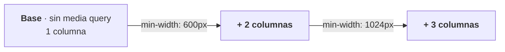

En **mobile-first** el CSS base, sin media query, es el del móvil, y cada `min-width` **suma** cambios para pantallas mayores:

```scss
// _productos.scss
/* base: móvil */
.productos {
  display: grid;
  gap: 16px;
  grid-template-columns: 1fr;
}

@media (min-width: 600px) {
  .productos { grid-template-columns: repeat(2, 1fr); }
}

@media (min-width: 1024px) {
  .productos { grid-template-columns: repeat(3, 1fr); }
}
```

| | Mobile-first | Desktop-first |
| --- | --- | --- |
| CSS base | Móvil | Escritorio |
| Consulta | `min-width` | `max-width` |
| Se usa en | Proyectos nuevos | Mantener webs antiguas |

**¿Por qué empezar por el móvil?** Porque es lo más restrictivo (si funciona en poco espacio, ampliar es fácil; al revés, no), porque el dispositivo con peor conexión recibe el CSS más simple, y porque obliga a decidir qué es lo importante.

!!! warning "No mezcles `min-width` y `max-width` en el mismo proyecto"
    En los anchos donde se solapan, las reglas se pisan y nadie sabe cuál manda. `min-width: 600px` incluye el 600.

!!! info "Sintaxis de rangos"
    `@media (width >= 600px)` es la forma moderna de escribir `min-width: 600px`, y está soportada en todos los navegadores actuales. Usamos `min-width` porque es la que encontrarás en la mayoría del código existente.

### 7.3 Los breakpoints los decide el contenido, no el dispositivo

Un breakpoint "del iPhone 15" (393 px) **caduca con el siguiente móvil**. Uno puesto **donde el contenido se rompe** no caduca nunca.

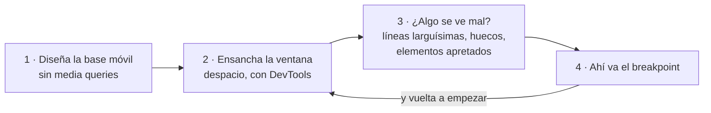

| Breakpoint de dispositivo ❌ | Breakpoint de contenido ✅ |
| --- | --- |
| `@media (min-width: 393px) /* iPhone */` | `@media (min-width: 560px) /* las tarjetas ya caben de dos en dos */` |
| `@media (min-width: 820px) /* iPad */` | `@media (min-width: 980px) /* sobra aire: 3 columnas + aside */` |

Con **2–4 breakpoints** suele bastar para una página entera. Las líneas de texto también son un buen indicador: la legibilidad empeora por encima de unos 75 caracteres por línea, y `max-width: 65ch` en los párrafos lo evita sin media queries.

### 7.4 Los breakpoints, en un solo sitio (SASS de la UD3)

Si escribes `600px` a mano en treinta media queries, moverlo a 640 son treinta cambios. La solución, como en la UD3: **variables y un mixin**.

=== "_mixins.scss"

    ```scss
    $bp-md: 600px;
    $bp-lg: 1024px;

    @mixin desde($ancho) {
      @media (min-width: $ancho) {
        @content;   // aquí se inserta el bloque del @include
      }
    }
    ```

=== "components/_productos.scss"

    ```scss
    @use '../mixins' as *;

    .productos {
      grid-template-columns: 1fr;

      @include desde($bp-md) {
        grid-template-columns: 1fr 1fr;
      }
    }
    ```

=== "CSS generado"

    ```css
    .productos {
      grid-template-columns: 1fr;
    }
    @media (min-width: 600px) {
      .productos {
        grid-template-columns: 1fr 1fr;
      }
    }
    ```

| Ventaja | Por qué |
| --- | --- |
| Cambiar un breakpoint | Se toca una variable, no treinta media queries |
| La media query vive con su componente | Todo lo de `.productos`, también su versión de tablet, está en el mismo fichero |
| `@content` | Inserta el bloque que escribes dentro del `@include` |

!!! note "¿Por qué `$` y no `--`?"
    Las media queries **no admiten `var()`**: una custom property no puede usarse en la condición de un `@media`. Por eso los breakpoints van en variables de SASS.

---

## 8. Unidades fluidas: menos píxeles fijos, menos media queries :material-ruler:

### 8.1 Las unidades que más usarás

| Unidad | Relativa a | Uso típico |
| --- | --- | --- |
| `px` | Nada (fija) | Bordes, sombras finas |
| `%` | El contenedor padre | Anchos de columnas |
| `rem` | El tamaño de letra **raíz** (`html`, 16 px por defecto): `1.5rem` = 24 px | **Tipografía y espaciados** |
| `em` | El tamaño de letra **del propio elemento** | Padding de botones (crece con su letra) |
| `vw` / `vh` | 1 % del ancho / alto de la ventana | Secciones a pantalla completa |
| `fr` | El espacio libre del grid | Columnas de Grid |
| `ch` | El ancho del carácter "0" | Limitar la longitud de línea (`max-width: 65ch`) |

!!! info "Accesibilidad: tipografía siempre en `rem`"
    Hay personas que configuran el navegador con la letra más grande porque no ven bien. Con `rem`, tu tipografía **crece con esa preferencia**; con `px`, la ignora.

!!! warning "Dos trampas habituales"
    - `em` **se acumula**: una lista con `font-size: 1.2em` dentro de otra con `1.2em` sale a 1,44. `rem` siempre mide respecto a la raíz.
    - `100vw` incluye la barra de desplazamiento en escritorio y provoca **scroll horizontal**. Para ocupar todo el ancho, `width: 100%`.

### 8.2 `clamp()`: tipografía fluida sin media queries

`clamp(mínimo, preferido, máximo)` devuelve el valor preferido, pero **nunca por debajo del mínimo ni por encima del máximo**:

```scss
// _tipografia.scss
h1 {
  font-size: clamp(1.5rem, 1rem + 2.5vw, 3rem);
}
```

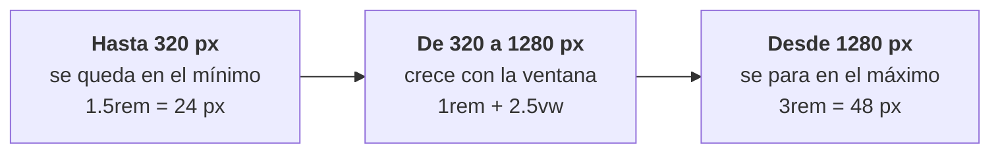

La cuenta: a 320 px de ancho, 16 + 2,5 % de 320 = 16 + 8 = **24 px**; a 1280 px, 16 + 32 = **48 px**. Entre medias, crece de forma continua, sin saltos.

- **Sumar `rem` + `vw`** hace que el zoom del navegador siga funcionando. Un tamaño solo en `vw` depende únicamente del ancho de la ventana y el zoom no lo agranda.
- Sirve también para `padding`, `gap` o márgenes.
- Un `clamp()` sustituye a **tres o cuatro media queries** de tamaño de letra.
- Existen también `min()` y `max()`: `width: min(100%, 1200px)` = "el 100 %, pero nunca más de 1200 px". Calculadora de `clamp()`: [utopia.fyi](https://utopia.fyi/).

### 8.3 `100vh` miente en el móvil: usa `100dvh`

En el móvil, la barra del navegador aparece y desaparece al hacer scroll. `vh` mide la ventana **como si la barra no estuviera** (el tamaño más grande), así que un bloque de `100vh` queda parcialmente tapado: si abajo estaba el botón de "Comprar", no se ve.

| Unidad | Qué mide |
| --- | --- |
| `vh` | Alto de la ventana **sin** barras (el más grande) |
| `svh` | Alto **con** las barras visibles (el más pequeño) |
| `lvh` | Alto sin barras (grande): como `vh` |
| **`dvh`** | Se ajusta **en vivo** al alto realmente visible |

```scss
// _hero.scss
.hero {
  min-height: 100dvh;   // min-height: si el contenido es más largo, puede crecer
}
```

Funcionan en todos los navegadores actuales. Como `dvh` cambia mientras haces scroll, en elementos que no deben "bailar" `svh` es más estable.

---

## 9. Container queries: el componente se adapta a su hueco :material-view-dashboard-outline:

### 9.1 El problema: la misma tarjeta en dos sitios

Pantalla de 1280 px. La misma tarjeta de producto aparece en el `main` (ancho) y en el `aside` (estrecho):

| | `@media (min-width: 600px)` ❌ | `@container (min-width: 400px)` ✅ |
| --- | --- | --- |
| Qué mira | La **pantalla**: ve 1280 px en los dos sitios | El ancho de **su contenedor** |
| Tarjeta en `main` | Horizontal | Horizontal |
| Tarjeta en `aside` | Horizontal… y no cabe | Vertical |

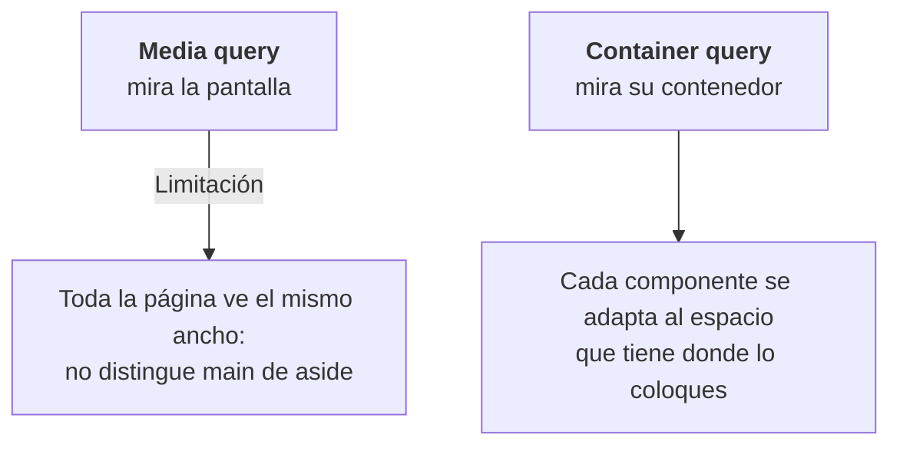

Con container queries **el componente es independiente de dónde lo pongas**. Es la idea de los componentes reutilizables de la **UD7**. No sustituyen a las media queries: **media queries para el layout de la página, container queries para los componentes**.

### 9.2 Container queries en dos pasos

=== "Paso 1 · el PADRE se declara contenedor"

    ```css
    .producto-slot {
      container-type: inline-size;
      container-name: card;          /* opcional */
    }
    ```

=== "Paso 2 · el HIJO pregunta por su contenedor"

    ```css
    .card { display: grid; }

    @container card (min-width: 400px) {
      .card {
        grid-template-columns: 1fr 2fr;
      }
    }
    ```

| Pieza | Qué hace |
| --- | --- |
| `container-type: inline-size` | Permite consultar el **ancho** del contenedor (el caso normal). `size` consulta ancho y alto. |
| `container-name` | Opcional: elige a qué contenedor se pregunta si hay varios anidados. Sin nombre, se pregunta al más cercano. Atajo: `container: card / inline-size;` |
| `cqi` | 1 % del ancho del contenedor (como `vw`, pero del contenedor): `font-size: 5cqi` |

!!! danger "Olvidar el paso 1"
    Si el padre no tiene `container-type`, el `@container` **no hace nada y no da ningún error**.

!!! info "¿Por qué dos pasos?"
    Un elemento **no puede preguntar por su propio tamaño**: si cambiara su tamaño según su tamaño, entraría en un bucle infinito. Por eso la consulta la hace siempre el hijo sobre un antecesor. A veces hace falta añadir un contenedor en el HTML: es la única excepción en la que esta unidad toca el HTML.

---

## 10. Hojas de estilo alternativas hoy: modo oscuro e impresión (RA2.d) :material-theme-light-dark:

| Antes | Hoy | Para qué |
| --- | --- | --- |
| `<link rel="alternate stylesheet">` | `prefers-color-scheme` + custom properties | Tema claro / oscuro |
| `<link media="print">` | `@media print { … }` | Estilos al imprimir |

### 10.1 Modo oscuro

Los colores se definen como **custom properties** (variables de CSS, con `--`) en `:root`, y se cambian sus valores si el sistema operativo está en modo oscuro:

```scss
// _tema.scss
:root {
  --bg: #fff;
  --texto: #1a1a1a;
}

@media (prefers-color-scheme: dark) {
  :root {
    --bg: #121212;
    --texto: #f0f0f0;
  }
}

body {
  background: var(--bg);
  color: var(--texto);
}
```

### 10.2 Hoja de impresión

```scss
// _print.scss
@media print {
  nav, .btn, footer { display: none; }      // lo que no sirve en papel
  body { color: #000; background: #fff; }   // sin gastar tinta
}
```

!!! info "Variables SASS (`$`) frente a custom properties (`--`)"
    | | `$variable` (SASS) | `--variable` (CSS) |
    | --- | --- | --- |
    | Dónde existe | Solo en el `.scss`: **desaparece al compilar** | En el navegador |
    | ¿Puede cambiar con la página cargada? | No | **Sí** (media queries, clases, JavaScript) |
    | ¿Sirve en la condición de un `@media`? | Sí | No |
    | Uso típico | Tokens, breakpoints, cálculos | **Temas de color** |

    Lo habitual es combinarlas: SASS genera las custom properties a partir de los tokens (`--bg: #{$neutral-0};`).

!!! tip "Detalles para un modo oscuro completo"
    `color-scheme: light dark;` en `:root` indica al navegador que la página admite ambos temas, y así también los controles nativos (barras de desplazamiento, inputs) se pintan en oscuro. Un botón para cambiar de tema manualmente necesita JavaScript (UD8).

---

## 11. Verificar: DevTools y pruebas responsive :material-bug-check-outline:

### 11.1 DevTools: el CSS se depura, no se adivina

| Herramienta | Para qué |
| --- | --- |
| **Styles** | Todas las reglas que afectan al elemento, **ordenadas por quién gana**. Las que pierden aparecen **tachadas**: si una propiedad tuya sale tachada, otra le gana, y DevTools te dice cuál. |
| **Computed** | El valor final de cada propiedad y el dibujo del modelo de caja. |
| **Insignias flex / grid** | Pintan ejes, líneas numeradas y huecos encima de la página. |
| **Modo dispositivo** (Ctrl+Mayús+M) | Anchos, rotación y simulación táctil. |
| **Rendering** (menú ⋮ → *More tools*) | *Emulate CSS prefers-color-scheme: dark* para probar el modo oscuro sin cambiar el sistema; también emula `print` y `prefers-reduced-motion`. |

### 11.2 Probar el responsive de verdad

- **Modo dispositivo**: elige *Responsive* y **arrastra el borde**; no te quedes en tres tamaños predefinidos.
- **Un móvil real**: el emulador no simula la barra del navegador ni el uso con el dedo.
- **Zoom al 200 %**: el texto debe seguir leyéndose sin scroll horizontal (WCAG 1.4.4 y 1.4.10).
- **En horizontal**: casi todo el mundo prueba solo en vertical.
- **Contenido real**: nombres largos y textos de verdad, no un *Lorem ipsum* corto.

!!! success "La prueba del acordeón"
    Abre la página a 1440 px y estrecha la ventana hasta 320 px **muy despacio**. Si en **algún** ancho intermedio algo se solapa, se corta o aparece scroll horizontal, falta un breakpoint o sobra un ancho fijo. Para encontrar qué se sale: añade temporalmente `* { outline: 1px solid red; }`.

---

## 12. Errores comunes :material-alert-circle-outline:

### 12.1 Cascada y caja

| Error | Qué pasa | ❌ Incorrecto | ✅ Correcto |
| --- | --- | --- | --- |
| `!important` para "ganar" | Abre una escalada que nadie gana | `.btn { color: red !important; }` | `.producto__btn { color: red; }` |
| Pensar que gana la última regla | Solo decide si hay empate de especificidad | `#nav a {…}` … `a.activo {…}` | Comprobarlo en Styles (tachados) |
| Olvidar el reset de `box-sizing` | La caja mide más de lo que pone `width` | `width: 300px; padding: 20px;` → 340 | `*, *::before, *::after { box-sizing: border-box; }` |
| Anchos fijos en píxeles | Scroll horizontal en móvil | `.contenedor { width: 1200px; }` | `.contenedor { max-width: 1200px; }` |

### 12.2 Layout y responsive

| Error | Qué pasa | ❌ Incorrecto | ✅ Correcto |
| --- | --- | --- | --- |
| Sin meta viewport | Las media queries no se activan en el móvil | `<head>` sin la etiqueta | `<meta name="viewport" content="width=device-width, initial-scale=1">` |
| Breakpoints de dispositivo | Caducan con el siguiente móvil | `@media (min-width: 393px) /* iPhone */` | `@media (min-width: 560px) /* se rompe aquí */` |
| Mezclar `min-width` y `max-width` | Reglas que se pisan | `max-width: 767px` + `min-width: 600px` | Solo `min-width` (mobile-first) |
| `@container` sin contenedor | No pasa nada y no da error | `@container (min-width: 400px) { … }` sin más | `.slot { container-type: inline-size; }` en el padre |
| `display: flex` "no afecta" a los nietos | Flexbox solo actúa sobre los hijos directos | `display: flex` en el abuelo | `display: flex` en el padre directo |
| `justify-content: center` "no centra en vertical" | Con `row`, justify es horizontal | `justify-content: center` | `align-items: center` |

---

## 13. Ejercicio práctico guiado: la página de AURIA, de fea a responsive :material-clipboard-check:

!!! info "Actividad de consolidación (no evaluable)"
    **Objetivo:** Maquetar con CSS3 moderno la estructura semántica de AURIA construida en la UD3, sobre la carpeta `scss/` con `sass --watch` en marcha. El HTML solo se toca si hace falta un contenedor para el `@container`.

**Pasos, en este orden:**

1. **Reset:** `box-sizing: border-box` universal al principio de `_base.scss`.
2. **Esqueleto en Grid:** layout de la página con `grid-template-areas` (`header`, `main`, `aside`, `footer`). En móvil, una columna; a partir del breakpoint, el lateral.
3. **Tarjeta en Flexbox:** imagen, título, precio y botón de la tarjeta de producto, con los tokens de espaciado (sin valores mágicos).
4. **Dos breakpoints mobile-first** con el mixin `desde`, puestos **donde se rompe tu contenido**, no en el ancho de un dispositivo.
5. **Modo oscuro:** custom properties + `@media (prefers-color-scheme: dark)`.
6. **Reto (avanzado):** la tarjeta con **container query**, para que funcione bien a la vez en el `main` y en el `aside`.

!!! success "Criterio de éxito"
    La página pasa **la prueba del acordeón** (de 1440 a 320 px) sin scroll horizontal y con la tarjeta bien colocada en el `main` y en el `aside`.

---

## 14. Comprueba lo aprendido :material-head-question-outline:

??? question "1. Una regla con un id y otra con tres clases: ¿cuál gana y por qué?"
    La del id: (1, 0, 0) contra (0, 3, 0). Se compara la primera cifra y ya decide.

??? question "2. Con `width: 300px`, `padding: 20px` y `border: 5px`, ¿cuánto mide la caja con `content-box`? ¿Y con `border-box`?"
    350 px (300 + 2×20 + 2×5) y 300 px (el contenido se queda en 250).

??? question "3. ¿Cuándo eliges Grid y cuándo Flexbox? Pon un ejemplo de AURIA para cada uno."
    Grid cuando hay que controlar filas y columnas a la vez: el esqueleto de la página o la rejilla de productos. Flexbox para una fila o una columna cuyo contenido decide el tamaño: el interior de la tarjeta o el menú de la cabecera.

??? question "4. ¿Por qué un breakpoint puesto donde se rompe el contenido envejece mejor que uno «del iPhone»?"
    Porque los dispositivos cambian cada año y el contenido no. Un breakpoint de dispositivo deja de corresponder a nada en cuanto sale otro modelo; uno de contenido sigue marcando el punto en el que el diseño necesita cambiar.

??? question "5. ¿Qué resuelve una container query que una media query no puede resolver?"
    Que un mismo componente se adapte al espacio que tiene **donde está colocado** (por ejemplo, la tarjeta en el `main` y en el `aside` a la vez), porque mira a su contenedor y no al viewport, que es igual para toda la página.

!!! example "Mini-reto (20 min, en parejas)"
    Elegid un layout de la vida real (periódico, tienda, blog o panel de control) y:

    1. **Especificidad:** calculad el marcador de 5 selectores de su CSS (DevTools → Styles).
    2. **Grid:** replicad su layout de 3 zonas con `grid-template-areas`.
    3. **Flexbox:** un menú horizontal con `gap` y `space-between`.
    4. **Responsive:** un breakpoint mobile-first y un `clamp()` en el `h1`.
    5. **Acordeón:** sin scroll horizontal de 1440 a 320 px.

    Después, intercambiad con otra pareja e intentad romper su layout: insignias grid/flex activadas, modo dispositivo de 320 a 1440 y zoom al 200 %. **Éxito:** la otra pareja no encuentra ningún ancho en el que vuestro layout se rompa.

---

## 15. Glosario :material-book-alphabet:

### Cascada, caja y layout

| Término | Definición |
| --- | --- |
| **Cascada** | Algoritmo que decide qué regla se aplica: origen e importancia, especificidad y, si empatan, orden de aparición. |
| **Especificidad** | Peso de un selector (id, clase, elemento). Se compara cifra a cifra: (1,0,0) gana a (0,12,0). |
| **`!important`** | Salta la especificidad. Abusar de él genera una escalada difícil de mantener (deuda técnica). |
| **Herencia** | Valores que los hijos reciben del padre sin pedirlos: los de texto sí, los de caja no. |
| **`inherit` / `initial`** | Fuerzan el valor del padre / el valor inicial de CSS. |
| **Modelo de caja** | Content + padding + border + margin. |
| **`box-sizing`** | Qué incluye `width`: solo el contenido (`content-box`) o también padding y borde (`border-box`). |
| **Colapso de márgenes** | Dos márgenes verticales seguidos se funden en el mayor. |
| **Flexbox** | Layout en una dimensión: fila o columna. |
| **Eje principal** | El que marca `flex-direction`; se alinea con `justify-content`. |
| **Eje cruzado** | El perpendicular; se alinea con `align-items`. |
| **`flex-grow`** | Cuánto crece un hijo si sobra espacio. |
| **Grid** | Layout en dos dimensiones: filas y columnas. |
| **Línea / pista / celda** | División numerada de la rejilla / fila o columna entera / intersección de ambas. |
| **`fr`** | Fracción del espacio libre de un grid. |

### Responsive y container queries

| Término | Definición |
| --- | --- |
| **Responsive** | Una sola web que se adapta a cualquier ancho. |
| **Meta viewport** | Hace que el móvil use su ancho real, sin encoger la página. |
| **Media query** | CSS que se aplica según características de la pantalla o del medio. |
| **Mobile-first** | CSS base para móvil y `min-width` para ampliar. |
| **Breakpoint** | Ancho en el que cambia el layout porque el contenido lo pide. |
| **`rem`** | Relativo al tamaño de letra raíz; respeta la preferencia del usuario. |
| **`vw` / `vh`** | 1 % del ancho / alto de la ventana. |
| **`dvh`** | Alto real visible en móvil, con o sin barras del navegador. |
| **`clamp()`** | Valor fluido con mínimo y máximo. |
| **Container query** | CSS que se aplica según el tamaño del contenedor, no de la pantalla. |
| **`container-type`** | Convierte un elemento en contenedor consultable. |
| **Custom property** | Variable de CSS (`--x`) que existe en el navegador y puede cambiar en vivo. |
| **`prefers-color-scheme`** | Media query del tema claro u oscuro del sistema. |
| **`@media print`** | Estilos que solo se aplican al imprimir. |

---

## 16. Resumen y conexión con la siguiente unidad :material-link-variant:

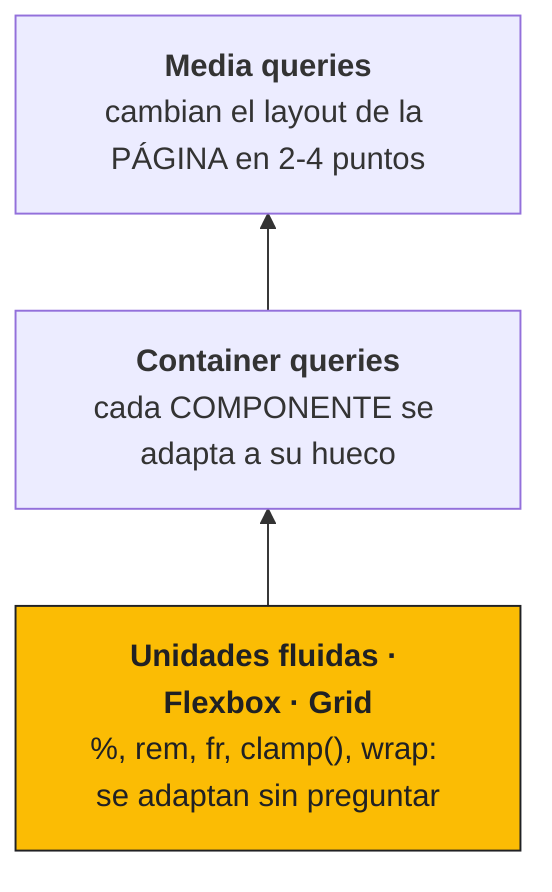

**Mañana sale un móvil nuevo, ¿qué tienes que tocar?** Si la base es fluida, **nada**. Cuanto más trabajo hace la base de la pirámide, menos media queries necesitas arriba: igual que con los tokens de la UD2, el ahorro se nota el día que algo cambia.

- La cascada decide por **origen**, luego por **especificidad** y solo al final por **orden**.
- Con `box-sizing: border-box`, `width` es el ancho real de la caja.
- **Flexbox** coloca en una dimensión; **Grid**, en dos. Grid fuera, Flexbox dentro.
- **Mobile-first** con `min-width`, y breakpoints **donde se rompe el contenido**.
- `rem`, `fr`, `clamp()` y `dvh` reducen el número de media queries.
- Las **container queries** adaptan el componente a su hueco, no a la pantalla.

AURIA ya tiene piel y se adapta a cualquier pantalla. En la **UD5** ordenamos ese CSS para que escale cuando trabajan varias personas: la metodología **BEM** (la alternativa al `!important`), el enfoque *utility-first* de **Tailwind CSS**, la validación con **Stylelint** y la actualización de la **guía de estilo**.

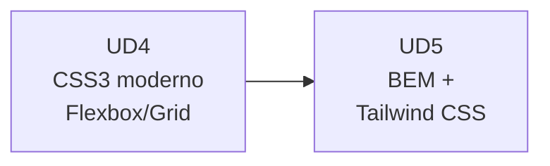

---

## 17. Referencias y fuentes :material-book-open-page-variant:

* MDN Web Docs — [Cascada, especificidad y herencia](https://developer.mozilla.org/es/docs/Learn/CSS/Building_blocks/Cascade_and_inheritance).
* MDN Web Docs — [El modelo de caja](https://developer.mozilla.org/es/docs/Learn/CSS/Building_blocks/The_box_model).
* MDN Web Docs — [CSS Flexible Box Layout](https://developer.mozilla.org/es/docs/Web/CSS/CSS_flexible_box_layout).
* MDN Web Docs — [CSS Grid Layout](https://developer.mozilla.org/es/docs/Web/CSS/CSS_grid_layout).
* MDN Web Docs — [Media queries](https://developer.mozilla.org/es/docs/Web/CSS/CSS_media_queries/Using_media_queries) y [`clamp()`](https://developer.mozilla.org/es/docs/Web/CSS/clamp).
* MDN Web Docs — [CSS Container Queries](https://developer.mozilla.org/es/docs/Web/CSS/CSS_containment/Container_queries).
* web.dev — [prefers-color-scheme](https://web.dev/articles/prefers-color-scheme) y [Unidades de viewport grandes, pequeñas y dinámicas](https://web.dev/blog/viewport-units).
* Flexbox Froggy — [flexboxfroggy.com](https://flexboxfroggy.com/#es) · Grid Garden — [cssgridgarden.com](https://cssgridgarden.com/#es).
* Ruiz, M. — *Diseño de Interfaces Web*.
