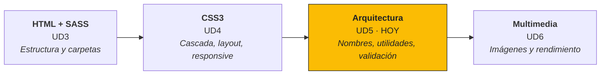
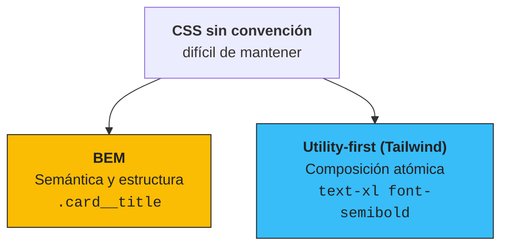
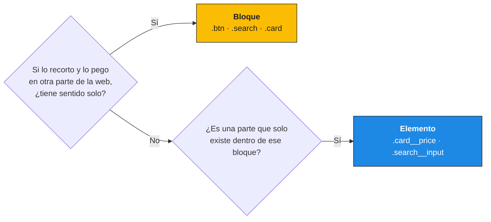
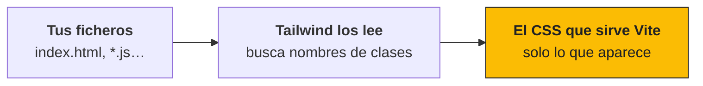
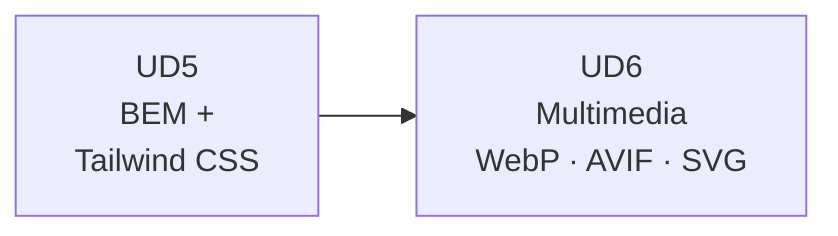

# UD5 · Arquitectura CSS (BEM) y Utility-First con Tailwind CSS :simple-csswizardry:

<div class="presentacion" markdown>
:material-presentation-play:{ .presentacion__icono } **Presentación de clase** · 55 diapositivas para seguir la unidad

[:material-file-pdf-box: Abrir o descargar el PDF](../assets/presentaciones/DIW-UD5.pdf){ .md-button .md-button--primary target="_blank" }
</div>

## Resultado de aprendizaje y criterios cubiertos :material-school:

Esta unidad cierra **RA2 — Crea interfaces Web homogéneas definiendo y aplicando estilos**.

| Criterio | Enunciado | Cobertura |
|---|---|---|
| **RA2.g** | Se han creado clases de estilos. | ✅ Completa (BEM y clases de utilidad) |
| **RA2.h** | Se han utilizado herramientas de validación de hojas de estilos. | ✅ Completa (W3C, Stylelint, Prettier) |
| **RA2.i** | Se ha utilizado y actualizado la guía de estilo. | ✅ Completa |

!!! note "Cierre del Resultado de Aprendizaje 2"
    Con esta unidad **RA2 queda completado**. En la UD6 empieza el **RA3**: recursos multimedia y rendimiento.

---

## 1. Dónde estamos: AURIA ya tiene piel, hoy ordenamos el armario :material-map-marker-path:



En la UD4 la página de AURIA ganó colores, layout y responsive. En esta unidad **casi no cambia cómo se ve**: cambia **cómo está escrito** el CSS, para que se pueda mantener cuando crece y cuando lo toca más de una persona.

!!! question "La pregunta de la unidad"
    **¿Cómo escribimos CSS que otra persona pueda tocar sin miedo dentro de seis meses?** La contestamos en cuatro bloques:

    1. **El problema:** qué pasa cuando no hay convención (sección 2).
    2. **BEM:** nombres que explican la estructura del componente (sección 3).
    3. **Tailwind CSS:** componer el aspecto con clases de utilidad (sección 4).
    4. **Validar y documentar:** W3C, Stylelint, Prettier y la guía de estilo (secciones 5 y 6).

### 1.1 Por qué importa en el mundo real

El CSS de un proyecto real **no deja de crecer**: unas decenas de líneas el primer mes, miles al segundo año, y tocadas por muchas personas distintas.

- **Varias personas, un mismo CSS.** Lo que escribes hoy lo modificará otra persona mañana.
- **Se lee más de lo que se escribe.** Un nombre claro ahorra horas de buscar "qué hace esta clase".
- **Miedo a borrar.** Sin convención nadie sabe si una regla se usa, así que nadie borra nada: el CSS solo crece.
- **Revisión automática.** En las empresas el CSS pasa un *linter* antes de entrar al proyecto.
- **Diseño y código sincronizados.** La guía de estilo es el contrato entre diseño y desarrollo.

!!! tip "Dato clave"
    El problema del CSS no es escribirlo: es **mantenerlo** cuando crece y cuando lo toca más de una persona.

---

## 2. El problema: CSS que nadie se atreve a tocar :material-alert-octagon-outline:

### 2.1 Tres síntomas de un CSS sin convención

Este es el aspecto típico de un `styles.css` con dos años de vida:

```css
.card { … }
.card2 { … }
.btn-2 { … }
.rojo { color: red; }
.nuevo-btn-ok { … }

#main .card .btn:hover { … }
div.productos ul li a span { … }

.card .title { … }
.modal .title { … }  /* ¿cuál gana? */
```

| Síntoma | Ejemplo | Qué provoca |
| --- | --- | --- |
| **Nombres sin significado** | `.card2`, `.btn-2`, `.rojo` | Nadie sabe qué son ni dónde se usan. ¿Y si `.rojo` tiene que pasar a ser azul? |
| **Especificidad que sube** | `#main .card .btn:hover` | Solo se pueden vencer con un selector aún más largo… o con `!important` |
| **Estilos que se pisan** | `.card .title` y `.modal .title` | El aspecto depende de **dónde** está el HTML: lo mueves y cambia |

!!! danger "Resultado"
    Nadie se atreve a borrar nada: se añade otra regla "por si acaso" y el fichero solo crece. El CSS que ya no se usa pero sigue ahí se llama **código muerto**.

### 2.2 Recuerda la UD4: la especificidad es una escalada

| Selector | Especificidad |
| --- | --- |
| `.title` | (0,1,0) |
| `.card .title` | (0,2,0) |
| `#main .card .title` | (1,2,0) |
| `#main .card .title { … !important }` | fuera de la escala |

Cada vez que alguien "gana" subiendo el peso, el siguiente tiene que subirlo más. Es una escalada que nadie gana.

!!! info "La idea de toda la unidad"
    Si **todos** los selectores pesan lo mismo, **(0,1,0)**, nadie tiene que pelear: si dos reglas chocan, decide el orden. Y lo que evita que choquen es el **nombre**.

### 2.3 Dos respuestas al mismo problema



- **BEM:** nombras cada pieza según lo que **es** dentro de su componente y escribes su CSS una vez.
- **Utility-first:** cada clase hace **una sola cosa** y el aspecto se monta combinándolas en el HTML.

No son rivales que haya que elegir para siempre: son dos respuestas al mismo problema. Existen otras arquitecturas (OOCSS, SMACSS, ITCSS), pero BEM y Tailwind son las más extendidas.

---

## 3. BEM: Bloque, Elemento, Modificador (RA2.g) :material-file-tree-outline:

### 3.1 Las tres piezas

| Pieza | Qué es | Ejemplo en AURIA |
| --- | --- | --- |
| **Bloque** | Componente independiente con sentido propio. Se puede llevar a otra página y sigue teniendo sentido. | `.card` |
| **Elemento** | Parte del bloque, sin sentido fuera de él. | `.card__image`, `.card__title`, `.card__price`, `.card__button` |
| **Modificador** | Variante de aspecto o de estado del bloque o de un elemento. | `.card--destacada`, `.card__button--primary` |

BEM lo creó **Yandex** (el buscador ruso) hacia 2009, para que equipos grandes pudieran compartir el mismo CSS sin pisarse.

### 3.2 La sintaxis: dos guiones bajos y dos guiones

```text
card__button--primary
│   │       │
│   │       └── --primary  → modificador
│   └── __button          → elemento
└── card                  → bloque
```

Se lee: *"el botón de la tarjeta, en su variante principal"*.

| Patrón | Ejemplo | Significado |
| --- | --- | --- |
| `.bloque` | `.card` | El componente |
| `.bloque__elemento` | `.card__title` | Una parte del componente |
| `.bloque--modificador` | `.card--destacada` | Variante del componente entero |
| `.bloque__elemento--modificador` | `.card__button--primary` | Variante de una parte |

!!! tip "Nombres compuestos"
    Todo en **minúsculas** y con **guion simple** dentro de cada palabra compuesta: `.product-card__add-button--disabled`. Los separadores son dobles precisamente para no confundirse con ese guion simple.

### 3.3 La tarjeta de AURIA con nombres BEM

```html
<article class="card card--destacada">
  <span class="card__badge badge">Oferta</span>
  
  <h3 class="card__title">AURIA Pro</h3>
  <p class="card__price">199 €</p>
  <a class="card__button btn" href="/carrito">
    Añadir al carrito
  </a>
</article>
```

<!-- mapa:ud05-anatomia -->

📖 La misma tarjeta, dibujada: cada pieza con su clase. **Púlsalo para verlo en grande.**

<div class="mapa-diw">
<div class="uml-barra"><span>UD5 · bloque, elementos y modificadores</span><button class="uml-btn" data-uml-abrir>🔍 Ampliar</button></div>
<div class="uml-lienzo" title="Pulsa para ampliar">
<svg xmlns="http://www.w3.org/2000/svg" width="100%" style="height:auto;display:block" role="img" aria-label="La tarjeta de AURIA, pieza a pieza" viewBox="0 0 1220 690">
<defs><filter id="ud05-anatomia-sombra" x="-5%" y="-5%" width="110%" height="115%"><feDropShadow dx="0" dy="2" stdDeviation="3" flood-color="#000" flood-opacity=".12"/></filter><marker id="ud05-anatomia-mp80868b" viewBox="0 0 10 10" refX="5" refY="5" markerWidth="9" markerHeight="9" markerUnits="userSpaceOnUse"><circle cx="5" cy="5" r="4" style="fill:var(--mf-80868b,#80868b)"/></marker></defs>
<rect width="100%" height="100%" style="fill:var(--m-lienzo,#fff)"/>
<text x="40.0" y="44.0" text-anchor="start" font-family="'Inter', 'Segoe UI', 'DejaVu Sans', Helvetica, Arial, sans-serif" font-size="23" xml:space="preserve"><tspan font-weight="800" style="fill:var(--mt-202124,#202124)">La tarjeta de AURIA, pieza a pieza </tspan><tspan font-weight="400" style="fill:var(--mt-80868b,#80868b)">· bloque, elementos y modificadores</tspan></text>
<text x="40.0" y="72.0" text-anchor="start" font-family="'Inter', 'Segoe UI', 'DejaVu Sans', Helvetica, Arial, sans-serif" font-size="14" font-weight="400" xml:space="preserve" style="fill:var(--mt-5f6368,#5f6368)">Cada clase dice qué es la pieza y de qué bloque es. Sin abrir el CSS ya sabes qué es cada cosa.</text>
<rect x="58.0" y="118.0" width="324.0" height="494.0" rx="16" fill="none" stroke="#b06000" stroke-width="2" stroke-dasharray="8 6"/>
<rect x="70.0" y="130.0" width="300.0" height="470.0" rx="12" stroke="#1e88e5" stroke-width="3" filter="url(#ud05-anatomia-sombra)" style="fill:var(--m-fondo,#fff)"/>
<rect x="84.0" y="144.0" width="272.0" height="190.0" rx="8" stroke="none" stroke-width="0" style="fill:var(--mf-eef3fe,#eef3fe)"/>
<g transform="translate(175.0,184) scale(3.75)" fill="none" stroke="#1e88e5" stroke-width="2.2" stroke-linecap="round"><path d="M4,15 v-3 a8,8 0 0 1 16,0 v3"/><rect x="2.5" y="13.5" width="5" height="8" rx="2" fill="#1e88e5"/><rect x="16.5" y="13.5" width="5" height="8" rx="2" fill="#1e88e5"/></g>
<rect x="96.0" y="168.0" width="72.0" height="24.0" rx="12" fill="#e37400" stroke="#e37400" stroke-width="0.1"/>
<text x="132.0" y="184.5" text-anchor="middle" font-family="'Inter', 'Segoe UI', 'DejaVu Sans', Helvetica, Arial, sans-serif" font-size="11.5" font-weight="800" fill="#fff" xml:space="preserve">OFERTA</text>
<text x="90.0" y="370.0" text-anchor="start" font-family="'Inter', 'Segoe UI', 'DejaVu Sans', Helvetica, Arial, sans-serif" font-size="22" font-weight="800" xml:space="preserve" style="fill:var(--mt-202124,#202124)">AURIA Pro</text>
<rect x="90.0" y="386.0" width="230.0" height="7.0" rx="3" stroke="none" stroke-width="0" style="fill:var(--mf-dadce0,#dadce0)"/>
<rect x="90.0" y="400.0" width="180.0" height="7.0" rx="3" stroke="none" stroke-width="0" style="fill:var(--mf-dadce0,#dadce0)"/>
<text x="90.0" y="452.0" text-anchor="start" font-family="'Inter', 'Segoe UI', 'DejaVu Sans', Helvetica, Arial, sans-serif" font-size="24" font-weight="800" fill="#1e88e5" xml:space="preserve">199 €</text>
<rect x="90.0" y="528.0" width="190.0" height="46.0" rx="8" fill="#1e88e5" stroke="#1e88e5" stroke-width="0.1"/>
<text x="185.0" y="557.0" text-anchor="middle" font-family="'Inter', 'Segoe UI', 'DejaVu Sans', Helvetica, Arial, sans-serif" font-size="15" font-weight="700" fill="#fff" xml:space="preserve">Añadir al carrito</text>
<path d="M168,180 H418" fill="none" stroke-width="1.4" stroke-linecap="round" stroke-linejoin="round" marker-start="url(#ud05-anatomia-mp80868b)" style="stroke:var(--mf-80868b,#80868b)"/>
<text x="430.0" y="181.0" text-anchor="start" font-family="'Inter', 'Segoe UI', 'DejaVu Sans', Helvetica, Arial, sans-serif" font-size="15" xml:space="preserve"><tspan font-weight="700" font-family="'DejaVu Sans Mono', 'JetBrains Mono', Consolas, monospace" style="fill:var(--mt-1a4fa0,#1a4fa0)">card__badge</tspan><tspan font-weight="700" font-family="'DejaVu Sans Mono', 'JetBrains Mono', Consolas, monospace" style="fill:var(--mt-188038,#188038)"> badge</tspan></text>
<text x="430.0" y="200.0" text-anchor="start" font-family="'Inter', 'Segoe UI', 'DejaVu Sans', Helvetica, Arial, sans-serif" font-size="12.5" font-weight="400" xml:space="preserve" style="fill:var(--mt-5f6368,#5f6368)">la etiqueta: de la tarjeta y bloque propio (mezcla)</text>
<path d="M356,260 H418" fill="none" stroke-width="1.4" stroke-linecap="round" stroke-linejoin="round" marker-start="url(#ud05-anatomia-mp80868b)" style="stroke:var(--mf-80868b,#80868b)"/>
<text x="430.0" y="261.0" text-anchor="start" font-family="'Inter', 'Segoe UI', 'DejaVu Sans', Helvetica, Arial, sans-serif" font-size="15" xml:space="preserve"><tspan font-weight="700" font-family="'DejaVu Sans Mono', 'JetBrains Mono', Consolas, monospace" style="fill:var(--mt-1a4fa0,#1a4fa0)">card__image</tspan></text>
<text x="430.0" y="280.0" text-anchor="start" font-family="'Inter', 'Segoe UI', 'DejaVu Sans', Helvetica, Arial, sans-serif" font-size="12.5" font-weight="400" xml:space="preserve" style="fill:var(--mt-5f6368,#5f6368)">la foto: solo existe dentro de la tarjeta</text>
<path d="M205,364 H418" fill="none" stroke-width="1.4" stroke-linecap="round" stroke-linejoin="round" marker-start="url(#ud05-anatomia-mp80868b)" style="stroke:var(--mf-80868b,#80868b)"/>
<text x="430.0" y="365.0" text-anchor="start" font-family="'Inter', 'Segoe UI', 'DejaVu Sans', Helvetica, Arial, sans-serif" font-size="15" xml:space="preserve"><tspan font-weight="700" font-family="'DejaVu Sans Mono', 'JetBrains Mono', Consolas, monospace" style="fill:var(--mt-1a4fa0,#1a4fa0)">card__title</tspan></text>
<text x="430.0" y="384.0" text-anchor="start" font-family="'Inter', 'Segoe UI', 'DejaVu Sans', Helvetica, Arial, sans-serif" font-size="12.5" font-weight="400" xml:space="preserve" style="fill:var(--mt-5f6368,#5f6368)">el nombre del producto</text>
<path d="M162,444 H418" fill="none" stroke-width="1.4" stroke-linecap="round" stroke-linejoin="round" marker-start="url(#ud05-anatomia-mp80868b)" style="stroke:var(--mf-80868b,#80868b)"/>
<text x="430.0" y="445.0" text-anchor="start" font-family="'Inter', 'Segoe UI', 'DejaVu Sans', Helvetica, Arial, sans-serif" font-size="15" xml:space="preserve"><tspan font-weight="700" font-family="'DejaVu Sans Mono', 'JetBrains Mono', Consolas, monospace" style="fill:var(--mt-1a4fa0,#1a4fa0)">card__price</tspan></text>
<text x="430.0" y="464.0" text-anchor="start" font-family="'Inter', 'Segoe UI', 'DejaVu Sans', Helvetica, Arial, sans-serif" font-size="12.5" font-weight="400" xml:space="preserve" style="fill:var(--mt-5f6368,#5f6368)">el precio</text>
<path d="M280,551 H418" fill="none" stroke-width="1.4" stroke-linecap="round" stroke-linejoin="round" marker-start="url(#ud05-anatomia-mp80868b)" style="stroke:var(--mf-80868b,#80868b)"/>
<text x="430.0" y="552.0" text-anchor="start" font-family="'Inter', 'Segoe UI', 'DejaVu Sans', Helvetica, Arial, sans-serif" font-size="15" xml:space="preserve"><tspan font-weight="700" font-family="'DejaVu Sans Mono', 'JetBrains Mono', Consolas, monospace" style="fill:var(--mt-1a4fa0,#1a4fa0)">card__button</tspan><tspan font-weight="700" font-family="'DejaVu Sans Mono', 'JetBrains Mono', Consolas, monospace" style="fill:var(--mt-188038,#188038)"> btn</tspan></text>
<text x="430.0" y="571.0" text-anchor="start" font-family="'Inter', 'Segoe UI', 'DejaVu Sans', Helvetica, Arial, sans-serif" font-size="12.5" font-weight="400" xml:space="preserve" style="fill:var(--mt-5f6368,#5f6368)">el botón: de la tarjeta y bloque .btn (mezcla)</text>
<path d="M382,598 H418" fill="none" stroke-width="1.4" stroke-linecap="round" stroke-linejoin="round" marker-start="url(#ud05-anatomia-mp80868b)" style="stroke:var(--mf-80868b,#80868b)"/>
<text x="430.0" y="599.0" text-anchor="start" font-family="'Inter', 'Segoe UI', 'DejaVu Sans', Helvetica, Arial, sans-serif" font-size="15" xml:space="preserve"><tspan font-weight="700" font-family="'DejaVu Sans Mono', 'JetBrains Mono', Consolas, monospace" style="fill:var(--mt-b06000,#b06000)">card</tspan><tspan font-weight="700" font-family="'DejaVu Sans Mono', 'JetBrains Mono', Consolas, monospace" style="fill:var(--mt-9334e6,#9334e6)"> card--destacada</tspan></text>
<text x="430.0" y="618.0" text-anchor="start" font-family="'Inter', 'Segoe UI', 'DejaVu Sans', Helvetica, Arial, sans-serif" font-size="12.5" font-weight="400" xml:space="preserve" style="fill:var(--mt-5f6368,#5f6368)">el bloque, y su variante: el borde de marca</text>
<text x="860.0" y="150.0" text-anchor="start" font-family="'Inter', 'Segoe UI', 'DejaVu Sans', Helvetica, Arial, sans-serif" font-size="15" font-weight="800" xml:space="preserve" style="fill:var(--mt-202124,#202124)">Modificadores: variantes de la tarjeta entera</text>
<rect x="860.0" y="172.0" width="95.0" height="150.0" rx="8" stroke-width="1.4" style="fill:var(--m-fondo,#fff);stroke:var(--mf-dadce0,#dadce0)"/>
<rect x="866.0" y="178.0" width="83.0" height="63.0" rx="5" stroke="none" stroke-width="0" style="fill:var(--mf-eef3fe,#eef3fe)"/>
<g transform="translate(888.6,189.34) scale(1.575)" fill="none" stroke="#1e88e5" stroke-width="2.2" stroke-linecap="round"><path d="M4,15 v-3 a8,8 0 0 1 16,0 v3"/><rect x="2.5" y="13.5" width="5" height="8" rx="2" fill="#1e88e5"/><rect x="16.5" y="13.5" width="5" height="8" rx="2" fill="#1e88e5"/></g>
<rect x="868.0" y="251.0" width="52.3" height="7.0" rx="3" stroke="none" stroke-width="0" style="fill:var(--mf-80868b,#80868b)"/>
<rect x="868.0" y="265.0" width="33.2" height="9.0" rx="3" fill="#1e88e5" stroke="none" stroke-width="0"/>
<rect x="868.0" y="298.0" width="79.0" height="16.0" rx="5" fill="#1e88e5" stroke="none" stroke-width="0"/>
<text x="907.5" y="344.0" text-anchor="middle" font-family="'DejaVu Sans Mono', 'JetBrains Mono', Consolas, monospace" font-size="12.5" font-weight="700" xml:space="preserve" style="fill:var(--mt-b06000,#b06000)">card</text>
<rect x="973.0" y="172.0" width="95.0" height="150.0" rx="8" stroke="#1e88e5" stroke-width="3" style="fill:var(--m-fondo,#fff)"/>
<rect x="979.0" y="178.0" width="83.0" height="63.0" rx="5" stroke="none" stroke-width="0" style="fill:var(--mf-eef3fe,#eef3fe)"/>
<g transform="translate(1001.6,189.34) scale(1.575)" fill="none" stroke="#1e88e5" stroke-width="2.2" stroke-linecap="round"><path d="M4,15 v-3 a8,8 0 0 1 16,0 v3"/><rect x="2.5" y="13.5" width="5" height="8" rx="2" fill="#1e88e5"/><rect x="16.5" y="13.5" width="5" height="8" rx="2" fill="#1e88e5"/></g>
<rect x="981.0" y="251.0" width="52.3" height="7.0" rx="3" stroke="none" stroke-width="0" style="fill:var(--mf-80868b,#80868b)"/>
<rect x="981.0" y="265.0" width="33.2" height="9.0" rx="3" fill="#1e88e5" stroke="none" stroke-width="0"/>
<rect x="981.0" y="298.0" width="79.0" height="16.0" rx="5" fill="#1e88e5" stroke="none" stroke-width="0"/>
<text x="1020.5" y="344.0" text-anchor="middle" font-family="'DejaVu Sans Mono', 'JetBrains Mono', Consolas, monospace" font-size="12.5" font-weight="700" xml:space="preserve" style="fill:var(--mt-9334e6,#9334e6)">--destacada</text>
<rect x="1086.0" y="172.0" width="95.0" height="150.0" rx="8" stroke-width="1.4" style="fill:var(--m-fondo,#fff);stroke:var(--mf-dadce0,#dadce0)"/>
<rect x="1092.0" y="178.0" width="83.0" height="63.0" rx="5" stroke="none" stroke-width="0" style="fill:var(--mf-f1f3f4,#f1f3f4)"/>
<g transform="translate(1114.6,189.34) scale(1.575)" fill="none" stroke-width="2.2" stroke-linecap="round" style="stroke:var(--mf-80868b,#80868b)"><path d="M4,15 v-3 a8,8 0 0 1 16,0 v3"/><rect x="2.5" y="13.5" width="5" height="8" rx="2" style="fill:var(--mf-80868b,#80868b)"/><rect x="16.5" y="13.5" width="5" height="8" rx="2" style="fill:var(--mf-80868b,#80868b)"/></g>
<rect x="1094.0" y="251.0" width="52.3" height="7.0" rx="3" stroke="none" stroke-width="0" style="fill:var(--mf-80868b,#80868b)"/>
<rect x="1094.0" y="265.0" width="33.2" height="9.0" rx="3" fill="#1e88e5" stroke="none" stroke-width="0"/>
<rect x="1094.0" y="298.0" width="79.0" height="16.0" rx="5" fill="#1e88e5" stroke="none" stroke-width="0"/>
<text x="1133.5" y="344.0" text-anchor="middle" font-family="'DejaVu Sans Mono', 'JetBrains Mono', Consolas, monospace" font-size="12.5" font-weight="700" xml:space="preserve" style="fill:var(--mt-9334e6,#9334e6)">--agotada</text>
<text x="1133.5" y="362.0" text-anchor="middle" font-family="'Inter', 'Segoe UI', 'DejaVu Sans', Helvetica, Arial, sans-serif" font-size="11.5" font-weight="400" xml:space="preserve" style="fill:var(--mt-5f6368,#5f6368)">(foto en gris)</text>
<text x="860.0" y="404.0" text-anchor="start" font-family="'Inter', 'Segoe UI', 'DejaVu Sans', Helvetica, Arial, sans-serif" font-size="13" font-weight="400" xml:space="preserve" style="fill:var(--mt-3c4043,#3c4043)">En el HTML, el modificador va siempre con</text>
<text x="860.0" y="423.5" text-anchor="start" font-family="'Inter', 'Segoe UI', 'DejaVu Sans', Helvetica, Arial, sans-serif" font-size="13" font-weight="400" xml:space="preserve" style="fill:var(--mt-3c4043,#3c4043)">la base:</text>
<text x="860.0" y="447.0" text-anchor="start" font-family="'Inter', 'Segoe UI', 'DejaVu Sans', Helvetica, Arial, sans-serif" font-size="13" xml:space="preserve"><tspan font-weight="400" font-family="'DejaVu Sans Mono', 'JetBrains Mono', Consolas, monospace" style="fill:var(--mt-202124,#202124)">class=&quot;</tspan><tspan font-weight="700" font-family="'DejaVu Sans Mono', 'JetBrains Mono', Consolas, monospace" style="fill:var(--mt-b06000,#b06000)">card</tspan><tspan font-weight="700" font-family="'DejaVu Sans Mono', 'JetBrains Mono', Consolas, monospace" style="fill:var(--mt-9334e6,#9334e6)"> card--agotada</tspan><tspan font-weight="400" font-family="'DejaVu Sans Mono', 'JetBrains Mono', Consolas, monospace" style="fill:var(--mt-202124,#202124)">&quot;</tspan></text>
<text x="860.0" y="477.0" text-anchor="start" font-family="'Inter', 'Segoe UI', 'DejaVu Sans', Helvetica, Arial, sans-serif" font-size="13" xml:space="preserve"><tspan font-weight="600" font-family="'DejaVu Sans Mono', 'JetBrains Mono', Consolas, monospace" style="fill:var(--mt-202124,#202124)">card</tspan><tspan font-weight="400" style="fill:var(--mt-3c4043,#3c4043)"> trae todo lo común. </tspan><tspan font-weight="600" font-family="'DejaVu Sans Mono', 'JetBrains Mono', Consolas, monospace" style="fill:var(--mt-202124,#202124)">card--agotada</tspan><tspan font-weight="400" style="fill:var(--mt-3c4043,#3c4043)">,</tspan></text>
<text x="860.0" y="496.5" text-anchor="start" font-family="'Inter', 'Segoe UI', 'DejaVu Sans', Helvetica, Arial, sans-serif" font-size="13" font-weight="400" xml:space="preserve" style="fill:var(--mt-3c4043,#3c4043)">solo lo que cambia.</text>
<text x="40.0" y="665.0" text-anchor="start" font-family="'Inter', 'Segoe UI', 'DejaVu Sans', Helvetica, Arial, sans-serif" font-size="14" font-weight="800" xml:space="preserve" style="fill:var(--mt-202124,#202124)">Cómo se lee</text>
<rect x="156.2" y="652.0" width="18.0" height="16.0" rx="4" fill="#b06000" stroke="#b06000" stroke-width="2"/>
<text x="182.2" y="665.0" text-anchor="start" font-family="'Inter', 'Segoe UI', 'DejaVu Sans', Helvetica, Arial, sans-serif" font-size="12.5" font-weight="400" xml:space="preserve" style="fill:var(--mt-3c4043,#3c4043)">bloque</text>
<rect x="250.2" y="652.0" width="18.0" height="16.0" rx="4" stroke-width="2" style="fill:var(--mf-1a4fa0,#1a4fa0);stroke:var(--mf-1a4fa0,#1a4fa0)"/>
<text x="276.2" y="665.0" text-anchor="start" font-family="'Inter', 'Segoe UI', 'DejaVu Sans', Helvetica, Arial, sans-serif" font-size="12.5" font-weight="400" xml:space="preserve" style="fill:var(--mt-3c4043,#3c4043)">elemento  __</text>
<rect x="386.2" y="652.0" width="18.0" height="16.0" rx="4" fill="#9334e6" stroke="#9334e6" stroke-width="2"/>
<text x="412.2" y="665.0" text-anchor="start" font-family="'Inter', 'Segoe UI', 'DejaVu Sans', Helvetica, Arial, sans-serif" font-size="12.5" font-weight="400" xml:space="preserve" style="fill:var(--mt-3c4043,#3c4043)">modificador  --</text>
<rect x="543.2" y="652.0" width="18.0" height="16.0" rx="4" fill="#188038" stroke="#188038" stroke-width="2"/>
<text x="569.2" y="665.0" text-anchor="start" font-family="'Inter', 'Segoe UI', 'DejaVu Sans', Helvetica, Arial, sans-serif" font-size="12.5" font-weight="400" xml:space="preserve" style="fill:var(--mt-3c4043,#3c4043)">otro bloque (mezcla)</text>
</svg>
</div>
</div>

<!-- /mapa:ud05-anatomia -->

1. **Modificador + base:** `class="card card--destacada"`. El modificador **siempre acompaña** a la clase base: la base trae lo común y el modificador solo lo que cambia (apartado 3.6).
2. **Se lee en el HTML:** sin abrir el CSS ya sabes qué es cada pieza y a qué componente pertenece.
3. **Dos clases en una pieza:** la etiqueta y el botón son piezas de la tarjeta **y** bloques propios (`badge`, `btn`). Se llama **mezcla** y la verás en el apartado 3.6.
4. **El HTML semántico sigue:** `article`, `h3` y `a` son las etiquetas de la UD3. BEM ordena los nombres de las clases; no cambia qué etiqueta usas.

### 3.4 BEM y SASS encajan: el `&` de la UD3

El `&` de SASS se sustituye por el selector en el que estás, **pegado**. Con BEM, todo el componente queda en un fichero:

=== "components/_card.scss"

    ```scss
    .card {
      display: flex;
      flex-direction: column;
      gap: $space-md;

      &--destacada {
        border: 2px solid $color-brand-primary;
      }
      &__title { font-size: 1.25rem; }
      &__price {
        color: $color-brand-primary;
        font-weight: 700;
      }
    }
    ```

=== "CSS compilado"

    ```css
    .card { display: flex; flex-direction: column; gap: 16px; }
    .card--destacada { border: 2px solid #1E88E5; }
    .card__title { font-size: 1.25rem; }
    .card__price { color: #1E88E5; font-weight: 700; }
    ```

!!! warning "El `&` tiene que ir pegado"
    `&__title` genera `.card__title`: **una** clase, (0,1,0). Si escribes `.title` dentro de `.card` (sin `&`), SASS genera `.card .title`: **dos** clases, (0,2,0), y vuelves al problema. Y si dejas un espacio (`& __title`), sale `.card __title`, que no funciona.

!!! info "¿Y el anidamiento del CSS nativo?"
    El CSS nativo ya admite anidamiento, pero su `&` **no pega texto**: `&__title` no funciona en CSS puro. Para escribir BEM con `&`, SASS.

### 3.5 Especificidad plana: todas las reglas pesan (0,1,0)

| Sin convención | Especificidad | Con BEM | Especificidad |
| --- | --- | --- | --- |
| `#main .card .title` | (1,2,0) | `.card__title` | (0,1,0) |
| `.modal div .title` | (0,2,1) | `.modal__title` | (0,1,0) |
| `.card .title` | (0,2,0) | `.card__button` | (0,1,0) |
| `.title` | (0,1,0) | `.card--destacada` | (0,1,0) |

Con BEM todas las reglas pesan igual: si dos chocan, decide el orden. Y como cada componente tiene sus propios nombres, casi nunca chocan.

!!! tip "La alternativa al `!important` de la UD4"
    No se gana subiendo el peso: se consigue que **nadie tenga que ganar**.

#### La única excepción: el modificador del bloque cambia un elemento

AURIA se queda sin existencias de un modelo. La tarjeta tiene que verse **agotada**: la foto en gris. El estado es de **toda la tarjeta**, así que el modificador va en el bloque, y desde ahí se alcanza el elemento:

```html
<article class="card card--agotada">
  
  …
</article>
```

```scss
.card {
  &--agotada &__image {
    filter: grayscale(100%);   // la foto, en blanco y negro (0% = sus colores de siempre)
  }
}
```

SASS pone cada `&` en su sitio y genera `.card--agotada .card__image`: «la imagen de una tarjeta agotada». Pesa **(0,2,0)**, y es el **único** selector de dos clases que se permite, siempre con esta forma: `.bloque--modificador .bloque__elemento`.

¿Por qué no `.card__image--agotada`, que es una sola clase? Hazte una pregunta: **¿quién sabe que está agotada?**

<!-- mapa:ud05-quien-sabe -->

📖 Las dos formas de marcar la tarjeta agotada, lado a lado. **Púlsalo para verlo en grande.**

<div class="mapa-diw">
<div class="uml-barra"><span>UD5 · .bloque--mod .bloque__elem</span><button class="uml-btn" data-uml-abrir>🔍 Ampliar</button></div>
<div class="uml-lienzo" title="Pulsa para ampliar">
<svg xmlns="http://www.w3.org/2000/svg" width="100%" style="height:auto;display:block" role="img" aria-label="¿Quién sabe que está agotada?" viewBox="0 0 1220 500">
<defs><filter id="ud05-quien-sabe-sombra" x="-5%" y="-5%" width="110%" height="115%"><feDropShadow dx="0" dy="2" stdDeviation="3" flood-color="#000" flood-opacity=".12"/></filter><marker id="ud05-quien-sabe-mf9334e6" viewBox="0 0 20 20" refX="16" refY="10" markerWidth="15" markerHeight="15" markerUnits="userSpaceOnUse" orient="auto-start-reverse"><path d="M2,2 L18,10 L2,18 z" fill="#9334e6"/></marker></defs>
<rect width="100%" height="100%" style="fill:var(--m-lienzo,#fff)"/>
<text x="40.0" y="44.0" text-anchor="start" font-family="'Inter', 'Segoe UI', 'DejaVu Sans', Helvetica, Arial, sans-serif" font-size="23" xml:space="preserve"><tspan font-weight="800" style="fill:var(--mt-202124,#202124)">¿Quién sabe que está agotada? </tspan><tspan font-weight="400" style="fill:var(--mt-80868b,#80868b)">· el estado de todo el bloque, una vez y en el bloque</tspan></text>
<rect x="40.0" y="100.0" width="540.0" height="370.0" rx="12" stroke="#188038" stroke-width="2" style="fill:var(--m-fondo,#fff)"/>
<circle cx="68" cy="130" r="11" fill="#188038"/><path d="M63.05,130 l3.52,3.74 l6.6,-7.699999999999999" fill="none" stroke="#fff" stroke-width="2.4" stroke-linecap="round" stroke-linejoin="round"/>
<text x="90.0" y="136.0" text-anchor="start" font-family="'DejaVu Sans Mono', 'JetBrains Mono', Consolas, monospace" font-size="16" font-weight="700" xml:space="preserve" style="fill:var(--mt-188038,#188038)">.card--agotada .card__image</text>
<text x="62.0" y="180.0" text-anchor="start" font-family="'Inter', 'Segoe UI', 'DejaVu Sans', Helvetica, Arial, sans-serif" font-size="12.5" xml:space="preserve"><tspan font-weight="400" font-family="'DejaVu Sans Mono', 'JetBrains Mono', Consolas, monospace" style="fill:var(--mt-202124,#202124)">&lt;article class=&quot;</tspan><tspan font-weight="700" font-family="'DejaVu Sans Mono', 'JetBrains Mono', Consolas, monospace" style="fill:var(--mt-9334e6,#9334e6)">card card--agotada</tspan><tspan font-weight="400" font-family="'DejaVu Sans Mono', 'JetBrains Mono', Consolas, monospace" style="fill:var(--mt-202124,#202124)">&quot;&gt;</tspan></text>
<text x="62.0" y="205.0" text-anchor="start" font-family="'Inter', 'Segoe UI', 'DejaVu Sans', Helvetica, Arial, sans-serif" font-size="12.5" xml:space="preserve"><tspan font-weight="400" font-family="'DejaVu Sans Mono', 'JetBrains Mono', Consolas, monospace" style="fill:var(--mt-202124,#202124)">  &lt;img class=&quot;card__image&quot;&gt;</tspan></text>
<text x="62.0" y="230.0" text-anchor="start" font-family="'Inter', 'Segoe UI', 'DejaVu Sans', Helvetica, Arial, sans-serif" font-size="12.5" xml:space="preserve"><tspan font-weight="400" font-family="'DejaVu Sans Mono', 'JetBrains Mono', Consolas, monospace" style="fill:var(--mt-202124,#202124)">  &lt;h3 class=&quot;card__title&quot;&gt;</tspan></text>
<text x="62.0" y="255.0" text-anchor="start" font-family="'Inter', 'Segoe UI', 'DejaVu Sans', Helvetica, Arial, sans-serif" font-size="12.5" xml:space="preserve"><tspan font-weight="400" font-family="'DejaVu Sans Mono', 'JetBrains Mono', Consolas, monospace" style="fill:var(--mt-202124,#202124)">  &lt;p class=&quot;card__price&quot;&gt;</tspan></text>
<text x="62.0" y="280.0" text-anchor="start" font-family="'Inter', 'Segoe UI', 'DejaVu Sans', Helvetica, Arial, sans-serif" font-size="12.5" xml:space="preserve"><tspan font-weight="400" font-family="'DejaVu Sans Mono', 'JetBrains Mono', Consolas, monospace" style="fill:var(--mt-202124,#202124)">  &lt;a class=&quot;card__button btn&quot;&gt;</tspan></text>
<text x="62.0" y="305.0" text-anchor="start" font-family="'Inter', 'Segoe UI', 'DejaVu Sans', Helvetica, Arial, sans-serif" font-size="12.5" xml:space="preserve"><tspan font-weight="400" font-family="'DejaVu Sans Mono', 'JetBrains Mono', Consolas, monospace" style="fill:var(--mt-202124,#202124)">&lt;/article&gt;</tspan></text>
<path d="M340,176 C385,176 385,201 278,201" fill="none" stroke="#9334e6" stroke-width="2" stroke-linecap="round" stroke-linejoin="round" marker-end="url(#ud05-quien-sabe-mf9334e6)"/>
<text x="392.0" y="186.0" text-anchor="start" font-family="'Inter', 'Segoe UI', 'DejaVu Sans', Helvetica, Arial, sans-serif" font-size="12" font-weight="600" xml:space="preserve" style="fill:var(--mt-9334e6,#9334e6)">afecta a</text>
<text x="392.0" y="202.0" text-anchor="start" font-family="'Inter', 'Segoe UI', 'DejaVu Sans', Helvetica, Arial, sans-serif" font-size="12" font-weight="600" xml:space="preserve" style="fill:var(--mt-9334e6,#9334e6)">la imagen</text>
<rect x="62.0" y="338.0" width="340.0" height="77.0" rx="8" stroke-width="1.2" style="fill:var(--mf-f8f9fa,#f8f9fa);stroke:var(--mf-dadce0,#dadce0)"/>
<text x="76.0" y="360.0" text-anchor="start" font-family="'DejaVu Sans Mono', 'JetBrains Mono', Consolas, monospace" font-size="12.5" font-weight="400" xml:space="preserve" style="fill:var(--mt-202124,#202124)">.card--agotada .card__image {</text>
<text x="76.0" y="379.0" text-anchor="start" font-family="'DejaVu Sans Mono', 'JetBrains Mono', Consolas, monospace" font-size="12.5" font-weight="400" xml:space="preserve" style="fill:var(--mt-202124,#202124)">  filter: grayscale(100%);</text>
<text x="76.0" y="398.0" text-anchor="start" font-family="'DejaVu Sans Mono', 'JetBrains Mono', Consolas, monospace" font-size="12.5" font-weight="400" xml:space="preserve" style="fill:var(--mt-202124,#202124)">}</text>
<text x="412.0" y="380.5" text-anchor="start" font-family="'DejaVu Sans Mono', 'JetBrains Mono', Consolas, monospace" font-size="12.5" font-weight="700" xml:space="preserve" style="fill:var(--mt-188038,#188038)">(0,2,0)</text>
<text x="62.0" y="441.0" text-anchor="start" font-family="'Inter', 'Segoe UI', 'DejaVu Sans', Helvetica, Arial, sans-serif" font-size="12.5" font-weight="400" xml:space="preserve" style="fill:var(--mt-3c4043,#3c4043)">El estado se pone UNA vez. ¿Mañana el precio también cambia? Una</text>
<text x="62.0" y="459.8" text-anchor="start" font-family="'Inter', 'Segoe UI', 'DejaVu Sans', Helvetica, Arial, sans-serif" font-size="12.5" font-weight="400" xml:space="preserve" style="fill:var(--mt-3c4043,#3c4043)">regla más en el CSS; el HTML no se toca.</text>
<rect x="475.0" y="166.0" width="88.0" height="150.0" rx="8" stroke-width="1.4" style="fill:var(--m-fondo,#fff);stroke:var(--mf-dadce0,#dadce0)"/>
<rect x="481.0" y="172.0" width="76.0" height="63.0" rx="5" stroke="none" stroke-width="0" style="fill:var(--mf-f1f3f4,#f1f3f4)"/>
<g transform="translate(500.1,183.34) scale(1.575)" fill="none" stroke-width="2.2" stroke-linecap="round" style="stroke:var(--mf-80868b,#80868b)"><path d="M4,15 v-3 a8,8 0 0 1 16,0 v3"/><rect x="2.5" y="13.5" width="5" height="8" rx="2" style="fill:var(--mf-80868b,#80868b)"/><rect x="16.5" y="13.5" width="5" height="8" rx="2" style="fill:var(--mf-80868b,#80868b)"/></g>
<rect x="483.0" y="245.0" width="48.4" height="7.0" rx="3" stroke="none" stroke-width="0" style="fill:var(--mf-80868b,#80868b)"/>
<rect x="483.0" y="259.0" width="30.8" height="9.0" rx="3" fill="#1e88e5" stroke="none" stroke-width="0"/>
<rect x="483.0" y="292.0" width="72.0" height="16.0" rx="5" fill="#1e88e5" stroke="none" stroke-width="0"/>
<text x="519.0" y="336.0" text-anchor="middle" font-family="'Inter', 'Segoe UI', 'DejaVu Sans', Helvetica, Arial, sans-serif" font-size="12" font-weight="700" xml:space="preserve" style="fill:var(--mt-188038,#188038)">así se ve</text>
<rect x="640.0" y="100.0" width="540.0" height="370.0" rx="12" stroke="#d93025" stroke-width="2" style="fill:var(--m-fondo,#fff)"/>
<circle cx="668" cy="130" r="11" fill="#d93025"/><path d="M663.82,125.82 L672.18,134.18 M672.18,125.82 L663.82,134.18" stroke="#fff" stroke-width="2.4" stroke-linecap="round"/>
<text x="690.0" y="136.0" text-anchor="start" font-family="'DejaVu Sans Mono', 'JetBrains Mono', Consolas, monospace" font-size="16" font-weight="700" xml:space="preserve" style="fill:var(--mt-d93025,#d93025)">.card__image--agotada</text>
<text x="662.0" y="180.0" text-anchor="start" font-family="'Inter', 'Segoe UI', 'DejaVu Sans', Helvetica, Arial, sans-serif" font-size="12.5" xml:space="preserve"><tspan font-weight="400" font-family="'DejaVu Sans Mono', 'JetBrains Mono', Consolas, monospace" style="fill:var(--mt-202124,#202124)">&lt;article class=&quot;card&quot;&gt;</tspan></text>
<text x="662.0" y="205.0" text-anchor="start" font-family="'Inter', 'Segoe UI', 'DejaVu Sans', Helvetica, Arial, sans-serif" font-size="12.5" xml:space="preserve"><tspan font-weight="400" font-family="'DejaVu Sans Mono', 'JetBrains Mono', Consolas, monospace" style="fill:var(--mt-202124,#202124)">  &lt;img class=&quot;card__image&quot;&gt;</tspan></text>
<text x="662.0" y="230.0" text-anchor="start" font-family="'Inter', 'Segoe UI', 'DejaVu Sans', Helvetica, Arial, sans-serif" font-size="12.5" xml:space="preserve"><tspan font-weight="400" font-family="'DejaVu Sans Mono', 'JetBrains Mono', Consolas, monospace" style="fill:var(--mt-202124,#202124)">  &lt;h3 class=&quot;card__title&quot;&gt;</tspan></text>
<text x="662.0" y="255.0" text-anchor="start" font-family="'Inter', 'Segoe UI', 'DejaVu Sans', Helvetica, Arial, sans-serif" font-size="12.5" xml:space="preserve"><tspan font-weight="400" font-family="'DejaVu Sans Mono', 'JetBrains Mono', Consolas, monospace" style="fill:var(--mt-202124,#202124)">  &lt;p class=&quot;card__price </tspan><tspan font-weight="700" font-family="'DejaVu Sans Mono', 'JetBrains Mono', Consolas, monospace" style="fill:var(--mt-9334e6,#9334e6)">card__price--agotada</tspan><tspan font-weight="400" font-family="'DejaVu Sans Mono', 'JetBrains Mono', Consolas, monospace" style="fill:var(--mt-202124,#202124)">&quot;&gt;</tspan></text>
<text x="662.0" y="280.0" text-anchor="start" font-family="'Inter', 'Segoe UI', 'DejaVu Sans', Helvetica, Arial, sans-serif" font-size="12.5" xml:space="preserve"><tspan font-weight="400" font-family="'DejaVu Sans Mono', 'JetBrains Mono', Consolas, monospace" style="fill:var(--mt-202124,#202124)">  &lt;a class=&quot;card__button btn&quot;&gt;</tspan></text>
<text x="662.0" y="305.0" text-anchor="start" font-family="'Inter', 'Segoe UI', 'DejaVu Sans', Helvetica, Arial, sans-serif" font-size="12.5" xml:space="preserve"><tspan font-weight="400" font-family="'DejaVu Sans Mono', 'JetBrains Mono', Consolas, monospace" style="fill:var(--mt-202124,#202124)">&lt;/article&gt;</tspan></text>
<text x="876.0" y="205.0" text-anchor="start" font-family="'Inter', 'Segoe UI', 'DejaVu Sans', Helvetica, Arial, sans-serif" font-size="12.5" font-weight="700" xml:space="preserve" style="fill:var(--mt-d93025,#d93025)">← se olvidó</text>
<rect x="662.0" y="338.0" width="340.0" height="58.0" rx="8" stroke-width="1.2" style="fill:var(--mf-f8f9fa,#f8f9fa);stroke:var(--mf-dadce0,#dadce0)"/>
<text x="676.0" y="360.0" text-anchor="start" font-family="'DejaVu Sans Mono', 'JetBrains Mono', Consolas, monospace" font-size="12.5" font-weight="400" xml:space="preserve" style="fill:var(--mt-202124,#202124)">.card__image--agotada { … }</text>
<text x="676.0" y="379.0" text-anchor="start" font-family="'DejaVu Sans Mono', 'JetBrains Mono', Consolas, monospace" font-size="12.5" font-weight="400" xml:space="preserve" style="fill:var(--mt-202124,#202124)">.card__price--agotada { … }</text>
<text x="1012.0" y="371.0" text-anchor="start" font-family="'Inter', 'Segoe UI', 'DejaVu Sans', Helvetica, Arial, sans-serif" font-size="12.5" font-weight="700" xml:space="preserve" style="fill:var(--mt-d93025,#d93025)">una por pieza</text>
<text x="662.0" y="422.0" text-anchor="start" font-family="'Inter', 'Segoe UI', 'DejaVu Sans', Helvetica, Arial, sans-serif" font-size="12.5" font-weight="400" xml:space="preserve" style="fill:var(--mt-3c4043,#3c4043)">El estado, repetido pieza a pieza: si una se olvida, la tarjeta queda</text>
<text x="662.0" y="440.8" text-anchor="start" font-family="'Inter', 'Segoe UI', 'DejaVu Sans', Helvetica, Arial, sans-serif" font-size="12.5" font-weight="400" xml:space="preserve" style="fill:var(--mt-3c4043,#3c4043)">a medias. Y cuando vuelve el stock, hay que quitarlo de todas.</text>
<rect x="1075.0" y="166.0" width="88.0" height="150.0" rx="8" stroke-width="1.4" style="fill:var(--m-fondo,#fff);stroke:var(--mf-dadce0,#dadce0)"/>
<rect x="1081.0" y="172.0" width="76.0" height="63.0" rx="5" stroke="none" stroke-width="0" style="fill:var(--mf-eef3fe,#eef3fe)"/>
<g transform="translate(1100.1,183.34) scale(1.575)" fill="none" stroke="#1e88e5" stroke-width="2.2" stroke-linecap="round"><path d="M4,15 v-3 a8,8 0 0 1 16,0 v3"/><rect x="2.5" y="13.5" width="5" height="8" rx="2" fill="#1e88e5"/><rect x="16.5" y="13.5" width="5" height="8" rx="2" fill="#1e88e5"/></g>
<rect x="1083.0" y="245.0" width="48.4" height="7.0" rx="3" stroke="none" stroke-width="0" style="fill:var(--mf-80868b,#80868b)"/>
<rect x="1083.0" y="259.0" width="30.8" height="9.0" rx="3" stroke="none" stroke-width="0" style="fill:var(--mf-80868b,#80868b)"/>
<rect x="1083.0" y="292.0" width="72.0" height="16.0" rx="5" fill="#1e88e5" stroke="none" stroke-width="0"/>
<text x="1119.0" y="336.0" text-anchor="middle" font-family="'Inter', 'Segoe UI', 'DejaVu Sans', Helvetica, Arial, sans-serif" font-size="12" font-weight="700" xml:space="preserve" style="fill:var(--mt-d93025,#d93025)">a medias</text>
</svg>
</div>
</div>

<!-- /mapa:ud05-quien-sabe -->

!!! tip "¿Cuál uso?"
    - **El estado es de todo el bloque** (agotada, destacada, de oferta) → modificador en el bloque y, si un elemento cambia, `.bloque--mod .bloque__elem`.
    - **Solo esa pieza cambia, por su cuenta** (el botón principal de una tarjeta normal) → `.bloque__elem--mod`: `card__button--primary`.
    - Nunca más de dos clases, ni etiquetas, ni ids: `.card--agotada .card__body .card__image` ya no pasa Stylelint (apartado 5.2).

### 3.6 Cuatro reglas que evitan el 90 % de los errores

| Regla | ❌ Incorrecto | ✅ Correcto | Por qué |
| --- | --- | --- | --- |
| **Sin nietos en el nombre** | `.card__body__title` | `.card__title` | El nombre refleja el bloque, no el árbol del HTML |
| **El modificador no va solo** | `class="card--destacada"` | `class="card card--destacada"` | El modificador solo trae lo que cambia |
| **Sin selectores de etiqueta** | `.card h3 { … }` | `.card__title { … }` | Si cambias `h3` por `h2`, el estilo no se pierde |
| **Bloque dentro de bloque** | `.card .btn { … }` | `class="card__button btn"` | **Mezcla** (*mix*): el botón es pieza de la tarjeta **y** un bloque propio |

Las dos últimas filas de la tabla tienen letra pequeña. Vamos con ellas.

#### El modificador trae solo lo que cambia

En el HTML el modificador **siempre** va con la base: `class="card card--destacada"`. Eso quiere decir que la tarjeta destacada **ya recibe** todo lo de `.card`. Si el modificador lo vuelve a escribir, sobra:

=== "❌ Repite la base"

    ```scss
    .card {
      display: flex;
      flex-direction: column;
      padding: $space-md;
      border-radius: $radius-md;

      &--destacada {
        display: flex;              // ya lo pone .card
        flex-direction: column;     // ya lo pone .card
        padding: $space-md;         // ya lo pone .card
        border: 2px solid $color-brand-primary;
      }
    }
    ```

=== "✅ Solo lo que cambia"

    ```scss
    .card {
      display: flex;
      flex-direction: column;
      padding: $space-md;
      border-radius: $radius-md;

      &--destacada {
        border: 2px solid $color-brand-primary;   // lo único distinto
      }
    }
    ```

¿Qué pasa con la versión ❌ si mañana todas las tarjetas llevan más relleno? Cambias `.card`… y la destacada sigue con el relleno viejo, porque tenía su propia copia. **Cada declaración, en un solo sitio.**

#### La mezcla (*mix*): una clase coloca, la otra pinta

El botón «Añadir al carrito» es igual en toda la web: en la cabecera, en la tarjeta, en el formulario. Por eso es un **bloque**, `.btn`, con su propio fichero `_btn.scss`. Pero **dentro de la tarjeta** tiene que ir en un sitio concreto: abajo del todo, a la izquierda. Eso solo lo sabe la tarjeta.

La solución es darle a la misma etiqueta **dos clases**, una de cada bloque: `class="card__button btn"`. Cada una se encarga de una cosa:

<!-- mapa:ud05-mezcla -->

📖 Qué pone cada una de las dos clases del botón. **Púlsalo para verlo en grande.**

<div class="mapa-diw">
<div class="uml-barra"><span>UD5 · class="card__button btn"</span><button class="uml-btn" data-uml-abrir>🔍 Ampliar</button></div>
<div class="uml-lienzo" title="Pulsa para ampliar">
<svg xmlns="http://www.w3.org/2000/svg" width="100%" style="height:auto;display:block" role="img" aria-label="La mezcla: una clase coloca, la otra pinta" viewBox="0 0 1220 610">
<defs><filter id="ud05-mezcla-sombra" x="-5%" y="-5%" width="110%" height="115%"><feDropShadow dx="0" dy="2" stdDeviation="3" flood-color="#000" flood-opacity=".12"/></filter><marker id="ud05-mezcla-mf1a4fa0" viewBox="0 0 20 20" refX="16" refY="10" markerWidth="15" markerHeight="15" markerUnits="userSpaceOnUse" orient="auto-start-reverse"><path d="M2,2 L18,10 L2,18 z" style="fill:var(--mf-1a4fa0,#1a4fa0)"/></marker><marker id="ud05-mezcla-mf188038" viewBox="0 0 20 20" refX="16" refY="10" markerWidth="15" markerHeight="15" markerUnits="userSpaceOnUse" orient="auto-start-reverse"><path d="M2,2 L18,10 L2,18 z" fill="#188038"/></marker></defs>
<rect width="100%" height="100%" style="fill:var(--m-lienzo,#fff)"/>
<text x="40.0" y="44.0" text-anchor="start" font-family="'Inter', 'Segoe UI', 'DejaVu Sans', Helvetica, Arial, sans-serif" font-size="23" xml:space="preserve"><tspan font-weight="800" style="fill:var(--mt-202124,#202124)">La mezcla: una clase coloca, la otra pinta </tspan><tspan font-weight="400" style="fill:var(--mt-80868b,#80868b)">· dos bloques en la misma etiqueta</tspan></text>
<text x="610.0" y="112.0" text-anchor="middle" font-family="'Inter', 'Segoe UI', 'DejaVu Sans', Helvetica, Arial, sans-serif" font-size="21" xml:space="preserve"><tspan font-weight="400" font-family="'DejaVu Sans Mono', 'JetBrains Mono', Consolas, monospace" style="fill:var(--mt-202124,#202124)">&lt;a class=&quot;</tspan><tspan font-weight="800" font-family="'DejaVu Sans Mono', 'JetBrains Mono', Consolas, monospace" style="fill:var(--mt-1a4fa0,#1a4fa0)">card__button</tspan><tspan font-weight="400" font-family="'DejaVu Sans Mono', 'JetBrains Mono', Consolas, monospace" style="fill:var(--mt-202124,#202124)"> </tspan><tspan font-weight="800" font-family="'DejaVu Sans Mono', 'JetBrains Mono', Consolas, monospace" style="fill:var(--mt-188038,#188038)">btn</tspan><tspan font-weight="400" font-family="'DejaVu Sans Mono', 'JetBrains Mono', Consolas, monospace" style="fill:var(--mt-202124,#202124)">&quot;&gt;</tspan></text>
<path d="M520,124 C520,140 320,140 320,156" fill="none" stroke-width="2.2" stroke-linecap="round" stroke-linejoin="round" marker-end="url(#ud05-mezcla-mf1a4fa0)" style="stroke:var(--mf-1a4fa0,#1a4fa0)"/>
<path d="M690,124 C690,140 900,140 900,156" fill="none" stroke="#188038" stroke-width="2.2" stroke-linecap="round" stroke-linejoin="round" marker-end="url(#ud05-mezcla-mf188038)"/>
<g filter="url(#ud05-mezcla-sombra)"><rect x="40" y="164" width="560" height="410" rx="10" stroke="#1565c0" stroke-width="2" style="fill:var(--mf-eef3fe,#eef3fe)"/><path d="M40,216 v-42 a10,10 0 0 1 10,-10 h540 a10,10 0 0 1 10,10 v42 z" fill="#1565c0" stroke="#1565c0" stroke-width="2"/></g>
<text x="56.0" y="188.0" text-anchor="start" font-family="'Inter', 'Segoe UI', 'DejaVu Sans', Helvetica, Arial, sans-serif" font-size="17" font-weight="700" fill="#fff" xml:space="preserve">card__button · dónde va</text>
<text x="56.0" y="203.0" text-anchor="start" font-family="'Inter', 'Segoe UI', 'DejaVu Sans', Helvetica, Arial, sans-serif" font-size="11.5" font-weight="400" fill="#fff" xml:space="preserve">en _card.scss: solo la tarjeta sabe dónde lo quiere</text>
<circle cx="69" cy="251.5" r="9" fill="#188038"/><path d="M64.95,251.5 l2.88,3.06 l5.3999999999999995,-6.3" fill="none" stroke="#fff" stroke-width="2.4" stroke-linecap="round" stroke-linejoin="round"/>
<text x="86.0" y="256.0" text-anchor="start" font-family="'Inter', 'Segoe UI', 'DejaVu Sans', Helvetica, Arial, sans-serif" font-size="13.5" xml:space="preserve"><tspan font-weight="600" font-family="'DejaVu Sans Mono', 'JetBrains Mono', Consolas, monospace" style="fill:var(--mt-202124,#202124)">margin-top: auto</tspan></text>
<circle cx="69" cy="281.5" r="9" fill="#188038"/><path d="M64.95,281.5 l2.88,3.06 l5.3999999999999995,-6.3" fill="none" stroke="#fff" stroke-width="2.4" stroke-linecap="round" stroke-linejoin="round"/>
<text x="86.0" y="286.0" text-anchor="start" font-family="'Inter', 'Segoe UI', 'DejaVu Sans', Helvetica, Arial, sans-serif" font-size="13.5" xml:space="preserve"><tspan font-weight="600" font-family="'DejaVu Sans Mono', 'JetBrains Mono', Consolas, monospace" style="fill:var(--mt-202124,#202124)">align-self</tspan></text>
<circle cx="69" cy="311.5" r="9" fill="#188038"/><path d="M64.95,311.5 l2.88,3.06 l5.3999999999999995,-6.3" fill="none" stroke="#fff" stroke-width="2.4" stroke-linecap="round" stroke-linejoin="round"/>
<text x="86.0" y="316.0" text-anchor="start" font-family="'Inter', 'Segoe UI', 'DejaVu Sans', Helvetica, Arial, sans-serif" font-size="13.5" xml:space="preserve"><tspan font-weight="600" font-family="'DejaVu Sans Mono', 'JetBrains Mono', Consolas, monospace" style="fill:var(--mt-202124,#202124)">margin</tspan></text>
<circle cx="69" cy="341.5" r="9" fill="#188038"/><path d="M64.95,341.5 l2.88,3.06 l5.3999999999999995,-6.3" fill="none" stroke="#fff" stroke-width="2.4" stroke-linecap="round" stroke-linejoin="round"/>
<text x="86.0" y="346.0" text-anchor="start" font-family="'Inter', 'Segoe UI', 'DejaVu Sans', Helvetica, Arial, sans-serif" font-size="13.5" xml:space="preserve"><tspan font-weight="600" font-family="'DejaVu Sans Mono', 'JetBrains Mono', Consolas, monospace" style="fill:var(--mt-202124,#202124)">position</tspan><tspan font-weight="400" style="fill:var(--mt-3c4043,#3c4043)">, </tspan><tspan font-weight="600" font-family="'DejaVu Sans Mono', 'JetBrains Mono', Consolas, monospace" style="fill:var(--mt-202124,#202124)">top</tspan><tspan font-weight="400" style="fill:var(--mt-3c4043,#3c4043)">, </tspan><tspan font-weight="600" font-family="'DejaVu Sans Mono', 'JetBrains Mono', Consolas, monospace" style="fill:var(--mt-202124,#202124)">left</tspan></text>
<circle cx="69" cy="371.5" r="9" fill="#d93025"/><path d="M65.58,368.08 L72.42,374.92 M72.42,368.08 L65.58,374.92" stroke="#fff" stroke-width="2.4" stroke-linecap="round"/>
<text x="86.0" y="376.0" text-anchor="start" font-family="'Inter', 'Segoe UI', 'DejaVu Sans', Helvetica, Arial, sans-serif" font-size="13.5" xml:space="preserve"><tspan font-weight="600" font-family="'DejaVu Sans Mono', 'JetBrains Mono', Consolas, monospace" style="fill:var(--mt-202124,#202124)">background</tspan><tspan font-weight="400" style="fill:var(--mt-3c4043,#3c4043)">, </tspan><tspan font-weight="600" font-family="'DejaVu Sans Mono', 'JetBrains Mono', Consolas, monospace" style="fill:var(--mt-202124,#202124)">color</tspan></text>
<circle cx="69" cy="401.5" r="9" fill="#d93025"/><path d="M65.58,398.08 L72.42,404.92 M72.42,398.08 L65.58,404.92" stroke="#fff" stroke-width="2.4" stroke-linecap="round"/>
<text x="86.0" y="406.0" text-anchor="start" font-family="'Inter', 'Segoe UI', 'DejaVu Sans', Helvetica, Arial, sans-serif" font-size="13.5" xml:space="preserve"><tspan font-weight="600" font-family="'DejaVu Sans Mono', 'JetBrains Mono', Consolas, monospace" style="fill:var(--mt-202124,#202124)">padding</tspan><tspan font-weight="400" style="fill:var(--mt-3c4043,#3c4043)">, </tspan><tspan font-weight="600" font-family="'DejaVu Sans Mono', 'JetBrains Mono', Consolas, monospace" style="fill:var(--mt-202124,#202124)">font</tspan><tspan font-weight="400" style="fill:var(--mt-3c4043,#3c4043)">, </tspan><tspan font-weight="600" font-family="'DejaVu Sans Mono', 'JetBrains Mono', Consolas, monospace" style="fill:var(--mt-202124,#202124)">border</tspan></text>
<text x="60.0" y="450.0" text-anchor="start" font-family="'Inter', 'Segoe UI', 'DejaVu Sans', Helvetica, Arial, sans-serif" font-size="12.5" font-weight="400" xml:space="preserve" style="fill:var(--mt-5f6368,#5f6368)">Lo que no se ve en el dibujo: solo dice en</text>
<text x="60.0" y="468.8" text-anchor="start" font-family="'Inter', 'Segoe UI', 'DejaVu Sans', Helvetica, Arial, sans-serif" font-size="12.5" font-weight="400" xml:space="preserve" style="fill:var(--mt-5f6368,#5f6368)">qué sitio de la tarjeta va la pieza.</text>
<rect x="390.0" y="238.0" width="180.0" height="310.0" rx="10" stroke-width="1.5" style="fill:var(--m-fondo,#fff);stroke:var(--mf-dadce0,#dadce0)"/>
<rect x="400.0" y="248.0" width="160.0" height="100.0" rx="6" stroke="none" stroke-width="0" style="fill:var(--mf-f1f3f4,#f1f3f4)"/>
<g transform="translate(454.0,270) scale(2.1666666666666665)" fill="none" stroke-width="2.2" stroke-linecap="round" style="stroke:var(--mf-80868b,#80868b)"><path d="M4,15 v-3 a8,8 0 0 1 16,0 v3"/><rect x="2.5" y="13.5" width="5" height="8" rx="2" style="fill:var(--mf-80868b,#80868b)"/><rect x="16.5" y="13.5" width="5" height="8" rx="2" style="fill:var(--mf-80868b,#80868b)"/></g>
<rect x="406.0" y="256.0" width="50.0" height="16.0" rx="8" fill="#e37400" stroke="#e37400" stroke-width="0.1"/>
<path d="M390,264 H406" fill="none" stroke-width="1.3" stroke-linecap="round" stroke-linejoin="round" stroke-dasharray="3 3" style="stroke:var(--mf-1a4fa0,#1a4fa0)"/>
<path d="M431,238 V256" fill="none" stroke-width="1.3" stroke-linecap="round" stroke-linejoin="round" stroke-dasharray="3 3" style="stroke:var(--mf-1a4fa0,#1a4fa0)"/>
<rect x="402.0" y="362.0" width="110.0" height="8.0" rx="3" stroke="none" stroke-width="0" style="fill:var(--mf-80868b,#80868b)"/>
<rect x="402.0" y="378.0" width="60.0" height="10.0" rx="3" fill="#1e88e5" stroke="none" stroke-width="0"/>
<rect x="402.0" y="508.0" width="110.0" height="28.0" rx="6" fill="#1e88e5" stroke="none" stroke-width="0"/>
<rect x="420.0" y="519.5" width="74.0" height="5.0" rx="2.5" fill="#fefefe" stroke="none" stroke-width="0"/>
<path d="M544,398 V502" fill="none" stroke-width="1.8" stroke-linecap="round" stroke-linejoin="round" marker-end="url(#ud05-mezcla-mf1a4fa0)" marker-start="url(#ud05-mezcla-mf1a4fa0)" style="stroke:var(--mf-1a4fa0,#1a4fa0)"/>
<text x="538.0" y="438.0" text-anchor="end" font-family="'DejaVu Sans Mono', 'JetBrains Mono', Consolas, monospace" font-size="11.5" font-weight="700" xml:space="preserve" paint-order="stroke" stroke-width="5" stroke-linejoin="round" style="fill:var(--mt-1a4fa0,#1a4fa0);stroke:var(--m-fondo,#fff)">margin-top:</text>
<text x="538.0" y="454.0" text-anchor="end" font-family="'DejaVu Sans Mono', 'JetBrains Mono', Consolas, monospace" font-size="11.5" font-weight="700" xml:space="preserve" paint-order="stroke" stroke-width="5" stroke-linejoin="round" style="fill:var(--mt-1a4fa0,#1a4fa0);stroke:var(--m-fondo,#fff)">auto</text>
<text x="390.0" y="230.0" text-anchor="start" font-family="'Inter', 'Segoe UI', 'DejaVu Sans', Helvetica, Arial, sans-serif" font-size="11" font-weight="600" xml:space="preserve" style="fill:var(--mt-1a4fa0,#1a4fa0)">absolute, respecto a .card</text>
<g filter="url(#ud05-mezcla-sombra)"><rect x="620" y="164" width="560" height="410" rx="10" stroke="#188038" stroke-width="2" style="fill:var(--mf-e6f4ea,#e6f4ea)"/><path d="M620,216 v-42 a10,10 0 0 1 10,-10 h540 a10,10 0 0 1 10,10 v42 z" fill="#188038" stroke="#188038" stroke-width="2"/></g>
<text x="636.0" y="188.0" text-anchor="start" font-family="'Inter', 'Segoe UI', 'DejaVu Sans', Helvetica, Arial, sans-serif" font-size="17" font-weight="700" fill="#fff" xml:space="preserve">btn · cómo se ve</text>
<text x="636.0" y="203.0" text-anchor="start" font-family="'Inter', 'Segoe UI', 'DejaVu Sans', Helvetica, Arial, sans-serif" font-size="11.5" font-weight="400" fill="#fff" xml:space="preserve">en _btn.scss: igual en toda la web</text>
<circle cx="649" cy="251.5" r="9" fill="#188038"/><path d="M644.95,251.5 l2.88,3.06 l5.3999999999999995,-6.3" fill="none" stroke="#fff" stroke-width="2.4" stroke-linecap="round" stroke-linejoin="round"/>
<text x="666.0" y="256.0" text-anchor="start" font-family="'Inter', 'Segoe UI', 'DejaVu Sans', Helvetica, Arial, sans-serif" font-size="13.5" xml:space="preserve"><tspan font-weight="600" font-family="'DejaVu Sans Mono', 'JetBrains Mono', Consolas, monospace" style="fill:var(--mt-202124,#202124)">background</tspan><tspan font-weight="400" style="fill:var(--mt-3c4043,#3c4043)">, </tspan><tspan font-weight="600" font-family="'DejaVu Sans Mono', 'JetBrains Mono', Consolas, monospace" style="fill:var(--mt-202124,#202124)">color</tspan></text>
<circle cx="649" cy="281.5" r="9" fill="#188038"/><path d="M644.95,281.5 l2.88,3.06 l5.3999999999999995,-6.3" fill="none" stroke="#fff" stroke-width="2.4" stroke-linecap="round" stroke-linejoin="round"/>
<text x="666.0" y="286.0" text-anchor="start" font-family="'Inter', 'Segoe UI', 'DejaVu Sans', Helvetica, Arial, sans-serif" font-size="13.5" xml:space="preserve"><tspan font-weight="600" font-family="'DejaVu Sans Mono', 'JetBrains Mono', Consolas, monospace" style="fill:var(--mt-202124,#202124)">padding</tspan><tspan font-weight="400" style="fill:var(--mt-3c4043,#3c4043)">, </tspan><tspan font-weight="600" font-family="'DejaVu Sans Mono', 'JetBrains Mono', Consolas, monospace" style="fill:var(--mt-202124,#202124)">border-radius</tspan><tspan font-weight="400" style="fill:var(--mt-3c4043,#3c4043)">, </tspan><tspan font-weight="600" font-family="'DejaVu Sans Mono', 'JetBrains Mono', Consolas, monospace" style="fill:var(--mt-202124,#202124)">font</tspan></text>
<circle cx="649" cy="311.5" r="9" fill="#188038"/><path d="M644.95,311.5 l2.88,3.06 l5.3999999999999995,-6.3" fill="none" stroke="#fff" stroke-width="2.4" stroke-linecap="round" stroke-linejoin="round"/>
<text x="666.0" y="316.0" text-anchor="start" font-family="'Inter', 'Segoe UI', 'DejaVu Sans', Helvetica, Arial, sans-serif" font-size="13.5" xml:space="preserve"><tspan font-weight="600" font-family="'DejaVu Sans Mono', 'JetBrains Mono', Consolas, monospace" style="fill:var(--mt-202124,#202124)">:hover</tspan><tspan font-weight="400" style="fill:var(--mt-3c4043,#3c4043)">, </tspan><tspan font-weight="600" font-family="'DejaVu Sans Mono', 'JetBrains Mono', Consolas, monospace" style="fill:var(--mt-202124,#202124)">:focus-visible</tspan></text>
<circle cx="649" cy="341.5" r="9" fill="#d93025"/><path d="M645.58,338.08 L652.42,344.92 M652.42,338.08 L645.58,344.92" stroke="#fff" stroke-width="2.4" stroke-linecap="round"/>
<text x="666.0" y="346.0" text-anchor="start" font-family="'Inter', 'Segoe UI', 'DejaVu Sans', Helvetica, Arial, sans-serif" font-size="13.5" font-weight="400" xml:space="preserve" style="fill:var(--mt-3c4043,#3c4043)">márgenes o posición: dependen del sitio</text>
<text x="640.0" y="394.0" text-anchor="start" font-family="'Inter', 'Segoe UI', 'DejaVu Sans', Helvetica, Arial, sans-serif" font-size="13" font-weight="700" xml:space="preserve" style="fill:var(--mt-202124,#202124)">El mismo .btn en tres sitios:</text>
<rect x="640.0" y="410.0" width="160.0" height="118.0" rx="8" stroke-width="1.3" style="fill:var(--m-fondo,#fff);stroke:var(--mf-dadce0,#dadce0)"/>
<text x="720.0" y="546.0" text-anchor="middle" font-family="'Inter', 'Segoe UI', 'DejaVu Sans', Helvetica, Arial, sans-serif" font-size="12" font-weight="600" xml:space="preserve" style="fill:var(--mt-5f6368,#5f6368)">cabecera</text>
<rect x="640.0" y="410.0" width="160.0" height="34.0" rx="8" stroke="none" stroke-width="0" style="fill:var(--mf-f1f3f4,#f1f3f4)"/>
<rect x="732.0" y="416.0" width="60.0" height="22.0" rx="6" fill="#1e88e5" stroke="none" stroke-width="0"/>
<rect x="750.0" y="424.5" width="24.0" height="5.0" rx="2.5" fill="#fefefe" stroke="none" stroke-width="0"/>
<rect x="650.0" y="460.0" width="120.0" height="7.0" rx="3" stroke="none" stroke-width="0" style="fill:var(--mf-dadce0,#dadce0)"/>
<rect x="650.0" y="474.0" width="90.0" height="7.0" rx="3" stroke="none" stroke-width="0" style="fill:var(--mf-dadce0,#dadce0)"/>
<rect x="818.0" y="410.0" width="160.0" height="118.0" rx="8" stroke-width="1.3" style="fill:var(--m-fondo,#fff);stroke:var(--mf-dadce0,#dadce0)"/>
<text x="898.0" y="546.0" text-anchor="middle" font-family="'Inter', 'Segoe UI', 'DejaVu Sans', Helvetica, Arial, sans-serif" font-size="12" font-weight="600" xml:space="preserve" style="fill:var(--mt-5f6368,#5f6368)">tarjeta</text>
<rect x="858.0" y="418.0" width="80.0" height="40.0" rx="5" stroke="none" stroke-width="0" style="fill:var(--mf-f1f3f4,#f1f3f4)"/>
<rect x="858.0" y="466.0" width="60.0" height="6.0" rx="3" stroke="none" stroke-width="0" style="fill:var(--mf-80868b,#80868b)"/>
<rect x="858.0" y="494.0" width="80.0" height="22.0" rx="6" fill="#1e88e5" stroke="none" stroke-width="0"/>
<rect x="876.0" y="502.5" width="44.0" height="5.0" rx="2.5" fill="#fefefe" stroke="none" stroke-width="0"/>
<rect x="996.0" y="410.0" width="160.0" height="118.0" rx="8" stroke-width="1.3" style="fill:var(--m-fondo,#fff);stroke:var(--mf-dadce0,#dadce0)"/>
<text x="1076.0" y="546.0" text-anchor="middle" font-family="'Inter', 'Segoe UI', 'DejaVu Sans', Helvetica, Arial, sans-serif" font-size="12" font-weight="600" xml:space="preserve" style="fill:var(--mt-5f6368,#5f6368)">formulario</text>
<rect x="1006.0" y="422.0" width="140.0" height="22.0" rx="5" stroke-width="1.2" style="fill:var(--m-fondo,#fff);stroke:var(--mf-80868b,#80868b)"/>
<rect x="1006.0" y="452.0" width="140.0" height="22.0" rx="5" stroke-width="1.2" style="fill:var(--m-fondo,#fff);stroke:var(--mf-80868b,#80868b)"/>
<rect x="1006.0" y="488.0" width="140.0" height="26.0" rx="6" fill="#1e88e5" stroke="none" stroke-width="0"/>
<rect x="1024.0" y="498.5" width="104.0" height="5.0" rx="2.5" fill="#fefefe" stroke="none" stroke-width="0"/>
</svg>
</div>
</div>

<!-- /mapa:ud05-mezcla -->

```scss
// components/_card.scss: la tarjeta coloca sus piezas, pero no las pinta
.card {
  position: relative;          // la referencia para colocar la etiqueta
  display: flex;
  flex-direction: column;

  &__badge {                   // el aspecto lo pone .badge
    position: absolute;        // encima de la foto…
    top: $space-sm;            // …cerca de la esquina de arriba de .card
    left: $space-sm;
  }

  &__button {                  // el aspecto lo pone .btn
    align-self: flex-start;    // no ocupa todo el ancho
    margin-top: auto;          // empuja el botón al fondo de la tarjeta (UD4)
  }
}
```

- `margin-top: auto` es el truco de Flexbox de la UD4: el margen automático se come todo el hueco libre de arriba, así que el botón queda **al fondo**, aunque una tarjeta tenga el título más largo que otra.
- `position: absolute` coloca la etiqueta **respecto al antepasado más cercano que tenga `position`**. Por eso `.card` lleva `position: relative`: sin él, la etiqueta se iría a una esquina de la página.
- Si la etiqueta tiene variantes, se mezcla con la base y el modificador de su bloque: `class="card__badge badge badge--oferta"`.

!!! danger "Lo que **no** va en la clase del elemento"
    `background`, `color`, `padding`, `font`, `border`… son el **aspecto** del botón y ya los pone `.btn`. Si `.card__button` los cambiara, tendrías dos botones distintos según dónde estén, y cambiar el diseño del botón sería buscar por todos los ficheros. Por la misma razón, en `_card.scss` **nunca** aparece `.btn`: `.card .btn { … }` volvería a anidar.

### 3.7 ¿Bloque o elemento? Una pregunta lo decide



Ejemplos de AURIA:

- **Botón "Añadir":** bloque `.btn` (hay botones iguales en toda la web).
- **Precio:** elemento `.card__price`.
- **Valoración con estrellas:** bloque `.rating` (aparece también en las reseñas).
- **Etiqueta "Oferta":** elemento `.card__badge`, o bloque `.badge` si se reutiliza. En AURIA se reutiliza, así que es las dos cosas a la vez: una **mezcla**, `card__badge badge`.

!!! info "No hay una respuesta única"
    Lo importante es que el equipo lo decida **y lo escriba en la guía de estilo** (sección 6).

### 3.8 Estados: modificador, pseudoclase o atributo ARIA

| Tipo | Para qué | Ejemplos |
| --- | --- | --- |
| **Pseudoclases** | Estados que **el navegador ya conoce** | `&:hover`, `&:focus-visible`, `&:disabled` |
| **Modificadores** | Variantes que **decides tú** | `.card--destacada`, `.btn--secondary`, `.alert--error` |
| **Atributos ARIA** | Estados que **también debe oír el lector de pantalla** (UD9) | `[aria-expanded="true"]`, `[aria-current="page"]`, `[aria-invalid="true"]` |

Un ejemplo con los dos atributos ARIA que más vas a usar en un menú:

| Atributo | Qué dice | Quién lo pone |
| --- | --- | --- |
| `aria-current="page"` | «Este enlace es el de la página en la que estás» | El HTML de cada página, en su enlace |
| `aria-expanded="true"` / `"false"` | «Este botón tiene algo abierto / cerrado» | El JavaScript, cada vez que se pulsa el botón |

```scss
.menu {
  &__list { display: none; }

  // El estado lo marca el atributo ARIA del botón: CSS y lector de pantalla leen el mismo dato
  &__toggle[aria-expanded="true"] + &__list { display: block; }

  &__link[aria-current="page"] { font-weight: 700; }
}
```

- `[aria-expanded="true"]` es un **selector de atributo**: el botón solo cumple la regla mientras tenga ese atributo con ese valor. Pesa como una clase (UD4).
- `+` es el **combinador de hermano siguiente**: `A + B` es «el B que va **justo después** de A, con el mismo padre». Aquí: «la lista que va justo después de un botón abierto». Por eso en el HTML el botón y la lista tienen que ser hermanos, y en ese orden.

!!! tip "Regla"
    Si el estado ya existe en HTML o en ARIA, **úsalo para el CSS** en vez de inventar una clase (`.activo`, `.abierto`). Así el aspecto y lo que oye el lector de pantalla no se desincronizan.

### 3.9 Refactorizar un CSS heredado, paso a paso

**Refactorizar** es cambiar cómo está escrito el código **sin cambiar lo que hace**. Es lo que te vas a encontrar en cualquier empresa: un CSS que funciona (más o menos) y que nadie se atreve a tocar. Lo vemos con el menú de la web antigua de AURIA, que en el móvil ya no se abre.

**Paso 1 · Mira lo que hay y por qué molesta.**

```html
<nav id="nav">
  <button id="nav-boton">Menú</button>
  <ul>
    <li><a href="index.html" class="activo">Inicio</a></li>
    <li><a href="tienda.html">Tienda</a></li>
    <li><a href="contacto.html">Contacto</a></li>
  </ul>
</nav>
```

```scss
// components/_menu.scss (heredado)
#nav ul { display: flex; gap: 16px; }
#nav ul li a { color: white !important; }
#nav ul li a.activo { font-weight: 700; }

@media (max-width: 599px) {
  #nav ul { display: none; }
  #nav.abierto ul { display: block; }
}
```

| Problema | Por qué molesta |
| --- | --- |
| `#nav ul li a.activo` pesa **(1,1,3)** | Para cambiarlo desde otro sitio hay que escribir algo aún más pesado. Es la escalada del apartado 2.2 |
| `!important` | Gana a todo. El siguiente que quiera cambiar el color tendrá que poner otro |
| `ul`, `li`, `a` | Si mañana el menú es un `<ol>` o los enlaces pasan a ser botones, se pierde el estilo |
| `white`, `16px` | Valores escritos a mano: si cambia la paleta, este menú se queda atrás. Van en los tokens |
| `max-width` | Es *desktop-first*: el móvil deshace lo de escritorio. En la UD4 trabajamos al revés |
| `.activo` y `.abierto` | Estados que **el lector de pantalla no oye**. Y el JavaScript nuevo ya no pone `.abierto`: por eso no se abre |

**Paso 2 · Nombres BEM y estados ARIA en el HTML.** No se añaden ni se quitan etiquetas: se cambian clases y atributos.

```html
<nav class="menu" aria-label="Principal">
  <button class="menu__toggle" aria-expanded="false" aria-controls="menu-lista">Menú</button>
  <ul class="menu__list" id="menu-lista">
    <li><a class="menu__link" href="index.html" aria-current="page">Inicio</a></li>
    <li><a class="menu__link" href="tienda.html">Tienda</a></li>
    <li><a class="menu__link" href="contacto.html">Contacto</a></li>
  </ul>
</nav>
```

- `.activo` desaparece: el enlace de la página actual lleva `aria-current="page"`.
- El botón empieza con `aria-expanded="false"`: el menú está cerrado.
- Los `<li>` no llevan clase porque no hace falta darles estilo: la lista ya les quita la viñeta.

!!! info "¿Y los `id`? En el HTML valen; en el CSS, no"
    `id="menu-lista"` se queda: lo usa `aria-controls` para decir **qué** abre el botón, y el lector de pantalla lo aprovecha. Un `id` también sirve para un ancla (`href="#contacto"`) o para el `for` de un `<label>`. Lo que no se hace es **estilar** con él: `#menu-lista { … }` pesa (1,0,0) y Stylelint lo rechaza (apartado 5.2).

**Paso 3 · El JavaScript cambia el atributo, no una clase.**

```js
// js/menu.js
const boton = document.querySelector(".menu__toggle");

boton.addEventListener("click", () => {
  const abierto = boton.getAttribute("aria-expanded") === "true";
  boton.setAttribute("aria-expanded", String(!abierto));   // "false" ↔ "true"
});
```

**Paso 4 · El SCSS nuevo: mobile-first, sin ids, sin etiquetas, sin `!important`.** Primero el móvil (lista oculta); después, con el mixin `desde` de la UD4, lo que cambia a partir de `$bp-md`:

<!-- mapa:ud05-menu -->

📖 Lo que hace el menú rehecho en el móvil y en escritorio, y cómo se lee el selector que lo abre. **Púlsalo para verlo en grande.**

<div class="mapa-diw">
<div class="uml-barra"><span>UD5 · el menú rehecho, en tres anchos</span><button class="uml-btn" data-uml-abrir>🔍 Ampliar</button></div>
<div class="uml-lienzo" title="Pulsa para ampliar">
<svg xmlns="http://www.w3.org/2000/svg" width="100%" style="height:auto;display:block" role="img" aria-label="El menú: aria-expanded y el combinador +" viewBox="0 0 1220 680">
<defs><filter id="ud05-menu-sombra" x="-5%" y="-5%" width="110%" height="115%"><feDropShadow dx="0" dy="2" stdDeviation="3" flood-color="#000" flood-opacity=".12"/></filter><marker id="ud05-menu-mfe37400" viewBox="0 0 20 20" refX="16" refY="10" markerWidth="15" markerHeight="15" markerUnits="userSpaceOnUse" orient="auto-start-reverse"><path d="M2,2 L18,10 L2,18 z" fill="#e37400"/></marker><marker id="ud05-menu-mf1a4fa0" viewBox="0 0 20 20" refX="16" refY="10" markerWidth="15" markerHeight="15" markerUnits="userSpaceOnUse" orient="auto-start-reverse"><path d="M2,2 L18,10 L2,18 z" style="fill:var(--mf-1a4fa0,#1a4fa0)"/></marker><marker id="ud05-menu-mf80868b" viewBox="0 0 20 20" refX="16" refY="10" markerWidth="15" markerHeight="15" markerUnits="userSpaceOnUse" orient="auto-start-reverse"><path d="M2,2 L18,10 L2,18 z" style="fill:var(--mf-80868b,#80868b)"/></marker></defs>
<rect width="100%" height="100%" style="fill:var(--m-lienzo,#fff)"/>
<text x="40.0" y="44.0" text-anchor="start" font-family="'Inter', 'Segoe UI', 'DejaVu Sans', Helvetica, Arial, sans-serif" font-size="23" xml:space="preserve"><tspan font-weight="800" style="fill:var(--mt-202124,#202124)">El menú: el botón dice si está abierto, y el CSS lo lee </tspan><tspan font-weight="400" style="fill:var(--mt-80868b,#80868b)">· aria-expanded y el combinador +</tspan></text>
<text x="40.0" y="114.0" text-anchor="start" font-family="'Inter', 'Segoe UI', 'DejaVu Sans', Helvetica, Arial, sans-serif" font-size="14" font-weight="800" xml:space="preserve" style="fill:var(--mt-202124,#202124)">1 · Móvil, cerrado</text>
<rect x="40.0" y="128.0" width="260.0" height="290.0" rx="14" stroke-width="1.5" style="fill:var(--m-fondo,#fff);stroke:var(--mf-80868b,#80868b)"/>
<rect x="50.0" y="138.0" width="240.0" height="52.0" rx="8" fill="#1e88e5" stroke="none" stroke-width="0"/>
<text x="66.0" y="171.0" text-anchor="start" font-family="'Inter', 'Segoe UI', 'DejaVu Sans', Helvetica, Arial, sans-serif" font-size="17" font-weight="800" fill="#fff" xml:space="preserve">AURIA</text>
<rect x="206" y="150" width="70" height="28" rx="6" fill="none" stroke="#fff" stroke-width="1.5"/>
<text x="241.0" y="169.0" text-anchor="middle" font-family="'Inter', 'Segoe UI', 'DejaVu Sans', Helvetica, Arial, sans-serif" font-size="13" font-weight="700" fill="#fff" xml:space="preserve">Menú</text>
<rect x="62.0" y="212.0" width="154.0" height="8.0" rx="3" stroke="none" stroke-width="0" style="fill:var(--mf-dadce0,#dadce0)"/>
<rect x="62.0" y="230.0" width="198.0" height="8.0" rx="3" stroke="none" stroke-width="0" style="fill:var(--mf-dadce0,#dadce0)"/>
<rect x="62.0" y="248.0" width="154.0" height="8.0" rx="3" stroke="none" stroke-width="0" style="fill:var(--mf-dadce0,#dadce0)"/>
<rect x="62.0" y="266.0" width="198.0" height="8.0" rx="3" stroke="none" stroke-width="0" style="fill:var(--mf-dadce0,#dadce0)"/>
<rect x="62.0" y="284.0" width="154.0" height="8.0" rx="3" stroke="none" stroke-width="0" style="fill:var(--mf-dadce0,#dadce0)"/>
<text x="40.0" y="446.0" text-anchor="start" font-family="'Inter', 'Segoe UI', 'DejaVu Sans', Helvetica, Arial, sans-serif" font-size="13" xml:space="preserve"><tspan font-weight="400" font-family="'DejaVu Sans Mono', 'JetBrains Mono', Consolas, monospace" style="fill:var(--mt-202124,#202124)">aria-expanded=&quot;</tspan><tspan font-weight="700" font-family="'DejaVu Sans Mono', 'JetBrains Mono', Consolas, monospace" style="fill:var(--mt-d93025,#d93025)">false</tspan><tspan font-weight="400" font-family="'DejaVu Sans Mono', 'JetBrains Mono', Consolas, monospace" style="fill:var(--mt-202124,#202124)">&quot;</tspan></text>
<text x="40.0" y="468.0" text-anchor="start" font-family="'Inter', 'Segoe UI', 'DejaVu Sans', Helvetica, Arial, sans-serif" font-size="12.5" xml:space="preserve"><tspan font-weight="400" style="fill:var(--mt-5f6368,#5f6368)">lista: </tspan><tspan font-weight="600" font-family="'DejaVu Sans Mono', 'JetBrains Mono', Consolas, monospace" style="fill:var(--mt-202124,#202124)">display: none</tspan></text>
<text x="430.0" y="114.0" text-anchor="start" font-family="'Inter', 'Segoe UI', 'DejaVu Sans', Helvetica, Arial, sans-serif" font-size="14" font-weight="800" xml:space="preserve" style="fill:var(--mt-202124,#202124)">2 · Móvil, abierto</text>
<rect x="430.0" y="128.0" width="260.0" height="290.0" rx="14" stroke-width="1.5" style="fill:var(--m-fondo,#fff);stroke:var(--mf-80868b,#80868b)"/>
<rect x="440.0" y="138.0" width="240.0" height="52.0" rx="8" fill="#1e88e5" stroke="none" stroke-width="0"/>
<text x="456.0" y="171.0" text-anchor="start" font-family="'Inter', 'Segoe UI', 'DejaVu Sans', Helvetica, Arial, sans-serif" font-size="17" font-weight="800" fill="#fff" xml:space="preserve">AURIA</text>
<rect x="596.0" y="150.0" width="70.0" height="28.0" rx="6" fill="#fefefe" stroke="#fefefe" stroke-width="1.5"/>
<text x="631.0" y="169.0" text-anchor="middle" font-family="'Inter', 'Segoe UI', 'DejaVu Sans', Helvetica, Arial, sans-serif" font-size="13" font-weight="700" fill="#1e88e5" xml:space="preserve">Menú</text>
<rect x="440.0" y="194.0" width="240.0" height="112.0" rx="8" fill="#1565c0" stroke="none" stroke-width="0"/>
<text x="456.0" y="222.0" text-anchor="start" font-family="'Inter', 'Segoe UI', 'DejaVu Sans', Helvetica, Arial, sans-serif" font-size="14" font-weight="800" fill="#fff" xml:space="preserve">Inicio</text>
<text x="456.0" y="254.0" text-anchor="start" font-family="'Inter', 'Segoe UI', 'DejaVu Sans', Helvetica, Arial, sans-serif" font-size="14" font-weight="500" fill="#fff" xml:space="preserve">Tienda</text>
<text x="456.0" y="286.0" text-anchor="start" font-family="'Inter', 'Segoe UI', 'DejaVu Sans', Helvetica, Arial, sans-serif" font-size="14" font-weight="500" fill="#fff" xml:space="preserve">Contacto</text>
<rect x="456.0" y="228.0" width="42.0" height="2.5" rx="1" fill="#fefefe" stroke="none" stroke-width="0"/>
<rect x="452.0" y="324.0" width="154.0" height="8.0" rx="3" stroke="none" stroke-width="0" style="fill:var(--mf-dadce0,#dadce0)"/>
<rect x="452.0" y="342.0" width="198.0" height="8.0" rx="3" stroke="none" stroke-width="0" style="fill:var(--mf-dadce0,#dadce0)"/>
<rect x="452.0" y="360.0" width="154.0" height="8.0" rx="3" stroke="none" stroke-width="0" style="fill:var(--mf-dadce0,#dadce0)"/>
<rect x="452.0" y="378.0" width="198.0" height="8.0" rx="3" stroke="none" stroke-width="0" style="fill:var(--mf-dadce0,#dadce0)"/>
<path d="M692,164 C722,164 722,248 694,248" fill="none" stroke="#e37400" stroke-width="2.4" stroke-linecap="round" stroke-linejoin="round" marker-end="url(#ud05-menu-mfe37400)"/>
<text x="728.0" y="214.0" text-anchor="start" font-family="'Inter', 'Segoe UI', 'DejaVu Sans', Helvetica, Arial, sans-serif" font-size="24" font-weight="800" xml:space="preserve" style="fill:var(--mt-e37400,#e37400)">+</text>
<text x="728.0" y="234.0" text-anchor="start" font-family="'Inter', 'Segoe UI', 'DejaVu Sans', Helvetica, Arial, sans-serif" font-size="11.5" font-weight="600" xml:space="preserve" style="fill:var(--mt-e37400,#e37400)">justo</text>
<text x="728.0" y="249.0" text-anchor="start" font-family="'Inter', 'Segoe UI', 'DejaVu Sans', Helvetica, Arial, sans-serif" font-size="11.5" font-weight="600" xml:space="preserve" style="fill:var(--mt-e37400,#e37400)">después</text>
<text x="430.0" y="446.0" text-anchor="start" font-family="'Inter', 'Segoe UI', 'DejaVu Sans', Helvetica, Arial, sans-serif" font-size="13" xml:space="preserve"><tspan font-weight="400" font-family="'DejaVu Sans Mono', 'JetBrains Mono', Consolas, monospace" style="fill:var(--mt-202124,#202124)">aria-expanded=&quot;</tspan><tspan font-weight="700" font-family="'DejaVu Sans Mono', 'JetBrains Mono', Consolas, monospace" style="fill:var(--mt-188038,#188038)">true</tspan><tspan font-weight="400" font-family="'DejaVu Sans Mono', 'JetBrains Mono', Consolas, monospace" style="fill:var(--mt-202124,#202124)">&quot;</tspan></text>
<text x="430.0" y="468.0" text-anchor="start" font-family="'Inter', 'Segoe UI', 'DejaVu Sans', Helvetica, Arial, sans-serif" font-size="12.5" xml:space="preserve"><tspan font-weight="400" style="fill:var(--mt-5f6368,#5f6368)">lista: </tspan><tspan font-weight="600" font-family="'DejaVu Sans Mono', 'JetBrains Mono', Consolas, monospace" style="fill:var(--mt-202124,#202124)">display: block</tspan></text>
<path d="M312,238 H418" fill="none" stroke-width="2.2" stroke-linecap="round" stroke-linejoin="round" marker-end="url(#ud05-menu-mf1a4fa0)" style="stroke:var(--mf-1a4fa0,#1a4fa0)"/>
<path d="M418,288 H312" fill="none" stroke-width="2.2" stroke-linecap="round" stroke-linejoin="round" marker-end="url(#ud05-menu-mf1a4fa0)" style="stroke:var(--mf-1a4fa0,#1a4fa0)"/>
<text x="365.0" y="228.0" text-anchor="middle" font-family="'Inter', 'Segoe UI', 'DejaVu Sans', Helvetica, Arial, sans-serif" font-size="12.5" font-weight="700" xml:space="preserve" style="fill:var(--mt-1a4fa0,#1a4fa0)">pulsas</text>
<text x="365.0" y="310.0" text-anchor="middle" font-family="'Inter', 'Segoe UI', 'DejaVu Sans', Helvetica, Arial, sans-serif" font-size="12.5" font-weight="700" xml:space="preserve" style="fill:var(--mt-1a4fa0,#1a4fa0)">pulsas otra vez</text>
<text x="365.0" y="264.0" text-anchor="middle" font-family="'DejaVu Sans Mono', 'JetBrains Mono', Consolas, monospace" font-size="11.5" font-weight="600" xml:space="preserve" style="fill:var(--mt-5f6368,#5f6368)">js/menu.js</text>
<text x="790.0" y="114.0" text-anchor="start" font-family="'Inter', 'Segoe UI', 'DejaVu Sans', Helvetica, Arial, sans-serif" font-size="14" font-weight="800" xml:space="preserve" style="fill:var(--mt-202124,#202124)">3 · Desde $bp-md (600 px)</text>
<rect x="790.0" y="128.0" width="390.0" height="290.0" rx="10" stroke-width="1.5" style="fill:var(--m-fondo,#fff);stroke:var(--mf-80868b,#80868b)"/>
<rect x="800.0" y="138.0" width="370.0" height="52.0" rx="8" fill="#1e88e5" stroke="none" stroke-width="0"/>
<text x="816.0" y="171.0" text-anchor="start" font-family="'Inter', 'Segoe UI', 'DejaVu Sans', Helvetica, Arial, sans-serif" font-size="17" font-weight="800" fill="#fff" xml:space="preserve">AURIA</text>
<text x="930.0" y="170.0" text-anchor="start" font-family="'Inter', 'Segoe UI', 'DejaVu Sans', Helvetica, Arial, sans-serif" font-size="13.5" font-weight="800" fill="#fff" xml:space="preserve">Inicio</text>
<rect x="930.0" y="176.0" width="40.0" height="2.5" rx="1" fill="#fefefe" stroke="none" stroke-width="0"/>
<text x="1010.0" y="170.0" text-anchor="start" font-family="'Inter', 'Segoe UI', 'DejaVu Sans', Helvetica, Arial, sans-serif" font-size="13.5" font-weight="500" fill="#fff" xml:space="preserve">Tienda</text>
<text x="1090.0" y="170.0" text-anchor="start" font-family="'Inter', 'Segoe UI', 'DejaVu Sans', Helvetica, Arial, sans-serif" font-size="13.5" font-weight="500" fill="#fff" xml:space="preserve">Contacto</text>
<rect x="812.0" y="212.0" width="245.0" height="8.0" rx="3" stroke="none" stroke-width="0" style="fill:var(--mf-dadce0,#dadce0)"/>
<rect x="812.0" y="230.0" width="315.0" height="8.0" rx="3" stroke="none" stroke-width="0" style="fill:var(--mf-dadce0,#dadce0)"/>
<rect x="812.0" y="248.0" width="245.0" height="8.0" rx="3" stroke="none" stroke-width="0" style="fill:var(--mf-dadce0,#dadce0)"/>
<rect x="812.0" y="266.0" width="315.0" height="8.0" rx="3" stroke="none" stroke-width="0" style="fill:var(--mf-dadce0,#dadce0)"/>
<rect x="812.0" y="284.0" width="245.0" height="8.0" rx="3" stroke="none" stroke-width="0" style="fill:var(--mf-dadce0,#dadce0)"/>
<text x="790.0" y="446.0" text-anchor="start" font-family="'Inter', 'Segoe UI', 'DejaVu Sans', Helvetica, Arial, sans-serif" font-size="12.5" xml:space="preserve"><tspan font-weight="400" style="fill:var(--mt-5f6368,#5f6368)">botón: </tspan><tspan font-weight="600" font-family="'DejaVu Sans Mono', 'JetBrains Mono', Consolas, monospace" style="fill:var(--mt-202124,#202124)">display: none</tspan></text>
<text x="790.0" y="468.0" text-anchor="start" font-family="'Inter', 'Segoe UI', 'DejaVu Sans', Helvetica, Arial, sans-serif" font-size="12.5" xml:space="preserve"><tspan font-weight="400" style="fill:var(--mt-5f6368,#5f6368)">lista: </tspan><tspan font-weight="600" font-family="'DejaVu Sans Mono', 'JetBrains Mono', Consolas, monospace" style="fill:var(--mt-202124,#202124)">display: flex</tspan><tspan font-weight="400" style="fill:var(--mt-5f6368,#5f6368)"> (en fila)</tspan></text>
<path d="M702,358 H778" fill="none" stroke-width="2" stroke-linecap="round" stroke-linejoin="round" stroke-dasharray="6 5" marker-end="url(#ud05-menu-mf80868b)" style="stroke:var(--mf-80868b,#80868b)"/>
<text x="740.0" y="348.0" text-anchor="middle" font-family="'Inter', 'Segoe UI', 'DejaVu Sans', Helvetica, Arial, sans-serif" font-size="12" font-weight="600" xml:space="preserve" style="fill:var(--mt-5f6368,#5f6368)">ensanchas</text>
<text x="326.0" y="548.0" text-anchor="start" font-family="'DejaVu Sans Mono', 'JetBrains Mono', Consolas, monospace" font-size="19" font-weight="800" xml:space="preserve" style="fill:var(--mt-1a4fa0,#1a4fa0)">.menu__toggle</text>
<path d="M330.045,560 q0,8 8,8 H395.38 l6,7 l6,-7 H464.71500000000003 q8,0 8,-8" fill="none" stroke-width="1.6" stroke-linejoin="round" style="stroke:var(--mf-1a4fa0,#1a4fa0)"/>
<text x="401.4" y="596.0" text-anchor="middle" font-family="'Inter', 'Segoe UI', 'DejaVu Sans', Helvetica, Arial, sans-serif" font-size="12.5" font-weight="600" xml:space="preserve" style="fill:var(--mt-1a4fa0,#1a4fa0)">el botón…</text>
<text x="476.7" y="548.0" text-anchor="start" font-family="'DejaVu Sans Mono', 'JetBrains Mono', Consolas, monospace" font-size="19" font-weight="800" xml:space="preserve" style="fill:var(--mt-9334e6,#9334e6)">[aria-expanded=&quot;true&quot;]</text>
<path d="M480.71500000000003,560 q0,8 8,8 H598.205 l6,7 l6,-7 H719.695 q8,0 8,-8" fill="none" stroke="#9334e6" stroke-width="1.6" stroke-linejoin="round"/>
<text x="604.2" y="596.0" text-anchor="middle" font-family="'Inter', 'Segoe UI', 'DejaVu Sans', Helvetica, Arial, sans-serif" font-size="12.5" font-weight="600" xml:space="preserve" style="fill:var(--mt-9334e6,#9334e6)">…mientras esté abierto</text>
<text x="731.7" y="548.0" text-anchor="start" font-family="'DejaVu Sans Mono', 'JetBrains Mono', Consolas, monospace" font-size="19" font-weight="800" xml:space="preserve" style="fill:var(--mt-e37400,#e37400)"> + </text>
<path d="M735.695,526 q0,-8 8,-8 H743.08 l6,-7 l6,7 H754.465 q8,0 8,8" fill="none" stroke="#e37400" stroke-width="1.6" stroke-linejoin="round"/>
<text x="749.1" y="502.0" text-anchor="middle" font-family="'Inter', 'Segoe UI', 'DejaVu Sans', Helvetica, Arial, sans-serif" font-size="12.5" font-weight="600" xml:space="preserve" style="fill:var(--mt-e37400,#e37400)">justo después, con el mismo padre</text>
<text x="766.5" y="548.0" text-anchor="start" font-family="'DejaVu Sans Mono', 'JetBrains Mono', Consolas, monospace" font-size="19" font-weight="800" xml:space="preserve" style="fill:var(--mt-1a4fa0,#1a4fa0)">.menu__list</text>
<path d="M770.465,560 q0,8 8,8 H824.21 l6,7 l6,-7 H881.955 q8,0 8,-8" fill="none" stroke-width="1.6" stroke-linejoin="round" style="stroke:var(--mf-1a4fa0,#1a4fa0)"/>
<text x="830.2" y="596.0" text-anchor="middle" font-family="'Inter', 'Segoe UI', 'DejaVu Sans', Helvetica, Arial, sans-serif" font-size="12.5" font-weight="600" xml:space="preserve" style="fill:var(--mt-1a4fa0,#1a4fa0)">la lista</text>
<text x="610.0" y="632.0" text-anchor="middle" font-family="'Inter', 'Segoe UI', 'DejaVu Sans', Helvetica, Arial, sans-serif" font-size="12.5" font-weight="400" xml:space="preserve" style="fill:var(--mt-5f6368,#5f6368)">aria-current=&quot;page&quot; marca el enlace de la página actual: .menu__link[aria-current=&quot;page&quot;] lo pone en negrita.</text>
<text x="610.0" y="652.0" text-anchor="middle" font-family="'Inter', 'Segoe UI', 'DejaVu Sans', Helvetica, Arial, sans-serif" font-size="12.5" font-weight="400" xml:space="preserve" style="fill:var(--mt-5f6368,#5f6368)">El lector de pantalla lee los mismos atributos: «Menú, botón, expandido». La vista y lo que se oye no se desincronizan.</text>
</svg>
</div>
</div>

<!-- /mapa:ud05-menu -->

```scss
// components/_menu.scss (rehecho)
@use '../tokens' as *;
@use '../mixins' as *;

.menu {
  &__toggle {
    @include desde($bp-md) {
      display: none;           // en escritorio el botón sobra
    }
  }

  &__list {
    display: none;             // móvil: cerrada
    margin: 0;
    padding: 0;
    list-style: none;

    @include desde($bp-md) {
      display: flex;           // escritorio: siempre visible, en fila
      gap: $space-md;
    }
  }

  &__toggle[aria-expanded="true"] + &__list {
    display: block;            // móvil: abierta cuando el botón lo dice
  }

  &__link {
    color: $neutral-0;
  }

  &__link[aria-current="page"] {
    font-weight: 700;
  }
}
```

| Antes | Peso | Después | Peso |
| --- | --- | --- | --- |
| `#nav ul li a` + `!important` | fuera de la escala | `.menu__link` | (0,1,0) |
| `#nav ul li a.activo` | (1,1,3) | `.menu__link[aria-current="page"]` | (0,2,0) |
| `#nav.abierto ul` | (1,1,1) | `.menu__toggle[aria-expanded="true"] + .menu__list` | (0,3,0) |

Los atributos pesan como una clase, pero aquí no hay escalada: son selectores cortos, sin ids, y cada uno lee **un estado**, no una posición en el HTML.

!!! info "¿Por qué `&__link[aria-current="page"]` y no anidado dentro de `&__link`?"
    Se podría escribir `&__link { &[aria-current="page"] { … } }`, y genera lo mismo. Pero son **dos niveles** de anidamiento, y en los proyectos el máximo es uno (regla `max-nesting-depth`, apartado 5.2). Pegado al elemento se lee igual de bien.

**Paso 5 · Comprueba que hace lo mismo que antes (y lo que antes no hacía).**

1. `docker compose run --rm web npm run lint`: ningún error en `_menu.scss` (apartado 5.2).
2. En DevTools, con el ancho a 375 px, pulsa «Menú»: en *Elements* verás cómo `aria-expanded` cambia de `"false"` a `"true"` y la lista aparece.
3. Ensancha por encima de `$bp-md`: la lista sale en fila y el botón desaparece.
4. El enlace de la página actual sale en negrita, y ya no hay ninguna clase `activo` en el HTML.

### 3.10 Ventajas y límites de BEM

| ✅ Ventajas | ⚠️ Límites |
| --- | --- |
| Nombres que se explican solos en el HTML | Nombres largos: `.card__button--primary` |
| Especificidad plana y predecible | Exige disciplina: un solo `.card .title` y se rompe |
| Un componente = un fichero SASS | Hay que decidir qué es bloque y qué es elemento |
| Se puede borrar un bloque entero sin miedo | No guarda los valores: necesita los **tokens** de la UD2 |
| Encaja con los componentes de la UD7 (Atomic Design) | |

!!! tip "Clave"
    Los nombres largos son el precio de la claridad: **se escriben una vez y se leen cien**.

---

## 4. Utility-first con Tailwind CSS (RA2.g) :simple-tailwindcss:

### 4.1 Cambio de paradigma: del nombre a la composición

| BEM | Utility-first |
| --- | --- |
| 1. Pones un nombre: `.card__button` | 1. No escribes CSS nuevo |
| 2. Escribes su CSS en `_card.scss` | 2. Combinas clases ya hechas: `bg-blue-600 text-white px-4 py-2` |
| 3. Lo usas en el HTML | 3. El aspecto se lee en el HTML |
| **HTML limpio · la lógica visual está en el CSS** | **CSS mínimo · la lógica visual está en el HTML** |

Una **clase de utilidad** es, básicamente, **una declaración CSS con nombre corto**: `flex` → `display: flex`; `p-4` → `padding: 1rem`.

Tailwind CSS nació en 2017 (Adam Wathan). La versión actual, la **4** (2025), se configura **desde el propio CSS**.

### 4.2 La misma tarjeta de AURIA, en Tailwind

```html
<article class="flex flex-col gap-2 rounded-lg
                border-2 border-brand-primary p-4">
  
  <h3 class="text-xl font-semibold">AURIA Pro</h3>
  <p class="text-gray-600">199 €</p>
  <button class="rounded-md bg-brand-primary px-4 py-2
                 text-white hover:bg-blue-700
                 focus-visible:outline-2">
    Añadir al carrito
  </button>
</article>
```

Mismo resultado visual que la versión BEM, y **ni una línea de CSS propio**: todo el aspecto está en el atributo `class`. Si borras la tarjeta del HTML, su "CSS" desaparece con ella: no queda código muerto.

!!! question "¿No es lo mismo que el `style=\"\"` en línea?"
    Se parece, pero hay tres diferencias importantes: las utilidades **usan la escala de tokens** (no cualquier valor), **admiten estados y responsive** (`hover:`, `md:`), que el atributo `style` no puede, y pesan lo que **una clase**, no la prioridad máxima del estilo en línea. Por eso en un proyecto con Tailwind **no se escribe ningún `style=""`**: todo sale de las clases.

### 4.3 Las clases son CSS con nombre corto

| CSS | Tailwind |
| --- | --- |
| `display: flex` | `flex` |
| `flex-direction: column` | `flex-col` |
| `justify-content: space-between` | `justify-between` |
| `gap: 0.5rem` (8 px) | `gap-2` |
| `padding: 1rem` (16 px) | `p-4` |
| `padding-inline: 1rem` | `px-4` |
| `border-radius: 0.5rem` | `rounded-lg` |
| `font-weight: 600` | `font-semibold` |
| `display: grid; grid-template-columns: repeat(3, minmax(0, 1fr))` | `grid grid-cols-3` |

**La escala de espaciado:** cada número son **0,25 rem (4 px)**. `p-1` = 4 px, `p-2` = 8 px, `p-4` = 16 px, `p-6` = 24 px, `p-8` = 32 px. Igual que los tokens de espaciado de la UD2, te mueves por una escala en lugar de inventar valores. La `x` y la `y` indican el eje: `px-4` (izquierda y derecha), `py-2` (arriba y abajo).

!!! tip "No hay que memorizarlas"
    La extensión **Tailwind CSS IntelliSense** de VS Code autocompleta las clases y, al pasar el ratón por encima, enseña el CSS que genera cada una.

### 4.4 Variantes: estados y responsive con un prefijo

| Prefijo | Ejemplo | Equivale a |
| --- | --- | --- |
| `hover:` | `hover:bg-blue-700` | `&:hover` de SASS |
| `focus-visible:` | `focus-visible:outline-2` | `&:focus-visible` |
| `md:` | `md:flex-row` | `@media (min-width: 48rem)` |
| `lg:` | `lg:grid-cols-3` | `@media (min-width: 64rem)` |
| `dark:` | `dark:bg-gray-900` | `@media (prefers-color-scheme: dark)` |

**Mobile-first, como en la UD4:**

```html
<div class="flex flex-col md:flex-row">…</div>
```

- Sin prefijo se aplica **siempre** (la base, el móvil).
- `md:` **añade** a partir de 768 px.
- Se combinan: `md:hover:bg-blue-700`.

| Breakpoint | `sm` | `md` | `lg` | `xl` | `2xl` |
| --- | --- | --- | --- | --- | --- |
| Desde | 640 px | 768 px | 1024 px | 1280 px | 1536 px |

!!! warning "`md:` no significa «solo en tablet»"
    Significa **«a partir de md»**. Es exactamente el `min-width` de la UD4. Para algo que solo se vea en móvil, se pone en la base y se deshace en el breakpoint: `block md:hidden`.

!!! danger "La trampa de la rejilla que desborda a 320 px"
    El formulario de contacto de AURIA: una columna en el móvil y dos desde `md`. Parece que basta con esto:

    ```html
    <!-- ❌ a 320 px aparece scroll horizontal -->
    <form class="grid gap-4 md:grid-cols-2">…</form>

    <!-- ✅ una columna que sí se encoge -->
    <form class="grid grid-cols-1 gap-4 md:grid-cols-2">…</form>
    ```

    **¿Por qué?** Sin `grid-cols-…`, la rejilla crea una columna automática que **no se hace más estrecha que su contenido**, y un `<input>` tiene un ancho «natural» de unos 150–250 px. En una pantalla de 320 px, con el relleno, no cabe y la página se sale por la derecha. `grid-cols-1` es `grid-template-columns: repeat(1, minmax(0, 1fr))`: el `minmax(0, …)` permite que la columna se encoja hasta 0, y el campo con ella. **Compruébalo en DevTools** con el ancho a 320 px.

### 4.5 Tailwind CSS v4 en el proyecto: Vite en Docker

Igual que el SASS de la UD3: Tailwind **no se instala en tu ordenador**. Va como dependencia del proyecto, y quien lo ejecuta es **Vite**, dentro del contenedor de `compose.yaml`. Vite tiene un *plugin* (una pieza que se le añade) para Tailwind: `@tailwindcss/vite`.

**1. Las dependencias**, una vez, desde la carpeta del proyecto:

```bash
docker compose run --rm web npm install -D tailwindcss @tailwindcss/vite
```

**2. El plugin en `vite.config.mjs`.** A partir de aquí, cada vez que Vite sirva un CSS que importe Tailwind, lo pasa por él:

```js
// vite.config.mjs
import { defineConfig } from "vite";
import tailwindcss from "@tailwindcss/vite";

export default defineConfig({
  plugins: [tailwindcss()],
  css: { devSourcemap: true },   // el de la UD3: F12 muestra el fichero y la línea
});
```

**3. La hoja de Tailwind:** `src/tailwind.css`. Una línea basta para empezar:

```css
/* src/tailwind.css */
@import "tailwindcss";
```

**4. Enlazarla desde el HTML.** Como el `.scss` de la UD3: se enlaza el fichero fuente y Vite lo compila al servirlo.

```html
<!-- contacto.html -->
<link rel="stylesheet" href="/src/tailwind.css">
```

**5. Arrancar:** `docker compose up` y abre la página en `http://localhost:5173`. Cada vez que guardas el HTML, Tailwind busca las clases nuevas, genera su CSS y el navegador se actualiza solo.

Tailwind lee tus ficheros, busca las clases que usas y genera **solo esas** (apartado 4.7).

!!! info "Si el proyecto tiene varias páginas HTML"
    En desarrollo no hay que hacer nada: Vite sirve cualquier `.html` de la carpeta. Para la versión final (`docker compose run --rm web npx vite build`), cada página se apunta en `vite.config.mjs`, dentro de `build.rollupOptions.input`. En los kits de clase ya viene hecho.

!!! note "Otras dos formas de usar Tailwind, que verás en tutoriales"
    - **Su CLI** (programa de terminal): `docker compose run --rm web npx @tailwindcss/cli -i src/tailwind.css -o css/tailwind.css --watch` genera un `.css` normal, y el HTML enlaza ese. Es lo que hace Vite por dentro.
    - **Un `<script>` en el navegador** (`@tailwindcss/browser`): compila en la propia página, sin nada más. Para probar una idea rápida, **nunca para producción**.

!!! warning "Tailwind y SASS, por separado"
    Tailwind v4 ya hace el papel del preprocesador (variables, anidamiento, importaciones) y su documentación no recomienda combinarlo con SASS. Por eso **cada página usa una de las dos hojas**: la de SASS (`/scss/main.scss`) o la de Tailwind (`/src/tailwind.css`), nunca las dos a la vez.

### 4.6 Los tokens de la UD2 entran por `@theme`

```css
/* src/tailwind.css */
@import "tailwindcss";

@theme {
  --color-brand-primary: #1e88e5;
  --color-brand-dark: #1565c0;
  --spacing-md: 1rem;
  --radius-card: 0.5rem;
  --font-display: "Inter", sans-serif;
}
```

| Variable en `@theme` | Clases que crea |
| --- | --- |
| `--color-brand-primary` | `bg-brand-primary` · `text-brand-primary` · `border-brand-primary` |
| `--spacing-md` | `p-md` · `m-md` · `gap-md` |
| `--radius-card` | `rounded-card` |
| `--font-display` | `font-display` |

El **prefijo de la variable** (`--color-`, `--spacing-`, `--font-`, `--text-`, `--radius-`, `--breakpoint-`) decide qué clases se crean. Sin prefijo (`--card: 0.5rem`) es una variable CSS normal, pero Tailwind no crea ninguna clase.

!!! tip "Tailwind no sustituye a los tokens: los implementa"
    El nombre semántico de la UD2 (`color-brand-primary`) pasa a ser una clase. Si mañana cambia el azul de AURIA, se cambia **en un solo sitio**. Además, queda disponible como variable CSS normal: `var(--color-brand-primary)`.

!!! warning "SASS y Tailwind en el mismo proyecto: los mismos valores en los dos sitios"
    Si unas páginas van con SASS y otra con Tailwind, el azul de AURIA vive en **dos** ficheros: `$color-brand-primary: #1e88e5` en `_tokens.scss` y `--color-brand-primary: #1e88e5` en el `@theme`. Tienen que tener **el mismo valor** (`$space-md: 16px` y `--spacing-md: 1rem` también lo son), y la tabla de tokens de la guía de estilo los apunta lado a lado (apartado 6.2). Si uno cambia, el otro cambia en el mismo commit.

!!! info "Si ves `tailwind.config.js` en un tutorial"
    Es **Tailwind 3**: la configuración se hacía en un fichero JavaScript. La idea es la misma; en la v4 se escribe en el CSS con `@theme`.

### 4.7 Solo genera las clases que usas



Tailwind tiene miles de clases posibles, pero el CSS final solo trae las que encuentra en tu código: suele quedar en pocos KB.

!!! danger "La trampa: Tailwind busca texto, no ejecuta tu código"
    Una clase montada a trozos **no existe** para Tailwind:

    ```js
    // ❌ Tailwind nunca ve "bg-red-600" escrito entero
    const clase = `bg-${color}-600`;

    // ✅ Nombres completos
    const clase = color === "rojo" ? "bg-red-600" : "bg-blue-600";
    ```

    Si una clase "no hace nada", lo primero: **¿aparece escrita entera en algún fichero que Tailwind lee?** Después: ¿está corriendo `docker compose up`? ¿El HTML enlaza `/src/tailwind.css`? Y si es una clase de tus tokens (`bg-brand-primary`), ¿existe su variable en el `@theme`, **con prefijo**?

### 4.8 Salidas de emergencia: valores arbitrarios y `@apply`

=== "Valores arbitrarios"

    ```html
    <div class="w-[327px] top-[13px] bg-[#ff5a1f]">…</div>
    ```

    Escriben un valor exacto entre corchetes. Útiles para un caso puntual… y peligrosos: son los **valores mágicos** de la UD2 otra vez. **Si lo repites, crea un token en `@theme`.**

=== "@apply"

    ```css
    .btn {
      @apply rounded-md bg-brand-primary px-4 py-2 text-white;
    }
    ```

    Junta varias utilidades en una clase propia. Sirve cuando no tienes componentes y el mismo HTML se repite a mano. **Con moderación:** si todo es `@apply`, vuelves a escribir CSS de siempre con otra sintaxis.

!!! tip "Clave"
    Si en tu HTML hay muchos corchetes o algún `style=""`, no estás usando el sistema de diseño: **te lo estás saltando**. Si un color no está en el tema, lo que falta es añadirlo al tema.

### 4.9 ¿BEM o Tailwind? Depende del proyecto

| | BEM + SASS | Tailwind CSS |
| --- | --- | --- |
| **Dónde está el aspecto** | En el `.scss` | En el HTML |
| **HTML** | Limpio, nombres con significado | Largo, muchas clases |
| **Velocidad para maquetar** | Media | Alta |
| **Tamaño del CSS** | Crece con cada componente | Pequeño y estable |
| **Tokens** | Variables SASS / custom properties | `@theme` |
| **Encaja mejor con** | Webs con HTML escrito a mano, CMS | Proyectos con componentes (React, Vue…) |

**Y se pueden mezclar.** Muchos equipos usan BEM (o componentes) para la estructura y unas pocas utilidades para ajustes puntuales: márgenes entre piezas, ocultar algo en móvil… Lo que **no** funciona es no decidir: medio proyecto con cada sistema y sin norma.

!!! tip "Clave"
    No hay un ganador: hay una **decisión de equipo**, escrita en la guía de estilo y vigilada por las herramientas.

---

## 5. Validar: herramientas que revisan el CSS por ti (RA2.h) :material-check-decagram-outline:

### 5.1 Tres herramientas, tres preguntas distintas

| Herramienta | Pregunta que contesta | Qué detecta | Cuándo |
| --- | --- | --- | --- |
| **Validador W3C** | ¿Es CSS válido según el estándar? | Propiedades que no existen, valores mal escritos, llaves sin cerrar | A mano: [jigsaw.w3.org/css-validator](https://jigsaw.w3.org/css-validator/) |
| **Stylelint** | ¿Cumple las normas del equipo? | Nombres que no son BEM, ids, `!important`, colores fuera de los tokens, selectores demasiado largos | En el editor y antes de cada commit |
| **Prettier** | ¿Está bien formateado? | Sangría, espacios, comillas, saltos de línea (lo corrige solo) | Antes de cada commit, o al guardar |

!!! warning "El validador W3C entiende CSS, no SCSS"
    Si le pegas un `.scss` con `$variables` y `&`, se llena de errores. Se le pasa el **CSS compilado**: el que genera `docker compose run --rm web npx vite build` en `dist/assets/` (UD3). Stylelint, en cambio, sí sabe leer el `.scss`. Los *avisos* (warnings) del W3C no son errores: a veces el validador va por detrás de las novedades de CSS.

### 5.2 Stylelint: las normas del equipo, en un fichero

Stylelint es un **linter**: lee tu SCSS y avisa de todo lo que incumple unas **reglas**. Las reglas no se las inventa: están escritas en un fichero del proyecto, `.stylelintrc.json`, y son las mismas para todo el equipo.

**Cómo se lanza.** Como Vite y Sass, Stylelint y Prettier son dependencias de desarrollo del proyecto y se ejecutan **dentro de Docker**. Para no tener que acordarse de órdenes largas, se guardan como **scripts** en `package.json`:

```json
{
  "scripts": {
    "dev": "vite --host 0.0.0.0",
    "lint": "stylelint \"scss/**/*.scss\"",
    "arreglar": "stylelint \"scss/**/*.scss\" --fix",
    "formato": "prettier --write \"scss/**/*.scss\" \"*.html\" \"src/**/*.css\""
  }
}
```

`npm run lint` ejecuta lo que pone en `"lint"`. Y como lo queremos dentro del contenedor, delante va lo de siempre:

| Orden | Qué hace |
| --- | --- |
| `docker compose run --rm web npm run lint` | Revisa **todos** los `.scss` de `scss/` y lista los problemas. No cambia nada |
| `docker compose run --rm web npm run arreglar` | Lo mismo, pero arregla solo lo que es automático (apartado 5.3) |
| `docker compose run --rm web npm run formato` | Prettier: deja bien formateados el SCSS, el HTML y el CSS (apartado 5.4) |

!!! tip "Si tu proyecto no tiene `arreglar`"
    No todos los kits traen ese atajo. Es lo mismo que `lint` con `--fix` al final, y se lo puedes pasar así: `docker compose run --rm web npm run lint -- --fix` (lo que va después de `--` se añade a la orden).

**Enseñarle BEM.** El fichero `.stylelintrc.json`, en la raíz del proyecto, empieza así:

```json
{
  "extends": "stylelint-config-standard-scss",
  "rules": {
    "selector-class-pattern": [
      "^[a-z][a-z0-9-]*(__[a-z0-9-]+)?(--[a-z0-9-]+)?$",
      {
        "resolveNestedSelectors": true,
        "message": "Usa BEM: bloque__elemento--mod"
      }
    ]
  }
}
```

| Parte | Qué hace |
| --- | --- |
| `extends` | Parte de un conjunto de reglas ya hecho: el estándar, en su versión para SCSS |
| `rules` | Las reglas propias del equipo, que se añaden al estándar o lo cambian |
| `selector-class-pattern` | Expresión regular que deben cumplir **todos** los nombres de clase |
| La regex, en castellano | Minúsculas (con guiones), y opcionalmente un `__elemento` y un `--modificador`. Los "nietos" (`card__body__title`) y las mayúsculas (`cardTitle`) no pasan |
| `resolveNestedSelectors` | Revisa también los nombres que se forman con `&__` y `&--` en SASS. Sin esta opción, un `&_title` mal escrito se escaparía |
| `message` | El mensaje que se muestra cuando falla |

#### Las reglas del equipo

Además de BEM, los proyectos de clase traen más reglas. Cada una prohíbe algo que ya has visto en esta unidad o en la UD4, y cada una tiene una forma correcta de hacerlo:

| Regla | Qué prohíbe | Qué haces en su lugar |
| --- | --- | --- |
| `selector-max-id: 0` | `#nav { … }`: ningún id en el CSS | Una clase BEM. El `id` se queda en el HTML si lo usa `aria-controls`, un ancla o un `<label for>` (apartado 3.9) |
| `selector-max-type: 0` | `.card h3`, `ul li a`: selectores de etiqueta | Una clase en ese elemento: `.card__title`. Solo `_base.scss` puede usar etiquetas (`body`, `h1`…) |
| `declaration-no-important` | `!important` | Arreglar la especificidad: una clase por selector (apartado 3.5) |
| `color-no-hex` y `color-named` | `#1e88e5` o `white` escritos en un componente | El token: `$color-brand-primary`, o su custom property del tema de la UD4 (`var(--…)`). Los colores solo se escriben en `_tokens.scss` |
| `media-feature-name-disallowed-list: max-width` | `@media (max-width: 599px)` | Mobile-first: la base es el móvil y se añade con `@include desde($bp-md)` (UD4) |
| `max-nesting-depth: 1` | `.card { &__body { &__title { … } } }`: más de un nivel de anidamiento | Un solo nivel: `&__title`, `&--destacada`, `&:hover`. Para el estado de un elemento, pegado: `&__link:hover`, `&__link[aria-current="page"]`. Los `@include` y `@media` no cuentan |
| `selector-max-compound-selectors: 2` | `.menu .menu__list .menu__link`: tres piezas encadenadas | Una clase. Como mucho, dos: `.bloque--mod .bloque__elem` (apartado 3.5) |
| Anchos en `px` (`declaration-property-unit-disallowed-list`) | `width: 327px`, `min-width: 400px` | Anchos que se adaptan: `%`, `rem`, `fr`, `max-width`. Un ancho fijo en píxeles rompe el móvil |
| `length-zero-no-unit` (del estándar) | `margin: 0px` | `margin: 0`. Cero es cero en cualquier unidad. Lo arregla `--fix` |
| `media-feature-range-notation` (del estándar) | `@media (min-width: 600px)` escrito a mano en un componente | El mixin `desde($bp-md)`: el breakpoint sale de su variable y Stylelint no se queja |
| `no-duplicate-selectors` (del estándar) | La misma regla dos veces en un fichero | Juntarlas en una |

Algunas reglas tienen **excepciones por fichero**. En `.stylelintrc.json` van en `overrides`: «en estos ficheros, estas reglas no se aplican».

```json
"overrides": [
  { "files": ["scss/_tokens.scss"], "rules": { "color-no-hex": null, "color-named": null } },
  { "files": ["scss/_base.scss"], "rules": { "selector-max-type": null } }
]
```

Tiene sentido: `_tokens.scss` es **el** sitio de los colores, y `_base.scss` es el de los estilos de las etiquetas (`body`, `h1`, `a`…) que vimos en la UD3.

!!! note "Cada proyecto tiene el suyo"
    No todos los kits traen exactamente las mismas reglas: el `.stylelintrc.json` de cada proyecto es el que manda. Ábrelo antes de empezar: cada regla lleva su `message` en castellano.

!!! danger "No vale apagar la regla que molesta"
    `/* stylelint-disable */`, `// stylelint-disable-next-line` o cambiar `.stylelintrc.json` hacen que Stylelint se calle, pero el problema sigue ahí y el linter deja de proteger al equipo. Los comprobadores de clase lo detectan. **Se arregla el código, no la regla.**

!!! tip "Clave"
    La convención ya no depende de que alguien **se acuerde**: la máquina la revisa en cada fichero.

### 5.3 Leer lo que dice Stylelint

```text
$ docker compose run --rm web npm run lint

scss/components/_card.scss
  12:3  ✖  Usa BEM: bloque__elemento--mod                  selector-class-pattern
  18:5  ✖  Unexpected duplicate selector ".card__price"    no-duplicate-selectors
  24:12 ✖  Unexpected unit                                 length-zero-no-unit

✖ 3 problems (3 errors, 0 warnings)
```

| Parte | Significado |
| --- | --- |
| `scss/components/_card.scss` | El fichero |
| `12:3` | Línea y columna: dónde está el problema (en VS Code, Ctrl+G para ir a la línea) |
| `✖ Usa BEM…` | Qué ha encontrado: el `message` de la regla, o el texto en inglés si es del estándar |
| `selector-class-pattern` | El nombre de la regla: búscalo en tu `.stylelintrc.json` o en [stylelint.io](https://stylelint.io/user-guide/rules) para saber por qué existe |

```bash
docker compose run --rm web npm run arreglar
```

`--fix` arregla **lo automático** (por ejemplo, `0px` → `0`). Los **nombres** de clase no los puede arreglar: si cambia `.cardTitle` por `.card__title` en el `.scss`, el HTML sigue diciendo `cardTitle` y la página se rompe. Eso solo lo sabes tú, y se cambia en los dos sitios. Lo mismo con un id, una etiqueta o un color fuera de los tokens: hay que decidir qué clase o qué token va en su lugar.

!!! tip "Truco"
    Con la extensión **Stylelint** de VS Code, los errores aparecen subrayados mientras escribes, como las faltas de ortografía.

### 5.4 Prettier: el formato, sin discusiones

¿Dos espacios o cuatro? ¿Comillas simples o dobles? ¿Una declaración por línea? Son preguntas sin respuesta correcta, pero si cada persona lo hace a su manera, cada commit se llena de cambios que no cambian nada. **Prettier** es un **formateador**: reescribe el código siempre igual, y se acabó la discusión.

| | |
| --- | --- |
| **Qué ficheros** | Los que diga el script `formato`: el SCSS de `scss/`, el HTML de la raíz y el CSS de `src/` |
| **Cómo se lanza** | `docker compose run --rm web npm run formato` (`prettier --write`: **reescribe** los ficheros) |
| **Su configuración** | `.prettierrc.json`. En clase solo cambia una cosa: `{ "printWidth": 120 }`, el largo máximo de una línea (120 caracteres). Para lo demás usa sus valores de siempre: 2 espacios, comillas dobles, punto y coma |
| **Solo comprobar** | `prettier --check` dice qué ficheros están mal formateados **sin tocarlos**. Es lo que hacen los comprobadores de clase |

**¿No hace lo mismo `stylelint --fix`?** No: cada uno tiene su terreno.

| | Prettier (`npm run formato`) | Stylelint `--fix` (`npm run arreglar`) |
| --- | --- | --- |
| **Qué mira** | **Cómo está escrito**: sangrías, espacios, saltos de línea, comillas | **Qué está escrito**: lo que las reglas del equipo prohíben |
| **Ficheros** | SCSS, CSS y HTML | Solo SCSS |
| **Qué arregla** | Todo lo de formato, siempre | Solo lo automático (`0px` → `0`). Nombres, ids, colores: tú |
| **Te avisa de errores** | No: si algo no se entiende, simplemente no lo formatea | Sí: es su trabajo |

!!! tip "El orden antes de cada commit"
    1. `npm run arreglar` (lo automático de Stylelint). 2. `npm run formato` (Prettier lo deja bonito). 3. `npm run lint` para ver lo que queda: eso lo arreglas tú, a mano. Desde Stylelint 15, el estándar ya no revisa sangrías ni espacios, así que los dos no se pisan.

### 5.5 El circuito: que la máquina revise antes que las personas

Todas las herramientas de esta unidad viven en el **mismo contenedor** y trabajan sobre **tu carpeta**:

<!-- mapa:ud05-circuito -->

📖 Qué orden lanza cada herramienta, qué fichero lee y qué te devuelve. **Púlsalo para verlo en grande.**

<div class="mapa-diw">
<div class="uml-barra"><span>UD5 · Vite, Stylelint y Prettier</span><button class="uml-btn" data-uml-abrir>🔍 Ampliar</button></div>
<div class="uml-lienzo" title="Pulsa para ampliar">
<svg xmlns="http://www.w3.org/2000/svg" width="100%" style="height:auto;display:block" role="img" aria-label="Las herramientas, todas en Docker" viewBox="0 0 1220 600">
<defs><filter id="ud05-circuito-sombra" x="-5%" y="-5%" width="110%" height="115%"><feDropShadow dx="0" dy="2" stdDeviation="3" flood-color="#000" flood-opacity=".12"/></filter><marker id="ud05-circuito-mf1a4fa0" viewBox="0 0 20 20" refX="16" refY="10" markerWidth="15" markerHeight="15" markerUnits="userSpaceOnUse" orient="auto-start-reverse"><path d="M2,2 L18,10 L2,18 z" style="fill:var(--mf-1a4fa0,#1a4fa0)"/></marker><marker id="ud05-circuito-mfb06000" viewBox="0 0 20 20" refX="16" refY="10" markerWidth="15" markerHeight="15" markerUnits="userSpaceOnUse" orient="auto-start-reverse"><path d="M2,2 L18,10 L2,18 z" fill="#b06000"/></marker><marker id="ud05-circuito-mfe37400" viewBox="0 0 20 20" refX="16" refY="10" markerWidth="15" markerHeight="15" markerUnits="userSpaceOnUse" orient="auto-start-reverse"><path d="M2,2 L18,10 L2,18 z" fill="#e37400"/></marker><marker id="ud05-circuito-mf188038" viewBox="0 0 20 20" refX="16" refY="10" markerWidth="15" markerHeight="15" markerUnits="userSpaceOnUse" orient="auto-start-reverse"><path d="M2,2 L18,10 L2,18 z" fill="#188038"/></marker></defs>
<rect width="100%" height="100%" style="fill:var(--m-lienzo,#fff)"/>
<text x="40.0" y="44.0" text-anchor="start" font-family="'Inter', 'Segoe UI', 'DejaVu Sans', Helvetica, Arial, sans-serif" font-size="23" xml:space="preserve"><tspan font-weight="800" style="fill:var(--mt-202124,#202124)">Las herramientas, todas en Docker </tspan><tspan font-weight="400" style="fill:var(--mt-80868b,#80868b)">· una orden, un trabajo</tspan></text>
<text x="40.0" y="72.0" text-anchor="start" font-family="'Inter', 'Segoe UI', 'DejaVu Sans', Helvetica, Arial, sans-serif" font-size="14" font-weight="400" xml:space="preserve" style="fill:var(--mt-5f6368,#5f6368)">Cada orden empieza por docker compose run --rm web (salvo up): se ejecuta dentro y el contenedor se borra al acabar.</text>
<g filter="url(#ud05-circuito-sombra)"><rect x="40" y="110" width="290" height="450" rx="10" stroke="#5f6368" stroke-width="2" style="fill:var(--mf-f6f7f8,#f6f7f8)"/><path d="M40,162 v-42 a10,10 0 0 1 10,-10 h270 a10,10 0 0 1 10,10 v42 z" fill="#5f6368" stroke="#5f6368" stroke-width="2"/></g>
<text x="56.0" y="134.0" text-anchor="start" font-family="'Inter', 'Segoe UI', 'DejaVu Sans', Helvetica, Arial, sans-serif" font-size="17" font-weight="700" fill="#fff" xml:space="preserve">Tu carpeta del proyecto</text>
<text x="56.0" y="149.0" text-anchor="start" font-family="'Inter', 'Segoe UI', 'DejaVu Sans', Helvetica, Arial, sans-serif" font-size="11.5" font-weight="400" fill="#fff" xml:space="preserve">lo que editas en VS Code</text>
<text x="58.0" y="194.0" text-anchor="start" font-family="'DejaVu Sans Mono', 'JetBrains Mono', Consolas, monospace" font-size="13" font-weight="700" xml:space="preserve" style="fill:var(--mt-202124,#202124)">index.html</text>
<text x="58.0" y="210.0" text-anchor="start" font-family="'Inter', 'Segoe UI', 'DejaVu Sans', Helvetica, Arial, sans-serif" font-size="11.5" font-weight="400" xml:space="preserve" style="fill:var(--mt-5f6368,#5f6368)">páginas con SASS</text>
<text x="58.0" y="234.0" text-anchor="start" font-family="'DejaVu Sans Mono', 'JetBrains Mono', Consolas, monospace" font-size="13" font-weight="700" xml:space="preserve" style="fill:var(--mt-202124,#202124)">contacto.html</text>
<text x="58.0" y="250.0" text-anchor="start" font-family="'Inter', 'Segoe UI', 'DejaVu Sans', Helvetica, Arial, sans-serif" font-size="11.5" font-weight="400" xml:space="preserve" style="fill:var(--mt-5f6368,#5f6368)">página con Tailwind</text>
<text x="58.0" y="274.0" text-anchor="start" font-family="'DejaVu Sans Mono', 'JetBrains Mono', Consolas, monospace" font-size="13" font-weight="700" xml:space="preserve" style="fill:var(--mt-202124,#202124)">scss/</text>
<text x="58.0" y="290.0" text-anchor="start" font-family="'Inter', 'Segoe UI', 'DejaVu Sans', Helvetica, Arial, sans-serif" font-size="11.5" font-weight="400" xml:space="preserve" style="fill:var(--mt-5f6368,#5f6368)">_tokens, components/…</text>
<text x="58.0" y="314.0" text-anchor="start" font-family="'DejaVu Sans Mono', 'JetBrains Mono', Consolas, monospace" font-size="13" font-weight="700" xml:space="preserve" style="fill:var(--mt-202124,#202124)">src/tailwind.css</text>
<text x="58.0" y="330.0" text-anchor="start" font-family="'Inter', 'Segoe UI', 'DejaVu Sans', Helvetica, Arial, sans-serif" font-size="11.5" font-weight="400" xml:space="preserve" style="fill:var(--mt-5f6368,#5f6368)">@import + @theme</text>
<text x="58.0" y="354.0" text-anchor="start" font-family="'DejaVu Sans Mono', 'JetBrains Mono', Consolas, monospace" font-size="13" font-weight="700" xml:space="preserve" style="fill:var(--mt-202124,#202124)">package.json</text>
<text x="58.0" y="370.0" text-anchor="start" font-family="'Inter', 'Segoe UI', 'DejaVu Sans', Helvetica, Arial, sans-serif" font-size="11.5" font-weight="400" xml:space="preserve" style="fill:var(--mt-5f6368,#5f6368)">los scripts: lint…</text>
<text x="58.0" y="394.0" text-anchor="start" font-family="'DejaVu Sans Mono', 'JetBrains Mono', Consolas, monospace" font-size="13" font-weight="700" xml:space="preserve" style="fill:var(--mt-202124,#202124)">vite.config.mjs</text>
<text x="58.0" y="410.0" text-anchor="start" font-family="'Inter', 'Segoe UI', 'DejaVu Sans', Helvetica, Arial, sans-serif" font-size="11.5" font-weight="400" xml:space="preserve" style="fill:var(--mt-5f6368,#5f6368)">el plugin de Tailwind</text>
<text x="58.0" y="434.0" text-anchor="start" font-family="'DejaVu Sans Mono', 'JetBrains Mono', Consolas, monospace" font-size="13" font-weight="700" xml:space="preserve" style="fill:var(--mt-202124,#202124)">.stylelintrc.json</text>
<text x="58.0" y="450.0" text-anchor="start" font-family="'Inter', 'Segoe UI', 'DejaVu Sans', Helvetica, Arial, sans-serif" font-size="11.5" font-weight="400" xml:space="preserve" style="fill:var(--mt-5f6368,#5f6368)">las reglas</text>
<text x="58.0" y="474.0" text-anchor="start" font-family="'DejaVu Sans Mono', 'JetBrains Mono', Consolas, monospace" font-size="13" font-weight="700" xml:space="preserve" style="fill:var(--mt-202124,#202124)">.prettierrc.json</text>
<text x="58.0" y="490.0" text-anchor="start" font-family="'Inter', 'Segoe UI', 'DejaVu Sans', Helvetica, Arial, sans-serif" font-size="11.5" font-weight="400" xml:space="preserve" style="fill:var(--mt-5f6368,#5f6368)">el formato</text>
<text x="58.0" y="514.0" text-anchor="start" font-family="'DejaVu Sans Mono', 'JetBrains Mono', Consolas, monospace" font-size="13" font-weight="700" xml:space="preserve" style="fill:var(--mt-202124,#202124)">compose.yaml</text>
<text x="58.0" y="530.0" text-anchor="start" font-family="'Inter', 'Segoe UI', 'DejaVu Sans', Helvetica, Arial, sans-serif" font-size="11.5" font-weight="400" xml:space="preserve" style="fill:var(--mt-5f6368,#5f6368)">el contenedor</text>
<g filter="url(#ud05-circuito-sombra)"><rect x="370" y="110" width="460" height="450" rx="10" stroke="#1565c0" stroke-width="2" style="fill:var(--mf-eef3fe,#eef3fe)"/><path d="M370,162 v-42 a10,10 0 0 1 10,-10 h440 a10,10 0 0 1 10,10 v42 z" fill="#1565c0" stroke="#1565c0" stroke-width="2"/></g>
<text x="386.0" y="134.0" text-anchor="start" font-family="'Inter', 'Segoe UI', 'DejaVu Sans', Helvetica, Arial, sans-serif" font-size="17" font-weight="700" fill="#fff" xml:space="preserve">Contenedor «web»</text>
<text x="386.0" y="149.0" text-anchor="start" font-family="'Inter', 'Segoe UI', 'DejaVu Sans', Helvetica, Arial, sans-serif" font-size="11.5" font-weight="400" fill="#fff" xml:space="preserve">node:22-alpine · tu carpeta, montada en /app</text>
<path d="M332,340 H366" fill="none" stroke-width="2.4" stroke-linecap="round" stroke-linejoin="round" marker-end="url(#ud05-circuito-mf1a4fa0)" marker-start="url(#ud05-circuito-mf1a4fa0)" style="stroke:var(--mf-1a4fa0,#1a4fa0)"/>
<text x="349.0" y="322.0" text-anchor="middle" font-family="'DejaVu Sans Mono', 'JetBrains Mono', Consolas, monospace" font-size="11.5" font-weight="700" xml:space="preserve" style="fill:var(--mt-1a4fa0,#1a4fa0)">.:/app</text>
<rect x="386.0" y="180.0" width="428.0" height="82.0" rx="8" stroke-width="1.6" style="fill:var(--m-fondo,#fff);stroke:var(--mf-1a4fa0,#1a4fa0)"/>
<text x="400.0" y="204.0" text-anchor="start" font-family="'DejaVu Sans Mono', 'JetBrains Mono', Consolas, monospace" font-size="13" font-weight="700" xml:space="preserve" style="fill:var(--mt-1a4fa0,#1a4fa0)">docker compose up</text>
<text x="400.0" y="230.0" text-anchor="start" font-family="'Inter', 'Segoe UI', 'DejaVu Sans', Helvetica, Arial, sans-serif" font-size="15" font-weight="800" xml:space="preserve" style="fill:var(--mt-202124,#202124)">Vite</text>
<text x="400.0" y="249.0" text-anchor="start" font-family="'Inter', 'Segoe UI', 'DejaVu Sans', Helvetica, Arial, sans-serif" font-size="12" font-weight="400" xml:space="preserve" style="fill:var(--mt-5f6368,#5f6368)">compila SCSS (Sass) y Tailwind (@tailwindcss/vite)</text>
<path d="M814,221 H878" fill="none" stroke-width="2.2" stroke-linecap="round" stroke-linejoin="round" marker-end="url(#ud05-circuito-mf1a4fa0)" style="stroke:var(--mf-1a4fa0,#1a4fa0)"/>
<rect x="884.0" y="186.0" width="296.0" height="70.0" rx="8" stroke-width="1.4" style="fill:var(--m-fondo,#fff);stroke:var(--mf-1a4fa0,#1a4fa0)"/>
<text x="900.0" y="214.0" text-anchor="start" font-family="'DejaVu Sans Mono', 'JetBrains Mono', Consolas, monospace" font-size="13.5" font-weight="700" xml:space="preserve" style="fill:var(--mt-1a4fa0,#1a4fa0)">http://localhost:5173</text>
<text x="900.0" y="236.0" text-anchor="start" font-family="'Inter', 'Segoe UI', 'DejaVu Sans', Helvetica, Arial, sans-serif" font-size="12" font-weight="400" xml:space="preserve" style="fill:var(--mt-5f6368,#5f6368)">se actualiza solo al guardar</text>
<rect x="386.0" y="274.0" width="428.0" height="82.0" rx="8" stroke="#b06000" stroke-width="1.6" style="fill:var(--m-fondo,#fff)"/>
<text x="400.0" y="298.0" text-anchor="start" font-family="'DejaVu Sans Mono', 'JetBrains Mono', Consolas, monospace" font-size="13" font-weight="700" xml:space="preserve" style="fill:var(--mt-b06000,#b06000)">npm run lint</text>
<text x="400.0" y="324.0" text-anchor="start" font-family="'Inter', 'Segoe UI', 'DejaVu Sans', Helvetica, Arial, sans-serif" font-size="15" font-weight="800" xml:space="preserve" style="fill:var(--mt-202124,#202124)">Stylelint</text>
<text x="400.0" y="343.0" text-anchor="start" font-family="'Inter', 'Segoe UI', 'DejaVu Sans', Helvetica, Arial, sans-serif" font-size="12" font-weight="400" xml:space="preserve" style="fill:var(--mt-5f6368,#5f6368)">lee .stylelintrc.json</text>
<path d="M814,315 H878" fill="none" stroke="#b06000" stroke-width="2.2" stroke-linecap="round" stroke-linejoin="round" marker-end="url(#ud05-circuito-mfb06000)"/>
<rect x="884.0" y="280.0" width="296.0" height="70.0" rx="8" stroke="#b06000" stroke-width="1.4" style="fill:var(--m-fondo,#fff)"/>
<text x="900.0" y="308.0" text-anchor="start" font-family="'Inter', 'Segoe UI', 'DejaVu Sans', Helvetica, Arial, sans-serif" font-size="13.5" font-weight="700" xml:space="preserve" style="fill:var(--mt-b06000,#b06000)">lista de problemas</text>
<text x="900.0" y="330.0" text-anchor="start" font-family="'Inter', 'Segoe UI', 'DejaVu Sans', Helvetica, Arial, sans-serif" font-size="12" font-weight="400" xml:space="preserve" style="fill:var(--mt-5f6368,#5f6368)">fichero, línea y regla · no cambia nada</text>
<rect x="386.0" y="368.0" width="428.0" height="82.0" rx="8" stroke="#e37400" stroke-width="1.6" style="fill:var(--m-fondo,#fff)"/>
<text x="400.0" y="392.0" text-anchor="start" font-family="'DejaVu Sans Mono', 'JetBrains Mono', Consolas, monospace" font-size="13" font-weight="700" xml:space="preserve" style="fill:var(--mt-e37400,#e37400)">npm run arreglar</text>
<text x="400.0" y="418.0" text-anchor="start" font-family="'Inter', 'Segoe UI', 'DejaVu Sans', Helvetica, Arial, sans-serif" font-size="15" font-weight="800" xml:space="preserve" style="fill:var(--mt-202124,#202124)">Stylelint --fix</text>
<text x="400.0" y="437.0" text-anchor="start" font-family="'Inter', 'Segoe UI', 'DejaVu Sans', Helvetica, Arial, sans-serif" font-size="12" font-weight="400" xml:space="preserve" style="fill:var(--mt-5f6368,#5f6368)">solo lo automático</text>
<path d="M814,409 H878" fill="none" stroke="#e37400" stroke-width="2.2" stroke-linecap="round" stroke-linejoin="round" marker-end="url(#ud05-circuito-mfe37400)"/>
<rect x="884.0" y="374.0" width="296.0" height="70.0" rx="8" stroke="#e37400" stroke-width="1.4" style="fill:var(--m-fondo,#fff)"/>
<text x="900.0" y="402.0" text-anchor="start" font-family="'Inter', 'Segoe UI', 'DejaVu Sans', Helvetica, Arial, sans-serif" font-size="13.5" font-weight="700" xml:space="preserve" style="fill:var(--mt-e37400,#e37400)">cambia tus .scss</text>
<text x="900.0" y="424.0" text-anchor="start" font-family="'Inter', 'Segoe UI', 'DejaVu Sans', Helvetica, Arial, sans-serif" font-size="12" font-weight="400" xml:space="preserve" style="fill:var(--mt-5f6368,#5f6368)">0px → 0 · nombres y colores, tú</text>
<rect x="386.0" y="462.0" width="428.0" height="82.0" rx="8" stroke="#188038" stroke-width="1.6" style="fill:var(--m-fondo,#fff)"/>
<text x="400.0" y="486.0" text-anchor="start" font-family="'DejaVu Sans Mono', 'JetBrains Mono', Consolas, monospace" font-size="13" font-weight="700" xml:space="preserve" style="fill:var(--mt-188038,#188038)">npm run formato</text>
<text x="400.0" y="512.0" text-anchor="start" font-family="'Inter', 'Segoe UI', 'DejaVu Sans', Helvetica, Arial, sans-serif" font-size="15" font-weight="800" xml:space="preserve" style="fill:var(--mt-202124,#202124)">Prettier</text>
<text x="400.0" y="531.0" text-anchor="start" font-family="'Inter', 'Segoe UI', 'DejaVu Sans', Helvetica, Arial, sans-serif" font-size="12" font-weight="400" xml:space="preserve" style="fill:var(--mt-5f6368,#5f6368)">lee .prettierrc.json</text>
<path d="M814,503 H878" fill="none" stroke="#188038" stroke-width="2.2" stroke-linecap="round" stroke-linejoin="round" marker-end="url(#ud05-circuito-mf188038)"/>
<rect x="884.0" y="468.0" width="296.0" height="70.0" rx="8" stroke="#188038" stroke-width="1.4" style="fill:var(--m-fondo,#fff)"/>
<text x="900.0" y="496.0" text-anchor="start" font-family="'Inter', 'Segoe UI', 'DejaVu Sans', Helvetica, Arial, sans-serif" font-size="13.5" font-weight="700" xml:space="preserve" style="fill:var(--mt-188038,#188038)">reescribe .scss, .html y .css</text>
<text x="900.0" y="518.0" text-anchor="start" font-family="'Inter', 'Segoe UI', 'DejaVu Sans', Helvetica, Arial, sans-serif" font-size="12" font-weight="400" xml:space="preserve" style="fill:var(--mt-5f6368,#5f6368)">sangrías, espacios, saltos de línea</text>
</svg>
</div>
</div>

<!-- /mapa:ud05-circuito -->

En una revisión de código nadie debería perder tiempo discutiendo sangrías o nombres mal escritos. Las herramientas se encargan de lo mecánico y las personas revisan lo que importa: **si el componente está bien pensado**.

!!! info "En clase"
    Lanzáis las herramientas a mano (y la extensión de Stylelint os avisa en el editor). En las empresas, además, se pasan solas antes de cada commit (*hooks* de git) y en el servidor (integración continua, CI): si no pasan, el cambio no entra.

---

## 6. Documentar: la guía de estilo viva (RA2.i) :material-book-edit-outline:

### 6.1 De Penpot al código

La guía de estilo que creaste en la UD2 con Penpot no se queda en el diseño: cada parte tiene su sitio en el código.

| Elemento | En el diseño (UD2) | En el código (UD4 – UD5) |
| --- | --- | --- |
| **Colores** | Tokens de color en Penpot | `$color-brand-primary` · `--color-brand-primary` en `@theme` |
| **Tipografía** | Escala de estilos de texto | Variables de tamaño · `clamp()` (UD4) · `text-xl` |
| **Espaciado** | Tokens de espaciado | `$space-md` · `--spacing-md` |
| **Componentes** | Componentes de la librería | Bloques BEM (`_card.scss`) · catálogo en Storybook (UD7) |
| **Estados** | Variantes del componente (hover, desactivado…) | Pseudoclases, modificadores y atributos ARIA (apartado 3.8) |
| **Convenciones** | — | BEM, Stylelint y cuándo usar utilidades |

!!! info "RA2.i pide UTILIZAR y ACTUALIZAR la guía"
    Si el código cambia y la guía no, **la guía miente**. Un token que cambia en Penpot y no llega al código (o al revés) es justo la divergencia que hay que evitar. Quien hace el cambio actualiza la guía en ese mismo cambio.

### 6.2 Qué contiene una guía de estilo de código

| Apartado | Qué recoge |
| --- | --- |
| **Tokens** | Colores, tipografía, espaciado y radios, con su nombre en SASS **y** en Tailwind, y su valor |
| **Componentes** | Cada bloque: para qué sirve, sus elementos, sus modificadores, sus **estados** (`aria-current`, `aria-expanded`, `:disabled`…) y con qué se mezcla |
| **Convenciones** | BEM, prefijos, idioma (inglés o castellano, pero uno), qué no se hace (ids, `!important`, etiquetas) y cuándo se usa Tailwind |
| **Hacer / no hacer** | Ejemplos correctos e incorrectos, como en Material Design o GOV.UK |
| **Herramientas** | Cómo se arranca, cómo se revisa y cómo se formatea, con las órdenes exactas, y dónde están las reglas |
| **Cambios** | Qué se ha modificado y cuándo, para que nadie se pierda |

Un esqueleto mínimo de `GUIA-ESTILO.md` para AURIA (es Markdown, como estos apuntes):

```markdown
# Guía de estilo · AURIA

## Tokens
| Token           | SASS                 | Tailwind (@theme)     | Valor          |
| --------------- | -------------------- | --------------------- | -------------- |
| Color de marca  | $color-brand-primary | --color-brand-primary | #1e88e5        |
| Espaciado medio | $space-md            | --spacing-md          | 16px (1rem)    |
| Radio tarjeta   | $radius-md           | --radius-card         | 8px (0.5rem)   |

## Componentes
### card
Tarjeta de producto. Elementos: __image, __title, __price, __badge, __button.
Modificadores: --destacada (borde de marca), --agotada (imagen en gris:
.card--agotada .card__image).
Mezclas: __button con btn y __badge con badge. El elemento solo coloca.

### menu
Menú principal. Elementos: __toggle, __list, __link.
Estados: aria-expanded="true" en __toggle abre __list en el móvil
(lo cambia js/menu.js); aria-current="page" marca el enlace actual.

## Convenciones
- Nombres BEM en kebab-case. Una clase por selector; como mucho
  .bloque--mod .bloque__elem.
- Nada de #id, !important ni etiquetas (salvo _base.scss).
- Colores solo en _tokens.scss. Mobile-first con desde($bp-md).
- Tailwind solo en contacto.html, con los tokens en @theme.

## Herramientas
- Arrancar: docker compose up → http://localhost:5173
- Revisar: docker compose run --rm web npm run lint
- Arreglar lo automático: docker compose run --rm web npm run arreglar
- Formatear: docker compose run --rm web npm run formato
- Reglas: .stylelintrc.json y .prettierrc.json (no se tocan)

## Cambios
- 2026-10-28 · Añadido card--destacada.
- 2026-11-02 · Menú en BEM: fuera #nav, estados con aria-expanded.
```

Fíjate en tres detalles: la tabla de tokens pone **lado a lado** el nombre en SASS y en Tailwind (así se ve que el valor es el mismo); cada componente cuenta también sus **estados** y **quién los cambia**; y cada cambio lleva **fecha** (año-mes-día) y una línea que diga qué se hizo.

En la **UD7** esta guía se convierte en un catálogo navegable de componentes con **Storybook**.

---

## 7. Caso real: arquitecturas CSS en producción :material-domain:

| Caso | Qué hacen |
| --- | --- |
| **GOV.UK Frontend** | El sistema de diseño del gobierno británico usa BEM con prefijo: `.govuk-button--secondary` |
| **Tailwind en componentes** | Librerías como shadcn/ui o Tailwind Plus reparten componentes hechos solo con utilidades |
| **Linter obligatorio** | Los proyectos serios rechazan un cambio si no pasa Stylelint en la integración continua |
| **Tokens como fuente única** | Los mismos tokens alimentan la herramienta de diseño, el CSS y las apps móviles |
| **Guías públicas** | Material Design, GOV.UK o Atlassian publican sus guías con ejemplos de hacer / no hacer |
| **Borrar sin miedo** | Con componentes aislados se puede eliminar código muerto sabiendo que no rompe nada |

!!! example "Pruébalo"
    Abre [gov.uk](https://www.gov.uk), pulsa F12 y mira las clases de cualquier botón o del buscador: es BEM de libro.

---

## 8. Errores comunes :material-alert-circle-outline:

### 8.1 Trampas de BEM

| Error | Qué pasa | ❌ Incorrecto | ✅ Correcto |
| --- | --- | --- | --- |
| Nietos en el nombre | Copias el árbol del HTML en la clase | `.card__body__footer__button` | `.card__button` |
| Modificador sin base | Se pierden los estilos comunes | `<div class="card--destacada">` | `<div class="card card--destacada">` |
| Modificador que repite la base | Dos copias de lo mismo: cambias una y la otra se queda atrás | `&--destacada { display: flex; padding: …; border: … }` | `&--destacada { border: … }` |
| Volver a anidar | La especificidad sube otra vez | `.card .card__title { … }` | `.card__title { … }` |
| Estilar por etiqueta | Cambias `h3` por `h2` y se rompe | `.card h3 { … }` | `.card__title { … }` |
| `&` separado en SASS | Sale un selector descendiente que no funciona | `& __title { … }` | `&__title { … }` |
| El estado de todo el bloque, pieza a pieza | Hay que repetirlo en cada elemento y se desincroniza | `card__image--agotada`, `card__price--agotada` | `card--agotada` y `.card--agotada .card__image` |
| La mezcla que pinta | El botón se ve distinto según dónde esté | `.card__button { background: …; padding: … }` | `.card__button { margin-top: auto; }` y el aspecto en `.btn` |
| Estados con clases inventadas | El lector de pantalla no se entera | `class="activo"`, `.abierto` | `aria-current="page"`, `aria-expanded="true"` |

### 8.2 Trampas de Tailwind y herramientas

| Error | Qué pasa | ❌ Incorrecto | ✅ Correcto |
| --- | --- | --- | --- |
| Clases montadas a trozos | Tailwind no las encuentra y no las genera | `` `text-${tono}-600` `` | `tono === "ok" ? "text-green-600" : …` |
| Corchetes por todas partes | Valores mágicos otra vez | `p-[13px] text-[#1e88e5]` | `p-md text-brand-primary` (`@theme`) |
| `style=""` en el HTML | Te saltas el sistema de diseño | `style="color: #1e88e5"` | `class="text-brand-primary"` |
| Token sin prefijo en `@theme` | No se crean las clases | `--brand-primary: #1e88e5;` | `--color-brand-primary: #1e88e5;` |
| Rejilla sin `grid-cols-1` | Scroll horizontal a 320 px | `grid md:grid-cols-2` | `grid grid-cols-1 md:grid-cols-2` |
| No enlazar la hoja de Tailwind | Ninguna clase hace nada | `<link href="output.css">` (un fichero que no existe) | `<link rel="stylesheet" href="/src/tailwind.css">` y `docker compose up` |
| `@theme` distinto de `_tokens.scss` | Dos azules de marca en la misma web | `#1e88e5` en uno y `#1976d2` en otro | El mismo valor en los dos, apuntado en la guía |
| Validar el `.scss` en el W3C | El validador no entiende SASS | Pegar `_card.scss` en el validador | Validar el CSS compilado (`dist/assets/`) |
| Desactivar la regla que molesta | El linter deja de proteger | `"selector-class-pattern": null` o `/* stylelint-disable */` | Renombrar la clase según BEM |
| Instalar las herramientas en tu ordenador | Cada uno con su versión, y «en el mío funciona» | `npm install` o `npx stylelint` fuera de Docker | `docker compose run --rm web npm run lint` |

---

## 9. Ejercicio práctico guiado: la tarjeta de AURIA, con dos arquitecturas :material-clipboard-check:

!!! info "Actividad de consolidación (no evaluable)"
    **Objetivo:** aplicar las dos arquitecturas a la **tarjeta de producto de la UD4**. La versión BEM va en tu proyecto (`scss/`, enlazada desde `index.html`); la versión Tailwind, en una página aparte del mismo proyecto (`tarjeta-tailwind.html`, que enlaza `/src/tailwind.css`), para comparar las dos sin mezclarlas.

**Pasos, en este orden:**

1. **Refactor a BEM:** renombra la tarjeta con `card`, `card__image`, `card__title`, `card__price` y `card__button`, y añade los modificadores `card--destacada` y `card--agotada` (la foto en gris con `filter: grayscale(100%)`). Cambia el HTML y el SCSS.
2. **BEM en SASS:** todo el CSS de la tarjeta en `components/_card.scss`, con `&__` y `&--`. El modificador, solo con lo que cambia. Comprueba en DevTools que **todas las reglas son de una sola clase**, (0,1,0), salvo `.card--agotada .card__image`.
3. **Mezcla:** el botón con `class="card__button btn"`. En `_card.scss`, `.card__button` solo coloca (`margin-top: auto`); el aspecto, en `_btn.scss`.
4. **Versión Tailwind:** con el plugin de Vite (apartado 4.5), rehaz **la misma tarjeta** en `tarjeta-tailwind.html` solo con utilidades. Sin corchetes ni `style=""`.
5. **Tokens en `@theme`:** al menos **4 colores y 3 espaciados** de tu guía de la UD2, con **los mismos valores** que `_tokens.scss`, y úsalos en la tarjeta (`bg-brand-primary`, `p-md`…).
6. **Stylelint y Prettier:** con las reglas del apartado 5.2, `docker compose run --rm web npm run lint` hasta **0 errores**, y después `npm run formato`.
7. **Guía de estilo:** un `GUIA-ESTILO.md` con los tokens (SASS y Tailwind lado a lado), el bloque `card` documentado (elementos, modificadores y mezclas), las herramientas con sus órdenes y cuándo usarías BEM y cuándo Tailwind.

!!! success "Criterio de éxito"
    Las dos tarjetas **se ven igual**, Stylelint no da errores y **cambiar el azul de marca es tocar una sola línea** en cada versión (`_tokens.scss` y `@theme`).

---

## 10. Comprueba lo aprendido :material-head-question-outline:

??? question "1. ¿Qué es bloque, qué es elemento y qué es modificador en `.card__button--primary`?"
    Bloque `card` (la tarjeta), elemento `button` (el botón de la tarjeta) y modificador `primary` (su variante principal).

??? question "2. ¿Por qué con BEM no hace falta `!important`? Explícalo con la especificidad de la UD4."
    Porque todos los selectores son de una sola clase, (0,1,0): ninguna regla pesa más que otra y no hay que "ganar" a nadie. Además, como cada componente tiene sus propios nombres, casi nunca chocan; si chocan, decide el orden.

??? question "3. ¿Qué diferencia hay entre escribir `&__title` dentro de `.card` en SASS y escribir `.card .title`?"
    `&__title` genera `.card__title`: una clase, (0,1,0), que no depende de dónde esté el elemento. `.card .title` es un selector descendiente de dos clases, (0,2,0), que solo funciona si `.title` está dentro de `.card`.

??? question "4. En Tailwind, ¿qué significa `md:flex-row` y a qué media query de la UD4 equivale?"
    `flex-direction: row` **a partir** del breakpoint `md` (768 px). Equivale a `@media (min-width: 48rem) { … }`. No significa "solo en tablet".

??? question "5. ¿Qué revisa el validador W3C, qué revisa Stylelint y qué hace Prettier?"
    El W3C comprueba que el CSS cumple el estándar. Stylelint comprueba que cumple las normas del equipo (nombres BEM, ids, `!important`, colores…). Prettier no comprueba: **reescribe** el código con un formato uniforme.

??? question "6. ¿Por qué `.card--agotada .card__image` y no `.card__image--agotada`?"
    Porque quien está agotada es **la tarjeta**, no la imagen. Con el modificador en el bloque, el estado se pone **una vez** en el HTML y el CSS decide qué piezas cambian; si mañana también cambia el precio, se añade una regla y el HTML no se toca. Con `.card__image--agotada` habría que repetir el estado en cada pieza, y es fácil que una se quede sin él.

??? question "7. En `class=\"card__button btn\"`, ¿qué propiedades van en `.card__button` y cuáles no?"
    En `.card__button`, solo **colocación**: `margin`, `margin-top: auto`, `align-self`, posición. El aspecto (`background`, `color`, `padding`, `font`, `border`) es de `.btn`, que es igual en toda la web.

??? question "8. Stylelint marca `.cardTitle`. ¿Por qué `npm run arreglar` no lo arregla solo?"
    Porque el nombre también está en el HTML: si Stylelint lo cambiara en el `.scss`, la página se rompería. Además, tiene que decidir alguien si es `card__title` o un bloque nuevo. `--fix` solo arregla lo automático, como `0px` → `0`.

??? question "9. ¿Qué diferencia hay entre `npm run formato` y `npm run arreglar`?"
    `formato` lanza Prettier: cambia **cómo está escrito** (sangrías, espacios, saltos de línea) en SCSS, CSS y HTML. `arreglar` lanza Stylelint con `--fix`: corrige lo automático de las **reglas del equipo**, solo en el SCSS. Los dos se ejecutan con `docker compose run --rm web npm run …`.

??? question "10. ¿Por qué `grid md:grid-cols-2` puede desbordar a 320 px y cómo se arregla?"
    Sin columnas definidas, la columna automática no se hace más estrecha que su contenido (un `<input>` tiene un ancho mínimo). Con `grid-cols-1`, que es `minmax(0, 1fr)`, la columna puede encogerse: `grid grid-cols-1 md:grid-cols-2`.

??? question "11. ¿Para qué sirve `+` en `.menu__toggle[aria-expanded=\"true\"] + .menu__list`?"
    Es el combinador de **hermano siguiente**: selecciona la lista que va **justo después** del botón, con el mismo padre, solo mientras el botón tenga `aria-expanded="true"`. El JavaScript cambia ese atributo y el CSS lo lee: el lector de pantalla y la vista dicen lo mismo.

!!! example "Mini-reto (20 min, en parejas): detectives de arquitecturas"
    1. **Detectives:** encontrad 3 webs: una con BEM, una con Tailwind y una sin convención.
    2. **BEM:** renombrad en BEM un componente de la que no tiene convención.
    3. **Tailwind:** rehaced ese componente solo con utilidades.
    4. **Stylelint:** pasad vuestro BEM por Stylelint: 0 errores.
    5. **Veredicto:** ¿cuál elegiríais para ese proyecto y por qué?

    **Pistas para reconocerlas** (F12 → Elements → atributos `class`): dobles guiones bajos y dobles guiones → BEM; `flex px-4 md:…` → Tailwind; clases tipo `.box2` o ids con estilo → sin convención.

    **Éxito:** la otra pareja entiende vuestro componente BEM sin abrir el CSS y vuestra elección está justificada.

---

## 11. Glosario :material-book-alphabet:

### Arquitectura CSS y BEM

| Término | Definición |
| --- | --- |
| **Arquitectura CSS** | Normas para organizar y nombrar el CSS de un proyecto. |
| **Convención** | Acuerdo de equipo sobre cómo se escribe el código. |
| **BEM** | *Block, Element, Modifier*: convención de nombres de clases. |
| **Bloque** | Componente independiente con sentido propio: `.card`. |
| **Elemento** | Parte de un bloque, sin sentido fuera de él: `.card__title`. |
| **Modificador** | Variante de un bloque o elemento: `.card--destacada`. Trae solo lo que cambia. |
| **Mezcla (mix)** | Un nodo con clases de dos bloques: `card__button btn`. El elemento coloca; el otro bloque pinta. |
| **Especificidad plana** | Todas las reglas con una sola clase: (0,1,0). Como mucho, `.bloque--mod .bloque__elem`. |
| **`&`** | En SASS, el selector actual: `&__title` → `.card__title`. |
| **Combinador `+`** | Hermano siguiente: `A + B` es el B que va justo después de A, con el mismo padre. |
| **`aria-current="page"`** | Marca el enlace de la página actual. Sustituye a clases como `.activo`. |
| **`aria-expanded`** | Dice si un botón tiene algo abierto (`"true"`) o cerrado (`"false"`). Lo cambia el JavaScript. |
| **Refactorizar** | Cambiar cómo está escrito el código sin cambiar lo que hace. |
| **`filter: grayscale()`** | Pasa un elemento a escala de grises: `100%` del todo, `0%` sin cambio. |
| **OOCSS · SMACSS · ITCSS** | Otras arquitecturas CSS conocidas. |
| **Código muerto** | CSS que ya no se usa y nadie se atreve a borrar. |
| **Guía de estilo** | Documento vivo con tokens, componentes, estados, normas y herramientas. |

### Tailwind, validación y formato

| Término | Definición |
| --- | --- |
| **Utility-first** | Componer el aspecto con clases de una sola función. |
| **Clase de utilidad** | Clase que aplica una sola declaración: `p-4`. |
| **Tailwind CSS** | Framework utility-first; la v4 se configura desde el CSS. |
| **`@tailwindcss/vite`** | Plugin que hace que Vite compile Tailwind al servir la página. |
| **Variante** | Prefijo que condiciona una utilidad: `hover:`, `md:`, `dark:`. |
| **`@theme`** | Bloque de Tailwind v4 donde se definen los tokens. El prefijo decide las clases. |
| **Valor arbitrario** | Valor exacto entre corchetes: `w-[327px]`. |
| **`@apply`** | Junta utilidades dentro de una clase propia. |
| **Linter** | Herramienta que revisa reglas y errores del código. |
| **Stylelint** | Linter de CSS y SCSS configurable por reglas. |
| **`.stylelintrc.json`** | El fichero con las reglas de Stylelint del proyecto. `overrides` da excepciones por fichero. |
| **Prettier** | Formateador automático de código. |
| **`.prettierrc.json`** | La configuración de Prettier; en clase, solo `printWidth` (largo de línea). |
| **Script de npm** | Orden guardada con nombre en `package.json`: `npm run lint`. |
| **Validador W3C** | Comprueba que el CSS cumple el estándar. |
| **CI** | Integración continua: revisión automática en el servidor. |

---

## 12. Resumen y conexión con la siguiente unidad :material-link-variant:

**Dentro de seis meses, ¿quién va a leer tu CSS?** Probablemente tú, y no te vas a acordar de por qué pusiste `.btn-2`. Escribe el CSS para esa persona:

1. **Nombres:** BEM o utilidades, que cada clase diga lo que es.
2. **Tokens:** los valores salen de la guía de estilo, no de la cabeza.
3. **Herramientas:** Stylelint y Prettier revisan lo mecánico.

Igual que con los tokens de la UD2: el ahorro no se ve el día que lo escribes, se ve el día que hay que cambiarlo.

- Sin convención, el CSS crece, la especificidad sube y nadie se atreve a borrar.
- **BEM:** `.bloque__elemento--modificador`, todo con una sola clase (0,1,0). La única de dos: `.bloque--mod .bloque__elem`.
- El **modificador** va con la base y trae solo lo que cambia. En una **mezcla**, el elemento coloca y el otro bloque pinta.
- Los **estados** se leen de HTML y ARIA (`aria-current`, `aria-expanded` con `+`), no de clases inventadas.
- En **SASS**, `&__` y `&--` generan nombres BEM sin anidar selectores.
- **Tailwind** compone con utilidades; entra con el plugin de Vite y los tokens, por `@theme`, con los mismos valores que `_tokens.scss`.
- **W3C** valida el estándar, **Stylelint** las normas del equipo, **Prettier** el formato. Todo con `docker compose run --rm web npm run …`.
- La **guía de estilo** se usa y se actualiza: si el código cambia y ella no, miente.

Con la UD5 **se cierra el RA2**. En la **UD6** empieza el **RA3**: licencias y derechos de autor, formatos WebP, AVIF y SVG, imágenes adaptables con `picture`, `srcset` y `sizes`, y audio y vídeo que pesen poco y carguen rápido.



---

## 13. Referencias y fuentes :material-book-open-page-variant:

* BEM — [Metodología oficial (en.bem.info)](https://en.bem.info/methodology/) y [getbem.com](https://getbem.com/).
* Tailwind CSS — [Documentación oficial](https://tailwindcss.com/docs), [Instalación con Vite](https://tailwindcss.com/docs/installation/using-vite) y [Variables de tema (`@theme`)](https://tailwindcss.com/docs/theme).
* Stylelint — [Guía de uso y reglas](https://stylelint.io/user-guide/rules) y [`selector-class-pattern`](https://stylelint.io/user-guide/rules/selector-class-pattern).
* Prettier — [prettier.io](https://prettier.io/) y [sus opciones](https://prettier.io/docs/options).
* W3C — [Servicio de validación CSS](https://jigsaw.w3.org/css-validator/).
* MDN Web Docs — [Combinador de hermano siguiente](https://developer.mozilla.org/es/docs/Web/CSS/Next-sibling_combinator) y [`aria-expanded`](https://developer.mozilla.org/es/docs/Web/Accessibility/ARIA/Attributes/aria-expanded).
* GOV.UK Design System — [design-system.service.gov.uk](https://design-system.service.gov.uk/).
* MDN Web Docs — [Organizar el CSS](https://developer.mozilla.org/es/docs/Learn/CSS/Building_blocks/Organizing).
* Ruiz, M. — *Diseño de Interfaces Web*.
