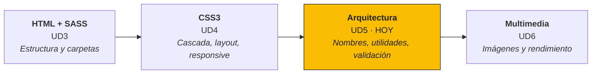
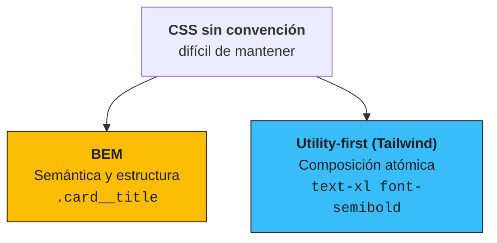
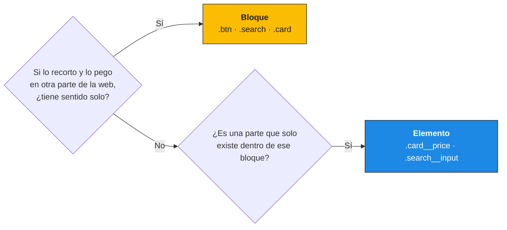
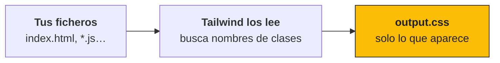
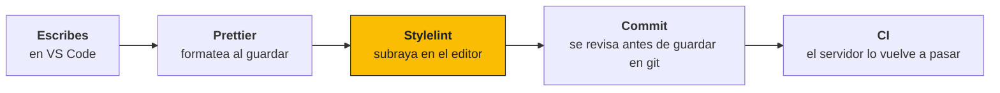
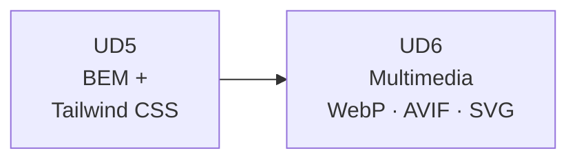

# UD5 · Arquitectura CSS (BEM) y Utility-First con Tailwind CSS :simple-csswizardry:

<div class="presentacion" markdown>
:material-presentation-play:{ .presentacion__icono } **Presentación de clase** · 46 diapositivas para seguir la unidad

[:material-file-pdf-box: Abrir o descargar el PDF](../assets/presentaciones/DIW-UD5.pdf){ .md-button .md-button--primary target="_blank" }
</div>

## Resultado de aprendizaje y criterios cubiertos :material-school:

Esta unidad cierra **RA2 — Crea interfaces Web homogéneas definiendo y aplicando estilos**.

| Criterio | Enunciado | Cobertura |
|---|---|---|
| **RA2.g** | Se han creado clases de estilos. | ✅ Completa (BEM y clases de utilidad) |
| **RA2.h** | Se han utilizado herramientas de validación de hojas de estilos. | ✅ Completa (W3C, Stylelint, Prettier) |
| **RA2.i** | Se ha utilizado y actualizado la guía de estilo. | ✅ Completa |

!!! note "Cierre del Resultado de Aprendizaje 2"
    Con esta unidad **RA2 queda completado**. En la UD6 empieza el **RA3**: recursos multimedia y rendimiento.

---

## 1. Dónde estamos: AURIA ya tiene piel, hoy ordenamos el armario :material-map-marker-path:



En la UD4 la página de AURIA ganó colores, layout y responsive. En esta unidad **casi no cambia cómo se ve**: cambia **cómo está escrito** el CSS, para que se pueda mantener cuando crece y cuando lo toca más de una persona.

!!! question "La pregunta de la unidad"
    **¿Cómo escribimos CSS que otra persona pueda tocar sin miedo dentro de seis meses?** La contestamos en cuatro bloques:

    1. **El problema:** qué pasa cuando no hay convención (sección 2).
    2. **BEM:** nombres que explican la estructura del componente (sección 3).
    3. **Tailwind CSS:** componer el aspecto con clases de utilidad (sección 4).
    4. **Validar y documentar:** W3C, Stylelint, Prettier y la guía de estilo (secciones 5 y 6).

### 1.1 Por qué importa en el mundo real

El CSS de un proyecto real **no deja de crecer**: unas decenas de líneas el primer mes, miles al segundo año, y tocadas por muchas personas distintas.

- **Varias personas, un mismo CSS.** Lo que escribes hoy lo modificará otra persona mañana.
- **Se lee más de lo que se escribe.** Un nombre claro ahorra horas de buscar "qué hace esta clase".
- **Miedo a borrar.** Sin convención nadie sabe si una regla se usa, así que nadie borra nada: el CSS solo crece.
- **Revisión automática.** En las empresas el CSS pasa un *linter* antes de entrar al proyecto.
- **Diseño y código sincronizados.** La guía de estilo es el contrato entre diseño y desarrollo.

!!! tip "Dato clave"
    El problema del CSS no es escribirlo: es **mantenerlo** cuando crece y cuando lo toca más de una persona.

---

## 2. El problema: CSS que nadie se atreve a tocar :material-alert-octagon-outline:

### 2.1 Tres síntomas de un CSS sin convención

Este es el aspecto típico de un `styles.css` con dos años de vida:

```css
.card { … }
.card2 { … }
.btn-2 { … }
.rojo { color: red; }
.nuevo-btn-ok { … }

#main .card .btn:hover { … }
div.productos ul li a span { … }

.card .title { … }
.modal .title { … }  /* ¿cuál gana? */
```

| Síntoma | Ejemplo | Qué provoca |
| --- | --- | --- |
| **Nombres sin significado** | `.card2`, `.btn-2`, `.rojo` | Nadie sabe qué son ni dónde se usan. ¿Y si `.rojo` tiene que pasar a ser azul? |
| **Especificidad que sube** | `#main .card .btn:hover` | Solo se pueden vencer con un selector aún más largo… o con `!important` |
| **Estilos que se pisan** | `.card .title` y `.modal .title` | El aspecto depende de **dónde** está el HTML: lo mueves y cambia |

!!! danger "Resultado"
    Nadie se atreve a borrar nada: se añade otra regla "por si acaso" y el fichero solo crece. El CSS que ya no se usa pero sigue ahí se llama **código muerto**.

### 2.2 Recuerda la UD4: la especificidad es una escalada

| Selector | Especificidad |
| --- | --- |
| `.title` | (0,1,0) |
| `.card .title` | (0,2,0) |
| `#main .card .title` | (1,2,0) |
| `#main .card .title { … !important }` | fuera de la escala |

Cada vez que alguien "gana" subiendo el peso, el siguiente tiene que subirlo más. Es una escalada que nadie gana.

!!! info "La idea de toda la unidad"
    Si **todos** los selectores pesan lo mismo, **(0,1,0)**, nadie tiene que pelear: si dos reglas chocan, decide el orden. Y lo que evita que choquen es el **nombre**.

### 2.3 Dos respuestas al mismo problema



- **BEM:** nombras cada pieza según lo que **es** dentro de su componente y escribes su CSS una vez.
- **Utility-first:** cada clase hace **una sola cosa** y el aspecto se monta combinándolas en el HTML.

No son rivales que haya que elegir para siempre: son dos respuestas al mismo problema. Existen otras arquitecturas (OOCSS, SMACSS, ITCSS), pero BEM y Tailwind son las más extendidas.

---

## 3. BEM: Bloque, Elemento, Modificador (RA2.g) :material-file-tree-outline:

### 3.1 Las tres piezas

| Pieza | Qué es | Ejemplo en AURIA |
| --- | --- | --- |
| **Bloque** | Componente independiente con sentido propio. Se puede llevar a otra página y sigue teniendo sentido. | `.card` |
| **Elemento** | Parte del bloque, sin sentido fuera de él. | `.card__image`, `.card__title`, `.card__price`, `.card__button` |
| **Modificador** | Variante de aspecto o de estado del bloque o de un elemento. | `.card--destacada`, `.card__button--primary` |

BEM lo creó **Yandex** (el buscador ruso) hacia 2009, para que equipos grandes pudieran compartir el mismo CSS sin pisarse.

### 3.2 La sintaxis: dos guiones bajos y dos guiones

```text
card__button--primary
│   │       │
│   │       └── --primary  → modificador
│   └── __button          → elemento
└── card                  → bloque
```

Se lee: *"el botón de la tarjeta, en su variante principal"*.

| Patrón | Ejemplo | Significado |
| --- | --- | --- |
| `.bloque` | `.card` | El componente |
| `.bloque__elemento` | `.card__title` | Una parte del componente |
| `.bloque--modificador` | `.card--destacada` | Variante del componente entero |
| `.bloque__elemento--modificador` | `.card__button--primary` | Variante de una parte |

!!! tip "Nombres compuestos"
    Todo en **minúsculas** y con **guion simple** dentro de cada palabra compuesta: `.product-card__add-button--disabled`. Los separadores son dobles precisamente para no confundirse con ese guion simple.

### 3.3 La tarjeta de AURIA con nombres BEM

```html
<article class="card card--destacada">
  
  <h3 class="card__title">AURIA Pro</h3>
  <p class="card__price">199 €</p>
  <button class="card__button card__button--primary">
    Añadir al carrito
  </button>
</article>
```

1. **Modificador + base:** `class="card card--destacada"`. El modificador **siempre acompaña** a la clase base: la base trae lo común y el modificador solo lo que cambia.
2. **Se lee en el HTML:** sin abrir el CSS ya sabes qué es cada pieza y a qué componente pertenece.
3. **El HTML semántico sigue:** `article`, `h3` y `button` son las etiquetas de la UD3. BEM ordena los nombres de las clases; no cambia qué etiqueta usas.

### 3.4 BEM y SASS encajan: el `&` de la UD3

El `&` de SASS se sustituye por el selector en el que estás, **pegado**. Con BEM, todo el componente queda en un fichero:

=== "components/_card.scss"

    ```scss
    .card {
      display: flex;
      flex-direction: column;
      gap: $space-md;

      &--destacada {
        border: 2px solid $color-brand-primary;
      }
      &__title { font-size: 1.25rem; }
      &__button--primary {
        background: $color-brand-primary;
      }
    }
    ```

=== "css/main.css (compilado)"

    ```css
    .card { display: flex; flex-direction: column; gap: 16px; }
    .card--destacada { border: 2px solid #1E88E5; }
    .card__title { font-size: 1.25rem; }
    .card__button--primary { background: #1E88E5; }
    ```

!!! warning "El `&` tiene que ir pegado"
    `&__title` genera `.card__title`: **una** clase, (0,1,0). Si escribes `.title` dentro de `.card` (sin `&`), SASS genera `.card .title`: **dos** clases, (0,2,0), y vuelves al problema. Y si dejas un espacio (`& __title`), sale `.card __title`, que no funciona.

!!! info "¿Y el anidamiento del CSS nativo?"
    El CSS nativo ya admite anidamiento, pero su `&` **no pega texto**: `&__title` no funciona en CSS puro. Para escribir BEM con `&`, SASS.

### 3.5 Especificidad plana: todas las reglas pesan (0,1,0)

| Sin convención | Especificidad | Con BEM | Especificidad |
| --- | --- | --- | --- |
| `#main .card .title` | (1,2,0) | `.card__title` | (0,1,0) |
| `.modal div .title` | (0,2,1) | `.modal__title` | (0,1,0) |
| `.card .title` | (0,2,0) | `.card__button` | (0,1,0) |
| `.title` | (0,1,0) | `.card--destacada` | (0,1,0) |

Con BEM todas las reglas pesan igual: si dos chocan, decide el orden. Y como cada componente tiene sus propios nombres, casi nunca chocan.

!!! tip "La alternativa al `!important` de la UD4"
    No se gana subiendo el peso: se consigue que **nadie tenga que ganar**.

### 3.6 Cuatro reglas que evitan el 90 % de los errores

| Regla | ❌ Incorrecto | ✅ Correcto | Por qué |
| --- | --- | --- | --- |
| **Sin nietos en el nombre** | `.card__body__title` | `.card__title` | El nombre refleja el bloque, no el árbol del HTML |
| **El modificador no va solo** | `class="card--destacada"` | `class="card card--destacada"` | El modificador solo trae lo que cambia |
| **Sin selectores de etiqueta** | `.card h3 { … }` | `.card__title { … }` | Si cambias `h3` por `h2`, el estilo no se pierde |
| **Bloque dentro de bloque** | `.card .btn { … }` | `class="card__button btn btn--primary"` | **Mezcla** (*mix*): el botón es pieza de la tarjeta **y** un bloque propio |

En una mezcla, la clase del elemento (`card__button`) aporta **la colocación** dentro del bloque (márgenes, posición) y la del otro bloque (`btn`) aporta **el aspecto**.

### 3.7 ¿Bloque o elemento? Una pregunta lo decide



Ejemplos de AURIA:

- **Botón "Añadir":** bloque `.btn` (hay botones iguales en toda la web).
- **Precio:** elemento `.card__price`.
- **Valoración con estrellas:** bloque `.rating` (aparece también en las reseñas).
- **Etiqueta "Oferta":** elemento `.card__badge`, o bloque `.badge` si se reutiliza.

!!! info "No hay una respuesta única"
    Lo importante es que el equipo lo decida **y lo escriba en la guía de estilo** (sección 6).

### 3.8 Estados: modificador, pseudoclase o atributo ARIA

| Tipo | Para qué | Ejemplos |
| --- | --- | --- |
| **Pseudoclases** | Estados que **el navegador ya conoce** | `&:hover`, `&:focus-visible`, `&:disabled` |
| **Modificadores** | Variantes que **decides tú** | `.card--destacada`, `.btn--secondary`, `.alert--error` |
| **Atributos ARIA** | Estados que **también debe oír el lector de pantalla** (UD9) | `[aria-expanded="true"]`, `[aria-current="page"]`, `[aria-invalid="true"]` |

```scss
.menu {
  &__list { display: none; }

  // El estado lo marca el atributo ARIA del botón: CSS y lector de pantalla leen el mismo dato
  &__toggle[aria-expanded="true"] + &__list { display: block; }
}
```

!!! tip "Regla"
    Si el estado ya existe en HTML o en ARIA, **úsalo para el CSS** en vez de inventar una clase. Así el aspecto y lo que oye el lector de pantalla no se desincronizan.

### 3.9 Ventajas y límites de BEM

| ✅ Ventajas | ⚠️ Límites |
| --- | --- |
| Nombres que se explican solos en el HTML | Nombres largos: `.card__button--primary` |
| Especificidad plana y predecible | Exige disciplina: un solo `.card .title` y se rompe |
| Un componente = un fichero SASS | Hay que decidir qué es bloque y qué es elemento |
| Se puede borrar un bloque entero sin miedo | No guarda los valores: necesita los **tokens** de la UD2 |
| Encaja con los componentes de la UD7 (Atomic Design) | |

!!! tip "Clave"
    Los nombres largos son el precio de la claridad: **se escriben una vez y se leen cien**.

---

## 4. Utility-first con Tailwind CSS (RA2.g) :simple-tailwindcss:

### 4.1 Cambio de paradigma: del nombre a la composición

| BEM | Utility-first |
| --- | --- |
| 1. Pones un nombre: `.card__button` | 1. No escribes CSS nuevo |
| 2. Escribes su CSS en `_card.scss` | 2. Combinas clases ya hechas: `bg-blue-600 text-white px-4 py-2` |
| 3. Lo usas en el HTML | 3. El aspecto se lee en el HTML |
| **HTML limpio · la lógica visual está en el CSS** | **CSS mínimo · la lógica visual está en el HTML** |

Una **clase de utilidad** es, básicamente, **una declaración CSS con nombre corto**: `flex` → `display: flex`; `p-4` → `padding: 1rem`.

Tailwind CSS nació en 2017 (Adam Wathan). La versión actual, la **4** (2025), se configura **desde el propio CSS**.

### 4.2 La misma tarjeta de AURIA, en Tailwind

```html
<article class="flex flex-col gap-2 rounded-lg
                border-2 border-brand-primary p-4">
  
  <h3 class="text-xl font-semibold">AURIA Pro</h3>
  <p class="text-gray-600">199 €</p>
  <button class="rounded-md bg-brand-primary px-4 py-2
                 text-white hover:bg-blue-700
                 focus-visible:outline-2">
    Añadir al carrito
  </button>
</article>
```

Mismo resultado visual que la versión BEM, y **ni una línea de CSS propio**: todo el aspecto está en el atributo `class`. Si borras la tarjeta del HTML, su "CSS" desaparece con ella: no queda código muerto.

!!! question "¿No es lo mismo que el `style=\"\"` en línea?"
    Se parece, pero hay tres diferencias importantes: las utilidades **usan la escala de tokens** (no cualquier valor), **admiten estados y responsive** (`hover:`, `md:`), que el atributo `style` no puede, y pesan lo que **una clase**, no la prioridad máxima del estilo en línea.

### 4.3 Las clases son CSS con nombre corto

| CSS | Tailwind |
| --- | --- |
| `display: flex` | `flex` |
| `flex-direction: column` | `flex-col` |
| `justify-content: space-between` | `justify-between` |
| `gap: 0.5rem` (8 px) | `gap-2` |
| `padding: 1rem` (16 px) | `p-4` |
| `padding-inline: 1rem` | `px-4` |
| `border-radius: 0.5rem` | `rounded-lg` |
| `font-weight: 600` | `font-semibold` |
| `display: grid; grid-template-columns: repeat(3, minmax(0, 1fr))` | `grid grid-cols-3` |

**La escala de espaciado:** cada número son **0,25 rem (4 px)**. `p-1` = 4 px, `p-2` = 8 px, `p-4` = 16 px, `p-6` = 24 px, `p-8` = 32 px. Igual que los tokens de espaciado de la UD2, te mueves por una escala en lugar de inventar valores. La `x` y la `y` indican el eje: `px-4` (izquierda y derecha), `py-2` (arriba y abajo).

!!! tip "No hay que memorizarlas"
    La extensión **Tailwind CSS IntelliSense** de VS Code autocompleta las clases y, al pasar el ratón por encima, enseña el CSS que genera cada una.

### 4.4 Variantes: estados y responsive con un prefijo

| Prefijo | Ejemplo | Equivale a |
| --- | --- | --- |
| `hover:` | `hover:bg-blue-700` | `&:hover` de SASS |
| `focus-visible:` | `focus-visible:outline-2` | `&:focus-visible` |
| `md:` | `md:flex-row` | `@media (min-width: 48rem)` |
| `lg:` | `lg:grid-cols-3` | `@media (min-width: 64rem)` |
| `dark:` | `dark:bg-gray-900` | `@media (prefers-color-scheme: dark)` |

**Mobile-first, como en la UD4:**

```html
<div class="flex flex-col md:flex-row">…</div>
```

- Sin prefijo se aplica **siempre** (la base, el móvil).
- `md:` **añade** a partir de 768 px.
- Se combinan: `md:hover:bg-blue-700`.

| Breakpoint | `sm` | `md` | `lg` | `xl` | `2xl` |
| --- | --- | --- | --- | --- | --- |
| Desde | 640 px | 768 px | 1024 px | 1280 px | 1536 px |

!!! warning "`md:` no significa «solo en tablet»"
    Significa **«a partir de md»**. Es exactamente el `min-width` de la UD4. Para algo que solo se vea en móvil, se pone en la base y se deshace en el breakpoint: `block md:hidden`.

### 4.5 Instalar Tailwind CSS v4 con su CLI

Igual que Dart Sass en la UD3: con `npm`, dentro del proyecto.

```bash
# 1. Instalar
npm install tailwindcss @tailwindcss/cli
```

```css
/* 2. Importar: src/input.css */
@import "tailwindcss";
```

```bash
# 3. Compilar en modo vigilancia
npx @tailwindcss/cli -i ./src/input.css -o ./src/output.css --watch
```

```html
<!-- 4. Enlazar el CSS generado -->
<link rel="stylesheet" href="output.css">
```

Tailwind lee tu HTML, busca las clases que usas y genera `output.css`.

!!! info "Para prototipos"
    Existe un `<script>` que compila en el navegador sin instalar nada (`@tailwindcss/browser`). Sirve para probar algo en cinco minutos, **no para producción**.

!!! warning "Tailwind y SASS, por separado"
    Tailwind v4 ya hace el papel del preprocesador (variables, anidamiento, importaciones) y su documentación no recomienda combinarlo con SASS. Por eso en el ejercicio la versión Tailwind va en una **carpeta aparte**.

### 4.6 Los tokens de la UD2 entran por `@theme`

```css
/* src/input.css */
@import "tailwindcss";

@theme {
  --color-brand-primary: #1e88e5;
  --color-brand-dark: #1565c0;
  --spacing-md: 1rem;
  --font-display: "Inter", sans-serif;
}
```

| Variable en `@theme` | Clases que crea |
| --- | --- |
| `--color-brand-primary` | `bg-brand-primary` · `text-brand-primary` · `border-brand-primary` |
| `--spacing-md` | `p-md` · `m-md` · `gap-md` |
| `--font-display` | `font-display` |

El **prefijo de la variable** (`--color-`, `--spacing-`, `--font-`, `--text-`, `--radius-`, `--breakpoint-`) decide qué clases se crean.

!!! tip "Tailwind no sustituye a los tokens: los implementa"
    El nombre semántico de la UD2 (`color-brand-primary`) pasa a ser una clase. Si mañana cambia el azul de AURIA, se cambia **en un solo sitio**. Además, queda disponible como variable CSS normal: `var(--color-brand-primary)`.

!!! info "Si ves `tailwind.config.js` en un tutorial"
    Es **Tailwind 3**: la configuración se hacía en un fichero JavaScript. La idea es la misma; en la v4 se escribe en el CSS con `@theme`.

### 4.7 Solo genera las clases que usas



Tailwind tiene miles de clases posibles, pero el CSS final solo trae las que encuentra en tu código: suele quedar en pocos KB.

!!! danger "La trampa: Tailwind busca texto, no ejecuta tu código"
    Una clase montada a trozos **no existe** para Tailwind:

    ```js
    // ❌ Tailwind nunca ve "bg-red-600" escrito entero
    const clase = `bg-${color}-600`;

    // ✅ Nombres completos
    const clase = color === "rojo" ? "bg-red-600" : "bg-blue-600";
    ```

    Si una clase "no hace nada", lo primero: **¿aparece escrita entera en algún fichero que Tailwind lee?** (Y después: ¿está corriendo el `--watch`? ¿Enlazas `output.css` y no `input.css`?)

### 4.8 Salidas de emergencia: valores arbitrarios y `@apply`

=== "Valores arbitrarios"

    ```html
    <div class="w-[327px] top-[13px] bg-[#ff5a1f]">…</div>
    ```

    Escriben un valor exacto entre corchetes. Útiles para un caso puntual… y peligrosos: son los **valores mágicos** de la UD2 otra vez. **Si lo repites, crea un token en `@theme`.**

=== "@apply"

    ```css
    .btn {
      @apply rounded-md bg-brand-primary px-4 py-2 text-white;
    }
    ```

    Junta varias utilidades en una clase propia. Sirve cuando no tienes componentes y el mismo HTML se repite a mano. **Con moderación:** si todo es `@apply`, vuelves a escribir CSS de siempre con otra sintaxis.

!!! tip "Clave"
    Si en tu HTML hay muchos corchetes, no estás usando el sistema de diseño: **te lo estás saltando**.

### 4.9 ¿BEM o Tailwind? Depende del proyecto

| | BEM + SASS | Tailwind CSS |
| --- | --- | --- |
| **Dónde está el aspecto** | En el `.scss` | En el HTML |
| **HTML** | Limpio, nombres con significado | Largo, muchas clases |
| **Velocidad para maquetar** | Media | Alta |
| **Tamaño del CSS** | Crece con cada componente | Pequeño y estable |
| **Tokens** | Variables SASS / custom properties | `@theme` |
| **Encaja mejor con** | Webs con HTML escrito a mano, CMS | Proyectos con componentes (React, Vue…) |

**Y se pueden mezclar.** Muchos equipos usan BEM (o componentes) para la estructura y unas pocas utilidades para ajustes puntuales: márgenes entre piezas, ocultar algo en móvil… Lo que **no** funciona es no decidir: medio proyecto con cada sistema y sin norma.

!!! tip "Clave"
    No hay un ganador: hay una **decisión de equipo**, escrita en la guía de estilo y vigilada por las herramientas.

---

## 5. Validar: herramientas que revisan el CSS por ti (RA2.h) :material-check-decagram-outline:

### 5.1 Tres herramientas, tres preguntas distintas

| Herramienta | Pregunta que contesta | Qué detecta | Cuándo |
| --- | --- | --- | --- |
| **Validador W3C** | ¿Es CSS válido según el estándar? | Propiedades que no existen, valores mal escritos, llaves sin cerrar | A mano: [jigsaw.w3.org/css-validator](https://jigsaw.w3.org/css-validator/) |
| **Stylelint** | ¿Cumple las normas del equipo? | Nombres que no son BEM, colores repetidos, selectores duplicados o demasiado específicos | En el editor y antes de cada commit |
| **Prettier** | ¿Está bien formateado? | Sangría, espacios, comillas, una declaración por línea (lo corrige solo) | Automático al guardar |

!!! warning "El validador W3C entiende CSS, no SCSS"
    Si le pegas un `.scss` con `$variables` y `&`, se llena de errores. Se le pasa el **`css/main.css` compilado**. Stylelint, en cambio, sí sabe leer el `.scss`. Los *avisos* (warnings) del W3C no son errores: a veces el validador va por detrás de las novedades de CSS.

### 5.2 Stylelint: instalar y enseñarle BEM

```bash
npm install --save-dev stylelint stylelint-config-standard-scss
```

Fichero `.stylelintrc.json` en la raíz del proyecto:

```json
{
  "extends": "stylelint-config-standard-scss",
  "rules": {
    "selector-class-pattern": [
      "^[a-z][a-z0-9-]*(__[a-z0-9-]+)?(--[a-z0-9-]+)?$",
      {
        "resolveNestedSelectors": true,
        "message": "Usa BEM: bloque__elemento--mod"
      }
    ]
  }
}
```

| Parte | Qué hace |
| --- | --- |
| `extends` | Parte de un conjunto de reglas ya hecho: el estándar, en su versión para SCSS |
| `selector-class-pattern` | Expresión regular que deben cumplir **todos** los nombres de clase |
| La regex, en castellano | Minúsculas (con guiones), y opcionalmente un `__elemento` y un `--modificador`. Los "nietos" (`card__body__title`) y las mayúsculas (`cardTitle`) no pasan |
| `resolveNestedSelectors` | Revisa también los nombres que se forman con `&__` y `&--` en SASS. Sin esta opción, un `&_title` mal escrito se escaparía |
| `message` | El mensaje que se muestra cuando falla |

Para pasarlo a todos los ficheros SCSS:

```bash
npx stylelint "scss/**/*.scss"
```

!!! tip "Clave"
    La convención ya no depende de que alguien **se acuerde**: la máquina la revisa en cada fichero.

### 5.3 Leer lo que dice Stylelint

```text
scss/components/_card.scss
  12:3  ✖  Expected ".cardTitle" to match pattern          selector-class-pattern
  18:5  ✖  Unexpected duplicate selector ".card__price"    no-duplicate-selectors
  24:14 ✖  Expected "#ffffff" to be "#fff"                 color-hex-length

✖ 3 problems (3 errors, 0 warnings)
```

| Parte | Significado |
| --- | --- |
| `12:3` | Línea y columna: dónde está el problema (en VS Code, Ctrl+G) |
| `✖ Expected…` | Qué ha encontrado, en inglés |
| `selector-class-pattern` | El nombre de la regla: búscalo en [stylelint.io](https://stylelint.io/user-guide/rules) para saber por qué existe |

```bash
npx stylelint "scss/**/*.scss" --fix
```

`--fix` arregla lo automático (por ejemplo, `#ffffff` → `#fff`). Los **nombres** los cambias tú, porque también hay que tocar el HTML.

!!! tip "Truco"
    Con la extensión **Stylelint** de VS Code, los errores aparecen subrayados mientras escribes, como las faltas de ortografía.

### 5.4 El circuito: que la máquina revise antes que las personas



En una revisión de código nadie debería perder tiempo discutiendo sangrías o nombres mal escritos. Las herramientas se encargan de lo mecánico y las personas revisan lo que importa: **si el componente está bien pensado**.

!!! info "En clase"
    Nos quedamos en el editor (Prettier + Stylelint). La revisión en el commit (*hooks* de git) y la integración continua (CI) las veréis en los proyectos.

---

## 6. Documentar: la guía de estilo viva (RA2.i) :material-book-edit-outline:

### 6.1 De Penpot al código

La guía de estilo que creaste en la UD2 con Penpot no se queda en el diseño: cada parte tiene su sitio en el código.

| Elemento | En el diseño (UD2) | En el código (UD4 – UD5) |
| --- | --- | --- |
| **Colores** | Tokens de color en Penpot | `$color-brand-primary` · `--color-brand-primary` en `@theme` |
| **Tipografía** | Escala de estilos de texto | Variables de tamaño · `clamp()` (UD4) · `text-xl` |
| **Espaciado** | Tokens de espaciado | `$space-md` · `--spacing-md` |
| **Componentes** | Componentes de la librería | Bloques BEM (`_card.scss`) · catálogo en Storybook (UD7) |
| **Convenciones** | — | BEM, Stylelint y cuándo usar utilidades |

!!! info "RA2.i pide UTILIZAR y ACTUALIZAR la guía"
    Si el código cambia y la guía no, **la guía miente**. Un token que cambia en Penpot y no llega al código (o al revés) es justo la divergencia que hay que evitar. Quien hace el cambio actualiza la guía en ese mismo cambio.

### 6.2 Qué contiene una guía de estilo de código

| Apartado | Qué recoge |
| --- | --- |
| **Tokens** | Colores, tipografía, espaciado y radios, con su nombre en código |
| **Componentes** | Cada bloque: para qué sirve, sus elementos y sus modificadores |
| **Convención de nombres** | BEM, prefijos, idioma (inglés o castellano, pero uno) |
| **Hacer / no hacer** | Ejemplos correctos e incorrectos, como en Material Design o GOV.UK |
| **Herramientas** | Cómo compilar, qué linter se usa y con qué reglas |
| **Cambios** | Qué se ha modificado y cuándo, para que nadie se pierda |

Un esqueleto mínimo de `README.md` para AURIA:

```markdown
# Guía de estilo · AURIA

## Tokens
| Token | SASS | Tailwind (@theme) | Valor |
| --- | --- | --- | --- |
| Color de marca | $color-brand-primary | --color-brand-primary | #1e88e5 |
| Espaciado medio | $space-md | --spacing-md | 1rem |

## Componentes
### card
Tarjeta de producto. Elementos: __image, __title, __price, __button.
Modificadores: --destacada (borde de marca).

## Convenciones
- Nombres BEM en kebab-case. Stylelint: selector-class-pattern.
- Utilidades solo para ajustes puntuales de espaciado.

## Herramientas
- Compilar: sass --watch scss:css
- Revisar: npx stylelint "scss/**/*.scss"

## Cambios
- 2026-10-28 · Añadido card--destacada.
```

En la **UD7** esta guía se convierte en un catálogo navegable de componentes con **Storybook**.

---

## 7. Caso real: arquitecturas CSS en producción :material-domain:

| Caso | Qué hacen |
| --- | --- |
| **GOV.UK Frontend** | El sistema de diseño del gobierno británico usa BEM con prefijo: `.govuk-button--secondary` |
| **Tailwind en componentes** | Librerías como shadcn/ui o Tailwind Plus reparten componentes hechos solo con utilidades |
| **Linter obligatorio** | Los proyectos serios rechazan un cambio si no pasa Stylelint en la integración continua |
| **Tokens como fuente única** | Los mismos tokens alimentan la herramienta de diseño, el CSS y las apps móviles |
| **Guías públicas** | Material Design, GOV.UK o Atlassian publican sus guías con ejemplos de hacer / no hacer |
| **Borrar sin miedo** | Con componentes aislados se puede eliminar código muerto sabiendo que no rompe nada |

!!! example "Pruébalo"
    Abre [gov.uk](https://www.gov.uk), pulsa F12 y mira las clases de cualquier botón o del buscador: es BEM de libro.

---

## 8. Errores comunes :material-alert-circle-outline:

### 8.1 Trampas de BEM

| Error | Qué pasa | ❌ Incorrecto | ✅ Correcto |
| --- | --- | --- | --- |
| Nietos en el nombre | Copias el árbol del HTML en la clase | `.card__body__footer__button` | `.card__button` |
| Modificador sin base | Se pierden los estilos comunes | `<div class="card--destacada">` | `<div class="card card--destacada">` |
| Volver a anidar | La especificidad sube otra vez | `.card .card__title { … }` | `.card__title { … }` |
| Estilar por etiqueta | Cambias `h3` por `h2` y se rompe | `.card h3 { … }` | `.card__title { … }` |
| `&` separado en SASS | Sale un selector descendiente que no funciona | `& __title { … }` | `&__title { … }` |

### 8.2 Trampas de Tailwind y herramientas

| Error | Qué pasa | ❌ Incorrecto | ✅ Correcto |
| --- | --- | --- | --- |
| Clases montadas a trozos | Tailwind no las encuentra y no las genera | `` `text-${tono}-600` `` | `tono === "ok" ? "text-green-600" : …` |
| Corchetes por todas partes | Valores mágicos otra vez | `p-[13px] text-[#1e88e5]` | `p-md text-brand-primary` (`@theme`) |
| Token sin prefijo en `@theme` | No se crean las clases | `--brand-primary: #1e88e5;` | `--color-brand-primary: #1e88e5;` |
| Validar el `.scss` en el W3C | El validador no entiende SASS | Pegar `_card.scss` en el validador | Validar `css/main.css` (el compilado) |
| Desactivar la regla que molesta | El linter deja de proteger | `"selector-class-pattern": null` | Renombrar la clase según BEM |

---

## 9. Ejercicio práctico guiado: la tarjeta de AURIA, con dos arquitecturas :material-clipboard-check:

!!! info "Actividad de consolidación (no evaluable)"
    **Objetivo:** aplicar las dos arquitecturas a la **tarjeta de producto de la UD4**. La versión BEM se hace en tu proyecto (`scss/`); la versión Tailwind, en una carpeta aparte (`auria-tailwind/`) para comparar las dos sin mezclarlas.

**Pasos, en este orden:**

1. **Refactor a BEM:** renombra la tarjeta con `card`, `card__image`, `card__title`, `card__price` y `card__button` (y un modificador `card--destacada`). Cambia el HTML y el SCSS.
2. **BEM en SASS:** todo el CSS de la tarjeta en `components/_card.scss`, con `&__` y `&--`. Comprueba en `css/main.css` que **todas las reglas son de una sola clase**, (0,1,0).
3. **Versión Tailwind:** en `auria-tailwind/`, instala Tailwind v4 con su CLI y rehaz **la misma tarjeta** solo con utilidades.
4. **Tokens en `@theme`:** al menos **4 colores y 3 espaciados** de tu guía de la UD2, y úsalos en la tarjeta (`bg-brand-primary`, `p-md`…).
5. **Stylelint:** en el proyecto BEM, con la configuración de la sección 5.2, hasta **0 errores**.
6. **Guía de estilo:** un `README.md` con los tokens, el bloque `card` documentado (elementos y modificadores) y cuándo usarías BEM y cuándo Tailwind.

!!! success "Criterio de éxito"
    Las dos tarjetas **se ven igual**, Stylelint no da errores y **cambiar el azul de marca es tocar una sola línea** en cada versión (`_tokens.scss` y `@theme`).

---

## 10. Comprueba lo aprendido :material-head-question-outline:

??? question "1. ¿Qué es bloque, qué es elemento y qué es modificador en `.card__button--primary`?"
    Bloque `card` (la tarjeta), elemento `button` (el botón de la tarjeta) y modificador `primary` (su variante principal).

??? question "2. ¿Por qué con BEM no hace falta `!important`? Explícalo con la especificidad de la UD4."
    Porque todos los selectores son de una sola clase, (0,1,0): ninguna regla pesa más que otra y no hay que "ganar" a nadie. Además, como cada componente tiene sus propios nombres, casi nunca chocan; si chocan, decide el orden.

??? question "3. ¿Qué diferencia hay entre escribir `&__title` dentro de `.card` en SASS y escribir `.card .title`?"
    `&__title` genera `.card__title`: una clase, (0,1,0), que no depende de dónde esté el elemento. `.card .title` es un selector descendiente de dos clases, (0,2,0), que solo funciona si `.title` está dentro de `.card`.

??? question "4. En Tailwind, ¿qué significa `md:flex-row` y a qué media query de la UD4 equivale?"
    `flex-direction: row` **a partir** del breakpoint `md` (768 px). Equivale a `@media (min-width: 48rem) { … }`. No significa "solo en tablet".

??? question "5. ¿Qué revisa el validador W3C, qué revisa Stylelint y qué hace Prettier?"
    El W3C comprueba que el CSS cumple el estándar. Stylelint comprueba que cumple las normas del equipo (nombres BEM, duplicados, colores…). Prettier no comprueba: **reescribe** el código con un formato uniforme.

!!! example "Mini-reto (20 min, en parejas): detectives de arquitecturas"
    1. **Detectives:** encontrad 3 webs: una con BEM, una con Tailwind y una sin convención.
    2. **BEM:** renombrad en BEM un componente de la que no tiene convención.
    3. **Tailwind:** rehaced ese componente solo con utilidades.
    4. **Stylelint:** pasad vuestro BEM por Stylelint: 0 errores.
    5. **Veredicto:** ¿cuál elegiríais para ese proyecto y por qué?

    **Pistas para reconocerlas** (F12 → Elements → atributos `class`): dobles guiones bajos y dobles guiones → BEM; `flex px-4 md:…` → Tailwind; clases tipo `.box2` o ids con estilo → sin convención.

    **Éxito:** la otra pareja entiende vuestro componente BEM sin abrir el CSS y vuestra elección está justificada.

---

## 11. Glosario :material-book-alphabet:

### Arquitectura CSS y BEM

| Término | Definición |
| --- | --- |
| **Arquitectura CSS** | Normas para organizar y nombrar el CSS de un proyecto. |
| **Convención** | Acuerdo de equipo sobre cómo se escribe el código. |
| **BEM** | *Block, Element, Modifier*: convención de nombres de clases. |
| **Bloque** | Componente independiente con sentido propio: `.card`. |
| **Elemento** | Parte de un bloque, sin sentido fuera de él: `.card__title`. |
| **Modificador** | Variante de un bloque o elemento: `.card--destacada`. |
| **Mezcla (mix)** | Un nodo con clases de dos bloques: `card__button btn`. |
| **Especificidad plana** | Todas las reglas con una sola clase: (0,1,0). |
| **`&`** | En SASS, el selector actual: `&__title` → `.card__title`. |
| **OOCSS · SMACSS · ITCSS** | Otras arquitecturas CSS conocidas. |
| **Código muerto** | CSS que ya no se usa y nadie se atreve a borrar. |
| **Guía de estilo** | Documento vivo con tokens, componentes y normas. |

### Tailwind, validación y formato

| Término | Definición |
| --- | --- |
| **Utility-first** | Componer el aspecto con clases de una sola función. |
| **Clase de utilidad** | Clase que aplica una sola declaración: `p-4`. |
| **Tailwind CSS** | Framework utility-first; la v4 se configura desde el CSS. |
| **Variante** | Prefijo que condiciona una utilidad: `hover:`, `md:`, `dark:`. |
| **`@theme`** | Bloque de Tailwind v4 donde se definen los tokens. |
| **Valor arbitrario** | Valor exacto entre corchetes: `w-[327px]`. |
| **`@apply`** | Junta utilidades dentro de una clase propia. |
| **Linter** | Herramienta que revisa reglas y errores del código. |
| **Stylelint** | Linter de CSS y SCSS configurable por reglas. |
| **Prettier** | Formateador automático de código. |
| **Validador W3C** | Comprueba que el CSS cumple el estándar. |
| **CI** | Integración continua: revisión automática en el servidor. |

---

## 12. Resumen y conexión con la siguiente unidad :material-link-variant:

**Dentro de seis meses, ¿quién va a leer tu CSS?** Probablemente tú, y no te vas a acordar de por qué pusiste `.btn-2`. Escribe el CSS para esa persona:

1. **Nombres:** BEM o utilidades, que cada clase diga lo que es.
2. **Tokens:** los valores salen de la guía de estilo, no de la cabeza.
3. **Herramientas:** Stylelint y Prettier revisan lo mecánico.

Igual que con los tokens de la UD2: el ahorro no se ve el día que lo escribes, se ve el día que hay que cambiarlo.

- Sin convención, el CSS crece, la especificidad sube y nadie se atreve a borrar.
- **BEM:** `.bloque__elemento--modificador`, todo con una sola clase (0,1,0).
- En **SASS**, `&__` y `&--` generan nombres BEM sin anidar selectores.
- **Tailwind** compone con utilidades; los tokens entran por `@theme`.
- **W3C** valida el estándar, **Stylelint** las normas del equipo, **Prettier** el formato.
- La **guía de estilo** se usa y se actualiza: si el código cambia y ella no, miente.

Con la UD5 **se cierra el RA2**. En la **UD6** empieza el **RA3**: licencias y derechos de autor, formatos WebP, AVIF y SVG, imágenes adaptables con `picture`, `srcset` y `sizes`, y audio y vídeo que pesen poco y carguen rápido.



---

## 13. Referencias y fuentes :material-book-open-page-variant:

* BEM — [Metodología oficial (en.bem.info)](https://en.bem.info/methodology/) y [getbem.com](https://getbem.com/).
* Tailwind CSS — [Documentación oficial](https://tailwindcss.com/docs), [Instalación con la CLI](https://tailwindcss.com/docs/installation/tailwind-cli) y [Variables de tema (`@theme`)](https://tailwindcss.com/docs/theme).
* Stylelint — [Guía de uso y reglas](https://stylelint.io/user-guide/rules) y [`selector-class-pattern`](https://stylelint.io/user-guide/rules/selector-class-pattern).
* Prettier — [prettier.io](https://prettier.io/).
* W3C — [Servicio de validación CSS](https://jigsaw.w3.org/css-validator/).
* GOV.UK Design System — [design-system.service.gov.uk](https://design-system.service.gov.uk/).
* MDN Web Docs — [Organizar el CSS](https://developer.mozilla.org/es/docs/Learn/CSS/Building_blocks/Organizing).
* Ruiz, M. — *Diseño de Interfaces Web*.
