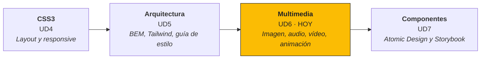
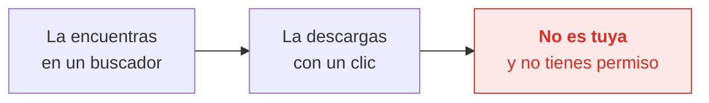
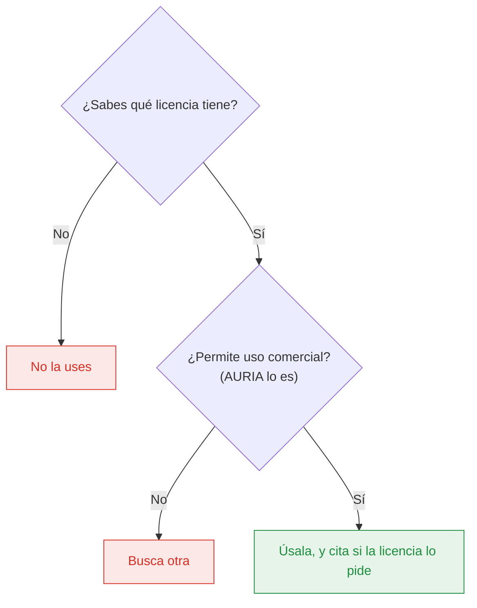
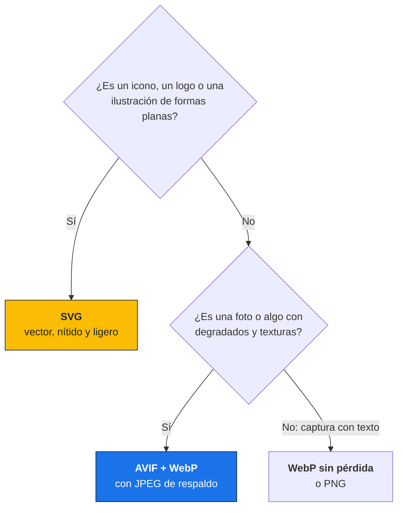
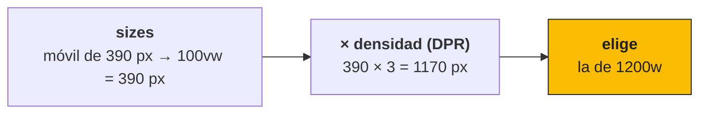
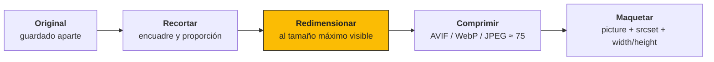
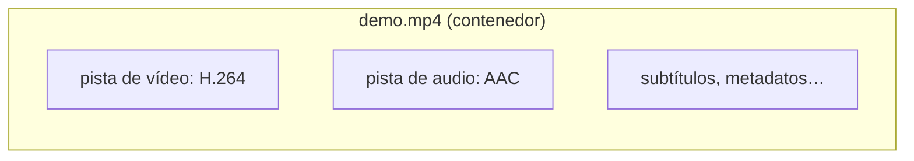
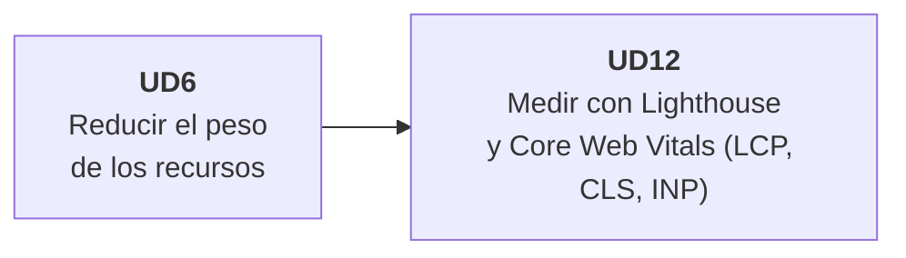
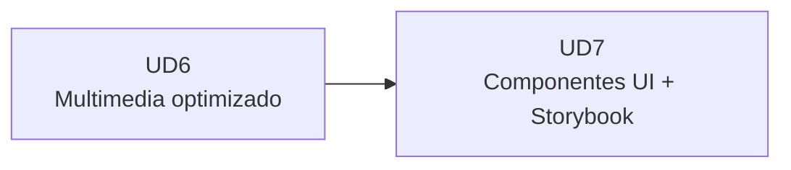

# UD6 · Optimización Multimedia (WebP/AVIF), SVG e Introducción a Performance :material-image-multiple-outline:

<div class="presentacion" markdown>
:material-presentation-play:{ .presentacion__icono } **Presentación de clase** · 17 diapositivas, lo esencial para una hora; la extendida tiene todo el detalle

[:material-file-pdf-box: Presentación de clase (17)](../assets/presentaciones/DIW-UD6.pdf){ .md-button .md-button--primary target="_blank" }
[:material-file-document-multiple-outline: Versión extendida (56)](../assets/presentaciones/DIW-UD6-extendida.pdf){ .md-button target="_blank" }
</div>

## Resultado de aprendizaje y criterios cubiertos :material-school:

Esta unidad aborda de forma integral el **RA3 — Integra elementos multimedia en páginas Web analizando su interactividad y usabilidad**.

| Criterio | Enunciado | Cobertura | Evaluación |
|---|---|---|---|
| **RA3.a** | Licencias y derechos de autor en material multimedia. | UD6 (§2) | **UD6 (1.ª Ev.)** |
| **RA3.b** | Formatos de imagen, audio y vídeo a utilizar. | UD6 (§3, §4, §6) | **UD6 (1.ª Ev.)** |
| **RA3.c** | Herramientas disponibles para generar contenido multimedia. | UD6 (§5) | **UD6 (1.ª Ev.)** |
| **RA3.d** | Herramientas para el tratamiento digital de la imagen. | UD6 (§5) | UD7 (2.ª Ev.) |
| **RA3.e** | Herramientas para manipular audio y vídeo. | UD6 (§6) | UD7 (2.ª Ev.) |
| **RA3.f** | Animaciones a partir de imágenes fijas. | UD6 (§7) | UD7 (2.ª Ev.) |
| **RA3.g** | Importar/exportar imagen, audio, vídeo en diversos formatos. | UD6 (§5, §6) | UD7 (2.ª Ev.) |
| **RA3.h** | Aplicación de la guía de estilo a contenido multimedia. | UD6 (§5.6) | UD7 (2.ª Ev.) |

!!! note "Planificación de evaluación"
    Aunque los criterios **RA3.d** a **RA3.h** se evalúan formalmente en la UD7 mediante componentes reales, el contenido teórico-práctico completo (tratamiento de imagen, vídeo, audio y animación) se imparte íntegramente en esta unidad.

---

## 1. Dónde estamos: AURIA ya está bien hecha, ahora que pese poco :material-map-marker-path:



!!! question "La pregunta de la unidad"
    **¿Cómo ponemos imágenes, audio y vídeo que podamos usar legalmente y que no hagan lenta la web?** Cada recurso multimedia responde a tres preguntas:

    1. **¿Puedo usarlo?** Licencias (sección 2).
    2. **¿En qué formato?** Imagen, SVG, audio y vídeo (secciones 3, 5 y 6).
    3. **¿Cuánto pesa?** Imágenes responsive, carga diferida, compresión y medición (secciones 4, 5 y 8).

<!-- mapa:diw-ud6-vistazo -->

📖 Toda la unidad sobre una sola foto: la licencia, prepararla, sus variantes, el HTML y cuál baja el navegador. Los números se explican debajo. **En la web, púlsalo para verlo en grande.**

<div class="mapa-diw">
<div class="uml-barra"><span>UD6 · la foto de los AURIA Pro, de principio a fin</span><button class="uml-btn" data-uml-abrir>🔍 Ampliar</button></div>
<div class="uml-lienzo" title="Pulsa para ampliar">
<svg xmlns="http://www.w3.org/2000/svg" width="100%" style="height:auto;display:block" role="img" aria-label="De la foto a la página" viewBox="0 0 1600 1108">
<defs><filter id="diw-ud6-vistazo-sombra" x="-5%" y="-5%" width="110%" height="115%"><feDropShadow dx="0" dy="2" stdDeviation="3" flood-color="#000" flood-opacity=".12"/></filter><marker id="diw-ud6-vistazo-mf80868b" viewBox="0 0 20 20" refX="16" refY="10" markerWidth="15" markerHeight="15" markerUnits="userSpaceOnUse" orient="auto-start-reverse"><path d="M2,2 L18,10 L2,18 z" style="fill:var(--mf-80868b,#80868b)"/></marker></defs>
<rect width="100%" height="100%" style="fill:var(--m-lienzo,#fff)"/>
<text x="40.0" y="44.0" text-anchor="start" font-family="'Inter', 'Segoe UI', 'DejaVu Sans', Helvetica, Arial, sans-serif" font-size="23" xml:space="preserve"><tspan font-weight="800" style="fill:var(--mt-202124,#202124)">UD6 · De la foto a la página </tspan><tspan font-weight="400" style="fill:var(--mt-80868b,#80868b)">la foto de los AURIA Pro, de principio a fin</tspan></text>
<text x="40.0" y="72.0" text-anchor="start" font-family="'Inter', 'Segoe UI', 'DejaVu Sans', Helvetica, Arial, sans-serif" font-size="14" font-weight="400" xml:space="preserve" style="fill:var(--mt-5f6368,#5f6368)">Las tres preguntas de la unidad sobre una sola foto: ¿puedo usarla?, ¿en qué formato?, ¿cuánto pesa? Los números se explican debajo.</text>
<g filter="url(#diw-ud6-vistazo-sombra)"><rect x="40" y="110" width="280" height="440" rx="10" stroke="#188038" stroke-width="2" style="fill:var(--mf-e6f4ea,#e6f4ea)"/><path d="M40,162 v-42 a10,10 0 0 1 10,-10 h260 a10,10 0 0 1 10,10 v42 z" fill="#188038" stroke="#188038" stroke-width="2"/></g>
<g transform="translate(54,125.0) scale(0.9166666666666666)" fill="none" stroke="#fff" stroke-width="2" stroke-linejoin="round"><rect x="3" y="4" width="18" height="16" rx="2"/><circle cx="9" cy="9.5" r="1.8" fill="#fff"/><path d="M4,18 l5,-5 l3,3 l3,-4 l5,6"/></g>
<text x="86.0" y="134.0" text-anchor="start" font-family="'Inter', 'Segoe UI', 'DejaVu Sans', Helvetica, Arial, sans-serif" font-size="17" font-weight="700" fill="#fff" xml:space="preserve">La foto</text>
<text x="86.0" y="149.0" text-anchor="start" font-family="'Inter', 'Segoe UI', 'DejaVu Sans', Helvetica, Arial, sans-serif" font-size="11.5" font-weight="400" fill="#fff" xml:space="preserve">con su licencia · apartado 2</text>
<path d="M322,136 H348" fill="none" stroke-width="2.4" stroke-linecap="round" stroke-linejoin="round" marker-end="url(#diw-ud6-vistazo-mf80868b)" style="stroke:var(--mf-80868b,#80868b)"/>
<g filter="url(#diw-ud6-vistazo-sombra)"><rect x="350" y="110" width="280" height="440" rx="10" stroke="#b06000" stroke-width="2" style="fill:var(--mf-fef7e0,#fef7e0)"/><path d="M350,162 v-42 a10,10 0 0 1 10,-10 h260 a10,10 0 0 1 10,10 v42 z" fill="#b06000" stroke="#b06000" stroke-width="2"/></g>
<text x="366.0" y="134.0" text-anchor="start" font-family="'Inter', 'Segoe UI', 'DejaVu Sans', Helvetica, Arial, sans-serif" font-size="17" font-weight="700" fill="#fff" xml:space="preserve">Preparar</text>
<text x="366.0" y="149.0" text-anchor="start" font-family="'Inter', 'Segoe UI', 'DejaVu Sans', Helvetica, Arial, sans-serif" font-size="11.5" font-weight="400" fill="#fff" xml:space="preserve">Squoosh o magick · 5.5</text>
<path d="M632,136 H658" fill="none" stroke-width="2.4" stroke-linecap="round" stroke-linejoin="round" marker-end="url(#diw-ud6-vistazo-mf80868b)" style="stroke:var(--mf-80868b,#80868b)"/>
<g filter="url(#diw-ud6-vistazo-sombra)"><rect x="660" y="110" width="280" height="440" rx="10" stroke-width="2" style="fill:var(--mf-eef3fe,#eef3fe);stroke:var(--mf-1a4fa0,#1a4fa0)"/><path d="M660,162 v-42 a10,10 0 0 1 10,-10 h260 a10,10 0 0 1 10,10 v42 z" stroke-width="2" style="fill:var(--mf-1a4fa0,#1a4fa0);stroke:var(--mf-1a4fa0,#1a4fa0)"/></g>
<text x="676.0" y="134.0" text-anchor="start" font-family="'Inter', 'Segoe UI', 'DejaVu Sans', Helvetica, Arial, sans-serif" font-size="17" font-weight="700" fill="#fff" xml:space="preserve">Las variantes</text>
<text x="676.0" y="149.0" text-anchor="start" font-family="'Inter', 'Segoe UI', 'DejaVu Sans', Helvetica, Arial, sans-serif" font-size="11.5" font-weight="400" fill="#fff" xml:space="preserve">3 formatos × 3 anchos · 3 y 5.5</text>
<path d="M942,136 H968" fill="none" stroke-width="2.4" stroke-linecap="round" stroke-linejoin="round" marker-end="url(#diw-ud6-vistazo-mf80868b)" style="stroke:var(--mf-80868b,#80868b)"/>
<g filter="url(#diw-ud6-vistazo-sombra)"><rect x="970" y="110" width="280" height="440" rx="10" stroke="#9334e6" stroke-width="2" style="fill:var(--mf-f6efff,#f6efff)"/><path d="M970,162 v-42 a10,10 0 0 1 10,-10 h260 a10,10 0 0 1 10,10 v42 z" fill="#9334e6" stroke="#9334e6" stroke-width="2"/></g>
<g transform="translate(984,125.0) scale(0.9166666666666666)" fill="none" stroke="#fff" stroke-width="2" stroke-linejoin="round"><path d="M6,2 H14 L19,7 V22 H6 z M14,2 V7 H19"/><path d="M9,12 h7 M9,16 h7"/></g>
<text x="1016.0" y="134.0" text-anchor="start" font-family="'Inter', 'Segoe UI', 'DejaVu Sans', Helvetica, Arial, sans-serif" font-size="17" font-weight="700" fill="#fff" xml:space="preserve">Maquetar</text>
<text x="1016.0" y="149.0" text-anchor="start" font-family="'Inter', 'Segoe UI', 'DejaVu Sans', Helvetica, Arial, sans-serif" font-size="11.5" font-weight="400" fill="#fff" xml:space="preserve">picture, srcset y sizes · 4</text>
<path d="M1252,136 H1278" fill="none" stroke-width="2.4" stroke-linecap="round" stroke-linejoin="round" marker-end="url(#diw-ud6-vistazo-mf80868b)" style="stroke:var(--mf-80868b,#80868b)"/>
<g filter="url(#diw-ud6-vistazo-sombra)"><rect x="1280" y="110" width="280" height="440" rx="10" stroke="#007b83" stroke-width="2" style="fill:var(--mf-e4f7f8,#e4f7f8)"/><path d="M1280,162 v-42 a10,10 0 0 1 10,-10 h260 a10,10 0 0 1 10,10 v42 z" fill="#007b83" stroke="#007b83" stroke-width="2"/></g>
<g transform="translate(1294,125.0) scale(0.9166666666666666)" fill="none" stroke="#fff" stroke-width="2" stroke-linejoin="round"><rect x="2" y="3" width="20" height="13" rx="2"/><path d="M8,21 h8 M12,16 v5"/></g>
<text x="1326.0" y="134.0" text-anchor="start" font-family="'Inter', 'Segoe UI', 'DejaVu Sans', Helvetica, Arial, sans-serif" font-size="17" font-weight="700" fill="#fff" xml:space="preserve">El navegador</text>
<text x="1326.0" y="149.0" text-anchor="start" font-family="'Inter', 'Segoe UI', 'DejaVu Sans', Helvetica, Arial, sans-serif" font-size="11.5" font-weight="400" fill="#fff" xml:space="preserve">baja solo una · 4.3</text>
<rect x="58.0" y="180.0" width="244.0" height="120.0" rx="8" stroke="none" stroke-width="0" style="fill:var(--mf-eef3fe,#eef3fe)"/>
<g transform="translate(150,210) scale(2.5)" fill="none" stroke-width="2.2" stroke-linecap="round" style="stroke:var(--mf-1a4fa0,#1a4fa0)"><path d="M4,15 v-3 a8,8 0 0 1 16,0 v3"/><rect x="2.5" y="13.5" width="5" height="8" rx="2" style="fill:var(--mf-1a4fa0,#1a4fa0)"/><rect x="16.5" y="13.5" width="5" height="8" rx="2" style="fill:var(--mf-1a4fa0,#1a4fa0)"/></g>
<text x="58.0" y="326.0" text-anchor="start" font-family="'DejaVu Sans Mono', 'JetBrains Mono', Consolas, monospace" font-size="14" font-weight="700" xml:space="preserve" style="fill:var(--mt-202124,#202124)">auria-pro.jpg</text>
<text x="58.0" y="346.0" text-anchor="start" font-family="'Inter', 'Segoe UI', 'DejaVu Sans', Helvetica, Arial, sans-serif" font-size="12.5" font-weight="400" xml:space="preserve" style="fill:var(--mt-5f6368,#5f6368)">2400 × 2400 px · 1,1 MB</text>
<circle cx="68" cy="376" r="9" fill="#188038"/><path d="M63.95,376 l2.88,3.06 l5.3999999999999995,-6.3" fill="none" stroke="#fff" stroke-width="2.4" stroke-linecap="round" stroke-linejoin="round"/>
<text x="86.0" y="381.0" text-anchor="start" font-family="'Inter', 'Segoe UI', 'DejaVu Sans', Helvetica, Arial, sans-serif" font-size="12.5" font-weight="600" xml:space="preserve" style="fill:var(--mt-202124,#202124)">CC0 o CC BY de Openverse</text>
<circle cx="68" cy="406" r="9" fill="#d93025"/><path d="M64.58,402.58 L71.42,409.42 M71.42,402.58 L64.58,409.42" stroke="#fff" stroke-width="2.4" stroke-linecap="round"/>
<text x="86.0" y="411.0" text-anchor="start" font-family="'Inter', 'Segoe UI', 'DejaVu Sans', Helvetica, Arial, sans-serif" font-size="12.5" font-weight="400" xml:space="preserve" style="fill:var(--mt-202124,#202124)">CC BY-NC: AURIA vende</text>
<circle cx="68" cy="436" r="9" fill="#d93025"/><path d="M64.58,432.58 L71.42,439.42 M71.42,432.58 L64.58,439.42" stroke="#fff" stroke-width="2.4" stroke-linecap="round"/>
<text x="86.0" y="441.0" text-anchor="start" font-family="'Inter', 'Segoe UI', 'DejaVu Sans', Helvetica, Arial, sans-serif" font-size="12.5" font-weight="400" xml:space="preserve" style="fill:var(--mt-202124,#202124)">«La saqué de Google»</text>
<text x="58.0" y="480.0" text-anchor="start" font-family="'Inter', 'Segoe UI', 'DejaVu Sans', Helvetica, Arial, sans-serif" font-size="12.5" font-weight="400" xml:space="preserve" style="fill:var(--mt-3c4043,#3c4043)">Licencia y fuente, apuntadas al</text>
<text x="58.0" y="498.8" text-anchor="start" font-family="'Inter', 'Segoe UI', 'DejaVu Sans', Helvetica, Arial, sans-serif" font-size="12.5" xml:space="preserve"><tspan font-weight="400" style="fill:var(--mt-3c4043,#3c4043)">descargarla (TALF en </tspan><tspan font-weight="600" font-family="'DejaVu Sans Mono', 'JetBrains Mono', Consolas, monospace" style="fill:var(--mt-202124,#202124)">/creditos</tspan><tspan font-weight="400" style="fill:var(--mt-3c4043,#3c4043)">).</tspan></text>
<circle cx="304" cy="180" r="12" fill="#188038"/>
<text x="304.0" y="184.5" text-anchor="middle" font-family="'Inter', 'Segoe UI', 'DejaVu Sans', Helvetica, Arial, sans-serif" font-size="13" font-weight="800" fill="#fff" xml:space="preserve">1</text>
<rect x="368.0" y="180.0" width="244.0" height="48.0" rx="8" stroke="#b06000" stroke-width="1.4" style="fill:var(--m-fondo,#fff)"/>
<text x="380.0" y="200.0" text-anchor="start" font-family="'Inter', 'Segoe UI', 'DejaVu Sans', Helvetica, Arial, sans-serif" font-size="13" font-weight="700" xml:space="preserve" style="fill:var(--mt-b06000,#b06000)">Original</text>
<text x="380.0" y="218.0" text-anchor="start" font-family="'Inter', 'Segoe UI', 'DejaVu Sans', Helvetica, Arial, sans-serif" font-size="11.5" font-weight="400" xml:space="preserve" style="fill:var(--mt-5f6368,#5f6368)">guardado aparte, no se toca</text>
<path d="M490,229 v8" fill="none" stroke="#b06000" stroke-width="1.6" stroke-linecap="round" stroke-linejoin="round"/>
<rect x="368.0" y="238.0" width="244.0" height="48.0" rx="8" stroke="#b06000" stroke-width="1.4" style="fill:var(--m-fondo,#fff)"/>
<text x="380.0" y="258.0" text-anchor="start" font-family="'Inter', 'Segoe UI', 'DejaVu Sans', Helvetica, Arial, sans-serif" font-size="13" font-weight="700" xml:space="preserve" style="fill:var(--mt-b06000,#b06000)">Recortar</text>
<text x="380.0" y="276.0" text-anchor="start" font-family="'Inter', 'Segoe UI', 'DejaVu Sans', Helvetica, Arial, sans-serif" font-size="11.5" font-weight="400" xml:space="preserve" style="fill:var(--mt-5f6368,#5f6368)">1:1, como pide la guía de estilo</text>
<path d="M490,287 v8" fill="none" stroke="#b06000" stroke-width="1.6" stroke-linecap="round" stroke-linejoin="round"/>
<rect x="368.0" y="296.0" width="244.0" height="48.0" rx="8" fill="#b06000" stroke="#b06000" stroke-width="1.4"/>
<text x="380.0" y="316.0" text-anchor="start" font-family="'Inter', 'Segoe UI', 'DejaVu Sans', Helvetica, Arial, sans-serif" font-size="13" font-weight="700" fill="#fff" xml:space="preserve">Redimensionar</text>
<text x="380.0" y="334.0" text-anchor="start" font-family="'Inter', 'Segoe UI', 'DejaVu Sans', Helvetica, Arial, sans-serif" font-size="11.5" font-weight="400" fill="#fff" xml:space="preserve">a 400, 800 y 1200 px</text>
<path d="M490,345 v8" fill="none" stroke="#b06000" stroke-width="1.6" stroke-linecap="round" stroke-linejoin="round"/>
<rect x="368.0" y="354.0" width="244.0" height="48.0" rx="8" stroke="#b06000" stroke-width="1.4" style="fill:var(--m-fondo,#fff)"/>
<text x="380.0" y="374.0" text-anchor="start" font-family="'Inter', 'Segoe UI', 'DejaVu Sans', Helvetica, Arial, sans-serif" font-size="13" font-weight="700" xml:space="preserve" style="fill:var(--mt-b06000,#b06000)">Comprimir</text>
<text x="380.0" y="392.0" text-anchor="start" font-family="'Inter', 'Segoe UI', 'DejaVu Sans', Helvetica, Arial, sans-serif" font-size="11.5" font-weight="400" xml:space="preserve" style="fill:var(--mt-5f6368,#5f6368)">AVIF, WebP y JPEG, calidad ≈ 75</text>
<circle cx="612" cy="296" r="11" fill="#b06000"/>
<text x="612.0" y="300.5" text-anchor="middle" font-family="'Inter', 'Segoe UI', 'DejaVu Sans', Helvetica, Arial, sans-serif" font-size="13" font-weight="800" fill="#fff" xml:space="preserve">2</text>
<rect x="368.0" y="422.0" width="244.0" height="95.0" rx="8" stroke-width="1.2" style="fill:var(--mf-f8f9fa,#f8f9fa);stroke:var(--mf-dadce0,#dadce0)"/>
<text x="382.0" y="444.0" text-anchor="start" font-family="'Inter', 'Segoe UI', 'DejaVu Sans', Helvetica, Arial, sans-serif" font-size="11.5" font-weight="700" xml:space="preserve" style="fill:var(--mt-b06000,#b06000)">por lotes, con ImageMagick</text>
<text x="382.0" y="468.0" text-anchor="start" font-family="'DejaVu Sans Mono', 'JetBrains Mono', Consolas, monospace" font-size="11" font-weight="400" xml:space="preserve" style="fill:var(--mt-202124,#202124)">magick auria-pro.jpg</text>
<text x="382.0" y="485.0" text-anchor="start" font-family="'DejaVu Sans Mono', 'JetBrains Mono', Consolas, monospace" font-size="11" font-weight="400" xml:space="preserve" style="fill:var(--mt-202124,#202124)">  -resize 800x -quality 75</text>
<text x="382.0" y="502.0" text-anchor="start" font-family="'DejaVu Sans Mono', 'JetBrains Mono', Consolas, monospace" font-size="11" font-weight="400" xml:space="preserve" style="fill:var(--mt-202124,#202124)">  auria-pro-800.webp</text>
<text x="678.0" y="190.0" text-anchor="start" font-family="'Inter', 'Segoe UI', 'DejaVu Sans', Helvetica, Arial, sans-serif" font-size="14" font-weight="800" xml:space="preserve" style="fill:var(--mt-1a4fa0,#1a4fa0)">AVIF</text>
<text x="727.4" y="190.0" text-anchor="start" font-family="'Inter', 'Segoe UI', 'DejaVu Sans', Helvetica, Arial, sans-serif" font-size="12" font-weight="400" xml:space="preserve" style="fill:var(--mt-5f6368,#5f6368)">≈ 50 % del peso del JPEG</text>
<rect x="678.0" y="242.0" width="18.0" height="18.0" rx="3" stroke-width="1.4" style="fill:var(--m-fondo,#fff);stroke:var(--mf-1a4fa0,#1a4fa0)"/>
<text x="687.0" y="276.0" text-anchor="middle" font-family="'DejaVu Sans Mono', 'JetBrains Mono', Consolas, monospace" font-size="11" font-weight="600" xml:space="preserve" style="fill:var(--mt-202124,#202124)">-400</text>
<rect x="722.0" y="224.0" width="36.0" height="36.0" rx="3" stroke-width="1.4" style="fill:var(--m-fondo,#fff);stroke:var(--mf-1a4fa0,#1a4fa0)"/>
<text x="740.0" y="276.0" text-anchor="middle" font-family="'DejaVu Sans Mono', 'JetBrains Mono', Consolas, monospace" font-size="11" font-weight="600" xml:space="preserve" style="fill:var(--mt-202124,#202124)">-800</text>
<rect x="784.0" y="206.0" width="54.0" height="54.0" rx="3" stroke-width="1.4" style="fill:var(--m-fondo,#fff);stroke:var(--mf-1a4fa0,#1a4fa0)"/>
<text x="811.0" y="276.0" text-anchor="middle" font-family="'DejaVu Sans Mono', 'JetBrains Mono', Consolas, monospace" font-size="11" font-weight="600" xml:space="preserve" style="fill:var(--mt-202124,#202124)">-1200</text>
<text x="678.0" y="302.0" text-anchor="start" font-family="'Inter', 'Segoe UI', 'DejaVu Sans', Helvetica, Arial, sans-serif" font-size="14" font-weight="800" xml:space="preserve" style="fill:var(--mt-1a4fa0,#1a4fa0)">WebP</text>
<text x="727.4" y="302.0" text-anchor="start" font-family="'Inter', 'Segoe UI', 'DejaVu Sans', Helvetica, Arial, sans-serif" font-size="12" font-weight="400" xml:space="preserve" style="fill:var(--mt-5f6368,#5f6368)">≈ 70 %</text>
<rect x="678.0" y="354.0" width="18.0" height="18.0" rx="3" stroke-width="1.4" style="fill:var(--m-fondo,#fff);stroke:var(--mf-1a4fa0,#1a4fa0)"/>
<text x="687.0" y="388.0" text-anchor="middle" font-family="'DejaVu Sans Mono', 'JetBrains Mono', Consolas, monospace" font-size="11" font-weight="600" xml:space="preserve" style="fill:var(--mt-202124,#202124)">-400</text>
<rect x="722.0" y="336.0" width="36.0" height="36.0" rx="3" stroke-width="1.4" style="fill:var(--m-fondo,#fff);stroke:var(--mf-1a4fa0,#1a4fa0)"/>
<text x="740.0" y="388.0" text-anchor="middle" font-family="'DejaVu Sans Mono', 'JetBrains Mono', Consolas, monospace" font-size="11" font-weight="600" xml:space="preserve" style="fill:var(--mt-202124,#202124)">-800</text>
<rect x="784.0" y="318.0" width="54.0" height="54.0" rx="3" stroke-width="1.4" style="fill:var(--m-fondo,#fff);stroke:var(--mf-1a4fa0,#1a4fa0)"/>
<text x="811.0" y="388.0" text-anchor="middle" font-family="'DejaVu Sans Mono', 'JetBrains Mono', Consolas, monospace" font-size="11" font-weight="600" xml:space="preserve" style="fill:var(--mt-202124,#202124)">-1200</text>
<text x="678.0" y="414.0" text-anchor="start" font-family="'Inter', 'Segoe UI', 'DejaVu Sans', Helvetica, Arial, sans-serif" font-size="14" font-weight="800" xml:space="preserve" style="fill:var(--mt-1a4fa0,#1a4fa0)">JPEG</text>
<text x="727.4" y="414.0" text-anchor="start" font-family="'Inter', 'Segoe UI', 'DejaVu Sans', Helvetica, Arial, sans-serif" font-size="12" font-weight="400" xml:space="preserve" style="fill:var(--mt-5f6368,#5f6368)">100 % · el respaldo</text>
<rect x="678.0" y="466.0" width="18.0" height="18.0" rx="3" stroke-width="1.4" style="fill:var(--m-fondo,#fff);stroke:var(--mf-1a4fa0,#1a4fa0)"/>
<text x="687.0" y="500.0" text-anchor="middle" font-family="'DejaVu Sans Mono', 'JetBrains Mono', Consolas, monospace" font-size="11" font-weight="600" xml:space="preserve" style="fill:var(--mt-202124,#202124)">-400</text>
<rect x="722.0" y="448.0" width="36.0" height="36.0" rx="3" stroke-width="1.4" style="fill:var(--m-fondo,#fff);stroke:var(--mf-1a4fa0,#1a4fa0)"/>
<text x="740.0" y="500.0" text-anchor="middle" font-family="'DejaVu Sans Mono', 'JetBrains Mono', Consolas, monospace" font-size="11" font-weight="600" xml:space="preserve" style="fill:var(--mt-202124,#202124)">-800</text>
<rect x="784.0" y="430.0" width="54.0" height="54.0" rx="3" stroke-width="1.4" style="fill:var(--m-fondo,#fff);stroke:var(--mf-1a4fa0,#1a4fa0)"/>
<text x="811.0" y="500.0" text-anchor="middle" font-family="'DejaVu Sans Mono', 'JetBrains Mono', Consolas, monospace" font-size="11" font-weight="600" xml:space="preserve" style="fill:var(--mt-202124,#202124)">-1200</text>
<circle cx="924" cy="180" r="12" style="fill:var(--mf-1a4fa0,#1a4fa0)"/>
<text x="924.0" y="184.5" text-anchor="middle" font-family="'Inter', 'Segoe UI', 'DejaVu Sans', Helvetica, Arial, sans-serif" font-size="13" font-weight="800" fill="#fff" xml:space="preserve">3</text>
<rect x="984.0" y="176.0" width="252.0" height="200.0" rx="8" stroke-width="1.2" style="fill:var(--mf-f8f9fa,#f8f9fa);stroke:var(--mf-dadce0,#dadce0)"/>
<text x="998.0" y="198.0" text-anchor="start" font-family="'DejaVu Sans Mono', 'JetBrains Mono', Consolas, monospace" font-size="11" font-weight="400" xml:space="preserve" style="fill:var(--mt-202124,#202124)">&lt;picture&gt;</text>
<text x="998.0" y="216.0" text-anchor="start" font-family="'DejaVu Sans Mono', 'JetBrains Mono', Consolas, monospace" font-size="11" font-weight="400" xml:space="preserve" style="fill:var(--mt-202124,#202124)">  &lt;source type=&quot;image/avif&quot;</text>
<circle cx="1218" cy="212" r="10" fill="#9334e6"/>
<text x="1218.0" y="216.5" text-anchor="middle" font-family="'Inter', 'Segoe UI', 'DejaVu Sans', Helvetica, Arial, sans-serif" font-size="13" font-weight="800" fill="#fff" xml:space="preserve">4</text>
<text x="998.0" y="234.0" text-anchor="start" font-family="'DejaVu Sans Mono', 'JetBrains Mono', Consolas, monospace" font-size="11" font-weight="400" xml:space="preserve" style="fill:var(--mt-202124,#202124)">    srcset=&quot;…-400.avif 400w,</text>
<text x="998.0" y="252.0" text-anchor="start" font-family="'DejaVu Sans Mono', 'JetBrains Mono', Consolas, monospace" font-size="11" font-weight="400" xml:space="preserve" style="fill:var(--mt-202124,#202124)">      …-1200.avif 1200w&quot;</text>
<text x="998.0" y="270.0" text-anchor="start" font-family="'DejaVu Sans Mono', 'JetBrains Mono', Consolas, monospace" font-size="11" font-weight="400" xml:space="preserve" style="fill:var(--mt-202124,#202124)">    sizes=&quot;…&quot;&gt;</text>
<circle cx="1218" cy="266" r="10" fill="#9334e6"/>
<text x="1218.0" y="270.5" text-anchor="middle" font-family="'Inter', 'Segoe UI', 'DejaVu Sans', Helvetica, Arial, sans-serif" font-size="13" font-weight="800" fill="#fff" xml:space="preserve">4</text>
<text x="998.0" y="288.0" text-anchor="start" font-family="'DejaVu Sans Mono', 'JetBrains Mono', Consolas, monospace" font-size="11" font-weight="400" xml:space="preserve" style="fill:var(--mt-202124,#202124)">  &lt;source type=&quot;image/webp&quot; …&gt;</text>
<text x="998.0" y="306.0" text-anchor="start" font-family="'DejaVu Sans Mono', 'JetBrains Mono', Consolas, monospace" font-size="11" font-weight="400" xml:space="preserve" style="fill:var(--mt-202124,#202124)">  &lt;img src=&quot;auria-pro-800.jpg&quot;</text>
<text x="998.0" y="324.0" text-anchor="start" font-family="'DejaVu Sans Mono', 'JetBrains Mono', Consolas, monospace" font-size="11" font-weight="400" xml:space="preserve" style="fill:var(--mt-202124,#202124)">    alt=&quot;Auriculares AURIA Pro&quot;</text>
<text x="998.0" y="342.0" text-anchor="start" font-family="'DejaVu Sans Mono', 'JetBrains Mono', Consolas, monospace" font-size="11" font-weight="400" xml:space="preserve" style="fill:var(--mt-202124,#202124)">    width=&quot;800&quot; height=&quot;800&quot;&gt;</text>
<circle cx="1218" cy="338" r="10" fill="#9334e6"/>
<text x="1218.0" y="342.5" text-anchor="middle" font-family="'Inter', 'Segoe UI', 'DejaVu Sans', Helvetica, Arial, sans-serif" font-size="13" font-weight="800" fill="#fff" xml:space="preserve">5</text>
<text x="998.0" y="360.0" text-anchor="start" font-family="'DejaVu Sans Mono', 'JetBrains Mono', Consolas, monospace" font-size="11" font-weight="400" xml:space="preserve" style="fill:var(--mt-202124,#202124)">&lt;/picture&gt;</text>
<text x="986.0" y="400.0" text-anchor="start" font-family="'Inter', 'Segoe UI', 'DejaVu Sans', Helvetica, Arial, sans-serif" font-size="12.5" font-weight="400" xml:space="preserve" style="fill:var(--mt-3c4043,#3c4043)">Del formato más moderno al más</text>
<text x="986.0" y="418.8" text-anchor="start" font-family="'Inter', 'Segoe UI', 'DejaVu Sans', Helvetica, Arial, sans-serif" font-size="12.5" xml:space="preserve"><tspan font-weight="400" style="fill:var(--mt-3c4043,#3c4043)">antiguo. El </tspan><tspan font-weight="600" font-family="'DejaVu Sans Mono', 'JetBrains Mono', Consolas, monospace" style="fill:var(--mt-202124,#202124)">&lt;img&gt;</tspan><tspan font-weight="400" style="fill:var(--mt-3c4043,#3c4043)"> es el que se</tspan></text>
<text x="986.0" y="437.5" text-anchor="start" font-family="'Inter', 'Segoe UI', 'DejaVu Sans', Helvetica, Arial, sans-serif" font-size="12.5" xml:space="preserve"><tspan font-weight="400" style="fill:var(--mt-3c4043,#3c4043)">ve y el que lleva el </tspan><tspan font-weight="600" font-family="'DejaVu Sans Mono', 'JetBrains Mono', Consolas, monospace" style="fill:var(--mt-202124,#202124)">alt</tspan><tspan font-weight="400" style="fill:var(--mt-3c4043,#3c4043)">.</tspan></text>
<rect x="1298.0" y="180.0" width="244.0" height="116.0" rx="9" stroke="#007b83" stroke-width="1.4" style="fill:var(--m-fondo,#fff)"/>
<g transform="translate(1308,190) scale(1.0)" fill="none" stroke="#007b83" stroke-width="2" stroke-linejoin="round"><rect x="6" y="2" width="12" height="20" rx="2.5"/><path d="M10.5,18.5 h3"/></g>
<text x="1340.0" y="208.0" text-anchor="start" font-family="'Inter', 'Segoe UI', 'DejaVu Sans', Helvetica, Arial, sans-serif" font-size="12.5" font-weight="700" xml:space="preserve" style="fill:var(--mt-202124,#202124)">Móvil · 390 px · DPR 3</text>
<text x="1310.0" y="236.0" text-anchor="start" font-family="'DejaVu Sans Mono', 'JetBrains Mono', Consolas, monospace" font-size="12" font-weight="400" xml:space="preserve" style="fill:var(--mt-5f6368,#5f6368)">100vw → 390 × 3 = 1170 px</text>
<rect x="1310.0" y="252.0" width="220.0" height="30.0" rx="6" fill="#007b83" stroke="#007b83" stroke-width="0.1"/>
<text x="1420.0" y="272.0" text-anchor="middle" font-family="'DejaVu Sans Mono', 'JetBrains Mono', Consolas, monospace" font-size="12" font-weight="700" fill="#fff" xml:space="preserve">auria-pro-1200.avif</text>
<rect x="1298.0" y="310.0" width="244.0" height="116.0" rx="9" stroke="#007b83" stroke-width="1.4" style="fill:var(--m-fondo,#fff)"/>
<g transform="translate(1308,320) scale(1.0)" fill="none" stroke="#007b83" stroke-width="2" stroke-linejoin="round"><rect x="2" y="3" width="20" height="13" rx="2"/><path d="M8,21 h8 M12,16 v5"/></g>
<text x="1340.0" y="338.0" text-anchor="start" font-family="'Inter', 'Segoe UI', 'DejaVu Sans', Helvetica, Arial, sans-serif" font-size="12.5" font-weight="700" xml:space="preserve" style="fill:var(--mt-202124,#202124)">Portátil · 1366 px · DPR 1</text>
<text x="1310.0" y="366.0" text-anchor="start" font-family="'DejaVu Sans Mono', 'JetBrains Mono', Consolas, monospace" font-size="12" font-weight="400" xml:space="preserve" style="fill:var(--mt-5f6368,#5f6368)">33vw → ≈ 450 px</text>
<rect x="1310.0" y="382.0" width="220.0" height="30.0" rx="6" fill="#007b83" stroke="#007b83" stroke-width="0.1"/>
<text x="1420.0" y="402.0" text-anchor="middle" font-family="'DejaVu Sans Mono', 'JetBrains Mono', Consolas, monospace" font-size="12" font-weight="700" fill="#fff" xml:space="preserve">auria-pro-800.avif</text>
<circle cx="1544" cy="180" r="12" fill="#007b83"/>
<text x="1544.0" y="184.5" text-anchor="middle" font-family="'Inter', 'Segoe UI', 'DejaVu Sans', Helvetica, Arial, sans-serif" font-size="13" font-weight="800" fill="#fff" xml:space="preserve">6</text>
<text x="1298.0" y="462.0" text-anchor="start" font-family="'Inter', 'Segoe UI', 'DejaVu Sans', Helvetica, Arial, sans-serif" font-size="12.5" xml:space="preserve"><tspan font-weight="400" style="fill:var(--mt-3c4043,#3c4043)">Sin AVIF, la </tspan><tspan font-weight="600" font-family="'DejaVu Sans Mono', 'JetBrains Mono', Consolas, monospace" style="fill:var(--mt-202124,#202124)">.webp</tspan><tspan font-weight="400" style="fill:var(--mt-3c4043,#3c4043)">; sin WebP, la</tspan></text>
<text x="1298.0" y="480.8" text-anchor="start" font-family="'Inter', 'Segoe UI', 'DejaVu Sans', Helvetica, Arial, sans-serif" font-size="12.5" xml:space="preserve"><tspan font-weight="600" font-family="'DejaVu Sans Mono', 'JetBrains Mono', Consolas, monospace" style="fill:var(--mt-202124,#202124)">.jpg</tspan><tspan font-weight="400" style="fill:var(--mt-3c4043,#3c4043)">. Siempre una sola.</tspan></text>
<rect x="40.0" y="580.0" width="1520.0" height="110.0" rx="12" stroke-width="1.6" filter="url(#diw-ud6-vistazo-sombra)" style="fill:var(--m-fondo,#fff);stroke:var(--mf-202124,#202124)"/>
<text x="64.0" y="614.0" text-anchor="start" font-family="'Inter', 'Segoe UI', 'DejaVu Sans', Helvetica, Arial, sans-serif" font-size="16" font-weight="800" xml:space="preserve" style="fill:var(--mt-202124,#202124)">Medir antes y después · apartado 8</text>
<text x="64.0" y="636.0" text-anchor="start" font-family="'Inter', 'Segoe UI', 'DejaVu Sans', Helvetica, Arial, sans-serif" font-size="12.5" font-weight="400" xml:space="preserve" style="fill:var(--mt-5f6368,#5f6368)">DevTools, pestaña Network, en el mismo orden las dos veces.</text>
<circle cx="1530" cy="608" r="12" style="fill:var(--mf-202124,#202124)"/>
<text x="1530.0" y="612.5" text-anchor="middle" font-family="'Inter', 'Segoe UI', 'DejaVu Sans', Helvetica, Arial, sans-serif" font-size="13" font-weight="800" fill="#fff" xml:space="preserve">7</text>
<rect x="64.0" y="650.0" width="280.0" height="30.0" rx="7" stroke-width="1.2" style="fill:var(--mf-f8f9fa,#f8f9fa);stroke:var(--mf-dadce0,#dadce0)"/>
<text x="76.0" y="670.0" text-anchor="start" font-family="'DejaVu Sans Mono', 'JetBrains Mono', Consolas, monospace" font-size="12.5" font-weight="700" xml:space="preserve" style="fill:var(--mt-202124,#202124)">Disable cache</text>
<text x="185.1" y="670.0" text-anchor="start" font-family="'Inter', 'Segoe UI', 'DejaVu Sans', Helvetica, Arial, sans-serif" font-size="12" font-weight="400" xml:space="preserve" style="fill:var(--mt-5f6368,#5f6368)">como la primera visita</text>
<rect x="364.0" y="650.0" width="280.0" height="30.0" rx="7" stroke-width="1.2" style="fill:var(--mf-f8f9fa,#f8f9fa);stroke:var(--mf-dadce0,#dadce0)"/>
<text x="376.0" y="670.0" text-anchor="start" font-family="'DejaVu Sans Mono', 'JetBrains Mono', Consolas, monospace" font-size="12.5" font-weight="700" xml:space="preserve" style="fill:var(--mt-202124,#202124)">Filtro Img</text>
<text x="462.2" y="670.0" text-anchor="start" font-family="'Inter', 'Segoe UI', 'DejaVu Sans', Helvetica, Arial, sans-serif" font-size="12" font-weight="400" xml:space="preserve" style="fill:var(--mt-5f6368,#5f6368)">solo las imágenes</text>
<rect x="664.0" y="650.0" width="280.0" height="30.0" rx="7" stroke-width="1.2" style="fill:var(--mf-f8f9fa,#f8f9fa);stroke:var(--mf-dadce0,#dadce0)"/>
<text x="676.0" y="670.0" text-anchor="start" font-family="'DejaVu Sans Mono', 'JetBrains Mono', Consolas, monospace" font-size="12.5" font-weight="700" xml:space="preserve" style="fill:var(--mt-202124,#202124)">transferred</text>
<text x="769.9" y="670.0" text-anchor="start" font-family="'Inter', 'Segoe UI', 'DejaVu Sans', Helvetica, Arial, sans-serif" font-size="12" font-weight="400" xml:space="preserve" style="fill:var(--mt-5f6368,#5f6368)">lo que bajó de verdad</text>
<rect x="964.0" y="650.0" width="280.0" height="30.0" rx="7" stroke-width="1.2" style="fill:var(--mf-f8f9fa,#f8f9fa);stroke:var(--mf-dadce0,#dadce0)"/>
<text x="976.0" y="670.0" text-anchor="start" font-family="'DejaVu Sans Mono', 'JetBrains Mono', Consolas, monospace" font-size="12.5" font-weight="700" xml:space="preserve" style="fill:var(--mt-202124,#202124)">Fast 4G</text>
<text x="1039.4" y="670.0" text-anchor="start" font-family="'Inter', 'Segoe UI', 'DejaVu Sans', Helvetica, Arial, sans-serif" font-size="12" font-weight="400" xml:space="preserve" style="fill:var(--mt-5f6368,#5f6368)">un móvil con mala cobertura</text>
<text x="1280.0" y="614.0" text-anchor="start" font-family="'Inter', 'Segoe UI', 'DejaVu Sans', Helvetica, Arial, sans-serif" font-size="12.5" font-weight="600" xml:space="preserve" style="fill:var(--mt-202124,#202124)">Los dos números, ANTES y</text>
<text x="1280.0" y="632.8" text-anchor="start" font-family="'Inter', 'Segoe UI', 'DejaVu Sans', Helvetica, Arial, sans-serif" font-size="12.5" font-weight="600" xml:space="preserve" style="fill:var(--mt-202124,#202124)">DESPUÉS, van al README.</text>
<rect x="40.0" y="720.0" width="369.5" height="104.2" rx="10" stroke-width="1.2" filter="url(#diw-ud6-vistazo-sombra)" style="fill:var(--m-fondo,#fff);stroke:var(--mf-dadce0,#dadce0)"/>
<rect x="40.0" y="720" width="6" height="104.25" rx="3" fill="#188038"/>
<circle cx="68.0" cy="742" r="12" fill="#188038"/>
<text x="68.0" y="746.5" text-anchor="middle" font-family="'Inter', 'Segoe UI', 'DejaVu Sans', Helvetica, Arial, sans-serif" font-size="13" font-weight="800" fill="#fff" xml:space="preserve">1</text>
<text x="88.0" y="747.0" text-anchor="start" font-family="'Inter', 'Segoe UI', 'DejaVu Sans', Helvetica, Arial, sans-serif" font-size="14" font-weight="700" xml:space="preserve" style="fill:var(--mt-202124,#202124)">Todo tiene dueño</text>
<text x="62.0" y="772.0" text-anchor="start" font-family="'Inter', 'Segoe UI', 'DejaVu Sans', Helvetica, Arial, sans-serif" font-size="12.5" font-weight="400" xml:space="preserve" style="fill:var(--mt-5f6368,#5f6368)">Encontrarla en un buscador no da permiso.</text>
<text x="62.0" y="790.8" text-anchor="start" font-family="'Inter', 'Segoe UI', 'DejaVu Sans', Helvetica, Arial, sans-serif" font-size="12.5" font-weight="400" xml:space="preserve" style="fill:var(--mt-5f6368,#5f6368)">AURIA es una tienda: solo CC0, CC BY o un</text>
<text x="62.0" y="809.5" text-anchor="start" font-family="'Inter', 'Segoe UI', 'DejaVu Sans', Helvetica, Arial, sans-serif" font-size="12.5" font-weight="400" xml:space="preserve" style="fill:var(--mt-5f6368,#5f6368)">banco con uso comercial.</text>
<rect x="423.5" y="720.0" width="369.5" height="104.2" rx="10" stroke-width="1.2" filter="url(#diw-ud6-vistazo-sombra)" style="fill:var(--m-fondo,#fff);stroke:var(--mf-dadce0,#dadce0)"/>
<rect x="423.5" y="720" width="6" height="104.25" rx="3" fill="#b06000"/>
<circle cx="451.5" cy="742" r="12" fill="#b06000"/>
<text x="451.5" y="746.5" text-anchor="middle" font-family="'Inter', 'Segoe UI', 'DejaVu Sans', Helvetica, Arial, sans-serif" font-size="13" font-weight="800" fill="#fff" xml:space="preserve">2</text>
<text x="471.5" y="747.0" text-anchor="start" font-family="'Inter', 'Segoe UI', 'DejaVu Sans', Helvetica, Arial, sans-serif" font-size="14" font-weight="700" xml:space="preserve" style="fill:var(--mt-202124,#202124)">Redimensionar es lo que más ahorra</text>
<text x="445.5" y="772.0" text-anchor="start" font-family="'Inter', 'Segoe UI', 'DejaVu Sans', Helvetica, Arial, sans-serif" font-size="12.5" font-weight="400" xml:space="preserve" style="fill:var(--mt-5f6368,#5f6368)">Una foto de 4000 px mostrada a 400 px tiene</text>
<text x="445.5" y="790.8" text-anchor="start" font-family="'Inter', 'Segoe UI', 'DejaVu Sans', Helvetica, Arial, sans-serif" font-size="12.5" font-weight="400" xml:space="preserve" style="fill:var(--mt-5f6368,#5f6368)">100 veces más píxeles de los que se ven.</text>
<text x="445.5" y="809.5" text-anchor="start" font-family="'Inter', 'Segoe UI', 'DejaVu Sans', Helvetica, Arial, sans-serif" font-size="12.5" font-weight="400" xml:space="preserve" style="fill:var(--mt-5f6368,#5f6368)">Ningún formato compensa eso.</text>
<rect x="807.0" y="720.0" width="369.5" height="104.2" rx="10" stroke-width="1.2" filter="url(#diw-ud6-vistazo-sombra)" style="fill:var(--m-fondo,#fff);stroke:var(--mf-dadce0,#dadce0)"/>
<rect x="807.0" y="720" width="6" height="104.25" rx="3" style="fill:var(--mf-1a4fa0,#1a4fa0)"/>
<circle cx="835.0" cy="742" r="12" style="fill:var(--mf-1a4fa0,#1a4fa0)"/>
<text x="835.0" y="746.5" text-anchor="middle" font-family="'Inter', 'Segoe UI', 'DejaVu Sans', Helvetica, Arial, sans-serif" font-size="13" font-weight="800" fill="#fff" xml:space="preserve">3</text>
<text x="855.0" y="747.0" text-anchor="start" font-family="'Inter', 'Segoe UI', 'DejaVu Sans', Helvetica, Arial, sans-serif" font-size="14" font-weight="700" xml:space="preserve" style="fill:var(--mt-202124,#202124)">Nombres con su ancho</text>
<text x="829.0" y="772.0" text-anchor="start" font-family="'Inter', 'Segoe UI', 'DejaVu Sans', Helvetica, Arial, sans-serif" font-size="12.5" xml:space="preserve"><tspan font-weight="600" font-family="'DejaVu Sans Mono', 'JetBrains Mono', Consolas, monospace" style="fill:var(--mt-202124,#202124)">auria-pro-800.webp</tspan><tspan font-weight="400" style="fill:var(--mt-5f6368,#5f6368)">: en el </tspan><tspan font-weight="600" font-family="'DejaVu Sans Mono', 'JetBrains Mono', Consolas, monospace" style="fill:var(--mt-202124,#202124)">srcset</tspan><tspan font-weight="400" style="fill:var(--mt-5f6368,#5f6368)"> sabes qué</tspan></text>
<text x="829.0" y="790.8" text-anchor="start" font-family="'Inter', 'Segoe UI', 'DejaVu Sans', Helvetica, Arial, sans-serif" font-size="12.5" font-weight="400" xml:space="preserve" style="fill:var(--mt-5f6368,#5f6368)">es cada fichero sin abrirlo.</text>
<rect x="1190.5" y="720.0" width="369.5" height="104.2" rx="10" stroke-width="1.2" filter="url(#diw-ud6-vistazo-sombra)" style="fill:var(--m-fondo,#fff);stroke:var(--mf-dadce0,#dadce0)"/>
<rect x="1190.5" y="720" width="6" height="104.25" rx="3" fill="#9334e6"/>
<circle cx="1218.5" cy="742" r="12" fill="#9334e6"/>
<text x="1218.5" y="746.5" text-anchor="middle" font-family="'Inter', 'Segoe UI', 'DejaVu Sans', Helvetica, Arial, sans-serif" font-size="13" font-weight="800" fill="#fff" xml:space="preserve">4</text>
<text x="1238.5" y="747.0" text-anchor="start" font-family="'Inter', 'Segoe UI', 'DejaVu Sans', Helvetica, Arial, sans-serif" font-size="14" font-weight="700" xml:space="preserve" style="fill:var(--mt-202124,#202124)">Formato y tamaño, juntos</text>
<text x="1212.5" y="772.0" text-anchor="start" font-family="'Inter', 'Segoe UI', 'DejaVu Sans', Helvetica, Arial, sans-serif" font-size="12.5" xml:space="preserve"><tspan font-weight="400" style="fill:var(--mt-5f6368,#5f6368)">Cada </tspan><tspan font-weight="600" font-family="'DejaVu Sans Mono', 'JetBrains Mono', Consolas, monospace" style="fill:var(--mt-202124,#202124)">&lt;source&gt;</tspan><tspan font-weight="400" style="fill:var(--mt-5f6368,#5f6368)"> lleva su </tspan><tspan font-weight="600" font-family="'DejaVu Sans Mono', 'JetBrains Mono', Consolas, monospace" style="fill:var(--mt-202124,#202124)">type</tspan><tspan font-weight="400" style="fill:var(--mt-5f6368,#5f6368)">, su </tspan><tspan font-weight="600" font-family="'DejaVu Sans Mono', 'JetBrains Mono', Consolas, monospace" style="fill:var(--mt-202124,#202124)">srcset</tspan><tspan font-weight="400" style="fill:var(--mt-5f6368,#5f6368)"> y</tspan></text>
<text x="1212.5" y="790.8" text-anchor="start" font-family="'Inter', 'Segoe UI', 'DejaVu Sans', Helvetica, Arial, sans-serif" font-size="12.5" xml:space="preserve"><tspan font-weight="400" style="fill:var(--mt-5f6368,#5f6368)">su </tspan><tspan font-weight="600" font-family="'DejaVu Sans Mono', 'JetBrains Mono', Consolas, monospace" style="fill:var(--mt-202124,#202124)">sizes</tspan><tspan font-weight="400" style="fill:var(--mt-5f6368,#5f6368)">. El navegador coge la primera que</tspan></text>
<text x="1212.5" y="809.5" text-anchor="start" font-family="'Inter', 'Segoe UI', 'DejaVu Sans', Helvetica, Arial, sans-serif" font-size="12.5" font-weight="400" xml:space="preserve" style="fill:var(--mt-5f6368,#5f6368)">entiende.</text>
<rect x="40.0" y="842.2" width="497.3" height="85.5" rx="10" stroke-width="1.2" filter="url(#diw-ud6-vistazo-sombra)" style="fill:var(--m-fondo,#fff);stroke:var(--mf-dadce0,#dadce0)"/>
<rect x="40.0" y="842.25" width="6" height="85.5" rx="3" fill="#9334e6"/>
<circle cx="68.0" cy="864.25" r="12" fill="#9334e6"/>
<text x="68.0" y="868.8" text-anchor="middle" font-family="'Inter', 'Segoe UI', 'DejaVu Sans', Helvetica, Arial, sans-serif" font-size="13" font-weight="800" fill="#fff" xml:space="preserve">5</text>
<text x="88.0" y="869.2" text-anchor="start" font-family="'Inter', 'Segoe UI', 'DejaVu Sans', Helvetica, Arial, sans-serif" font-size="14" font-weight="700" xml:space="preserve" style="fill:var(--mt-202124,#202124)">width y height</text>
<text x="62.0" y="894.2" text-anchor="start" font-family="'Inter', 'Segoe UI', 'DejaVu Sans', Helvetica, Arial, sans-serif" font-size="12.5" font-weight="400" xml:space="preserve" style="fill:var(--mt-5f6368,#5f6368)">Son el tamaño real del fichero: el navegador reserva el hueco y</text>
<text x="62.0" y="913.0" text-anchor="start" font-family="'Inter', 'Segoe UI', 'DejaVu Sans', Helvetica, Arial, sans-serif" font-size="12.5" font-weight="400" xml:space="preserve" style="fill:var(--mt-5f6368,#5f6368)">el texto no salta al cargar (CLS).</text>
<rect x="551.3" y="842.2" width="497.3" height="85.5" rx="10" stroke-width="1.2" filter="url(#diw-ud6-vistazo-sombra)" style="fill:var(--m-fondo,#fff);stroke:var(--mf-dadce0,#dadce0)"/>
<rect x="551.3333333333333" y="842.25" width="6" height="85.5" rx="3" fill="#007b83"/>
<circle cx="579.3333333333333" cy="864.25" r="12" fill="#007b83"/>
<text x="579.3" y="868.8" text-anchor="middle" font-family="'Inter', 'Segoe UI', 'DejaVu Sans', Helvetica, Arial, sans-serif" font-size="13" font-weight="800" fill="#fff" xml:space="preserve">6</text>
<text x="599.3" y="869.2" text-anchor="start" font-family="'Inter', 'Segoe UI', 'DejaVu Sans', Helvetica, Arial, sans-serif" font-size="14" font-weight="700" xml:space="preserve" style="fill:var(--mt-202124,#202124)">Descarga solo una</text>
<text x="573.3" y="894.2" text-anchor="start" font-family="'Inter', 'Segoe UI', 'DejaVu Sans', Helvetica, Arial, sans-serif" font-size="12.5" xml:space="preserve"><tspan font-weight="400" style="fill:var(--mt-5f6368,#5f6368)">Con lo que va a ocupar (</tspan><tspan font-weight="600" font-family="'DejaVu Sans Mono', 'JetBrains Mono', Consolas, monospace" style="fill:var(--mt-202124,#202124)">sizes</tspan><tspan font-weight="400" style="fill:var(--mt-5f6368,#5f6368)">) y la densidad de la pantalla,</tspan></text>
<text x="573.3" y="913.0" text-anchor="start" font-family="'Inter', 'Segoe UI', 'DejaVu Sans', Helvetica, Arial, sans-serif" font-size="12.5" font-weight="400" xml:space="preserve" style="fill:var(--mt-5f6368,#5f6368)">elige el fichero más pequeño que llega.</text>
<rect x="1062.7" y="842.2" width="497.3" height="85.5" rx="10" stroke-width="1.2" filter="url(#diw-ud6-vistazo-sombra)" style="fill:var(--m-fondo,#fff);stroke:var(--mf-dadce0,#dadce0)"/>
<rect x="1062.6666666666665" y="842.25" width="6" height="85.5" rx="3" style="fill:var(--mf-202124,#202124)"/>
<circle cx="1090.6666666666665" cy="864.25" r="12" style="fill:var(--mf-202124,#202124)"/>
<text x="1090.7" y="868.8" text-anchor="middle" font-family="'Inter', 'Segoe UI', 'DejaVu Sans', Helvetica, Arial, sans-serif" font-size="13" font-weight="800" fill="#fff" xml:space="preserve">7</text>
<text x="1110.7" y="869.2" text-anchor="start" font-family="'Inter', 'Segoe UI', 'DejaVu Sans', Helvetica, Arial, sans-serif" font-size="14" font-weight="700" xml:space="preserve" style="fill:var(--mt-202124,#202124)">Si no lo mides, no lo sabes</text>
<text x="1084.7" y="894.2" text-anchor="start" font-family="'Inter', 'Segoe UI', 'DejaVu Sans', Helvetica, Arial, sans-serif" font-size="12.5" font-weight="400" xml:space="preserve" style="fill:var(--mt-5f6368,#5f6368)">Con Disable cache y el filtro Img; para ver qué fichero eligió,</text>
<text x="1084.7" y="913.0" text-anchor="start" font-family="'Inter', 'Segoe UI', 'DejaVu Sans', Helvetica, Arial, sans-serif" font-size="12.5" xml:space="preserve"><tspan font-weight="600" font-family="'DejaVu Sans Mono', 'JetBrains Mono', Consolas, monospace" style="fill:var(--mt-202124,#202124)">currentSrc</tspan><tspan font-weight="400" style="fill:var(--mt-5f6368,#5f6368)"> en Elements.</tspan></text>
<text x="40.0" y="967.8" text-anchor="start" font-family="'Inter', 'Segoe UI', 'DejaVu Sans', Helvetica, Arial, sans-serif" font-size="15" font-weight="800" xml:space="preserve" style="fill:var(--mt-d93025,#d93025)">Trampas típicas</text>
<text x="180.0" y="967.8" text-anchor="start" font-family="'Inter', 'Segoe UI', 'DejaVu Sans', Helvetica, Arial, sans-serif" font-size="12.5" font-weight="400" xml:space="preserve" style="fill:var(--mt-5f6368,#5f6368)">(de la tabla del apartado 10.1)</text>
<rect x="40.0" y="981.8" width="369.5" height="96.2" rx="10" stroke="#f28b82" stroke-width="1.2" style="fill:var(--mf-fdecea,#fdecea)"/>
<circle cx="60.0" cy="1001.75" r="9" fill="#d93025"/><path d="M56.58,998.33 L63.42,1005.17 M63.42,998.33 L56.58,1005.17" stroke="#fff" stroke-width="2.4" stroke-linecap="round"/>
<text x="76.0" y="1006.8" text-anchor="start" font-family="'Inter', 'Segoe UI', 'DejaVu Sans', Helvetica, Arial, sans-serif" font-size="12.5" font-weight="700" xml:space="preserve" style="fill:var(--mt-202124,#202124)">PNG para una foto</text>
<text x="54.0" y="1027.5" text-anchor="start" font-family="'Inter', 'Segoe UI', 'DejaVu Sans', Helvetica, Arial, sans-serif" font-size="12.5" font-weight="400" xml:space="preserve" style="fill:var(--mt-3c4043,#3c4043)">Pesa varias veces más sin verse mejor (2,4 MB).</text>
<text x="54.0" y="1046.2" text-anchor="start" font-family="'Inter', 'Segoe UI', 'DejaVu Sans', Helvetica, Arial, sans-serif" font-size="12.5" xml:space="preserve"><tspan font-weight="400" style="fill:var(--mt-3c4043,#3c4043)">Arreglo: </tspan><tspan font-weight="600" font-family="'DejaVu Sans Mono', 'JetBrains Mono', Consolas, monospace" style="fill:var(--mt-202124,#202124)">&lt;picture&gt;</tspan><tspan font-weight="400" style="fill:var(--mt-3c4043,#3c4043)"> con AVIF, WebP y JPEG.</tspan></text>
<rect x="423.5" y="981.8" width="369.5" height="96.2" rx="10" stroke="#f28b82" stroke-width="1.2" style="fill:var(--mf-fdecea,#fdecea)"/>
<circle cx="443.5" cy="1001.75" r="9" fill="#d93025"/><path d="M440.08,998.33 L446.92,1005.17 M446.92,998.33 L440.08,1005.17" stroke="#fff" stroke-width="2.4" stroke-linecap="round"/>
<text x="459.5" y="1006.8" text-anchor="start" font-family="'Inter', 'Segoe UI', 'DejaVu Sans', Helvetica, Arial, sans-serif" font-size="12.5" font-weight="700" xml:space="preserve" style="fill:var(--mt-202124,#202124)">4000 px para un hueco de 400</text>
<text x="437.5" y="1027.5" text-anchor="start" font-family="'Inter', 'Segoe UI', 'DejaVu Sans', Helvetica, Arial, sans-serif" font-size="12.5" xml:space="preserve"><tspan font-weight="400" style="fill:var(--mt-3c4043,#3c4043)">Se bajan píxeles que nadie ve. Arreglo: </tspan><tspan font-weight="600" font-family="'DejaVu Sans Mono', 'JetBrains Mono', Consolas, monospace" style="fill:var(--mt-202124,#202124)">srcset</tspan></text>
<text x="437.5" y="1046.2" text-anchor="start" font-family="'Inter', 'Segoe UI', 'DejaVu Sans', Helvetica, Arial, sans-serif" font-size="12.5" xml:space="preserve"><tspan font-weight="400" style="fill:var(--mt-3c4043,#3c4043)">con 400w, 800w y 1200w, y </tspan><tspan font-weight="600" font-family="'DejaVu Sans Mono', 'JetBrains Mono', Consolas, monospace" style="fill:var(--mt-202124,#202124)">sizes</tspan><tspan font-weight="400" style="fill:var(--mt-3c4043,#3c4043)">.</tspan></text>
<rect x="807.0" y="981.8" width="369.5" height="96.2" rx="10" stroke="#f28b82" stroke-width="1.2" style="fill:var(--mf-fdecea,#fdecea)"/>
<circle cx="827.0" cy="1001.75" r="9" fill="#d93025"/><path d="M823.58,998.33 L830.42,1005.17 M830.42,998.33 L823.58,1005.17" stroke="#fff" stroke-width="2.4" stroke-linecap="round"/>
<text x="843.0" y="1006.8" text-anchor="start" font-family="'Inter', 'Segoe UI', 'DejaVu Sans', Helvetica, Arial, sans-serif" font-size="12.5" xml:space="preserve"><tspan font-weight="600" font-family="'DejaVu Sans Mono', 'JetBrains Mono', Consolas, monospace" style="fill:var(--mt-202124,#202124)">loading=&quot;lazy&quot;</tspan><tspan font-weight="700" style="fill:var(--mt-202124,#202124)"> en la principal</tspan></text>
<text x="821.0" y="1027.5" text-anchor="start" font-family="'Inter', 'Segoe UI', 'DejaVu Sans', Helvetica, Arial, sans-serif" font-size="12.5" font-weight="400" xml:space="preserve" style="fill:var(--mt-3c4043,#3c4043)">Retrasa lo primero que se ve (LCP). Arreglo:</text>
<text x="821.0" y="1046.2" text-anchor="start" font-family="'Inter', 'Segoe UI', 'DejaVu Sans', Helvetica, Arial, sans-serif" font-size="12.5" xml:space="preserve"><tspan font-weight="600" font-family="'DejaVu Sans Mono', 'JetBrains Mono', Consolas, monospace" style="fill:var(--mt-202124,#202124)">fetchpriority=&quot;high&quot;</tspan><tspan font-weight="400" style="fill:var(--mt-3c4043,#3c4043)"> en esa.</tspan></text>
<rect x="1190.5" y="981.8" width="369.5" height="96.2" rx="10" stroke="#f28b82" stroke-width="1.2" style="fill:var(--mf-fdecea,#fdecea)"/>
<circle cx="1210.5" cy="1001.75" r="9" fill="#d93025"/><path d="M1207.08,998.33 L1213.92,1005.17 M1213.92,998.33 L1207.08,1005.17" stroke="#fff" stroke-width="2.4" stroke-linecap="round"/>
<text x="1226.5" y="1006.8" text-anchor="start" font-family="'Inter', 'Segoe UI', 'DejaVu Sans', Helvetica, Arial, sans-serif" font-size="12.5" xml:space="preserve"><tspan font-weight="700" style="fill:var(--mt-202124,#202124)">Sin </tspan><tspan font-weight="600" font-family="'DejaVu Sans Mono', 'JetBrains Mono', Consolas, monospace" style="fill:var(--mt-202124,#202124)">width</tspan><tspan font-weight="700" style="fill:var(--mt-202124,#202124)"> ni </tspan><tspan font-weight="600" font-family="'DejaVu Sans Mono', 'JetBrains Mono', Consolas, monospace" style="fill:var(--mt-202124,#202124)">height</tspan></text>
<text x="1204.5" y="1027.5" text-anchor="start" font-family="'Inter', 'Segoe UI', 'DejaVu Sans', Helvetica, Arial, sans-serif" font-size="12.5" font-weight="400" xml:space="preserve" style="fill:var(--mt-3c4043,#3c4043)">La página salta al llegar la foto (CLS).</text>
<text x="1204.5" y="1046.2" text-anchor="start" font-family="'Inter', 'Segoe UI', 'DejaVu Sans', Helvetica, Arial, sans-serif" font-size="12.5" xml:space="preserve"><tspan font-weight="400" style="fill:var(--mt-3c4043,#3c4043)">Arreglo: </tspan><tspan font-weight="600" font-family="'DejaVu Sans Mono', 'JetBrains Mono', Consolas, monospace" style="fill:var(--mt-202124,#202124)">width=&quot;800&quot; height=&quot;800&quot;</tspan><tspan font-weight="400" style="fill:var(--mt-3c4043,#3c4043)">.</tspan></text>
</svg>
</div>
</div>

<!-- /mapa:diw-ud6-vistazo -->

### 1.1 Por qué importa en el mundo real

En una página típica, las **imágenes son lo que más pesa**: en torno a un 40 % de todo lo que se descarga, muy por encima del HTML (≈ 2 %) o del CSS (≈ 4 %) (datos orientativos del [Web Almanac de HTTP Archive](https://almanac.httparchive.org/)).

- **Velocidad:** cada segundo de espera hace que más gente abandone la página.
- **Datos móviles:** un móvil con tarifa limitada paga cada megabyte.
- **Derechos de autor:** una foto "cogida de Google" puede acabar en una reclamación.
- **Accesibilidad:** texto alternativo, subtítulos y nada que se mueva sin permiso.
- **Posicionamiento:** Google mide la carga (*Core Web Vitals*) para ordenar resultados.

!!! tip "Dato clave"
    Optimizar imágenes es casi siempre **la mejora de rendimiento más barata**: no hay que tocar el código de la web, solo preparar mejor los ficheros. La misma foto puede pesar 2,4 MB en PNG, 310 KB en JPEG y 95 KB en AVIF, y verse igual.

---

## 2. Derechos de autor y licencias (RA3.a) :material-copyright:

### 2.1 Por defecto, todo tiene dueño



- **El derecho de autor nace con la obra:** no hace falta registrarla ni poner ©. Si no dice nada, **todos los derechos están reservados**.
- **Encontrar no es poder usar:** que una imagen aparezca en un buscador no da ningún permiso.
- **Lo que manda es la licencia:** el permiso que da el autor, con sus condiciones.

En España, la **Ley de Propiedad Intelectual** protege fotos, ilustraciones, música, vídeos, tipografías y código. Citar al autor **no da permiso**: es una condición de algunas licencias.

!!! warning "AURIA es una tienda"
    Todo lo que se pone en su web es **uso comercial**.

### 2.2 Creative Commons: cuatro piezas que se combinan

| Pieza | Significado | Condición |
| --- | --- | --- |
| **BY** | Atribución | Hay que citar al autor. Está en **todas** las CC. |
| **SA** | Compartir igual | Lo que hagas a partir de la obra, con la misma licencia. |
| **NC** | No comercial | Prohibido usarla para ganar dinero. **No vale para AURIA.** |
| **ND** | Sin derivadas | Se usa tal cual: no se recorta, ni se edita, ni se retoca. |

Las seis licencias son combinaciones: **CC BY** (la más abierta), **CC BY-SA** (la de Wikipedia), **CC BY-NC**, **CC BY-NC-SA**, **CC BY-ND** y **CC BY-NC-ND** (la más cerrada). Aparte está **CC0**: el autor renuncia a todos sus derechos (dominio público), sin condiciones.

<!-- dibujo:cc -->

<div class="lienzo">
<svg class="gsvg" viewBox="0 0 660 480" role="img" aria-label="Las cuatro piezas Creative Commons: BY atribución, SA compartir igual, NC no comercial y ND sin derivadas, y las seis licencias que salen de combinarlas; las que llevan NC no valen para AURIA">
<rect class="c-ambar" x="10" y="10" width="148" height="116" rx="10"/><text x="84" y="46" text-anchor="middle" font-size="28" font-weight="800" class="tx-ambar">BY</text><text x="84" y="70" text-anchor="middle" font-size="15" font-weight="700">Atribución</text><text x="84" y="92" text-anchor="middle" font-size="13" class="t2">hay que citar</text><text x="84" y="110" text-anchor="middle" font-size="13" class="t2">al autor</text><rect class="c-azul" x="174" y="10" width="148" height="116" rx="10"/><text x="248" y="46" text-anchor="middle" font-size="28" font-weight="800" class="tx-azul">SA</text><text x="248" y="70" text-anchor="middle" font-size="15" font-weight="700">Compartir igual</text><text x="248" y="92" text-anchor="middle" font-size="13" class="t2">lo que hagas, con</text><text x="248" y="110" text-anchor="middle" font-size="13" class="t2">la misma licencia</text><rect class="c-rojo" x="338" y="10" width="148" height="116" rx="10"/><text x="412" y="46" text-anchor="middle" font-size="28" font-weight="800" class="tx-rojo">NC</text><text x="412" y="70" text-anchor="middle" font-size="15" font-weight="700">No comercial</text><text x="412" y="92" text-anchor="middle" font-size="13" class="t2">nada de ganar</text><text x="412" y="110" text-anchor="middle" font-size="13" class="t2">dinero con ella</text><rect class="c-morado" x="502" y="10" width="148" height="116" rx="10"/><text x="576" y="46" text-anchor="middle" font-size="28" font-weight="800" class="tx-morado">ND</text><text x="576" y="70" text-anchor="middle" font-size="15" font-weight="700">Sin derivadas</text><text x="576" y="92" text-anchor="middle" font-size="13" class="t2">tal cual: sin</text><text x="576" y="110" text-anchor="middle" font-size="13" class="t2">recortar ni retocar</text><text x="330" y="152" text-anchor="middle" font-size="14"><tspan font-weight="700">BY</tspan> va siempre · <tspan font-weight="700">SA</tspan> y <tspan font-weight="700">ND</tspan> nunca juntas → <tspan font-weight="700">seis licencias</tspan></text><text x="330" y="172" text-anchor="middle" font-size="13" class="t2">(no se puede «compartir igual» lo que no se puede cambiar)</text><text x="10" y="200" font-size="14" font-weight="700" class="tx-verde">Valen para AURIA (uso comercial)</text><rect class="c-gris" x="10" y="208" width="202" height="90" rx="8"/><text x="20" y="230" font-size="14" font-weight="700" class="mono">CC BY</text><text x="200" y="232" text-anchor="end" font-size="18" font-weight="800" class="tx-verde">✓</text><text x="20" y="288" font-size="13" class="t2">la más abierta</text><rect class="c-ambar" x="20" y="240" width="46" height="26" rx="5"/><text x="43" y="258" text-anchor="middle" font-size="13" font-weight="800" class="tx-ambar">BY</text><rect class="c-gris" x="228" y="208" width="202" height="90" rx="8"/><text x="238" y="230" font-size="14" font-weight="700" class="mono">CC BY-SA</text><text x="418" y="232" text-anchor="end" font-size="18" font-weight="800" class="tx-verde">✓</text><text x="238" y="288" font-size="13" class="t2">la de Wikipedia</text><rect class="c-ambar" x="238" y="240" width="46" height="26" rx="5"/><text x="261" y="258" text-anchor="middle" font-size="13" font-weight="800" class="tx-ambar">BY</text><rect class="c-azul" x="290" y="240" width="46" height="26" rx="5"/><text x="313" y="258" text-anchor="middle" font-size="13" font-weight="800" class="tx-azul">SA</text><rect class="c-gris" x="446" y="208" width="202" height="90" rx="8"/><text x="456" y="230" font-size="14" font-weight="700" class="mono">CC BY-ND</text><text x="636" y="232" text-anchor="end" font-size="18" font-weight="800" class="tx-verde">✓</text><text x="456" y="288" font-size="13" class="t2">solo tal cual</text><rect class="c-ambar" x="456" y="240" width="46" height="26" rx="5"/><text x="479" y="258" text-anchor="middle" font-size="13" font-weight="800" class="tx-ambar">BY</text><rect class="c-morado" x="508" y="240" width="46" height="26" rx="5"/><text x="531" y="258" text-anchor="middle" font-size="13" font-weight="800" class="tx-morado">ND</text><text x="10" y="322" font-size="14" font-weight="700" class="tx-rojo">No valen para AURIA: llevan NC</text><rect class="c-gris" x="10" y="330" width="202" height="90" rx="8"/><text x="20" y="352" font-size="14" font-weight="700" class="mono">CC BY-NC</text><text x="200" y="354" text-anchor="end" font-size="18" font-weight="800" class="tx-rojo">✗</text><text x="20" y="410" font-size="13" class="t2"></text><rect class="c-ambar" x="20" y="362" width="46" height="26" rx="5"/><text x="43" y="380" text-anchor="middle" font-size="13" font-weight="800" class="tx-ambar">BY</text><rect class="c-rojo" x="72" y="362" width="46" height="26" rx="5"/><text x="95" y="380" text-anchor="middle" font-size="13" font-weight="800" class="tx-rojo">NC</text><rect class="c-gris" x="228" y="330" width="202" height="90" rx="8"/><text x="238" y="352" font-size="14" font-weight="700" class="mono">CC BY-NC-SA</text><text x="418" y="354" text-anchor="end" font-size="18" font-weight="800" class="tx-rojo">✗</text><text x="238" y="410" font-size="13" class="t2"></text><rect class="c-ambar" x="238" y="362" width="46" height="26" rx="5"/><text x="261" y="380" text-anchor="middle" font-size="13" font-weight="800" class="tx-ambar">BY</text><rect class="c-rojo" x="290" y="362" width="46" height="26" rx="5"/><text x="313" y="380" text-anchor="middle" font-size="13" font-weight="800" class="tx-rojo">NC</text><rect class="c-azul" x="342" y="362" width="46" height="26" rx="5"/><text x="365" y="380" text-anchor="middle" font-size="13" font-weight="800" class="tx-azul">SA</text><rect class="c-gris" x="446" y="330" width="202" height="90" rx="8"/><text x="456" y="352" font-size="14" font-weight="700" class="mono">CC BY-NC-ND</text><text x="636" y="354" text-anchor="end" font-size="18" font-weight="800" class="tx-rojo">✗</text><text x="456" y="410" font-size="13" class="t2">la más cerrada</text><rect class="c-ambar" x="456" y="362" width="46" height="26" rx="5"/><text x="479" y="380" text-anchor="middle" font-size="13" font-weight="800" class="tx-ambar">BY</text><rect class="c-rojo" x="508" y="362" width="46" height="26" rx="5"/><text x="531" y="380" text-anchor="middle" font-size="13" font-weight="800" class="tx-rojo">NC</text><rect class="c-morado" x="560" y="362" width="46" height="26" rx="5"/><text x="583" y="380" text-anchor="middle" font-size="13" font-weight="800" class="tx-morado">ND</text><rect class="c-gris" x="10" y="432" width="640" height="40" rx="8"/><text x="330" y="457" text-anchor="middle" font-size="14"><tspan font-weight="800">CC0</tspan> no es una combinación: el autor renuncia a todo. Ni condiciones ni cita.</text>
</svg>
<p class="pie">Las seis licencias CC son combinaciones de cuatro piezas. AURIA es una tienda: todo lo que lleve <strong>NC</strong> queda fuera.</p>
</div>

<!-- /dibujo:cc -->

### 2.3 Qué licencia tiene lo que vas a usar

| Licencia | Uso comercial | Modificar | Citar | Dónde la encontrarás |
|---|---|---|---|---|
| **© Todos los derechos** | Solo con permiso | No | — | Casi todo internet, bancos de pago |
| **CC BY** | Sí | Sí | Sí | Wikimedia Commons, Flickr (filtrando) |
| **CC BY-SA** | Sí | Sí, misma licencia | Sí | Wikipedia |
| **CC BY-NC** | No | Sí | Sí | Material educativo |
| **CC0 / dominio público** | Sí | Sí | No | [Openverse](https://openverse.org), museos con colecciones abiertas |
| **Licencia propia del banco** | Sí (leer límites) | Sí | No obligatorio | Unsplash, Pexels, Pixabay |
| **SIL Open Font License** | Sí | Sí | — | Google Fonts |

!!! warning "Unsplash, Pexels y Pixabay no son CC0"
    Tienen **su propia licencia**, muy abierta (uso comercial, sin atribución obligatoria), pero con límites: por ejemplo, no se pueden revender las fotos tal cual ni usarlas para montar un servicio parecido. Hay que leer la licencia de cada sitio.

### 2.4 Decidir si se puede usar, y cómo citar

<!-- mapa:diw-ud6-licencias -->

📖 Las tres preguntas para decidir, las licencias que vas a encontrar y cómo se cita con TALF. Los números se explican debajo. **En la web, púlsalo para verlo en grande.**

<div class="mapa-diw">
<div class="uml-barra"><span>UD6 · 2.1 a 2.4 · decidir y citar</span><button class="uml-btn" data-uml-abrir>🔍 Ampliar</button></div>
<div class="uml-lienzo" title="Pulsa para ampliar">
<svg xmlns="http://www.w3.org/2000/svg" width="100%" style="height:auto;display:block" role="img" aria-label="¿Puedo usar esta foto en AURIA?" viewBox="0 0 1600 1179">
<defs><filter id="diw-ud6-licencias-sombra" x="-5%" y="-5%" width="110%" height="115%"><feDropShadow dx="0" dy="2" stdDeviation="3" flood-color="#000" flood-opacity=".12"/></filter><marker id="diw-ud6-licencias-mf80868b" viewBox="0 0 20 20" refX="16" refY="10" markerWidth="15" markerHeight="15" markerUnits="userSpaceOnUse" orient="auto-start-reverse"><path d="M2,2 L18,10 L2,18 z" style="fill:var(--mf-80868b,#80868b)"/></marker><marker id="diw-ud6-licencias-mfd93025" viewBox="0 0 20 20" refX="16" refY="10" markerWidth="15" markerHeight="15" markerUnits="userSpaceOnUse" orient="auto-start-reverse"><path d="M2,2 L18,10 L2,18 z" fill="#d93025"/></marker><marker id="diw-ud6-licencias-mf188038" viewBox="0 0 20 20" refX="16" refY="10" markerWidth="15" markerHeight="15" markerUnits="userSpaceOnUse" orient="auto-start-reverse"><path d="M2,2 L18,10 L2,18 z" fill="#188038"/></marker></defs>
<rect width="100%" height="100%" style="fill:var(--m-lienzo,#fff)"/>
<text x="40.0" y="44.0" text-anchor="start" font-family="'Inter', 'Segoe UI', 'DejaVu Sans', Helvetica, Arial, sans-serif" font-size="23" xml:space="preserve"><tspan font-weight="800" style="fill:var(--mt-202124,#202124)">UD6 · ¿Puedo usar esta foto en AURIA? </tspan><tspan font-weight="400" style="fill:var(--mt-80868b,#80868b)">decidir y citar</tspan></text>
<text x="40.0" y="72.0" text-anchor="start" font-family="'Inter', 'Segoe UI', 'DejaVu Sans', Helvetica, Arial, sans-serif" font-size="14" font-weight="400" xml:space="preserve" style="fill:var(--mt-5f6368,#5f6368)">AURIA es una tienda: todo lo que pone en su web es uso comercial. Los números se explican debajo.</text>
<rect x="90.0" y="108.0" width="280.0" height="50.0" rx="25" stroke-width="1.6" style="fill:var(--m-fondo,#fff);stroke:var(--mf-202124,#202124)"/>
<g transform="translate(112,121) scale(1.0)" fill="none" stroke-width="2" stroke-linejoin="round" style="stroke:var(--mf-202124,#202124)"><rect x="3" y="4" width="18" height="16" rx="2"/><circle cx="9" cy="9.5" r="1.8" style="fill:var(--mf-202124,#202124)"/><path d="M4,18 l5,-5 l3,3 l3,-4 l5,6"/></g>
<text x="244.0" y="139.0" text-anchor="middle" font-family="'Inter', 'Segoe UI', 'DejaVu Sans', Helvetica, Arial, sans-serif" font-size="14" font-weight="700" xml:space="preserve" style="fill:var(--mt-202124,#202124)">Una foto que te gusta</text>
<path d="M230,158 V204" fill="none" stroke-width="2" stroke-linecap="round" stroke-linejoin="round" marker-end="url(#diw-ud6-licencias-mf80868b)" style="stroke:var(--mf-80868b,#80868b)"/>
<path d="M230,204.0 L395.0,250 L230,296.0 L65.0,250 Z" stroke-width="1.8" style="fill:var(--m-fondo,#fff);stroke:var(--mf-202124,#202124)"/>
<text x="230.0" y="255.0" text-anchor="middle" font-family="'Inter', 'Segoe UI', 'DejaVu Sans', Helvetica, Arial, sans-serif" font-size="13.5" font-weight="700" xml:space="preserve" style="fill:var(--mt-202124,#202124)">¿Sabes qué licencia tiene?</text>
<path d="M395,250 H448" fill="none" stroke="#d93025" stroke-width="2" stroke-linecap="round" stroke-linejoin="round" marker-end="url(#diw-ud6-licencias-mfd93025)"/>
<text x="410.0" y="242.0" text-anchor="start" font-family="'Inter', 'Segoe UI', 'DejaVu Sans', Helvetica, Arial, sans-serif" font-size="12.5" font-weight="700" xml:space="preserve" paint-order="stroke" stroke-width="5" stroke-linejoin="round" style="fill:var(--mt-d93025,#d93025);stroke:var(--m-fondo,#fff)">No</text>
<rect x="450.0" y="214.0" width="420.0" height="72.0" rx="10" stroke="#d93025" stroke-width="1.4" style="fill:var(--mf-fdecea,#fdecea)"/>
<circle cx="474" cy="238" r="10" fill="#d93025"/><path d="M470.2,234.2 L477.8,241.8 M477.8,234.2 L470.2,241.8" stroke="#fff" stroke-width="2.4" stroke-linecap="round"/>
<text x="494.0" y="243.0" text-anchor="start" font-family="'Inter', 'Segoe UI', 'DejaVu Sans', Helvetica, Arial, sans-serif" font-size="14" font-weight="700" xml:space="preserve" style="fill:var(--mt-d93025,#d93025)">No la uses</text>
<text x="474.0" y="270.0" text-anchor="start" font-family="'Inter', 'Segoe UI', 'DejaVu Sans', Helvetica, Arial, sans-serif" font-size="12" font-weight="400" xml:space="preserve" style="fill:var(--mt-3c4043,#3c4043)">si no dice nada: todos los derechos reservados (©)</text>
<circle cx="856" cy="214" r="11" fill="#d93025"/>
<text x="856.0" y="218.5" text-anchor="middle" font-family="'Inter', 'Segoe UI', 'DejaVu Sans', Helvetica, Arial, sans-serif" font-size="13" font-weight="800" fill="#fff" xml:space="preserve">1</text>
<path d="M230,296 V344" fill="none" stroke="#188038" stroke-width="2" stroke-linecap="round" stroke-linejoin="round" marker-end="url(#diw-ud6-licencias-mf188038)"/>
<text x="240.0" y="320.0" text-anchor="start" font-family="'Inter', 'Segoe UI', 'DejaVu Sans', Helvetica, Arial, sans-serif" font-size="12.5" font-weight="700" xml:space="preserve" paint-order="stroke" stroke-width="5" stroke-linejoin="round" style="fill:var(--mt-188038,#188038);stroke:var(--m-fondo,#fff)">Sí</text>
<path d="M230,344.0 L395.0,390 L230,436.0 L65.0,390 Z" stroke-width="1.8" style="fill:var(--m-fondo,#fff);stroke:var(--mf-202124,#202124)"/>
<text x="230.0" y="390.0" text-anchor="middle" font-family="'Inter', 'Segoe UI', 'DejaVu Sans', Helvetica, Arial, sans-serif" font-size="13.5" font-weight="700" xml:space="preserve" style="fill:var(--mt-202124,#202124)">¿Permite uso comercial?</text>
<text x="230.0" y="408.0" text-anchor="middle" font-family="'Inter', 'Segoe UI', 'DejaVu Sans', Helvetica, Arial, sans-serif" font-size="11.5" font-weight="400" xml:space="preserve" style="fill:var(--mt-5f6368,#5f6368)">lleva NC → no</text>
<path d="M395,390 H448" fill="none" stroke="#d93025" stroke-width="2" stroke-linecap="round" stroke-linejoin="round" marker-end="url(#diw-ud6-licencias-mfd93025)"/>
<text x="410.0" y="382.0" text-anchor="start" font-family="'Inter', 'Segoe UI', 'DejaVu Sans', Helvetica, Arial, sans-serif" font-size="12.5" font-weight="700" xml:space="preserve" paint-order="stroke" stroke-width="5" stroke-linejoin="round" style="fill:var(--mt-d93025,#d93025);stroke:var(--m-fondo,#fff)">No</text>
<rect x="450.0" y="354.0" width="420.0" height="72.0" rx="10" stroke="#d93025" stroke-width="1.4" style="fill:var(--mf-fdecea,#fdecea)"/>
<circle cx="474" cy="378" r="10" fill="#d93025"/><path d="M470.2,374.2 L477.8,381.8 M477.8,374.2 L470.2,381.8" stroke="#fff" stroke-width="2.4" stroke-linecap="round"/>
<text x="494.0" y="383.0" text-anchor="start" font-family="'Inter', 'Segoe UI', 'DejaVu Sans', Helvetica, Arial, sans-serif" font-size="14" font-weight="700" xml:space="preserve" style="fill:var(--mt-d93025,#d93025)">Busca otra</text>
<text x="474.0" y="410.0" text-anchor="start" font-family="'Inter', 'Segoe UI', 'DejaVu Sans', Helvetica, Arial, sans-serif" font-size="12" font-weight="400" xml:space="preserve" style="fill:var(--mt-3c4043,#3c4043)">AURIA vende: una CC BY-NC no le vale</text>
<circle cx="856" cy="354" r="11" fill="#d93025"/>
<text x="856.0" y="358.5" text-anchor="middle" font-family="'Inter', 'Segoe UI', 'DejaVu Sans', Helvetica, Arial, sans-serif" font-size="13" font-weight="800" fill="#fff" xml:space="preserve">2</text>
<path d="M230,436 V484" fill="none" stroke="#188038" stroke-width="2" stroke-linecap="round" stroke-linejoin="round" marker-end="url(#diw-ud6-licencias-mf188038)"/>
<text x="240.0" y="460.0" text-anchor="start" font-family="'Inter', 'Segoe UI', 'DejaVu Sans', Helvetica, Arial, sans-serif" font-size="12.5" font-weight="700" xml:space="preserve" paint-order="stroke" stroke-width="5" stroke-linejoin="round" style="fill:var(--mt-188038,#188038);stroke:var(--m-fondo,#fff)">Sí</text>
<path d="M230,484.0 L395.0,530 L230,576.0 L65.0,530 Z" stroke-width="1.8" style="fill:var(--m-fondo,#fff);stroke:var(--mf-202124,#202124)"/>
<text x="230.0" y="530.0" text-anchor="middle" font-family="'Inter', 'Segoe UI', 'DejaVu Sans', Helvetica, Arial, sans-serif" font-size="13.5" font-weight="700" xml:space="preserve" style="fill:var(--mt-202124,#202124)">¿Lleva ND y la vas a recortar?</text>
<text x="230.0" y="548.0" text-anchor="middle" font-family="'Inter', 'Segoe UI', 'DejaVu Sans', Helvetica, Arial, sans-serif" font-size="11.5" font-weight="400" xml:space="preserve" style="fill:var(--mt-5f6368,#5f6368)">ND = sin derivadas</text>
<path d="M395,530 H448" fill="none" stroke="#d93025" stroke-width="2" stroke-linecap="round" stroke-linejoin="round" marker-end="url(#diw-ud6-licencias-mfd93025)"/>
<text x="410.0" y="522.0" text-anchor="start" font-family="'Inter', 'Segoe UI', 'DejaVu Sans', Helvetica, Arial, sans-serif" font-size="12.5" font-weight="700" xml:space="preserve" paint-order="stroke" stroke-width="5" stroke-linejoin="round" style="fill:var(--mt-d93025,#d93025);stroke:var(--m-fondo,#fff)">Sí</text>
<rect x="450.0" y="494.0" width="420.0" height="72.0" rx="10" stroke="#d93025" stroke-width="1.4" style="fill:var(--mf-fdecea,#fdecea)"/>
<circle cx="474" cy="518" r="10" fill="#d93025"/><path d="M470.2,514.2 L477.8,521.8 M477.8,514.2 L470.2,521.8" stroke="#fff" stroke-width="2.4" stroke-linecap="round"/>
<text x="494.0" y="523.0" text-anchor="start" font-family="'Inter', 'Segoe UI', 'DejaVu Sans', Helvetica, Arial, sans-serif" font-size="14" font-weight="700" xml:space="preserve" style="fill:var(--mt-d93025,#d93025)">Úsala tal cual, o busca otra</text>
<text x="474.0" y="550.0" text-anchor="start" font-family="'Inter', 'Segoe UI', 'DejaVu Sans', Helvetica, Arial, sans-serif" font-size="12" font-weight="400" xml:space="preserve" style="fill:var(--mt-3c4043,#3c4043)">ND: ni recortar, ni retocar, ni editar</text>
<circle cx="856" cy="494" r="11" fill="#d93025"/>
<text x="856.0" y="498.5" text-anchor="middle" font-family="'Inter', 'Segoe UI', 'DejaVu Sans', Helvetica, Arial, sans-serif" font-size="13" font-weight="800" fill="#fff" xml:space="preserve">3</text>
<path d="M230,576 V630" fill="none" stroke="#188038" stroke-width="2" stroke-linecap="round" stroke-linejoin="round" marker-end="url(#diw-ud6-licencias-mf188038)"/>
<text x="240.0" y="600.0" text-anchor="start" font-family="'Inter', 'Segoe UI', 'DejaVu Sans', Helvetica, Arial, sans-serif" font-size="12.5" font-weight="700" xml:space="preserve" paint-order="stroke" stroke-width="5" stroke-linejoin="round" style="fill:var(--mt-188038,#188038);stroke:var(--m-fondo,#fff)">No</text>
<rect x="40.0" y="632.0" width="830.0" height="132.0" rx="10" stroke="#188038" stroke-width="1.6" style="fill:var(--mf-e6f4ea,#e6f4ea)"/>
<circle cx="66" cy="658" r="11" fill="#188038"/><path d="M61.05,658 l3.52,3.74 l6.6,-7.699999999999999" fill="none" stroke="#fff" stroke-width="2.4" stroke-linecap="round" stroke-linejoin="round"/>
<text x="88.0" y="663.0" text-anchor="start" font-family="'Inter', 'Segoe UI', 'DejaVu Sans', Helvetica, Arial, sans-serif" font-size="15" font-weight="800" xml:space="preserve" style="fill:var(--mt-188038,#188038)">Úsala, y cita si la licencia lo pide</text>
<circle cx="856" cy="632" r="11" fill="#188038"/>
<text x="856.0" y="636.5" text-anchor="middle" font-family="'Inter', 'Segoe UI', 'DejaVu Sans', Helvetica, Arial, sans-serif" font-size="13" font-weight="800" fill="#fff" xml:space="preserve">4</text>
<rect x="66.0" y="680.0" width="30.0" height="20" rx="10.0" stroke="#188038" stroke-width="1.3" style="fill:var(--m-fondo,#fff)"/>
<text x="81.0" y="694.1" text-anchor="middle" font-family="'DejaVu Sans Mono', 'JetBrains Mono', Consolas, monospace" font-size="11.5" font-weight="700" xml:space="preserve" style="fill:var(--mt-188038,#188038)">BY</text>
<text x="128.0" y="695.0" text-anchor="start" font-family="'Inter', 'Segoe UI', 'DejaVu Sans', Helvetica, Arial, sans-serif" font-size="12.5" font-weight="400" xml:space="preserve" style="fill:var(--mt-202124,#202124)">cítala con TALF (todas las CC lo piden)</text>
<rect x="66.0" y="704.0" width="30.0" height="20" rx="10.0" stroke="#188038" stroke-width="1.3" style="fill:var(--m-fondo,#fff)"/>
<text x="81.0" y="718.1" text-anchor="middle" font-family="'DejaVu Sans Mono', 'JetBrains Mono', Consolas, monospace" font-size="11.5" font-weight="700" xml:space="preserve" style="fill:var(--mt-188038,#188038)">SA</text>
<text x="128.0" y="719.0" text-anchor="start" font-family="'Inter', 'Segoe UI', 'DejaVu Sans', Helvetica, Arial, sans-serif" font-size="12.5" font-weight="400" xml:space="preserve" style="fill:var(--mt-202124,#202124)">lo que hagas con ella, con la misma licencia</text>
<rect x="66.0" y="728.0" width="37.0" height="20" rx="10.0" stroke="#188038" stroke-width="1.3" style="fill:var(--m-fondo,#fff)"/>
<text x="84.5" y="742.1" text-anchor="middle" font-family="'DejaVu Sans Mono', 'JetBrains Mono', Consolas, monospace" font-size="11.5" font-weight="700" xml:space="preserve" style="fill:var(--mt-188038,#188038)">CC0</text>
<text x="128.0" y="743.0" text-anchor="start" font-family="'Inter', 'Segoe UI', 'DejaVu Sans', Helvetica, Arial, sans-serif" font-size="12.5" font-weight="400" xml:space="preserve" style="fill:var(--mt-202124,#202124)">no hace falta citar, pero apunta de dónde salió</text>
<g filter="url(#diw-ud6-licencias-sombra)"><rect x="920" y="108" width="640" height="528" rx="10" stroke-width="2" style="fill:var(--mf-eef3fe,#eef3fe);stroke:var(--mf-1a4fa0,#1a4fa0)"/><path d="M920,160 v-42 a10,10 0 0 1 10,-10 h620 a10,10 0 0 1 10,10 v42 z" stroke-width="2" style="fill:var(--mf-1a4fa0,#1a4fa0);stroke:var(--mf-1a4fa0,#1a4fa0)"/></g>
<text x="936.0" y="132.0" text-anchor="start" font-family="'Inter', 'Segoe UI', 'DejaVu Sans', Helvetica, Arial, sans-serif" font-size="17" font-weight="700" fill="#fff" xml:space="preserve">Las licencias que vas a encontrar</text>
<text x="936.0" y="147.0" text-anchor="start" font-family="'Inter', 'Segoe UI', 'DejaVu Sans', Helvetica, Arial, sans-serif" font-size="11.5" font-weight="400" fill="#fff" xml:space="preserve">y si le valen a AURIA · 2.2 y 2.3</text>
<rect x="936.0" y="176.0" width="608.0" height="38.0" rx="8" stroke-width="1.2" style="fill:var(--m-fondo,#fff);stroke:var(--mf-dadce0,#dadce0)"/>
<circle cx="956" cy="195" r="10" fill="#d93025"/><path d="M952.2,191.2 L959.8,198.8 M959.8,191.2 L952.2,198.8" stroke="#fff" stroke-width="2.4" stroke-linecap="round"/>
<text x="976.0" y="200.0" text-anchor="start" font-family="'Inter', 'Segoe UI', 'DejaVu Sans', Helvetica, Arial, sans-serif" font-size="13" font-weight="700" xml:space="preserve" style="fill:var(--mt-202124,#202124)">© Todos los derechos</text>
<text x="1220.0" y="200.0" text-anchor="start" font-family="'Inter', 'Segoe UI', 'DejaVu Sans', Helvetica, Arial, sans-serif" font-size="12.5" font-weight="400" xml:space="preserve" style="fill:var(--mt-5f6368,#5f6368)">solo con permiso del autor</text>
<rect x="936.0" y="222.0" width="608.0" height="38.0" rx="8" stroke-width="1.2" style="fill:var(--m-fondo,#fff);stroke:var(--mf-dadce0,#dadce0)"/>
<circle cx="956" cy="241" r="10" fill="#188038"/><path d="M951.5,241 l3.2,3.4000000000000004 l6.0,-7.0" fill="none" stroke="#fff" stroke-width="2.4" stroke-linecap="round" stroke-linejoin="round"/>
<text x="976.0" y="246.0" text-anchor="start" font-family="'Inter', 'Segoe UI', 'DejaVu Sans', Helvetica, Arial, sans-serif" font-size="13" font-weight="700" xml:space="preserve" style="fill:var(--mt-202124,#202124)">CC0 · dominio público</text>
<text x="1220.0" y="246.0" text-anchor="start" font-family="'Inter', 'Segoe UI', 'DejaVu Sans', Helvetica, Arial, sans-serif" font-size="12.5" font-weight="400" xml:space="preserve" style="fill:var(--mt-5f6368,#5f6368)">sin condiciones; Openverse, museos</text>
<rect x="936.0" y="268.0" width="608.0" height="38.0" rx="8" stroke-width="1.2" style="fill:var(--m-fondo,#fff);stroke:var(--mf-dadce0,#dadce0)"/>
<circle cx="956" cy="287" r="10" fill="#188038"/><path d="M951.5,287 l3.2,3.4000000000000004 l6.0,-7.0" fill="none" stroke="#fff" stroke-width="2.4" stroke-linecap="round" stroke-linejoin="round"/>
<text x="976.0" y="292.0" text-anchor="start" font-family="'Inter', 'Segoe UI', 'DejaVu Sans', Helvetica, Arial, sans-serif" font-size="13" font-weight="700" xml:space="preserve" style="fill:var(--mt-202124,#202124)">CC BY</text>
<text x="1220.0" y="292.0" text-anchor="start" font-family="'Inter', 'Segoe UI', 'DejaVu Sans', Helvetica, Arial, sans-serif" font-size="12.5" font-weight="400" xml:space="preserve" style="fill:var(--mt-5f6368,#5f6368)">citar · Wikimedia Commons, Flickr</text>
<rect x="936.0" y="314.0" width="608.0" height="38.0" rx="8" stroke-width="1.2" style="fill:var(--m-fondo,#fff);stroke:var(--mf-dadce0,#dadce0)"/>
<circle cx="956" cy="333" r="10" fill="#188038"/><path d="M951.5,333 l3.2,3.4000000000000004 l6.0,-7.0" fill="none" stroke="#fff" stroke-width="2.4" stroke-linecap="round" stroke-linejoin="round"/>
<text x="976.0" y="338.0" text-anchor="start" font-family="'Inter', 'Segoe UI', 'DejaVu Sans', Helvetica, Arial, sans-serif" font-size="13" font-weight="700" xml:space="preserve" style="fill:var(--mt-202124,#202124)">CC BY-SA</text>
<text x="1220.0" y="338.0" text-anchor="start" font-family="'Inter', 'Segoe UI', 'DejaVu Sans', Helvetica, Arial, sans-serif" font-size="12.5" font-weight="400" xml:space="preserve" style="fill:var(--mt-5f6368,#5f6368)">citar y misma licencia · Wikipedia</text>
<rect x="936.0" y="360.0" width="608.0" height="38.0" rx="8" stroke-width="1.2" style="fill:var(--m-fondo,#fff);stroke:var(--mf-dadce0,#dadce0)"/>
<circle cx="956" cy="379" r="10" fill="#188038"/><path d="M951.5,379 l3.2,3.4000000000000004 l6.0,-7.0" fill="none" stroke="#fff" stroke-width="2.4" stroke-linecap="round" stroke-linejoin="round"/>
<text x="976.0" y="384.0" text-anchor="start" font-family="'Inter', 'Segoe UI', 'DejaVu Sans', Helvetica, Arial, sans-serif" font-size="13" font-weight="700" xml:space="preserve" style="fill:var(--mt-202124,#202124)">CC BY-ND</text>
<text x="1220.0" y="384.0" text-anchor="start" font-family="'Inter', 'Segoe UI', 'DejaVu Sans', Helvetica, Arial, sans-serif" font-size="12.5" font-weight="400" xml:space="preserve" style="fill:var(--mt-5f6368,#5f6368)">citar y tal cual, sin recortar</text>
<rect x="936.0" y="406.0" width="608.0" height="38.0" rx="8" stroke-width="1.2" style="fill:var(--m-fondo,#fff);stroke:var(--mf-dadce0,#dadce0)"/>
<circle cx="956" cy="425" r="10" fill="#d93025"/><path d="M952.2,421.2 L959.8,428.8 M959.8,421.2 L952.2,428.8" stroke="#fff" stroke-width="2.4" stroke-linecap="round"/>
<text x="976.0" y="430.0" text-anchor="start" font-family="'Inter', 'Segoe UI', 'DejaVu Sans', Helvetica, Arial, sans-serif" font-size="13" font-weight="700" xml:space="preserve" style="fill:var(--mt-202124,#202124)">CC BY-NC · NC-SA · NC-ND</text>
<text x="1220.0" y="430.0" text-anchor="start" font-family="'Inter', 'Segoe UI', 'DejaVu Sans', Helvetica, Arial, sans-serif" font-size="12.5" font-weight="400" xml:space="preserve" style="fill:var(--mt-5f6368,#5f6368)">NC: no comercial</text>
<rect x="936.0" y="452.0" width="608.0" height="38.0" rx="8" stroke-width="1.2" style="fill:var(--m-fondo,#fff);stroke:var(--mf-dadce0,#dadce0)"/>
<circle cx="956" cy="471" r="10" fill="#188038"/><path d="M951.5,471 l3.2,3.4000000000000004 l6.0,-7.0" fill="none" stroke="#fff" stroke-width="2.4" stroke-linecap="round" stroke-linejoin="round"/>
<text x="976.0" y="476.0" text-anchor="start" font-family="'Inter', 'Segoe UI', 'DejaVu Sans', Helvetica, Arial, sans-serif" font-size="13" font-weight="700" xml:space="preserve" style="fill:var(--mt-202124,#202124)">Unsplash · Pexels · Pixabay</text>
<text x="1220.0" y="476.0" text-anchor="start" font-family="'Inter', 'Segoe UI', 'DejaVu Sans', Helvetica, Arial, sans-serif" font-size="12.5" font-weight="400" xml:space="preserve" style="fill:var(--mt-5f6368,#5f6368)">su propia licencia, no CC0: leer límites</text>
<rect x="936.0" y="498.0" width="608.0" height="38.0" rx="8" stroke-width="1.2" style="fill:var(--m-fondo,#fff);stroke:var(--mf-dadce0,#dadce0)"/>
<circle cx="956" cy="517" r="10" fill="#188038"/><path d="M951.5,517 l3.2,3.4000000000000004 l6.0,-7.0" fill="none" stroke="#fff" stroke-width="2.4" stroke-linecap="round" stroke-linejoin="round"/>
<text x="976.0" y="522.0" text-anchor="start" font-family="'Inter', 'Segoe UI', 'DejaVu Sans', Helvetica, Arial, sans-serif" font-size="13" font-weight="700" xml:space="preserve" style="fill:var(--mt-202124,#202124)">SIL Open Font License</text>
<text x="1220.0" y="522.0" text-anchor="start" font-family="'Inter', 'Segoe UI', 'DejaVu Sans', Helvetica, Arial, sans-serif" font-size="12.5" font-weight="400" xml:space="preserve" style="fill:var(--mt-5f6368,#5f6368)">tipografías de Google Fonts</text>
<text x="940.0" y="568.0" text-anchor="start" font-family="'Inter', 'Segoe UI', 'DejaVu Sans', Helvetica, Arial, sans-serif" font-size="13" font-weight="700" xml:space="preserve" style="fill:var(--mt-202124,#202124)">Las cuatro piezas que se combinan:</text>
<rect x="940.0" y="587.0" width="30.6" height="22" rx="11.0" stroke-width="1.3" style="fill:var(--m-fondo,#fff);stroke:var(--mf-1a4fa0,#1a4fa0)"/>
<text x="955.3" y="602.3" text-anchor="middle" font-family="'DejaVu Sans Mono', 'JetBrains Mono', Consolas, monospace" font-size="12" font-weight="800" xml:space="preserve" style="fill:var(--mt-1a4fa0,#1a4fa0)">BY</text>
<text x="978.6" y="602.0" text-anchor="start" font-family="'Inter', 'Segoe UI', 'DejaVu Sans', Helvetica, Arial, sans-serif" font-size="12.5" font-weight="400" xml:space="preserve" style="fill:var(--mt-3c4043,#3c4043)">atribución</text>
<rect x="1078.6" y="587.0" width="30.6" height="22" rx="11.0" stroke-width="1.3" style="fill:var(--m-fondo,#fff);stroke:var(--mf-1a4fa0,#1a4fa0)"/>
<text x="1094.0" y="602.3" text-anchor="middle" font-family="'DejaVu Sans Mono', 'JetBrains Mono', Consolas, monospace" font-size="12" font-weight="800" xml:space="preserve" style="fill:var(--mt-1a4fa0,#1a4fa0)">SA</text>
<text x="1117.3" y="602.0" text-anchor="start" font-family="'Inter', 'Segoe UI', 'DejaVu Sans', Helvetica, Arial, sans-serif" font-size="12.5" font-weight="400" xml:space="preserve" style="fill:var(--mt-3c4043,#3c4043)">compartir igual</text>
<rect x="1252.3" y="587.0" width="30.6" height="22" rx="11.0" stroke-width="1.3" style="fill:var(--m-fondo,#fff);stroke:var(--mf-1a4fa0,#1a4fa0)"/>
<text x="1267.6" y="602.3" text-anchor="middle" font-family="'DejaVu Sans Mono', 'JetBrains Mono', Consolas, monospace" font-size="12" font-weight="800" xml:space="preserve" style="fill:var(--mt-1a4fa0,#1a4fa0)">NC</text>
<text x="1290.9" y="602.0" text-anchor="start" font-family="'Inter', 'Segoe UI', 'DejaVu Sans', Helvetica, Arial, sans-serif" font-size="12.5" font-weight="400" xml:space="preserve" style="fill:var(--mt-3c4043,#3c4043)">no comercial</text>
<rect x="1404.9" y="587.0" width="30.6" height="22" rx="11.0" stroke-width="1.3" style="fill:var(--m-fondo,#fff);stroke:var(--mf-1a4fa0,#1a4fa0)"/>
<text x="1420.2" y="602.3" text-anchor="middle" font-family="'DejaVu Sans Mono', 'JetBrains Mono', Consolas, monospace" font-size="12" font-weight="800" xml:space="preserve" style="fill:var(--mt-1a4fa0,#1a4fa0)">ND</text>
<text x="1443.6" y="602.0" text-anchor="start" font-family="'Inter', 'Segoe UI', 'DejaVu Sans', Helvetica, Arial, sans-serif" font-size="12.5" font-weight="400" xml:space="preserve" style="fill:var(--mt-3c4043,#3c4043)">sin derivadas</text>
<text x="40.0" y="800.0" text-anchor="start" font-family="'Inter', 'Segoe UI', 'DejaVu Sans', Helvetica, Arial, sans-serif" font-size="16" font-weight="800" xml:space="preserve" style="fill:var(--mt-202124,#202124)">Cómo citar: TALF</text>
<text x="197.4" y="800.0" text-anchor="start" font-family="'Inter', 'Segoe UI', 'DejaVu Sans', Helvetica, Arial, sans-serif" font-size="12.5" font-weight="400" xml:space="preserve" style="fill:var(--mt-5f6368,#5f6368)">junto a la foto o en una página /creditos con todo el material de terceros</text>
<rect x="40.0" y="818.0" width="830.0" height="120.0" rx="8" stroke-width="1.2" style="fill:var(--mf-f8f9fa,#f8f9fa);stroke:var(--mf-dadce0,#dadce0)"/>
<text x="54.0" y="840.0" text-anchor="start" font-family="'DejaVu Sans Mono', 'JetBrains Mono', Consolas, monospace" font-size="12" font-weight="400" xml:space="preserve" style="fill:var(--mt-202124,#202124)">&lt;p class=&quot;credito&quot;&gt;</text>
<text x="54.0" y="860.0" text-anchor="start" font-family="'DejaVu Sans Mono', 'JetBrains Mono', Consolas, monospace" font-size="12" font-weight="400" xml:space="preserve" style="fill:var(--mt-202124,#202124)">  «Auriculares» · &lt;a href=&quot;…&quot;&gt;Ana Ruiz&lt;/a&gt; ·</text>
<text x="54.0" y="880.0" text-anchor="start" font-family="'DejaVu Sans Mono', 'JetBrains Mono', Consolas, monospace" font-size="12" font-weight="400" xml:space="preserve" style="fill:var(--mt-202124,#202124)">  &lt;a href=&quot;https://creativecommons.org/licenses/by/4.0/deed.es&quot;&gt;CC BY 4.0&lt;/a&gt; ·</text>
<text x="54.0" y="900.0" text-anchor="start" font-family="'DejaVu Sans Mono', 'JetBrains Mono', Consolas, monospace" font-size="12" font-weight="400" xml:space="preserve" style="fill:var(--mt-202124,#202124)">  &lt;a href=&quot;…&quot;&gt;Wikimedia Commons&lt;/a&gt;</text>
<text x="54.0" y="920.0" text-anchor="start" font-family="'DejaVu Sans Mono', 'JetBrains Mono', Consolas, monospace" font-size="12" font-weight="400" xml:space="preserve" style="fill:var(--mt-202124,#202124)">&lt;/p&gt;</text>
<circle cx="856" cy="818" r="11" fill="#b06000"/>
<text x="856.0" y="822.5" text-anchor="middle" font-family="'Inter', 'Segoe UI', 'DejaVu Sans', Helvetica, Arial, sans-serif" font-size="13" font-weight="800" fill="#fff" xml:space="preserve">5</text>
<rect x="920.0" y="818.0" width="310.0" height="52.0" rx="9" stroke="#b06000" stroke-width="1.4" style="fill:var(--mf-fef7e0,#fef7e0)"/>
<circle cx="946" cy="844" r="15" fill="#b06000"/>
<text x="946.0" y="849.5" text-anchor="middle" font-family="'Inter', 'Segoe UI', 'DejaVu Sans', Helvetica, Arial, sans-serif" font-size="15" font-weight="800" fill="#fff" xml:space="preserve">T</text>
<text x="972.0" y="840.0" text-anchor="start" font-family="'Inter', 'Segoe UI', 'DejaVu Sans', Helvetica, Arial, sans-serif" font-size="13" xml:space="preserve"><tspan font-weight="700" style="fill:var(--mt-b06000,#b06000)">Título: </tspan><tspan font-weight="700" style="fill:var(--mt-202124,#202124)">«Auriculares»</tspan></text>
<text x="972.0" y="859.0" text-anchor="start" font-family="'Inter', 'Segoe UI', 'DejaVu Sans', Helvetica, Arial, sans-serif" font-size="12" font-weight="400" xml:space="preserve" style="fill:var(--mt-5f6368,#5f6368)">si lo tiene</text>
<rect x="1250.0" y="818.0" width="310.0" height="52.0" rx="9" stroke="#b06000" stroke-width="1.4" style="fill:var(--mf-fef7e0,#fef7e0)"/>
<circle cx="1276" cy="844" r="15" fill="#b06000"/>
<text x="1276.0" y="849.5" text-anchor="middle" font-family="'Inter', 'Segoe UI', 'DejaVu Sans', Helvetica, Arial, sans-serif" font-size="15" font-weight="800" fill="#fff" xml:space="preserve">A</text>
<text x="1302.0" y="840.0" text-anchor="start" font-family="'Inter', 'Segoe UI', 'DejaVu Sans', Helvetica, Arial, sans-serif" font-size="13" xml:space="preserve"><tspan font-weight="700" style="fill:var(--mt-b06000,#b06000)">Autor: </tspan><tspan font-weight="700" style="fill:var(--mt-202124,#202124)">Ana Ruiz</tspan></text>
<text x="1302.0" y="859.0" text-anchor="start" font-family="'Inter', 'Segoe UI', 'DejaVu Sans', Helvetica, Arial, sans-serif" font-size="12" font-weight="400" xml:space="preserve" style="fill:var(--mt-5f6368,#5f6368)">con enlace a su perfil</text>
<rect x="920.0" y="880.0" width="310.0" height="52.0" rx="9" stroke="#b06000" stroke-width="1.4" style="fill:var(--mf-fef7e0,#fef7e0)"/>
<circle cx="946" cy="906" r="15" fill="#b06000"/>
<text x="946.0" y="911.5" text-anchor="middle" font-family="'Inter', 'Segoe UI', 'DejaVu Sans', Helvetica, Arial, sans-serif" font-size="15" font-weight="800" fill="#fff" xml:space="preserve">L</text>
<text x="972.0" y="902.0" text-anchor="start" font-family="'Inter', 'Segoe UI', 'DejaVu Sans', Helvetica, Arial, sans-serif" font-size="13" xml:space="preserve"><tspan font-weight="700" style="fill:var(--mt-b06000,#b06000)">Licencia: </tspan><tspan font-weight="700" style="fill:var(--mt-202124,#202124)">CC BY 4.0</tspan></text>
<text x="972.0" y="921.0" text-anchor="start" font-family="'Inter', 'Segoe UI', 'DejaVu Sans', Helvetica, Arial, sans-serif" font-size="12" font-weight="400" xml:space="preserve" style="fill:var(--mt-5f6368,#5f6368)">con enlace a su texto</text>
<rect x="1250.0" y="880.0" width="310.0" height="52.0" rx="9" stroke="#b06000" stroke-width="1.4" style="fill:var(--mf-fef7e0,#fef7e0)"/>
<circle cx="1276" cy="906" r="15" fill="#b06000"/>
<text x="1276.0" y="911.5" text-anchor="middle" font-family="'Inter', 'Segoe UI', 'DejaVu Sans', Helvetica, Arial, sans-serif" font-size="15" font-weight="800" fill="#fff" xml:space="preserve">F</text>
<text x="1302.0" y="902.0" text-anchor="start" font-family="'Inter', 'Segoe UI', 'DejaVu Sans', Helvetica, Arial, sans-serif" font-size="13" xml:space="preserve"><tspan font-weight="700" style="fill:var(--mt-b06000,#b06000)">Fuente: </tspan><tspan font-weight="700" style="fill:var(--mt-202124,#202124)">Wikimedia Commons</tspan></text>
<text x="1302.0" y="921.0" text-anchor="start" font-family="'Inter', 'Segoe UI', 'DejaVu Sans', Helvetica, Arial, sans-serif" font-size="12" font-weight="400" xml:space="preserve" style="fill:var(--mt-5f6368,#5f6368)">dónde la encontraste</text>
<rect x="40.0" y="960.0" width="497.3" height="85.5" rx="10" stroke-width="1.2" filter="url(#diw-ud6-licencias-sombra)" style="fill:var(--m-fondo,#fff);stroke:var(--mf-dadce0,#dadce0)"/>
<rect x="40.0" y="960" width="6" height="85.5" rx="3" fill="#d93025"/>
<circle cx="68.0" cy="982" r="12" fill="#d93025"/>
<text x="68.0" y="986.5" text-anchor="middle" font-family="'Inter', 'Segoe UI', 'DejaVu Sans', Helvetica, Arial, sans-serif" font-size="13" font-weight="800" fill="#fff" xml:space="preserve">1</text>
<text x="88.0" y="987.0" text-anchor="start" font-family="'Inter', 'Segoe UI', 'DejaVu Sans', Helvetica, Arial, sans-serif" font-size="14" font-weight="700" xml:space="preserve" style="fill:var(--mt-202124,#202124)">Por defecto, todo tiene dueño</text>
<text x="62.0" y="1012.0" text-anchor="start" font-family="'Inter', 'Segoe UI', 'DejaVu Sans', Helvetica, Arial, sans-serif" font-size="12.5" font-weight="400" xml:space="preserve" style="fill:var(--mt-5f6368,#5f6368)">El derecho de autor nace con la obra, sin registro ni ©. Que</text>
<text x="62.0" y="1030.8" text-anchor="start" font-family="'Inter', 'Segoe UI', 'DejaVu Sans', Helvetica, Arial, sans-serif" font-size="12.5" font-weight="400" xml:space="preserve" style="fill:var(--mt-5f6368,#5f6368)">salga en un buscador no da ningún permiso.</text>
<rect x="551.3" y="960.0" width="497.3" height="85.5" rx="10" stroke-width="1.2" filter="url(#diw-ud6-licencias-sombra)" style="fill:var(--m-fondo,#fff);stroke:var(--mf-dadce0,#dadce0)"/>
<rect x="551.3333333333333" y="960" width="6" height="85.5" rx="3" fill="#d93025"/>
<circle cx="579.3333333333333" cy="982" r="12" fill="#d93025"/>
<text x="579.3" y="986.5" text-anchor="middle" font-family="'Inter', 'Segoe UI', 'DejaVu Sans', Helvetica, Arial, sans-serif" font-size="13" font-weight="800" fill="#fff" xml:space="preserve">2</text>
<text x="599.3" y="987.0" text-anchor="start" font-family="'Inter', 'Segoe UI', 'DejaVu Sans', Helvetica, Arial, sans-serif" font-size="14" font-weight="700" xml:space="preserve" style="fill:var(--mt-202124,#202124)">NC: no comercial</text>
<text x="573.3" y="1012.0" text-anchor="start" font-family="'Inter', 'Segoe UI', 'DejaVu Sans', Helvetica, Arial, sans-serif" font-size="12.5" font-weight="400" xml:space="preserve" style="fill:var(--mt-5f6368,#5f6368)">Prohibido usarla para ganar dinero. Todo lo de la web de una</text>
<text x="573.3" y="1030.8" text-anchor="start" font-family="'Inter', 'Segoe UI', 'DejaVu Sans', Helvetica, Arial, sans-serif" font-size="12.5" font-weight="400" xml:space="preserve" style="fill:var(--mt-5f6368,#5f6368)">tienda lo es, también un banner o un post.</text>
<rect x="1062.7" y="960.0" width="497.3" height="85.5" rx="10" stroke-width="1.2" filter="url(#diw-ud6-licencias-sombra)" style="fill:var(--m-fondo,#fff);stroke:var(--mf-dadce0,#dadce0)"/>
<rect x="1062.6666666666665" y="960" width="6" height="85.5" rx="3" fill="#d93025"/>
<circle cx="1090.6666666666665" cy="982" r="12" fill="#d93025"/>
<text x="1090.7" y="986.5" text-anchor="middle" font-family="'Inter', 'Segoe UI', 'DejaVu Sans', Helvetica, Arial, sans-serif" font-size="13" font-weight="800" fill="#fff" xml:space="preserve">3</text>
<text x="1110.7" y="987.0" text-anchor="start" font-family="'Inter', 'Segoe UI', 'DejaVu Sans', Helvetica, Arial, sans-serif" font-size="14" font-weight="700" xml:space="preserve" style="fill:var(--mt-202124,#202124)">ND: sin derivadas</text>
<text x="1084.7" y="1012.0" text-anchor="start" font-family="'Inter', 'Segoe UI', 'DejaVu Sans', Helvetica, Arial, sans-serif" font-size="12.5" font-weight="400" xml:space="preserve" style="fill:var(--mt-5f6368,#5f6368)">Se usa tal cual. Recortarla a 1:1 para la ficha de producto ya</text>
<text x="1084.7" y="1030.8" text-anchor="start" font-family="'Inter', 'Segoe UI', 'DejaVu Sans', Helvetica, Arial, sans-serif" font-size="12.5" font-weight="400" xml:space="preserve" style="fill:var(--mt-5f6368,#5f6368)">es una obra derivada.</text>
<rect x="40.0" y="1063.5" width="497.3" height="85.5" rx="10" stroke-width="1.2" filter="url(#diw-ud6-licencias-sombra)" style="fill:var(--m-fondo,#fff);stroke:var(--mf-dadce0,#dadce0)"/>
<rect x="40.0" y="1063.5" width="6" height="85.5" rx="3" fill="#188038"/>
<circle cx="68.0" cy="1085.5" r="12" fill="#188038"/>
<text x="68.0" y="1090.0" text-anchor="middle" font-family="'Inter', 'Segoe UI', 'DejaVu Sans', Helvetica, Arial, sans-serif" font-size="13" font-weight="800" fill="#fff" xml:space="preserve">4</text>
<text x="88.0" y="1090.5" text-anchor="start" font-family="'Inter', 'Segoe UI', 'DejaVu Sans', Helvetica, Arial, sans-serif" font-size="14" font-weight="700" xml:space="preserve" style="fill:var(--mt-202124,#202124)">Citar no da permiso</text>
<text x="62.0" y="1115.5" text-anchor="start" font-family="'Inter', 'Segoe UI', 'DejaVu Sans', Helvetica, Arial, sans-serif" font-size="12.5" font-weight="400" xml:space="preserve" style="fill:var(--mt-5f6368,#5f6368)">Es una condición de algunas licencias. Si la licencia no permite</text>
<text x="62.0" y="1134.2" text-anchor="start" font-family="'Inter', 'Segoe UI', 'DejaVu Sans', Helvetica, Arial, sans-serif" font-size="12.5" font-weight="400" xml:space="preserve" style="fill:var(--mt-5f6368,#5f6368)">el uso, citar no lo arregla.</text>
<rect x="551.3" y="1063.5" width="497.3" height="85.5" rx="10" stroke-width="1.2" filter="url(#diw-ud6-licencias-sombra)" style="fill:var(--m-fondo,#fff);stroke:var(--mf-dadce0,#dadce0)"/>
<rect x="551.3333333333333" y="1063.5" width="6" height="85.5" rx="3" fill="#b06000"/>
<circle cx="579.3333333333333" cy="1085.5" r="12" fill="#b06000"/>
<text x="579.3" y="1090.0" text-anchor="middle" font-family="'Inter', 'Segoe UI', 'DejaVu Sans', Helvetica, Arial, sans-serif" font-size="13" font-weight="800" fill="#fff" xml:space="preserve">5</text>
<text x="599.3" y="1090.5" text-anchor="start" font-family="'Inter', 'Segoe UI', 'DejaVu Sans', Helvetica, Arial, sans-serif" font-size="14" font-weight="700" xml:space="preserve" style="fill:var(--mt-202124,#202124)">TALF</text>
<text x="573.3" y="1115.5" text-anchor="start" font-family="'Inter', 'Segoe UI', 'DejaVu Sans', Helvetica, Arial, sans-serif" font-size="12.5" font-weight="400" xml:space="preserve" style="fill:var(--mt-5f6368,#5f6368)">Título, Autor, Licencia y Fuente, cada uno con su enlace. Es la</text>
<text x="573.3" y="1134.2" text-anchor="start" font-family="'Inter', 'Segoe UI', 'DejaVu Sans', Helvetica, Arial, sans-serif" font-size="12.5" font-weight="400" xml:space="preserve" style="fill:var(--mt-5f6368,#5f6368)">forma que recomienda Creative Commons.</text>
<rect x="1062.7" y="1063.5" width="497.3" height="85.5" rx="10" stroke-width="1.2" filter="url(#diw-ud6-licencias-sombra)" style="fill:var(--m-fondo,#fff);stroke:var(--mf-dadce0,#dadce0)"/>
<rect x="1062.6666666666665" y="1063.5" width="6" height="85.5" rx="3" style="fill:var(--mf-1a4fa0,#1a4fa0)"/>
<circle cx="1090.6666666666665" cy="1085.5" r="12" style="fill:var(--mf-1a4fa0,#1a4fa0)"/>
<text x="1090.7" y="1090.0" text-anchor="middle" font-family="'Inter', 'Segoe UI', 'DejaVu Sans', Helvetica, Arial, sans-serif" font-size="13" font-weight="800" fill="#fff" xml:space="preserve">6</text>
<text x="1110.7" y="1090.5" text-anchor="start" font-family="'Inter', 'Segoe UI', 'DejaVu Sans', Helvetica, Arial, sans-serif" font-size="14" font-weight="700" xml:space="preserve" style="fill:var(--mt-202124,#202124)">El hábito</text>
<text x="1084.7" y="1115.5" text-anchor="start" font-family="'Inter', 'Segoe UI', 'DejaVu Sans', Helvetica, Arial, sans-serif" font-size="12.5" font-weight="400" xml:space="preserve" style="fill:var(--mt-5f6368,#5f6368)">Apunta la licencia y la fuente EN EL MOMENTO de descargar. Una</text>
<text x="1084.7" y="1134.2" text-anchor="start" font-family="'Inter', 'Segoe UI', 'DejaVu Sans', Helvetica, Arial, sans-serif" font-size="12.5" font-weight="400" xml:space="preserve" style="fill:var(--mt-5f6368,#5f6368)">semana después nadie recuerda de dónde salió.</text>
</svg>
</div>
</div>

<!-- /mapa:diw-ud6-licencias -->



Para citar, **TALF**: **T**ítulo de la obra (si lo tiene), **A**utor (con enlace a su perfil), **L**icencia (con enlace a su texto) y **F**uente (dónde la encontraste).

```html
<p class="credito">
  «Auriculares» · <a href="…">Ana Ruiz</a> ·
  <a href="https://creativecommons.org/licenses/by/4.0/deed.es">CC BY 4.0</a> ·
  <a href="…">Wikimedia Commons</a>
</p>
```

Puede ir junto a la imagen o en una página de créditos (`/creditos`) que reúna todo el material de terceros.

!!! tip "Hábito"
    Apunta la licencia y la fuente **en el momento de descargar**. Una semana después nadie recuerda de dónde salió.

---

## 3. Formatos de imagen (RA3.b) :material-image-multiple-outline:

### 3.1 Raster o vectorial

| Tipo | Cómo se almacena | Al ampliar | Formatos | Para |
| --- | --- | --- | --- | --- |
| **Raster (mapa de bits)** | Rejilla de píxeles con un color cada uno | Se ven los cuadros | JPEG, PNG, GIF, WebP, AVIF | Fotos y todo lo "realista" |
| **Vectorial** | Formas descritas con números (`<circle cx="50" cy="50" r="40"/>`) | Siempre nítido | SVG | Iconos, logos, ilustraciones planas |

Un logo en SVG pesa lo mismo a 16 px que a 1600 px. Una foto no se puede pasar a vector: no son formas, son millones de puntos distintos.

<!-- dibujo:raster-vector -->

<div class="lienzo">
<svg class="gsvg" viewBox="0 0 640 308" role="img" aria-label="La misma figura ampliada cinco veces: en raster se ven los píxeles; en vectorial el círculo sigue nítido">
<defs><marker id="rv-punta" viewBox="0 0 10 10" refX="9" refY="5" markerWidth="8" markerHeight="8" orient="auto"><path class="punta" d="M0,0 L10,5 L0,10 z"/></marker></defs><rect class="c-gris" x="8" y="8" width="304" height="292" rx="10"/><rect class="c-gris" x="328" y="8" width="304" height="292" rx="10"/><text x="160" y="36" text-anchor="middle" font-size="18" font-weight="700" class="tx-ambar">Raster (mapa de bits)</text><text x="160" y="56" text-anchor="middle" font-size="13" class="t2">JPEG · PNG · WebP · AVIF</text><g class="pixeles chico"><rect class="f-suave" x="24" y="118" width="3" height="3"/><rect class="f-suave" x="27" y="118" width="3" height="3"/><rect class="f-suave" x="30" y="118" width="3" height="3"/><rect class="f-suave" x="33" y="118" width="3" height="3"/><rect class="f-suave" x="36" y="118" width="3" height="3"/><rect class="f-suave" x="39" y="118" width="3" height="3"/><rect class="f-suave" x="42" y="118" width="3" height="3"/><rect class="f-suave" x="45" y="118" width="3" height="3"/><rect class="f-suave" x="48" y="118" width="3" height="3"/><rect class="f-suave" x="51" y="118" width="3" height="3"/><rect class="f-suave" x="54" y="118" width="3" height="3"/><rect class="f-suave" x="57" y="118" width="3" height="3"/><rect class="f-suave" x="24" y="121" width="3" height="3"/><rect class="f-suave" x="27" y="121" width="3" height="3"/><rect class="f-suave" x="30" y="121" width="3" height="3"/><rect class="f-suave" x="33" y="121" width="3" height="3"/><rect class="f-ambar borde" x="36" y="121" width="3" height="3"/><rect class="f-ambar borde" x="39" y="121" width="3" height="3"/><rect class="f-ambar borde" x="42" y="121" width="3" height="3"/><rect class="f-ambar borde" x="45" y="121" width="3" height="3"/><rect class="f-suave" x="48" y="121" width="3" height="3"/><rect class="f-suave" x="51" y="121" width="3" height="3"/><rect class="f-suave" x="54" y="121" width="3" height="3"/><rect class="f-suave" x="57" y="121" width="3" height="3"/><rect class="f-suave" x="24" y="124" width="3" height="3"/><rect class="f-suave" x="27" y="124" width="3" height="3"/><rect class="f-ambar borde" x="30" y="124" width="3" height="3"/><rect class="f-ambar borde" x="33" y="124" width="3" height="3"/><rect class="f-ambar" x="36" y="124" width="3" height="3"/><rect class="f-ambar" x="39" y="124" width="3" height="3"/><rect class="f-ambar" x="42" y="124" width="3" height="3"/><rect class="f-ambar" x="45" y="124" width="3" height="3"/><rect class="f-ambar borde" x="48" y="124" width="3" height="3"/><rect class="f-ambar borde" x="51" y="124" width="3" height="3"/><rect class="f-suave" x="54" y="124" width="3" height="3"/><rect class="f-suave" x="57" y="124" width="3" height="3"/><rect class="f-suave" x="24" y="127" width="3" height="3"/><rect class="f-suave" x="27" y="127" width="3" height="3"/><rect class="f-ambar borde" x="30" y="127" width="3" height="3"/><rect class="f-ambar" x="33" y="127" width="3" height="3"/><rect class="f-ambar" x="36" y="127" width="3" height="3"/><rect class="f-ambar" x="39" y="127" width="3" height="3"/><rect class="f-ambar" x="42" y="127" width="3" height="3"/><rect class="f-ambar" x="45" y="127" width="3" height="3"/><rect class="f-ambar" x="48" y="127" width="3" height="3"/><rect class="f-ambar borde" x="51" y="127" width="3" height="3"/><rect class="f-suave" x="54" y="127" width="3" height="3"/><rect class="f-suave" x="57" y="127" width="3" height="3"/><rect class="f-suave" x="24" y="130" width="3" height="3"/><rect class="f-ambar borde" x="27" y="130" width="3" height="3"/><rect class="f-ambar" x="30" y="130" width="3" height="3"/><rect class="f-ambar" x="33" y="130" width="3" height="3"/><rect class="f-ambar" x="36" y="130" width="3" height="3"/><rect class="f-ambar" x="39" y="130" width="3" height="3"/><rect class="f-ambar" x="42" y="130" width="3" height="3"/><rect class="f-ambar" x="45" y="130" width="3" height="3"/><rect class="f-ambar" x="48" y="130" width="3" height="3"/><rect class="f-ambar" x="51" y="130" width="3" height="3"/><rect class="f-ambar borde" x="54" y="130" width="3" height="3"/><rect class="f-suave" x="57" y="130" width="3" height="3"/><rect class="f-suave" x="24" y="133" width="3" height="3"/><rect class="f-ambar borde" x="27" y="133" width="3" height="3"/><rect class="f-ambar" x="30" y="133" width="3" height="3"/><rect class="f-ambar" x="33" y="133" width="3" height="3"/><rect class="f-ambar" x="36" y="133" width="3" height="3"/><rect class="f-ambar" x="39" y="133" width="3" height="3"/><rect class="f-ambar" x="42" y="133" width="3" height="3"/><rect class="f-ambar" x="45" y="133" width="3" height="3"/><rect class="f-ambar" x="48" y="133" width="3" height="3"/><rect class="f-ambar" x="51" y="133" width="3" height="3"/><rect class="f-ambar borde" x="54" y="133" width="3" height="3"/><rect class="f-suave" x="57" y="133" width="3" height="3"/><rect class="f-suave" x="24" y="136" width="3" height="3"/><rect class="f-ambar borde" x="27" y="136" width="3" height="3"/><rect class="f-ambar" x="30" y="136" width="3" height="3"/><rect class="f-ambar" x="33" y="136" width="3" height="3"/><rect class="f-ambar" x="36" y="136" width="3" height="3"/><rect class="f-ambar" x="39" y="136" width="3" height="3"/><rect class="f-ambar" x="42" y="136" width="3" height="3"/><rect class="f-ambar" x="45" y="136" width="3" height="3"/><rect class="f-ambar" x="48" y="136" width="3" height="3"/><rect class="f-ambar" x="51" y="136" width="3" height="3"/><rect class="f-ambar borde" x="54" y="136" width="3" height="3"/><rect class="f-suave" x="57" y="136" width="3" height="3"/><rect class="f-suave" x="24" y="139" width="3" height="3"/><rect class="f-ambar borde" x="27" y="139" width="3" height="3"/><rect class="f-ambar" x="30" y="139" width="3" height="3"/><rect class="f-ambar" x="33" y="139" width="3" height="3"/><rect class="f-ambar" x="36" y="139" width="3" height="3"/><rect class="f-ambar" x="39" y="139" width="3" height="3"/><rect class="f-ambar" x="42" y="139" width="3" height="3"/><rect class="f-ambar" x="45" y="139" width="3" height="3"/><rect class="f-ambar" x="48" y="139" width="3" height="3"/><rect class="f-ambar" x="51" y="139" width="3" height="3"/><rect class="f-ambar borde" x="54" y="139" width="3" height="3"/><rect class="f-suave" x="57" y="139" width="3" height="3"/><rect class="f-suave" x="24" y="142" width="3" height="3"/><rect class="f-suave" x="27" y="142" width="3" height="3"/><rect class="f-ambar borde" x="30" y="142" width="3" height="3"/><rect class="f-ambar" x="33" y="142" width="3" height="3"/><rect class="f-ambar" x="36" y="142" width="3" height="3"/><rect class="f-ambar" x="39" y="142" width="3" height="3"/><rect class="f-ambar" x="42" y="142" width="3" height="3"/><rect class="f-ambar" x="45" y="142" width="3" height="3"/><rect class="f-ambar" x="48" y="142" width="3" height="3"/><rect class="f-ambar borde" x="51" y="142" width="3" height="3"/><rect class="f-suave" x="54" y="142" width="3" height="3"/><rect class="f-suave" x="57" y="142" width="3" height="3"/><rect class="f-suave" x="24" y="145" width="3" height="3"/><rect class="f-suave" x="27" y="145" width="3" height="3"/><rect class="f-ambar borde" x="30" y="145" width="3" height="3"/><rect class="f-ambar borde" x="33" y="145" width="3" height="3"/><rect class="f-ambar" x="36" y="145" width="3" height="3"/><rect class="f-ambar" x="39" y="145" width="3" height="3"/><rect class="f-ambar" x="42" y="145" width="3" height="3"/><rect class="f-ambar" x="45" y="145" width="3" height="3"/><rect class="f-ambar borde" x="48" y="145" width="3" height="3"/><rect class="f-ambar borde" x="51" y="145" width="3" height="3"/><rect class="f-suave" x="54" y="145" width="3" height="3"/><rect class="f-suave" x="57" y="145" width="3" height="3"/><rect class="f-suave" x="24" y="148" width="3" height="3"/><rect class="f-suave" x="27" y="148" width="3" height="3"/><rect class="f-suave" x="30" y="148" width="3" height="3"/><rect class="f-suave" x="33" y="148" width="3" height="3"/><rect class="f-ambar borde" x="36" y="148" width="3" height="3"/><rect class="f-ambar borde" x="39" y="148" width="3" height="3"/><rect class="f-ambar borde" x="42" y="148" width="3" height="3"/><rect class="f-ambar borde" x="45" y="148" width="3" height="3"/><rect class="f-suave" x="48" y="148" width="3" height="3"/><rect class="f-suave" x="51" y="148" width="3" height="3"/><rect class="f-suave" x="54" y="148" width="3" height="3"/><rect class="f-suave" x="57" y="148" width="3" height="3"/><rect class="f-suave" x="24" y="151" width="3" height="3"/><rect class="f-suave" x="27" y="151" width="3" height="3"/><rect class="f-suave" x="30" y="151" width="3" height="3"/><rect class="f-suave" x="33" y="151" width="3" height="3"/><rect class="f-suave" x="36" y="151" width="3" height="3"/><rect class="f-suave" x="39" y="151" width="3" height="3"/><rect class="f-suave" x="42" y="151" width="3" height="3"/><rect class="f-suave" x="45" y="151" width="3" height="3"/><rect class="f-suave" x="48" y="151" width="3" height="3"/><rect class="f-suave" x="51" y="151" width="3" height="3"/><rect class="f-suave" x="54" y="151" width="3" height="3"/><rect class="f-suave" x="57" y="151" width="3" height="3"/></g><g class="pixeles"><rect class="f-suave" x="104" y="70" width="16" height="16"/><rect class="f-suave" x="120" y="70" width="16" height="16"/><rect class="f-suave" x="136" y="70" width="16" height="16"/><rect class="f-suave" x="152" y="70" width="16" height="16"/><rect class="f-suave" x="168" y="70" width="16" height="16"/><rect class="f-suave" x="184" y="70" width="16" height="16"/><rect class="f-suave" x="200" y="70" width="16" height="16"/><rect class="f-suave" x="216" y="70" width="16" height="16"/><rect class="f-suave" x="232" y="70" width="16" height="16"/><rect class="f-suave" x="248" y="70" width="16" height="16"/><rect class="f-suave" x="264" y="70" width="16" height="16"/><rect class="f-suave" x="280" y="70" width="16" height="16"/><rect class="f-suave" x="104" y="86" width="16" height="16"/><rect class="f-suave" x="120" y="86" width="16" height="16"/><rect class="f-suave" x="136" y="86" width="16" height="16"/><rect class="f-suave" x="152" y="86" width="16" height="16"/><rect class="f-ambar borde" x="168" y="86" width="16" height="16"/><rect class="f-ambar borde" x="184" y="86" width="16" height="16"/><rect class="f-ambar borde" x="200" y="86" width="16" height="16"/><rect class="f-ambar borde" x="216" y="86" width="16" height="16"/><rect class="f-suave" x="232" y="86" width="16" height="16"/><rect class="f-suave" x="248" y="86" width="16" height="16"/><rect class="f-suave" x="264" y="86" width="16" height="16"/><rect class="f-suave" x="280" y="86" width="16" height="16"/><rect class="f-suave" x="104" y="102" width="16" height="16"/><rect class="f-suave" x="120" y="102" width="16" height="16"/><rect class="f-ambar borde" x="136" y="102" width="16" height="16"/><rect class="f-ambar borde" x="152" y="102" width="16" height="16"/><rect class="f-ambar" x="168" y="102" width="16" height="16"/><rect class="f-ambar" x="184" y="102" width="16" height="16"/><rect class="f-ambar" x="200" y="102" width="16" height="16"/><rect class="f-ambar" x="216" y="102" width="16" height="16"/><rect class="f-ambar borde" x="232" y="102" width="16" height="16"/><rect class="f-ambar borde" x="248" y="102" width="16" height="16"/><rect class="f-suave" x="264" y="102" width="16" height="16"/><rect class="f-suave" x="280" y="102" width="16" height="16"/><rect class="f-suave" x="104" y="118" width="16" height="16"/><rect class="f-suave" x="120" y="118" width="16" height="16"/><rect class="f-ambar borde" x="136" y="118" width="16" height="16"/><rect class="f-ambar" x="152" y="118" width="16" height="16"/><rect class="f-ambar" x="168" y="118" width="16" height="16"/><rect class="f-ambar" x="184" y="118" width="16" height="16"/><rect class="f-ambar" x="200" y="118" width="16" height="16"/><rect class="f-ambar" x="216" y="118" width="16" height="16"/><rect class="f-ambar" x="232" y="118" width="16" height="16"/><rect class="f-ambar borde" x="248" y="118" width="16" height="16"/><rect class="f-suave" x="264" y="118" width="16" height="16"/><rect class="f-suave" x="280" y="118" width="16" height="16"/><rect class="f-suave" x="104" y="134" width="16" height="16"/><rect class="f-ambar borde" x="120" y="134" width="16" height="16"/><rect class="f-ambar" x="136" y="134" width="16" height="16"/><rect class="f-ambar" x="152" y="134" width="16" height="16"/><rect class="f-ambar" x="168" y="134" width="16" height="16"/><rect class="f-ambar" x="184" y="134" width="16" height="16"/><rect class="f-ambar" x="200" y="134" width="16" height="16"/><rect class="f-ambar" x="216" y="134" width="16" height="16"/><rect class="f-ambar" x="232" y="134" width="16" height="16"/><rect class="f-ambar" x="248" y="134" width="16" height="16"/><rect class="f-ambar borde" x="264" y="134" width="16" height="16"/><rect class="f-suave" x="280" y="134" width="16" height="16"/><rect class="f-suave" x="104" y="150" width="16" height="16"/><rect class="f-ambar borde" x="120" y="150" width="16" height="16"/><rect class="f-ambar" x="136" y="150" width="16" height="16"/><rect class="f-ambar" x="152" y="150" width="16" height="16"/><rect class="f-ambar" x="168" y="150" width="16" height="16"/><rect class="f-ambar" x="184" y="150" width="16" height="16"/><rect class="f-ambar" x="200" y="150" width="16" height="16"/><rect class="f-ambar" x="216" y="150" width="16" height="16"/><rect class="f-ambar" x="232" y="150" width="16" height="16"/><rect class="f-ambar" x="248" y="150" width="16" height="16"/><rect class="f-ambar borde" x="264" y="150" width="16" height="16"/><rect class="f-suave" x="280" y="150" width="16" height="16"/><rect class="f-suave" x="104" y="166" width="16" height="16"/><rect class="f-ambar borde" x="120" y="166" width="16" height="16"/><rect class="f-ambar" x="136" y="166" width="16" height="16"/><rect class="f-ambar" x="152" y="166" width="16" height="16"/><rect class="f-ambar" x="168" y="166" width="16" height="16"/><rect class="f-ambar" x="184" y="166" width="16" height="16"/><rect class="f-ambar" x="200" y="166" width="16" height="16"/><rect class="f-ambar" x="216" y="166" width="16" height="16"/><rect class="f-ambar" x="232" y="166" width="16" height="16"/><rect class="f-ambar" x="248" y="166" width="16" height="16"/><rect class="f-ambar borde" x="264" y="166" width="16" height="16"/><rect class="f-suave" x="280" y="166" width="16" height="16"/><rect class="f-suave" x="104" y="182" width="16" height="16"/><rect class="f-ambar borde" x="120" y="182" width="16" height="16"/><rect class="f-ambar" x="136" y="182" width="16" height="16"/><rect class="f-ambar" x="152" y="182" width="16" height="16"/><rect class="f-ambar" x="168" y="182" width="16" height="16"/><rect class="f-ambar" x="184" y="182" width="16" height="16"/><rect class="f-ambar" x="200" y="182" width="16" height="16"/><rect class="f-ambar" x="216" y="182" width="16" height="16"/><rect class="f-ambar" x="232" y="182" width="16" height="16"/><rect class="f-ambar" x="248" y="182" width="16" height="16"/><rect class="f-ambar borde" x="264" y="182" width="16" height="16"/><rect class="f-suave" x="280" y="182" width="16" height="16"/><rect class="f-suave" x="104" y="198" width="16" height="16"/><rect class="f-suave" x="120" y="198" width="16" height="16"/><rect class="f-ambar borde" x="136" y="198" width="16" height="16"/><rect class="f-ambar" x="152" y="198" width="16" height="16"/><rect class="f-ambar" x="168" y="198" width="16" height="16"/><rect class="f-ambar" x="184" y="198" width="16" height="16"/><rect class="f-ambar" x="200" y="198" width="16" height="16"/><rect class="f-ambar" x="216" y="198" width="16" height="16"/><rect class="f-ambar" x="232" y="198" width="16" height="16"/><rect class="f-ambar borde" x="248" y="198" width="16" height="16"/><rect class="f-suave" x="264" y="198" width="16" height="16"/><rect class="f-suave" x="280" y="198" width="16" height="16"/><rect class="f-suave" x="104" y="214" width="16" height="16"/><rect class="f-suave" x="120" y="214" width="16" height="16"/><rect class="f-ambar borde" x="136" y="214" width="16" height="16"/><rect class="f-ambar borde" x="152" y="214" width="16" height="16"/><rect class="f-ambar" x="168" y="214" width="16" height="16"/><rect class="f-ambar" x="184" y="214" width="16" height="16"/><rect class="f-ambar" x="200" y="214" width="16" height="16"/><rect class="f-ambar" x="216" y="214" width="16" height="16"/><rect class="f-ambar borde" x="232" y="214" width="16" height="16"/><rect class="f-ambar borde" x="248" y="214" width="16" height="16"/><rect class="f-suave" x="264" y="214" width="16" height="16"/><rect class="f-suave" x="280" y="214" width="16" height="16"/><rect class="f-suave" x="104" y="230" width="16" height="16"/><rect class="f-suave" x="120" y="230" width="16" height="16"/><rect class="f-suave" x="136" y="230" width="16" height="16"/><rect class="f-suave" x="152" y="230" width="16" height="16"/><rect class="f-ambar borde" x="168" y="230" width="16" height="16"/><rect class="f-ambar borde" x="184" y="230" width="16" height="16"/><rect class="f-ambar borde" x="200" y="230" width="16" height="16"/><rect class="f-ambar borde" x="216" y="230" width="16" height="16"/><rect class="f-suave" x="232" y="230" width="16" height="16"/><rect class="f-suave" x="248" y="230" width="16" height="16"/><rect class="f-suave" x="264" y="230" width="16" height="16"/><rect class="f-suave" x="280" y="230" width="16" height="16"/><rect class="f-suave" x="104" y="246" width="16" height="16"/><rect class="f-suave" x="120" y="246" width="16" height="16"/><rect class="f-suave" x="136" y="246" width="16" height="16"/><rect class="f-suave" x="152" y="246" width="16" height="16"/><rect class="f-suave" x="168" y="246" width="16" height="16"/><rect class="f-suave" x="184" y="246" width="16" height="16"/><rect class="f-suave" x="200" y="246" width="16" height="16"/><rect class="f-suave" x="216" y="246" width="16" height="16"/><rect class="f-suave" x="232" y="246" width="16" height="16"/><rect class="f-suave" x="248" y="246" width="16" height="16"/><rect class="f-suave" x="264" y="246" width="16" height="16"/><rect class="f-suave" x="280" y="246" width="16" height="16"/></g><path class="flecha" d="M66,136 H96" marker-end="url(#rv-punta)"/><text x="80" y="126" text-anchor="middle" font-size="13" class="t2">× 5</text><text x="160" y="284" text-anchor="middle" font-size="14">Se ven los cuadros: no hay más detalle</text><text x="480" y="36" text-anchor="middle" font-size="18" font-weight="700" class="tx-azul">Vectorial (SVG)</text><text x="480" y="56" text-anchor="middle" font-size="13" class="t2">una forma descrita con números</text><circle class="c-azul" cx="362" cy="136" r="15"/><path class="flecha" d="M384,136 H414" marker-end="url(#rv-punta)"/><text x="398" y="126" text-anchor="middle" font-size="13" class="t2">× 5</text><circle class="c-azul" cx="520" cy="166" r="76" stroke-width="3"/><circle class="f-azul" cx="520" cy="166" r="3.5"/><path class="s-azul" d="M520,166 H596" stroke-width="2" stroke-dasharray="5 4"/><text x="558" y="158" text-anchor="middle" font-size="14" class="mono tx-azul">r</text><text x="480" y="270" text-anchor="middle" font-size="13" class="mono">&lt;circle cx="50" cy="50" r="40"/&gt;</text><text x="480" y="290" text-anchor="middle" font-size="14">Se vuelve a dibujar: siempre nítido</text>
</svg>
<p class="pie">Un logo en SVG pesa lo mismo a 16 px que a 1600 px. Una foto no se puede pasar a vector: son millones de puntos distintos.</p>
</div>

<!-- /dibujo:raster-vector -->

### 3.2 Comprimir con pérdida o sin pérdida

- **Sin pérdida (lossless):** al descomprimir sale exactamente la misma imagen, píxel a píxel. PNG, WebP sin pérdida, GIF. Para capturas de pantalla, texto y bordes nítidos.
- **Con pérdida (lossy):** descarta detalles que el ojo casi no ve. JPEG, WebP, AVIF. Para fotografías.

El **control de calidad** (JPEG, WebP, AVIF) va de 0 a 100: a 100 pesa mucho sin verse mejor; entre **75 y 80** está el punto dulce para fotos; a 30 aparecen bloques.

<!-- dibujo:perdida -->

<div class="lienzo">
<svg class="gsvg" viewBox="0 0 640 428" role="img" aria-label="La misma imagen comprimida sin pérdida sale idéntica; con pérdida se simplifica el detalle fino y pesa menos. Calidad: 30 da bloques, 75 a 80 es el punto dulce, 100 pesa sin verse mejor">
<defs><marker id="pp-punta" viewBox="0 0 10 10" refX="9" refY="5" markerWidth="8" markerHeight="8" orient="auto"><path class="punta" d="M0,0 L10,5 L0,10 z"/></marker></defs><text x="62" y="146" text-anchor="middle" font-size="15" font-weight="700">Original</text><rect class="linea" x="18" y="154" width="88" height="88" stroke-width="2"/><rect x="20" y="156" width="14" height="14" fill="#885407"/><rect x="34" y="156" width="14" height="14" fill="#df8a0c"/><rect x="48" y="156" width="14" height="14" fill="#d5840b"/><rect x="62" y="156" width="14" height="14" fill="#cb7e0b"/><rect x="76" y="156" width="14" height="14" fill="#df8a0c"/><rect x="90" y="156" width="14" height="14" fill="#f4a125"/><rect x="20" y="170" width="14" height="14" fill="#d5840b"/><rect x="34" y="170" width="14" height="14" fill="#da870b"/><rect x="48" y="170" width="14" height="14" fill="#ed930c"/><rect x="62" y="170" width="14" height="14" fill="#d5840b"/><rect x="76" y="170" width="14" height="14" fill="#f4a52f"/><rect x="90" y="170" width="14" height="14" fill="#f7be69"/><rect x="20" y="184" width="14" height="14" fill="#b8720a"/><rect x="34" y="184" width="14" height="14" fill="#f2960d"/><rect x="48" y="184" width="14" height="14" fill="#da870b"/><rect x="62" y="184" width="14" height="14" fill="#f39d1b"/><rect x="76" y="184" width="14" height="14" fill="#f5ab3d"/><rect x="90" y="184" width="14" height="14" fill="#f5a938"/><rect x="20" y="198" width="14" height="14" fill="#e9900c"/><rect x="34" y="198" width="14" height="14" fill="#f2960d"/><rect x="48" y="198" width="14" height="14" fill="#e48d0c"/><rect x="62" y="198" width="14" height="14" fill="#f5ad42"/><rect x="76" y="198" width="14" height="14" fill="#f7bc64"/><rect x="90" y="198" width="14" height="14" fill="#f7bc64"/><rect x="20" y="212" width="14" height="14" fill="#f39b16"/><rect x="34" y="212" width="14" height="14" fill="#df8a0c"/><rect x="48" y="212" width="14" height="14" fill="#f39f20"/><rect x="62" y="212" width="14" height="14" fill="#f5b047"/><rect x="76" y="212" width="14" height="14" fill="#f5ad42"/><rect x="90" y="212" width="14" height="14" fill="#f6b451"/><rect x="20" y="226" width="14" height="14" fill="#e48d0c"/><rect x="34" y="226" width="14" height="14" fill="#f4a52f"/><rect x="48" y="226" width="14" height="14" fill="#f6b85a"/><rect x="62" y="226" width="14" height="14" fill="#f5b047"/><rect x="76" y="226" width="14" height="14" fill="#f9cf90"/><rect x="90" y="226" width="14" height="14" fill="#f9d194"/><path class="flecha" d="M108,198 C130,198 130,82 152,82" marker-end="url(#pp-punta)"/><path class="flecha" d="M108,198 C130,198 130,262 152,262" marker-end="url(#pp-punta)"/><rect class="c-verde" x="160" y="44" width="250" height="76" rx="10"/><text x="285" y="72" text-anchor="middle" font-size="17" font-weight="700" class="tx-verde">Sin pérdida</text><text x="285" y="92" text-anchor="middle" font-size="13">guarda cada píxel tal cual</text><text x="285" y="110" text-anchor="middle" font-size="13" class="t2">PNG · WebP sin pérdida · GIF</text><rect class="c-ambar" x="160" y="224" width="250" height="76" rx="10"/><text x="285" y="252" text-anchor="middle" font-size="17" font-weight="700" class="tx-ambar">Con pérdida</text><text x="285" y="272" text-anchor="middle" font-size="13">tira el detalle que el ojo casi no ve</text><text x="285" y="290" text-anchor="middle" font-size="13" class="t2">JPEG · WebP · AVIF</text><path class="flecha" d="M410,82 H436" marker-end="url(#pp-punta)"/><path class="flecha" d="M410,262 H436" marker-end="url(#pp-punta)"/><rect class="linea" x="444" y="38" width="88" height="88" stroke-width="2"/><rect x="446" y="40" width="14" height="14" fill="#885407"/><rect x="460" y="40" width="14" height="14" fill="#df8a0c"/><rect x="474" y="40" width="14" height="14" fill="#d5840b"/><rect x="488" y="40" width="14" height="14" fill="#cb7e0b"/><rect x="502" y="40" width="14" height="14" fill="#df8a0c"/><rect x="516" y="40" width="14" height="14" fill="#f4a125"/><rect x="446" y="54" width="14" height="14" fill="#d5840b"/><rect x="460" y="54" width="14" height="14" fill="#da870b"/><rect x="474" y="54" width="14" height="14" fill="#ed930c"/><rect x="488" y="54" width="14" height="14" fill="#d5840b"/><rect x="502" y="54" width="14" height="14" fill="#f4a52f"/><rect x="516" y="54" width="14" height="14" fill="#f7be69"/><rect x="446" y="68" width="14" height="14" fill="#b8720a"/><rect x="460" y="68" width="14" height="14" fill="#f2960d"/><rect x="474" y="68" width="14" height="14" fill="#da870b"/><rect x="488" y="68" width="14" height="14" fill="#f39d1b"/><rect x="502" y="68" width="14" height="14" fill="#f5ab3d"/><rect x="516" y="68" width="14" height="14" fill="#f5a938"/><rect x="446" y="82" width="14" height="14" fill="#e9900c"/><rect x="460" y="82" width="14" height="14" fill="#f2960d"/><rect x="474" y="82" width="14" height="14" fill="#e48d0c"/><rect x="488" y="82" width="14" height="14" fill="#f5ad42"/><rect x="502" y="82" width="14" height="14" fill="#f7bc64"/><rect x="516" y="82" width="14" height="14" fill="#f7bc64"/><rect x="446" y="96" width="14" height="14" fill="#f39b16"/><rect x="460" y="96" width="14" height="14" fill="#df8a0c"/><rect x="474" y="96" width="14" height="14" fill="#f39f20"/><rect x="488" y="96" width="14" height="14" fill="#f5b047"/><rect x="502" y="96" width="14" height="14" fill="#f5ad42"/><rect x="516" y="96" width="14" height="14" fill="#f6b451"/><rect x="446" y="110" width="14" height="14" fill="#e48d0c"/><rect x="460" y="110" width="14" height="14" fill="#f4a52f"/><rect x="474" y="110" width="14" height="14" fill="#f6b85a"/><rect x="488" y="110" width="14" height="14" fill="#f5b047"/><rect x="502" y="110" width="14" height="14" fill="#f9cf90"/><rect x="516" y="110" width="14" height="14" fill="#f9d194"/><rect class="linea" x="444" y="218" width="88" height="88" stroke-width="2"/><rect x="446" y="220" width="14" height="14" fill="#c77b0a"/><rect x="460" y="220" width="14" height="14" fill="#c77b0a"/><rect x="474" y="220" width="14" height="14" fill="#da870b"/><rect x="488" y="220" width="14" height="14" fill="#da870b"/><rect x="502" y="220" width="14" height="14" fill="#f4a52f"/><rect x="516" y="220" width="14" height="14" fill="#f4a52f"/><rect x="446" y="234" width="14" height="14" fill="#c77b0a"/><rect x="460" y="234" width="14" height="14" fill="#c77b0a"/><rect x="474" y="234" width="14" height="14" fill="#da870b"/><rect x="488" y="234" width="14" height="14" fill="#da870b"/><rect x="502" y="234" width="14" height="14" fill="#f4a52f"/><rect x="516" y="234" width="14" height="14" fill="#f4a52f"/><rect x="446" y="248" width="14" height="14" fill="#df8a0c"/><rect x="460" y="248" width="14" height="14" fill="#df8a0c"/><rect x="474" y="248" width="14" height="14" fill="#f39b16"/><rect x="488" y="248" width="14" height="14" fill="#f39b16"/><rect x="502" y="248" width="14" height="14" fill="#f6b451"/><rect x="516" y="248" width="14" height="14" fill="#f6b451"/><rect x="446" y="262" width="14" height="14" fill="#df8a0c"/><rect x="460" y="262" width="14" height="14" fill="#df8a0c"/><rect x="474" y="262" width="14" height="14" fill="#f39b16"/><rect x="488" y="262" width="14" height="14" fill="#f39b16"/><rect x="502" y="262" width="14" height="14" fill="#f6b451"/><rect x="516" y="262" width="14" height="14" fill="#f6b451"/><rect x="446" y="276" width="14" height="14" fill="#f2960d"/><rect x="460" y="276" width="14" height="14" fill="#f2960d"/><rect x="474" y="276" width="14" height="14" fill="#f5ad42"/><rect x="488" y="276" width="14" height="14" fill="#f5ad42"/><rect x="502" y="276" width="14" height="14" fill="#f7c06e"/><rect x="516" y="276" width="14" height="14" fill="#f7c06e"/><rect x="446" y="290" width="14" height="14" fill="#f2960d"/><rect x="460" y="290" width="14" height="14" fill="#f2960d"/><rect x="474" y="290" width="14" height="14" fill="#f5ad42"/><rect x="488" y="290" width="14" height="14" fill="#f5ad42"/><rect x="502" y="290" width="14" height="14" fill="#f7c06e"/><rect x="516" y="290" width="14" height="14" fill="#f7c06e"/><text x="544" y="76" font-size="15" font-weight="700" class="tx-verde">= idéntica</text><text x="544" y="96" font-size="13" class="t2">píxel a píxel</text><text x="544" y="256" font-size="15" font-weight="700" class="tx-ambar">≈ casi igual</text><text x="544" y="276" font-size="13" class="t2">y pesa menos</text><text x="20" y="344" font-size="14" font-weight="700">Calidad al guardar (JPEG, WebP, AVIF)</text><rect x="60.0" y="372" width="520.0" height="14" rx="7" class="c-gris" stroke-width="1"/><rect x="450.0" y="372" width="26.0" height="14" class="f-verde"/><text x="60.0" y="402" text-anchor="middle" font-size="12" class="t2">0</text><text x="216.0" y="402" text-anchor="middle" font-size="12" class="t2">30</text><text x="450.0" y="402" text-anchor="middle" font-size="12" class="t2">75</text><text x="476.0" y="402" text-anchor="middle" font-size="12" class="t2">80</text><text x="580.0" y="402" text-anchor="middle" font-size="12" class="t2">100</text><text x="216.0" y="366" text-anchor="middle" font-size="13" class="tx-rojo">aparecen bloques</text><text x="463.0" y="366" text-anchor="middle" font-size="13" font-weight="700" class="tx-verde">punto dulce</text><text x="580.0" y="420" text-anchor="end" font-size="13" class="tx-ambar">pesa mucho y no se ve mejor</text>
</svg>
<p class="pie">Sin pérdida para capturas, texto y bordes nítidos; con pérdida para fotos. Cada vez que se vuelve a guardar un JPEG, pierde un poco más.</p>
</div>

<!-- /dibujo:perdida -->

!!! warning "Edita siempre desde el original"
    Cada vez que abres un JPEG, lo tocas y lo vuelves a guardar, pierde un poco más de calidad.

### 3.3 Los formatos, cara a cara

| Formato | Compresión | Transparencia | Animación | Soporte | Úsalo para |
| --- | --- | --- | --- | --- | --- |
| **JPEG** | Con pérdida | No | No | Universal | Fotos (formato de respaldo) |
| **PNG** | Sin pérdida | Sí | No | Universal | Capturas, gráficos con transparencia |
| **GIF** | Sin pérdida, 256 colores | Sí / no | Sí | Universal | Casi nada hoy |
| **WebP** | Las dos | Sí | Sí | Todos los actuales | Sustituto general de JPEG y PNG |
| **AVIF** | Las dos | Sí | Sí | Todos los actuales | Fotos: el que menos pesa |
| **SVG** | Es texto (vector) | Sí | Con CSS/JS | Universal | Iconos, logos, ilustraciones |

Misma foto y misma calidad visual, orientativamente: **JPEG 100 % · WebP ≈ 70 % · AVIF ≈ 50 %** del peso.

<!-- dibujo:pesos -->

<div class="lienzo">
<svg class="gsvg grafica" viewBox="0 0 640 266" role="img" aria-label="Peso de la misma foto en cuatro formatos: PNG 2,4 MB, JPEG 310 KB, WebP unos 220 KB y AVIF 95 KB">
<line class="rejilla" x1="80.0" y1="22" x2="80.0" y2="214"/><text x="80.0" y="234" text-anchor="middle" font-size="13" class="t2">0</text><line class="rejilla" x1="170.0" y1="22" x2="170.0" y2="214"/><text x="170.0" y="234" text-anchor="middle" font-size="13" class="t2">0,5 MB</text><line class="rejilla" x1="260.0" y1="22" x2="260.0" y2="214"/><text x="260.0" y="234" text-anchor="middle" font-size="13" class="t2">1 MB</text><line class="rejilla" x1="350.0" y1="22" x2="350.0" y2="214"/><text x="350.0" y="234" text-anchor="middle" font-size="13" class="t2">1,5 MB</text><line class="rejilla" x1="440.0" y1="22" x2="440.0" y2="214"/><text x="440.0" y="234" text-anchor="middle" font-size="13" class="t2">2 MB</text><line class="rejilla" x1="530.0" y1="22" x2="530.0" y2="214"/><text x="530.0" y="234" text-anchor="middle" font-size="13" class="t2">2,5 MB</text><line class="eje" x1="80" y1="22" x2="80" y2="214" stroke-width="1.5"/><text x="70" y="52" text-anchor="end" font-size="16" font-weight="700">PNG</text><g class="punto"><rect class="c-rojo" x="80" y="32" width="432.0" height="28" rx="4"/><title>PNG: 2,4 MB</title></g><text x="522.0" y="52" font-size="15" font-weight="700">2,4 MB</text><text x="70" y="98" text-anchor="end" font-size="16" font-weight="700">JPEG</text><g class="punto"><rect class="c-ambar" x="80" y="78" width="55.8" height="28" rx="4"/><title>JPEG: 310 KB</title></g><text x="145.8" y="98" font-size="15" font-weight="700">310 KB</text><text x="70" y="144" text-anchor="end" font-size="16" font-weight="700">WebP</text><g class="punto"><rect class="c-azul" x="80" y="124" width="39.6" height="28" rx="4"/><title>WebP: unos 220 KB (orientativo)</title></g><text x="129.6" y="144" font-size="15" font-weight="700">≈ 220 KB</text><text x="70" y="190" text-anchor="end" font-size="16" font-weight="700">AVIF</text><g class="punto"><rect class="c-verde" x="80" y="170" width="17.1" height="28" rx="4"/><title>AVIF: 95 KB</title></g><text x="107.1" y="190" font-size="15" font-weight="700">95 KB</text><text x="171.1" y="190" font-size="14" class="tx-verde">25 veces menos que el PNG</text><text x="305.0" y="256" text-anchor="middle" font-size="13" class="t2">peso de la misma foto de producto, con la misma calidad a la vista</text>
</svg>
<p class="pie">PNG, JPEG y AVIF: las cifras del apartado 1.1. WebP es <strong>orientativo</strong> (≈ 70 % del JPEG, apartado 3.3). Cada foto es un mundo: mídelo con Squoosh.</p>
</div>

<!-- /dibujo:pesos -->

### 3.4 ¿Qué formato? Dos preguntas



En AURIA:

| Recurso | Formato |
| --- | --- |
| Logo | SVG |
| Iconos (carrito, usuario) | SVG en un sprite (sección 5.3) |
| Fotos de producto | AVIF + WebP + JPEG |
| Captura del panel de la app | WebP sin pérdida |
| Favicon | SVG (y un PNG de respaldo) |

```html
<link rel="icon" href="favicon.svg" type="image/svg+xml">
<link rel="icon" href="favicon.png" sizes="32x32">
<link rel="apple-touch-icon" href="apple-touch-icon.png">
```

!!! danger "Error típico"
    **PNG para una foto** (pesa muchísimo) o **JPEG para un logo** (bordes sucios y sin transparencia).

### 3.5 El mejor formato de hoy no lo será siempre

JPEG (1992), PNG (1996), WebP (2010), AVIF (2019)… y ya hay formatos nuevos como **JPEG XL**, con muy buena compresión pero soporte todavía desigual entre navegadores. Antes de usar un formato nuevo, consulta [caniuse.com](https://caniuse.com). El `<picture>` (sección 4) permite añadir un formato nuevo sin quitar los viejos: por eso la estrategia se **revisa de vez en cuando**.

---

## 4. Imágenes en HTML: cada pantalla, su imagen (RA3.b) :material-devices:

### 4.1 `<picture>`: el navegador elige el formato

```html
<picture>
  <source srcset="auria-pro.avif" type="image/avif">
  <source srcset="auria-pro.webp" type="image/webp">
  
</picture>
```

1. ¿Entiende AVIF? → descarga `auria-pro.avif`.
2. Si no, ¿entiende WebP? → descarga `auria-pro.webp`.
3. Si tampoco → usa el ``: `auria-pro.jpg`.

- **Descarga solo una:** la primera `<source>` que entiende.
- **El `` es obligatorio:** es el que se ve, el que lleva el `alt` y el respaldo para todos.
- **El orden importa:** del formato más moderno al más antiguo.
- **El CSS se pone al ``**, no al `<picture>`.

### 4.2 El problema: el móvil se descarga la foto del escritorio

Un móvil que muestra la foto a 390 px de ancho no necesita un fichero de 2400 × 2400 px y 1,1 MB. La solución es **ofrecer varios tamaños** (`auria-pro-400.webp`, `-800`, `-1200`) y que el navegador elija.

!!! info "No es el responsive de la UD4"
    Allí cambiaba **el CSS** según la pantalla. Aquí cambia **el fichero que se descarga**.

### 4.3 `srcset` y `sizes`

<!-- mapa:diw-ud6-srcset -->

📖 Las cuentas que hace el navegador en un móvil, en un portátil y en un portátil sin `sizes`. Los números se explican debajo. **En la web, púlsalo para verlo en grande.**

<div class="mapa-diw">
<div class="uml-barra"><span>UD6 · 4.3 · la misma etiqueta en tres pantallas</span><button class="uml-btn" data-uml-abrir>🔍 Ampliar</button></div>
<div class="uml-lienzo" title="Pulsa para ampliar">
<svg xmlns="http://www.w3.org/2000/svg" width="100%" style="height:auto;display:block" role="img" aria-label="Cómo elige el navegador con srcset y sizes" viewBox="0 0 1600 1034">
<defs><filter id="diw-ud6-srcset-sombra" x="-5%" y="-5%" width="110%" height="115%"><feDropShadow dx="0" dy="2" stdDeviation="3" flood-color="#000" flood-opacity=".12"/></filter><marker id="diw-ud6-srcset-mf80868b" viewBox="0 0 20 20" refX="16" refY="10" markerWidth="15" markerHeight="15" markerUnits="userSpaceOnUse" orient="auto-start-reverse"><path d="M2,2 L18,10 L2,18 z" style="fill:var(--mf-80868b,#80868b)"/></marker><marker id="diw-ud6-srcset-mfd93025" viewBox="0 0 20 20" refX="16" refY="10" markerWidth="15" markerHeight="15" markerUnits="userSpaceOnUse" orient="auto-start-reverse"><path d="M2,2 L18,10 L2,18 z" fill="#d93025"/></marker></defs>
<rect width="100%" height="100%" style="fill:var(--m-lienzo,#fff)"/>
<text x="40.0" y="44.0" text-anchor="start" font-family="'Inter', 'Segoe UI', 'DejaVu Sans', Helvetica, Arial, sans-serif" font-size="23" xml:space="preserve"><tspan font-weight="800" style="fill:var(--mt-202124,#202124)">UD6 · Cómo elige el navegador con srcset y sizes </tspan><tspan font-weight="400" style="fill:var(--mt-80868b,#80868b)">la foto de los AURIA Pro en tres pantallas</tspan></text>
<text x="40.0" y="72.0" text-anchor="start" font-family="'Inter', 'Segoe UI', 'DejaVu Sans', Helvetica, Arial, sans-serif" font-size="14" font-weight="400" xml:space="preserve" style="fill:var(--mt-5f6368,#5f6368)">Primero lo que va a ocupar, luego la densidad de la pantalla, y por último el primer fichero que llega. Los números se explican debajo.</text>
<rect x="40.0" y="110.0" width="640.0" height="188.0" rx="8" stroke-width="1.2" style="fill:var(--mf-f8f9fa,#f8f9fa);stroke:var(--mf-dadce0,#dadce0)"/>
<text x="54.0" y="132.0" text-anchor="start" font-family="'Inter', 'Segoe UI', 'DejaVu Sans', Helvetica, Arial, sans-serif" font-size="11.5" font-weight="700" xml:space="preserve" style="fill:var(--mt-5f6368,#5f6368)">el &lt;img&gt; del apartado 4.3</text>
<text x="54.0" y="156.0" text-anchor="start" font-family="'DejaVu Sans Mono', 'JetBrains Mono', Consolas, monospace" font-size="13" font-weight="400" xml:space="preserve" style="fill:var(--mt-202124,#202124)">&lt;img src=&quot;auria-pro-800.webp&quot;</text>
<text x="54.0" y="180.0" text-anchor="start" font-family="'DejaVu Sans Mono', 'JetBrains Mono', Consolas, monospace" font-size="13" font-weight="400" xml:space="preserve" style="fill:var(--mt-202124,#202124)">     srcset=&quot;auria-pro-400.webp 400w,</text>
<circle cx="662" cy="176" r="10" style="fill:var(--mf-1a4fa0,#1a4fa0)"/>
<text x="662.0" y="180.5" text-anchor="middle" font-family="'Inter', 'Segoe UI', 'DejaVu Sans', Helvetica, Arial, sans-serif" font-size="13" font-weight="800" fill="#fff" xml:space="preserve">1</text>
<text x="54.0" y="204.0" text-anchor="start" font-family="'DejaVu Sans Mono', 'JetBrains Mono', Consolas, monospace" font-size="13" font-weight="400" xml:space="preserve" style="fill:var(--mt-202124,#202124)">             auria-pro-800.webp 800w,</text>
<text x="54.0" y="228.0" text-anchor="start" font-family="'DejaVu Sans Mono', 'JetBrains Mono', Consolas, monospace" font-size="13" font-weight="400" xml:space="preserve" style="fill:var(--mt-202124,#202124)">             auria-pro-1200.webp 1200w&quot;</text>
<text x="54.0" y="252.0" text-anchor="start" font-family="'DejaVu Sans Mono', 'JetBrains Mono', Consolas, monospace" font-size="13" font-weight="400" xml:space="preserve" style="fill:var(--mt-202124,#202124)">     sizes=&quot;(min-width: 48rem) 33vw, 100vw&quot;</text>
<circle cx="662" cy="248" r="10" fill="#9334e6"/>
<text x="662.0" y="252.5" text-anchor="middle" font-family="'Inter', 'Segoe UI', 'DejaVu Sans', Helvetica, Arial, sans-serif" font-size="13" font-weight="800" fill="#fff" xml:space="preserve">2</text>
<text x="54.0" y="276.0" text-anchor="start" font-family="'DejaVu Sans Mono', 'JetBrains Mono', Consolas, monospace" font-size="13" font-weight="400" xml:space="preserve" style="fill:var(--mt-202124,#202124)">     alt=&quot;Auriculares AURIA Pro&quot; width=&quot;800&quot; height=&quot;800&quot;&gt;</text>
<rect x="730.0" y="110.0" width="830.0" height="186.0" rx="10" stroke-width="1.2" style="fill:var(--m-fondo,#fff);stroke:var(--mf-dadce0,#dadce0)"/>
<text x="750.0" y="140.0" text-anchor="start" font-family="'Inter', 'Segoe UI', 'DejaVu Sans', Helvetica, Arial, sans-serif" font-size="15" font-weight="800" xml:space="preserve" style="fill:var(--mt-202124,#202124)">Los candidatos del srcset</text>
<text x="750.0" y="160.0" text-anchor="start" font-family="'Inter', 'Segoe UI', 'DejaVu Sans', Helvetica, Arial, sans-serif" font-size="12" font-weight="400" xml:space="preserve" style="fill:var(--mt-5f6368,#5f6368)">la misma foto, a tres anchos reales (dibujados a escala)</text>
<circle cx="1540" cy="134" r="11" style="fill:var(--mf-1a4fa0,#1a4fa0)"/>
<text x="1540.0" y="138.5" text-anchor="middle" font-family="'Inter', 'Segoe UI', 'DejaVu Sans', Helvetica, Arial, sans-serif" font-size="13" font-weight="800" fill="#fff" xml:space="preserve">1</text>
<rect x="760.0" y="246.7" width="33.3" height="33.3" rx="4" stroke-width="1.6" style="fill:var(--mf-eef3fe,#eef3fe);stroke:var(--mf-1a4fa0,#1a4fa0)"/>
<g transform="translate(768.3333333333334,255.0) scale(0.6944444444444445)" fill="none" stroke-width="2.2" stroke-linecap="round" style="stroke:var(--mf-1a4fa0,#1a4fa0)"><path d="M4,15 v-3 a8,8 0 0 1 16,0 v3"/><rect x="2.5" y="13.5" width="5" height="8" rx="2" style="fill:var(--mf-1a4fa0,#1a4fa0)"/><rect x="16.5" y="13.5" width="5" height="8" rx="2" style="fill:var(--mf-1a4fa0,#1a4fa0)"/></g>
<text x="805.3" y="272.0" text-anchor="start" font-family="'DejaVu Sans Mono', 'JetBrains Mono', Consolas, monospace" font-size="12" font-weight="700" xml:space="preserve" style="fill:var(--mt-202124,#202124)">auria-pro-400.webp</text>
<text x="805.3" y="252.0" text-anchor="start" font-family="'DejaVu Sans Mono', 'JetBrains Mono', Consolas, monospace" font-size="13" font-weight="800" xml:space="preserve" style="fill:var(--mt-1a4fa0,#1a4fa0)">400w</text>
<rect x="975.3" y="213.3" width="66.7" height="66.7" rx="4" stroke-width="1.6" style="fill:var(--mf-eef3fe,#eef3fe);stroke:var(--mf-1a4fa0,#1a4fa0)"/>
<g transform="translate(992.0,230.0) scale(1.388888888888889)" fill="none" stroke-width="2.2" stroke-linecap="round" style="stroke:var(--mf-1a4fa0,#1a4fa0)"><path d="M4,15 v-3 a8,8 0 0 1 16,0 v3"/><rect x="2.5" y="13.5" width="5" height="8" rx="2" style="fill:var(--mf-1a4fa0,#1a4fa0)"/><rect x="16.5" y="13.5" width="5" height="8" rx="2" style="fill:var(--mf-1a4fa0,#1a4fa0)"/></g>
<text x="1054.0" y="272.0" text-anchor="start" font-family="'DejaVu Sans Mono', 'JetBrains Mono', Consolas, monospace" font-size="12" font-weight="700" xml:space="preserve" style="fill:var(--mt-202124,#202124)">auria-pro-800.webp</text>
<text x="1054.0" y="252.0" text-anchor="start" font-family="'DejaVu Sans Mono', 'JetBrains Mono', Consolas, monospace" font-size="13" font-weight="800" xml:space="preserve" style="fill:var(--mt-1a4fa0,#1a4fa0)">800w</text>
<rect x="1224.0" y="180.0" width="100.0" height="100.0" rx="4" stroke-width="1.6" style="fill:var(--mf-eef3fe,#eef3fe);stroke:var(--mf-1a4fa0,#1a4fa0)"/>
<g transform="translate(1249.0,205.0) scale(2.0833333333333335)" fill="none" stroke-width="2.2" stroke-linecap="round" style="stroke:var(--mf-1a4fa0,#1a4fa0)"><path d="M4,15 v-3 a8,8 0 0 1 16,0 v3"/><rect x="2.5" y="13.5" width="5" height="8" rx="2" style="fill:var(--mf-1a4fa0,#1a4fa0)"/><rect x="16.5" y="13.5" width="5" height="8" rx="2" style="fill:var(--mf-1a4fa0,#1a4fa0)"/></g>
<text x="1336.0" y="272.0" text-anchor="start" font-family="'DejaVu Sans Mono', 'JetBrains Mono', Consolas, monospace" font-size="12" font-weight="700" xml:space="preserve" style="fill:var(--mt-202124,#202124)">auria-pro-1200.webp</text>
<text x="1336.0" y="252.0" text-anchor="start" font-family="'DejaVu Sans Mono', 'JetBrains Mono', Consolas, monospace" font-size="13" font-weight="800" xml:space="preserve" style="fill:var(--mt-1a4fa0,#1a4fa0)">1200w</text>
<text x="40.0" y="340.0" text-anchor="start" font-family="'Inter', 'Segoe UI', 'DejaVu Sans', Helvetica, Arial, sans-serif" font-size="16" font-weight="800" xml:space="preserve" style="fill:var(--mt-202124,#202124)">Tres pantallas: la misma etiqueta, tres ficheros distintos</text>
<text x="40.0" y="374.0" text-anchor="start" font-family="'Inter', 'Segoe UI', 'DejaVu Sans', Helvetica, Arial, sans-serif" font-size="13" font-weight="700" xml:space="preserve" style="fill:var(--mt-5f6368,#5f6368)">La pantalla</text>
<text x="348.0" y="374.0" text-anchor="start" font-family="'Inter', 'Segoe UI', 'DejaVu Sans', Helvetica, Arial, sans-serif" font-size="13" font-weight="700" xml:space="preserve" style="fill:var(--mt-9334e6,#9334e6)">Lo que va a ocupar (sizes)</text>
<circle cx="330" cy="370" r="10" fill="#9334e6"/>
<text x="330.0" y="374.5" text-anchor="middle" font-family="'Inter', 'Segoe UI', 'DejaVu Sans', Helvetica, Arial, sans-serif" font-size="13" font-weight="800" fill="#fff" xml:space="preserve">2</text>
<text x="708.0" y="374.0" text-anchor="start" font-family="'Inter', 'Segoe UI', 'DejaVu Sans', Helvetica, Arial, sans-serif" font-size="13" font-weight="700" xml:space="preserve" style="fill:var(--mt-b06000,#b06000)">× la densidad (DPR)</text>
<circle cx="690" cy="370" r="10" fill="#b06000"/>
<text x="690.0" y="374.5" text-anchor="middle" font-family="'Inter', 'Segoe UI', 'DejaVu Sans', Helvetica, Arial, sans-serif" font-size="13" font-weight="800" fill="#fff" xml:space="preserve">3</text>
<text x="988.0" y="374.0" text-anchor="start" font-family="'Inter', 'Segoe UI', 'DejaVu Sans', Helvetica, Arial, sans-serif" font-size="13" font-weight="700" xml:space="preserve" style="fill:var(--mt-1a4fa0,#1a4fa0)">Elige: el primero que llega</text>
<circle cx="970" cy="370" r="10" style="fill:var(--mf-1a4fa0,#1a4fa0)"/>
<text x="970.0" y="374.5" text-anchor="middle" font-family="'Inter', 'Segoe UI', 'DejaVu Sans', Helvetica, Arial, sans-serif" font-size="13" font-weight="800" fill="#fff" xml:space="preserve">4</text>
<text x="1320.0" y="374.0" text-anchor="start" font-family="'Inter', 'Segoe UI', 'DejaVu Sans', Helvetica, Arial, sans-serif" font-size="13" font-weight="700" xml:space="preserve" style="fill:var(--mt-007b83,#007b83)">Lo que baja</text>
<rect x="40.0" y="392.0" width="250.0" height="108.0" rx="9" stroke-width="1.2" style="fill:var(--m-fondo,#fff);stroke:var(--mf-dadce0,#dadce0)"/>
<rect x="320.0" y="392.0" width="330.0" height="108.0" rx="9" stroke-width="1.2" style="fill:var(--m-fondo,#fff);stroke:var(--mf-dadce0,#dadce0)"/>
<rect x="680.0" y="392.0" width="250.0" height="108.0" rx="9" stroke-width="1.2" style="fill:var(--m-fondo,#fff);stroke:var(--mf-dadce0,#dadce0)"/>
<rect x="960.0" y="392.0" width="330.0" height="108.0" rx="9" stroke-width="1.2" style="fill:var(--m-fondo,#fff);stroke:var(--mf-dadce0,#dadce0)"/>
<rect x="1320.0" y="392.0" width="240.0" height="108.0" rx="9" stroke-width="1.2" style="fill:var(--m-fondo,#fff);stroke:var(--mf-dadce0,#dadce0)"/>
<path d="M292,446 H318" fill="none" stroke-width="2" stroke-linecap="round" stroke-linejoin="round" marker-end="url(#diw-ud6-srcset-mf80868b)" style="stroke:var(--mf-80868b,#80868b)"/>
<path d="M652,446 H678" fill="none" stroke-width="2" stroke-linecap="round" stroke-linejoin="round" marker-end="url(#diw-ud6-srcset-mf80868b)" style="stroke:var(--mf-80868b,#80868b)"/>
<path d="M932,446 H958" fill="none" stroke-width="2" stroke-linecap="round" stroke-linejoin="round" marker-end="url(#diw-ud6-srcset-mf80868b)" style="stroke:var(--mf-80868b,#80868b)"/>
<path d="M1292,446 H1318" fill="none" stroke-width="2" stroke-linecap="round" stroke-linejoin="round" marker-end="url(#diw-ud6-srcset-mf80868b)" style="stroke:var(--mf-80868b,#80868b)"/>
<g transform="translate(54,408) scale(1.0833333333333333)" fill="none" stroke-width="2" stroke-linejoin="round" style="stroke:var(--mf-202124,#202124)"><rect x="6" y="2" width="12" height="20" rx="2.5"/><path d="M10.5,18.5 h3"/></g>
<text x="88.0" y="428.0" text-anchor="start" font-family="'Inter', 'Segoe UI', 'DejaVu Sans', Helvetica, Arial, sans-serif" font-size="14" font-weight="800" xml:space="preserve" style="fill:var(--mt-202124,#202124)">Móvil</text>
<text x="56.0" y="460.0" text-anchor="start" font-family="'DejaVu Sans Mono', 'JetBrains Mono', Consolas, monospace" font-size="13" font-weight="600" xml:space="preserve" style="fill:var(--mt-5f6368,#5f6368)">390 px · DPR 3</text>
<text x="334.0" y="436.0" text-anchor="start" font-family="'DejaVu Sans Mono', 'JetBrains Mono', Consolas, monospace" font-size="13.5" font-weight="700" xml:space="preserve" style="fill:var(--mt-202124,#202124)">390 px &lt; 48rem</text>
<text x="334.0" y="464.0" text-anchor="start" font-family="'DejaVu Sans Mono', 'JetBrains Mono', Consolas, monospace" font-size="13.5" font-weight="700" xml:space="preserve" style="fill:var(--mt-9334e6,#9334e6)">→ 100vw = 390 px</text>
<text x="694.0" y="436.0" text-anchor="start" font-family="'DejaVu Sans Mono', 'JetBrains Mono', Consolas, monospace" font-size="14" font-weight="700" xml:space="preserve" style="fill:var(--mt-202124,#202124)">390 × 3</text>
<text x="694.0" y="464.0" text-anchor="start" font-family="'DejaVu Sans Mono', 'JetBrains Mono', Consolas, monospace" font-size="14" font-weight="800" xml:space="preserve" style="fill:var(--mt-b06000,#b06000)">= 1170 px</text>
<rect x="980.0" y="454.0" width="24.0" height="24.0" rx="3" stroke-width="1.2" style="fill:var(--m-fondo,#fff);stroke:var(--mf-80868b,#80868b)"/>
<text x="992.0" y="493.0" text-anchor="middle" font-family="'DejaVu Sans Mono', 'JetBrains Mono', Consolas, monospace" font-size="11" font-weight="400" xml:space="preserve" style="fill:var(--mt-5f6368,#5f6368)">400w</text>
<rect x="1018.0" y="430.0" width="48.0" height="48.0" rx="3" stroke-width="1.2" style="fill:var(--m-fondo,#fff);stroke:var(--mf-80868b,#80868b)"/>
<text x="1042.0" y="493.0" text-anchor="middle" font-family="'DejaVu Sans Mono', 'JetBrains Mono', Consolas, monospace" font-size="11" font-weight="400" xml:space="preserve" style="fill:var(--mt-5f6368,#5f6368)">800w</text>
<rect x="1080.0" y="406.0" width="72.0" height="72.0" rx="3" stroke-width="1.6" style="fill:var(--mf-1a4fa0,#1a4fa0);stroke:var(--mf-1a4fa0,#1a4fa0)"/>
<text x="1116.0" y="493.0" text-anchor="middle" font-family="'DejaVu Sans Mono', 'JetBrains Mono', Consolas, monospace" font-size="11" font-weight="700" xml:space="preserve" style="fill:var(--mt-1a4fa0,#1a4fa0)">1200w</text>
<rect x="1334.0" y="410.0" width="212.0" height="30.0" rx="6" fill="#007b83" stroke="#007b83" stroke-width="0.1"/>
<text x="1440.0" y="430.0" text-anchor="middle" font-family="'DejaVu Sans Mono', 'JetBrains Mono', Consolas, monospace" font-size="12" font-weight="700" fill="#fff" xml:space="preserve">auria-pro-1200.webp</text>
<text x="1334.0" y="462.0" text-anchor="start" font-family="'Inter', 'Segoe UI', 'DejaVu Sans', Helvetica, Arial, sans-serif" font-size="12" font-weight="400" xml:space="preserve" style="fill:var(--mt-5f6368,#5f6368)">la de 800 se queda corta: la</text>
<text x="1334.0" y="480.0" text-anchor="start" font-family="'Inter', 'Segoe UI', 'DejaVu Sans', Helvetica, Arial, sans-serif" font-size="12" font-weight="400" xml:space="preserve" style="fill:var(--mt-5f6368,#5f6368)">de 1200</text>
<rect x="40.0" y="520.0" width="250.0" height="108.0" rx="9" stroke-width="1.2" style="fill:var(--m-fondo,#fff);stroke:var(--mf-dadce0,#dadce0)"/>
<rect x="320.0" y="520.0" width="330.0" height="108.0" rx="9" stroke-width="1.2" style="fill:var(--m-fondo,#fff);stroke:var(--mf-dadce0,#dadce0)"/>
<rect x="680.0" y="520.0" width="250.0" height="108.0" rx="9" stroke-width="1.2" style="fill:var(--m-fondo,#fff);stroke:var(--mf-dadce0,#dadce0)"/>
<rect x="960.0" y="520.0" width="330.0" height="108.0" rx="9" stroke-width="1.2" style="fill:var(--m-fondo,#fff);stroke:var(--mf-dadce0,#dadce0)"/>
<rect x="1320.0" y="520.0" width="240.0" height="108.0" rx="9" stroke-width="1.2" style="fill:var(--m-fondo,#fff);stroke:var(--mf-dadce0,#dadce0)"/>
<path d="M292,574 H318" fill="none" stroke-width="2" stroke-linecap="round" stroke-linejoin="round" marker-end="url(#diw-ud6-srcset-mf80868b)" style="stroke:var(--mf-80868b,#80868b)"/>
<path d="M652,574 H678" fill="none" stroke-width="2" stroke-linecap="round" stroke-linejoin="round" marker-end="url(#diw-ud6-srcset-mf80868b)" style="stroke:var(--mf-80868b,#80868b)"/>
<path d="M932,574 H958" fill="none" stroke-width="2" stroke-linecap="round" stroke-linejoin="round" marker-end="url(#diw-ud6-srcset-mf80868b)" style="stroke:var(--mf-80868b,#80868b)"/>
<path d="M1292,574 H1318" fill="none" stroke-width="2" stroke-linecap="round" stroke-linejoin="round" marker-end="url(#diw-ud6-srcset-mf80868b)" style="stroke:var(--mf-80868b,#80868b)"/>
<g transform="translate(54,536) scale(1.0833333333333333)" fill="none" stroke-width="2" stroke-linejoin="round" style="stroke:var(--mf-202124,#202124)"><rect x="2" y="3" width="20" height="13" rx="2"/><path d="M8,21 h8 M12,16 v5"/></g>
<text x="88.0" y="556.0" text-anchor="start" font-family="'Inter', 'Segoe UI', 'DejaVu Sans', Helvetica, Arial, sans-serif" font-size="14" font-weight="800" xml:space="preserve" style="fill:var(--mt-202124,#202124)">Portátil</text>
<text x="56.0" y="588.0" text-anchor="start" font-family="'DejaVu Sans Mono', 'JetBrains Mono', Consolas, monospace" font-size="13" font-weight="600" xml:space="preserve" style="fill:var(--mt-5f6368,#5f6368)">1366 px · DPR 1</text>
<text x="334.0" y="564.0" text-anchor="start" font-family="'DejaVu Sans Mono', 'JetBrains Mono', Consolas, monospace" font-size="13.5" font-weight="700" xml:space="preserve" style="fill:var(--mt-202124,#202124)">1366 px ≥ 48rem</text>
<text x="334.0" y="592.0" text-anchor="start" font-family="'DejaVu Sans Mono', 'JetBrains Mono', Consolas, monospace" font-size="13.5" font-weight="700" xml:space="preserve" style="fill:var(--mt-9334e6,#9334e6)">→ 33vw ≈ 450 px</text>
<text x="694.0" y="564.0" text-anchor="start" font-family="'DejaVu Sans Mono', 'JetBrains Mono', Consolas, monospace" font-size="14" font-weight="700" xml:space="preserve" style="fill:var(--mt-202124,#202124)">450 × 1</text>
<text x="694.0" y="592.0" text-anchor="start" font-family="'DejaVu Sans Mono', 'JetBrains Mono', Consolas, monospace" font-size="14" font-weight="800" xml:space="preserve" style="fill:var(--mt-b06000,#b06000)">= 450 px</text>
<rect x="980.0" y="582.0" width="24.0" height="24.0" rx="3" stroke-width="1.2" style="fill:var(--m-fondo,#fff);stroke:var(--mf-80868b,#80868b)"/>
<text x="992.0" y="621.0" text-anchor="middle" font-family="'DejaVu Sans Mono', 'JetBrains Mono', Consolas, monospace" font-size="11" font-weight="400" xml:space="preserve" style="fill:var(--mt-5f6368,#5f6368)">400w</text>
<rect x="1018.0" y="558.0" width="48.0" height="48.0" rx="3" stroke-width="1.6" style="fill:var(--mf-1a4fa0,#1a4fa0);stroke:var(--mf-1a4fa0,#1a4fa0)"/>
<text x="1042.0" y="621.0" text-anchor="middle" font-family="'DejaVu Sans Mono', 'JetBrains Mono', Consolas, monospace" font-size="11" font-weight="700" xml:space="preserve" style="fill:var(--mt-1a4fa0,#1a4fa0)">800w</text>
<rect x="1080.0" y="534.0" width="72.0" height="72.0" rx="3" stroke-width="1.2" style="fill:var(--m-fondo,#fff);stroke:var(--mf-80868b,#80868b)"/>
<text x="1116.0" y="621.0" text-anchor="middle" font-family="'DejaVu Sans Mono', 'JetBrains Mono', Consolas, monospace" font-size="11" font-weight="400" xml:space="preserve" style="fill:var(--mt-5f6368,#5f6368)">1200w</text>
<rect x="1334.0" y="538.0" width="212.0" height="30.0" rx="6" fill="#007b83" stroke="#007b83" stroke-width="0.1"/>
<text x="1440.0" y="558.0" text-anchor="middle" font-family="'DejaVu Sans Mono', 'JetBrains Mono', Consolas, monospace" font-size="12" font-weight="700" fill="#fff" xml:space="preserve">auria-pro-800.webp</text>
<text x="1334.0" y="590.0" text-anchor="start" font-family="'Inter', 'Segoe UI', 'DejaVu Sans', Helvetica, Arial, sans-serif" font-size="12" font-weight="400" xml:space="preserve" style="fill:var(--mt-5f6368,#5f6368)">la de 400 se vería borrosa</text>
<rect x="40.0" y="648.0" width="250.0" height="108.0" rx="9" stroke="#d93025" stroke-width="1.4" style="fill:var(--mf-fdecea,#fdecea)"/>
<rect x="320.0" y="648.0" width="330.0" height="108.0" rx="9" stroke="#d93025" stroke-width="1.4" style="fill:var(--mf-fdecea,#fdecea)"/>
<rect x="680.0" y="648.0" width="250.0" height="108.0" rx="9" stroke="#d93025" stroke-width="1.4" style="fill:var(--mf-fdecea,#fdecea)"/>
<rect x="960.0" y="648.0" width="330.0" height="108.0" rx="9" stroke="#d93025" stroke-width="1.4" style="fill:var(--mf-fdecea,#fdecea)"/>
<rect x="1320.0" y="648.0" width="240.0" height="108.0" rx="9" stroke="#d93025" stroke-width="1.4" style="fill:var(--mf-fdecea,#fdecea)"/>
<path d="M292,702 H318" fill="none" stroke="#d93025" stroke-width="2" stroke-linecap="round" stroke-linejoin="round" marker-end="url(#diw-ud6-srcset-mfd93025)"/>
<path d="M652,702 H678" fill="none" stroke="#d93025" stroke-width="2" stroke-linecap="round" stroke-linejoin="round" marker-end="url(#diw-ud6-srcset-mfd93025)"/>
<path d="M932,702 H958" fill="none" stroke="#d93025" stroke-width="2" stroke-linecap="round" stroke-linejoin="round" marker-end="url(#diw-ud6-srcset-mfd93025)"/>
<path d="M1292,702 H1318" fill="none" stroke="#d93025" stroke-width="2" stroke-linecap="round" stroke-linejoin="round" marker-end="url(#diw-ud6-srcset-mfd93025)"/>
<g transform="translate(54,664) scale(1.0833333333333333)" fill="none" stroke="#d93025" stroke-width="2" stroke-linejoin="round"><rect x="2" y="3" width="20" height="13" rx="2"/><path d="M8,21 h8 M12,16 v5"/></g>
<text x="88.0" y="684.0" text-anchor="start" font-family="'Inter', 'Segoe UI', 'DejaVu Sans', Helvetica, Arial, sans-serif" font-size="14" font-weight="800" xml:space="preserve" style="fill:var(--mt-d93025,#d93025)">Portátil, SIN sizes</text>
<text x="56.0" y="716.0" text-anchor="start" font-family="'DejaVu Sans Mono', 'JetBrains Mono', Consolas, monospace" font-size="13" font-weight="600" xml:space="preserve" style="fill:var(--mt-5f6368,#5f6368)">1366 px · DPR 1</text>
<text x="334.0" y="692.0" text-anchor="start" font-family="'DejaVu Sans Mono', 'JetBrains Mono', Consolas, monospace" font-size="13.5" font-weight="700" xml:space="preserve" style="fill:var(--mt-202124,#202124)">no hay sizes</text>
<text x="334.0" y="720.0" text-anchor="start" font-family="'DejaVu Sans Mono', 'JetBrains Mono', Consolas, monospace" font-size="13.5" font-weight="700" xml:space="preserve" style="fill:var(--mt-d93025,#d93025)">→ supone 100vw = 1366 px</text>
<text x="694.0" y="692.0" text-anchor="start" font-family="'DejaVu Sans Mono', 'JetBrains Mono', Consolas, monospace" font-size="14" font-weight="700" xml:space="preserve" style="fill:var(--mt-202124,#202124)">1366 × 1</text>
<text x="694.0" y="720.0" text-anchor="start" font-family="'DejaVu Sans Mono', 'JetBrains Mono', Consolas, monospace" font-size="14" font-weight="800" xml:space="preserve" style="fill:var(--mt-b06000,#b06000)">= 1366 px</text>
<rect x="980.0" y="710.0" width="24.0" height="24.0" rx="3" stroke-width="1.2" style="fill:var(--m-fondo,#fff);stroke:var(--mf-80868b,#80868b)"/>
<text x="992.0" y="749.0" text-anchor="middle" font-family="'DejaVu Sans Mono', 'JetBrains Mono', Consolas, monospace" font-size="11" font-weight="400" xml:space="preserve" style="fill:var(--mt-5f6368,#5f6368)">400w</text>
<rect x="1018.0" y="686.0" width="48.0" height="48.0" rx="3" stroke-width="1.2" style="fill:var(--m-fondo,#fff);stroke:var(--mf-80868b,#80868b)"/>
<text x="1042.0" y="749.0" text-anchor="middle" font-family="'DejaVu Sans Mono', 'JetBrains Mono', Consolas, monospace" font-size="11" font-weight="400" xml:space="preserve" style="fill:var(--mt-5f6368,#5f6368)">800w</text>
<rect x="1080.0" y="662.0" width="72.0" height="72.0" rx="3" fill="#d93025" stroke="#d93025" stroke-width="1.6"/>
<text x="1116.0" y="749.0" text-anchor="middle" font-family="'DejaVu Sans Mono', 'JetBrains Mono', Consolas, monospace" font-size="11" font-weight="700" xml:space="preserve" style="fill:var(--mt-d93025,#d93025)">1200w</text>
<rect x="1334.0" y="666.0" width="212.0" height="30.0" rx="6" fill="#d93025" stroke="#d93025" stroke-width="0.1"/>
<text x="1440.0" y="686.0" text-anchor="middle" font-family="'DejaVu Sans Mono', 'JetBrains Mono', Consolas, monospace" font-size="12" font-weight="700" fill="#fff" xml:space="preserve">auria-pro-1200.webp</text>
<text x="1334.0" y="718.0" text-anchor="start" font-family="'Inter', 'Segoe UI', 'DejaVu Sans', Helvetica, Arial, sans-serif" font-size="12" font-weight="600" xml:space="preserve" style="fill:var(--mt-d93025,#d93025)">ocupa 450 px: baja unas 7</text>
<text x="1334.0" y="736.0" text-anchor="start" font-family="'Inter', 'Segoe UI', 'DejaVu Sans', Helvetica, Arial, sans-serif" font-size="12" font-weight="600" xml:space="preserve" style="fill:var(--mt-d93025,#d93025)">veces más píxeles</text>
<circle cx="1546" cy="648" r="11" fill="#d93025"/>
<text x="1546.0" y="652.5" text-anchor="middle" font-family="'Inter', 'Segoe UI', 'DejaVu Sans', Helvetica, Arial, sans-serif" font-size="13" font-weight="800" fill="#fff" xml:space="preserve">5</text>
<rect x="40.0" y="796.0" width="497.3" height="85.5" rx="10" stroke-width="1.2" filter="url(#diw-ud6-srcset-sombra)" style="fill:var(--m-fondo,#fff);stroke:var(--mf-dadce0,#dadce0)"/>
<rect x="40.0" y="796" width="6" height="85.5" rx="3" style="fill:var(--mf-1a4fa0,#1a4fa0)"/>
<circle cx="68.0" cy="818" r="12" style="fill:var(--mf-1a4fa0,#1a4fa0)"/>
<text x="68.0" y="822.5" text-anchor="middle" font-family="'Inter', 'Segoe UI', 'DejaVu Sans', Helvetica, Arial, sans-serif" font-size="13" font-weight="800" fill="#fff" xml:space="preserve">1</text>
<text x="88.0" y="823.0" text-anchor="start" font-family="'Inter', 'Segoe UI', 'DejaVu Sans', Helvetica, Arial, sans-serif" font-size="14" font-weight="700" xml:space="preserve" style="fill:var(--mt-202124,#202124)">srcset: lo que ofreces</text>
<text x="62.0" y="848.0" text-anchor="start" font-family="'Inter', 'Segoe UI', 'DejaVu Sans', Helvetica, Arial, sans-serif" font-size="12.5" xml:space="preserve"><tspan font-weight="400" style="fill:var(--mt-5f6368,#5f6368)">Cada fichero con su ancho REAL en píxeles: </tspan><tspan font-weight="600" font-family="'DejaVu Sans Mono', 'JetBrains Mono', Consolas, monospace" style="fill:var(--mt-202124,#202124)">400w</tspan><tspan font-weight="400" style="fill:var(--mt-5f6368,#5f6368)"> es «este</tspan></text>
<text x="62.0" y="866.8" text-anchor="start" font-family="'Inter', 'Segoe UI', 'DejaVu Sans', Helvetica, Arial, sans-serif" font-size="12.5" font-weight="400" xml:space="preserve" style="fill:var(--mt-5f6368,#5f6368)">fichero mide 400 px». No es lo que va a ocupar.</text>
<rect x="551.3" y="796.0" width="497.3" height="85.5" rx="10" stroke-width="1.2" filter="url(#diw-ud6-srcset-sombra)" style="fill:var(--m-fondo,#fff);stroke:var(--mf-dadce0,#dadce0)"/>
<rect x="551.3333333333333" y="796" width="6" height="85.5" rx="3" fill="#9334e6"/>
<circle cx="579.3333333333333" cy="818" r="12" fill="#9334e6"/>
<text x="579.3" y="822.5" text-anchor="middle" font-family="'Inter', 'Segoe UI', 'DejaVu Sans', Helvetica, Arial, sans-serif" font-size="13" font-weight="800" fill="#fff" xml:space="preserve">2</text>
<text x="599.3" y="823.0" text-anchor="start" font-family="'Inter', 'Segoe UI', 'DejaVu Sans', Helvetica, Arial, sans-serif" font-size="14" font-weight="700" xml:space="preserve" style="fill:var(--mt-202124,#202124)">sizes: lo que va a ocupar</text>
<text x="573.3" y="848.0" text-anchor="start" font-family="'Inter', 'Segoe UI', 'DejaVu Sans', Helvetica, Arial, sans-serif" font-size="12.5" font-weight="400" xml:space="preserve" style="fill:var(--mt-5f6368,#5f6368)">Se usa la primera condición que se cumple; la última va sin</text>
<text x="573.3" y="866.8" text-anchor="start" font-family="'Inter', 'Segoe UI', 'DejaVu Sans', Helvetica, Arial, sans-serif" font-size="12.5" font-weight="400" xml:space="preserve" style="fill:var(--mt-5f6368,#5f6368)">condición. Desde 48rem, un tercio de la ventana; si no, toda.</text>
<rect x="1062.7" y="796.0" width="497.3" height="85.5" rx="10" stroke-width="1.2" filter="url(#diw-ud6-srcset-sombra)" style="fill:var(--m-fondo,#fff);stroke:var(--mf-dadce0,#dadce0)"/>
<rect x="1062.6666666666665" y="796" width="6" height="85.5" rx="3" fill="#b06000"/>
<circle cx="1090.6666666666665" cy="818" r="12" fill="#b06000"/>
<text x="1090.7" y="822.5" text-anchor="middle" font-family="'Inter', 'Segoe UI', 'DejaVu Sans', Helvetica, Arial, sans-serif" font-size="13" font-weight="800" fill="#fff" xml:space="preserve">3</text>
<text x="1110.7" y="823.0" text-anchor="start" font-family="'Inter', 'Segoe UI', 'DejaVu Sans', Helvetica, Arial, sans-serif" font-size="14" font-weight="700" xml:space="preserve" style="fill:var(--mt-202124,#202124)">La densidad (DPR)</text>
<text x="1084.7" y="848.0" text-anchor="start" font-family="'Inter', 'Segoe UI', 'DejaVu Sans', Helvetica, Arial, sans-serif" font-size="12.5" font-weight="400" xml:space="preserve" style="fill:var(--mt-5f6368,#5f6368)">Píxeles físicos por píxel CSS: portátil 1, móviles 2 o 3. En la</text>
<text x="1084.7" y="866.8" text-anchor="start" font-family="'Inter', 'Segoe UI', 'DejaVu Sans', Helvetica, Arial, sans-serif" font-size="12.5" xml:space="preserve"><tspan font-weight="400" style="fill:var(--mt-5f6368,#5f6368)">consola, </tspan><tspan font-weight="600" font-family="'DejaVu Sans Mono', 'JetBrains Mono', Consolas, monospace" style="fill:var(--mt-202124,#202124)">window.devicePixelRatio</tspan><tspan font-weight="400" style="fill:var(--mt-5f6368,#5f6368)">.</tspan></text>
<rect x="40.0" y="899.5" width="497.3" height="104.2" rx="10" stroke-width="1.2" filter="url(#diw-ud6-srcset-sombra)" style="fill:var(--m-fondo,#fff);stroke:var(--mf-dadce0,#dadce0)"/>
<rect x="40.0" y="899.5" width="6" height="104.25" rx="3" style="fill:var(--mf-1a4fa0,#1a4fa0)"/>
<circle cx="68.0" cy="921.5" r="12" style="fill:var(--mf-1a4fa0,#1a4fa0)"/>
<text x="68.0" y="926.0" text-anchor="middle" font-family="'Inter', 'Segoe UI', 'DejaVu Sans', Helvetica, Arial, sans-serif" font-size="13" font-weight="800" fill="#fff" xml:space="preserve">4</text>
<text x="88.0" y="926.5" text-anchor="start" font-family="'Inter', 'Segoe UI', 'DejaVu Sans', Helvetica, Arial, sans-serif" font-size="14" font-weight="700" xml:space="preserve" style="fill:var(--mt-202124,#202124)">El primero que llega</text>
<text x="62.0" y="951.5" text-anchor="start" font-family="'Inter', 'Segoe UI', 'DejaVu Sans', Helvetica, Arial, sans-serif" font-size="12.5" font-weight="400" xml:space="preserve" style="fill:var(--mt-5f6368,#5f6368)">De los candidatos, el más pequeño que cubre lo que necesita. Si</text>
<text x="62.0" y="970.2" text-anchor="start" font-family="'Inter', 'Segoe UI', 'DejaVu Sans', Helvetica, Arial, sans-serif" font-size="12.5" font-weight="400" xml:space="preserve" style="fill:var(--mt-5f6368,#5f6368)">ninguno llega, el más grande.</text>
<rect x="551.3" y="899.5" width="497.3" height="104.2" rx="10" stroke-width="1.2" filter="url(#diw-ud6-srcset-sombra)" style="fill:var(--m-fondo,#fff);stroke:var(--mf-dadce0,#dadce0)"/>
<rect x="551.3333333333333" y="899.5" width="6" height="104.25" rx="3" fill="#d93025"/>
<circle cx="579.3333333333333" cy="921.5" r="12" fill="#d93025"/>
<text x="579.3" y="926.0" text-anchor="middle" font-family="'Inter', 'Segoe UI', 'DejaVu Sans', Helvetica, Arial, sans-serif" font-size="13" font-weight="800" fill="#fff" xml:space="preserve">5</text>
<text x="599.3" y="926.5" text-anchor="start" font-family="'Inter', 'Segoe UI', 'DejaVu Sans', Helvetica, Arial, sans-serif" font-size="14" font-weight="700" xml:space="preserve" style="fill:var(--mt-202124,#202124)">sizes no cambia el tamaño</text>
<text x="573.3" y="951.5" text-anchor="start" font-family="'Inter', 'Segoe UI', 'DejaVu Sans', Helvetica, Arial, sans-serif" font-size="12.5" xml:space="preserve"><tspan font-weight="400" style="fill:var(--mt-5f6368,#5f6368)">Eso lo hace el CSS. </tspan><tspan font-weight="600" font-family="'DejaVu Sans Mono', 'JetBrains Mono', Consolas, monospace" style="fill:var(--mt-202124,#202124)">sizes</tspan><tspan font-weight="400" style="fill:var(--mt-5f6368,#5f6368)"> se lo dice al navegador ANTES de</tspan></text>
<text x="573.3" y="970.2" text-anchor="start" font-family="'Inter', 'Segoe UI', 'DejaVu Sans', Helvetica, Arial, sans-serif" font-size="12.5" xml:space="preserve"><tspan font-weight="400" style="fill:var(--mt-5f6368,#5f6368)">tener el CSS. Sin él, supone </tspan><tspan font-weight="600" font-family="'DejaVu Sans Mono', 'JetBrains Mono', Consolas, monospace" style="fill:var(--mt-202124,#202124)">100vw</tspan><tspan font-weight="400" style="fill:var(--mt-5f6368,#5f6368)"> y en escritorio baja de</tspan></text>
<text x="573.3" y="989.0" text-anchor="start" font-family="'Inter', 'Segoe UI', 'DejaVu Sans', Helvetica, Arial, sans-serif" font-size="12.5" font-weight="400" xml:space="preserve" style="fill:var(--mt-5f6368,#5f6368)">más.</text>
<rect x="1062.7" y="899.5" width="497.3" height="104.2" rx="10" stroke-width="1.2" filter="url(#diw-ud6-srcset-sombra)" style="fill:var(--m-fondo,#fff);stroke:var(--mf-dadce0,#dadce0)"/>
<rect x="1062.6666666666665" y="899.5" width="6" height="104.25" rx="3" fill="#007b83"/>
<circle cx="1090.6666666666665" cy="921.5" r="12" fill="#007b83"/>
<text x="1090.7" y="926.0" text-anchor="middle" font-family="'Inter', 'Segoe UI', 'DejaVu Sans', Helvetica, Arial, sans-serif" font-size="13" font-weight="800" fill="#fff" xml:space="preserve">6</text>
<text x="1110.7" y="926.5" text-anchor="start" font-family="'Inter', 'Segoe UI', 'DejaVu Sans', Helvetica, Arial, sans-serif" font-size="14" font-weight="700" xml:space="preserve" style="fill:var(--mt-202124,#202124)">Compruébalo</text>
<text x="1084.7" y="951.5" text-anchor="start" font-family="'Inter', 'Segoe UI', 'DejaVu Sans', Helvetica, Arial, sans-serif" font-size="12.5" xml:space="preserve"><tspan font-weight="400" style="fill:var(--mt-5f6368,#5f6368)">Elements → el </tspan><tspan font-weight="600" font-family="'DejaVu Sans Mono', 'JetBrains Mono', Consolas, monospace" style="fill:var(--mt-202124,#202124)">&lt;img&gt;</tspan><tspan font-weight="400" style="fill:var(--mt-5f6368,#5f6368)"> → Properties → </tspan><tspan font-weight="600" font-family="'DejaVu Sans Mono', 'JetBrains Mono', Consolas, monospace" style="fill:var(--mt-202124,#202124)">currentSrc</tspan><tspan font-weight="400" style="fill:var(--mt-5f6368,#5f6368)">. O Network con</tspan></text>
<text x="1084.7" y="970.2" text-anchor="start" font-family="'Inter', 'Segoe UI', 'DejaVu Sans', Helvetica, Arial, sans-serif" font-size="12.5" font-weight="400" xml:space="preserve" style="fill:var(--mt-5f6368,#5f6368)">Disable cache: si hay una más grande en caché, la reutiliza.</text>
</svg>
</div>
</div>

<!-- /mapa:diw-ud6-srcset -->

```html

```

| Atributo | Qué indica |
| --- | --- |
| `srcset` | Los ficheros disponibles y su **ancho real** en píxeles (`w` = *width*) |
| `sizes` | Lo que la imagen **va a ocupar en pantalla**: desde 48rem, un tercio de la ventana; si no, todo el ancho |
| `src` | El respaldo para navegadores que no entienden `srcset` |

**Cómo elige el navegador:**



Un portátil con densidad 1 y ventana de 1366 px, con `33vw`, necesita ≈ 450 px: coge la de 800w. La densidad (**DPR**, *device pixel ratio*) se ve en la consola con `window.devicePixelRatio`.

!!! warning "`sizes` no cambia el tamaño en pantalla"
    Eso lo hace el CSS. `sizes` le dice al navegador cuánto va a ocupar la imagen **antes de tener el CSS**, porque las imágenes empiezan a descargarse en cuanto se lee el HTML. Sin `sizes`, supone `100vw` y en escritorio descargará de más.

Formato y tamaño se combinan poniendo `srcset` y `sizes` en cada `<source>`:

```html
<picture>
  <source type="image/avif"
          srcset="auria-pro-400.avif 400w, auria-pro-800.avif 800w, auria-pro-1200.avif 1200w"
          sizes="(min-width: 48rem) 33vw, 100vw">
  <source type="image/webp"
          srcset="auria-pro-400.webp 400w, auria-pro-800.webp 800w, auria-pro-1200.webp 1200w"
          sizes="(min-width: 48rem) 33vw, 100vw">
  
</picture>
```

### 4.4 Dos casos más: densidad fija y dirección de arte

=== "Tamaño fijo: descriptores x"

    El logo siempre mide 160 px; solo cambia la densidad de la pantalla:

    ```html
    
    ```

    Pantalla normal → `logo-160`; pantalla retina (2x) → `logo-320`. Sin `sizes`. Si el logo es SVG, ni esto hace falta.

=== "Dirección de arte: `<picture>` con media"

    No es la misma foto más pequeña: es **otro encuadre** para el móvil.

    ```html
    <picture>
      <source media="(min-width: 48rem)" srcset="hero-ancho.webp">
      
    </picture>
    ```

| Necesitas… | Usa |
| --- | --- |
| El mismo encuadre a varios tamaños | `srcset` + `sizes` |
| Un encuadre distinto según la pantalla | `<picture>` + `<source media>` |
| Un formato distinto según el navegador | `<picture>` + `<source type>` |

### 4.5 `loading="lazy"`: no descargues lo que nadie ha visto

```html
<!-- La imagen principal: carga YA y con prioridad -->


<!-- Las de más abajo: cuando se acerquen -->

```

- **`loading="lazy"`:** el navegador espera a que la imagen se acerque a la pantalla. También vale para `<iframe>`.
- **Nunca en la primera imagen visible:** retrasarías justo lo que el usuario espera ver.
- **`fetchpriority="high"`:** marca la imagen más importante para que se pida antes.

<!-- dibujo:lazy -->

<div class="lienzo">
<svg class="gsvg" viewBox="0 0 640 476" role="img" aria-label="Una página de AURIA más larga que la pantalla: la imagen principal y lo visible se descargan ya; lo que está cerca del borde se pide al acercarse; lo de más abajo, con loading lazy, aún no se ha descargado">
<defs><marker id="lz-punta" viewBox="0 0 10 10" refX="9" refY="5" markerWidth="8" markerHeight="8" orient="auto"><path class="punta" d="M0,0 L10,5 L0,10 z"/></marker></defs><rect class="c-gris" x="230" y="20" width="180" height="448" rx="6" stroke-width="1.5"/><rect class="f-ambar-f" x="231" y="196" width="178" height="88"/><rect x="230" y="20" width="180" height="20" rx="6" fill="#fbbc04"/><text x="320" y="34" text-anchor="middle" font-size="11" font-weight="800" class="tx-fija">AURIA</text><rect class="c-verde" x="240" y="48" width="160" height="70" rx="4" stroke-width="1.5"/><text x="320" y="80" text-anchor="middle" font-size="12" class="mono tx-verde">hero.webp</text><text x="320" y="98" text-anchor="middle" font-size="13" class="tx-verde">✓</text><rect class="f-linea" x="240" y="126" width="120" height="6" rx="3"/><rect class="pantalla" x="240" y="140" width="76" height="68" rx="6" stroke-width="1.5"/><rect class="c-verde" x="246" y="146" width="64" height="40" rx="3" stroke-width="1.5"/><text x="278" y="171" text-anchor="middle" font-size="13" class="tx-verde">✓</text><rect class="f-linea" x="248" y="192" width="48" height="5" rx="2.5"/><rect class="pantalla" x="324" y="140" width="76" height="68" rx="6" stroke-width="1.5"/><rect class="c-verde" x="330" y="146" width="64" height="40" rx="3" stroke-width="1.5"/><text x="362" y="171" text-anchor="middle" font-size="13" class="tx-verde">✓</text><rect class="f-linea" x="332" y="192" width="48" height="5" rx="2.5"/><rect class="pantalla" x="240" y="218" width="76" height="68" rx="6" stroke-width="1.5"/><rect class="c-ambar" x="246" y="224" width="64" height="40" rx="3" stroke-width="1.5"/><text x="278" y="249" text-anchor="middle" font-size="13" class="tx-ambar">↓</text><rect class="f-linea" x="248" y="270" width="48" height="5" rx="2.5"/><rect class="pantalla" x="324" y="218" width="76" height="68" rx="6" stroke-width="1.5"/><rect class="c-ambar" x="330" y="224" width="64" height="40" rx="3" stroke-width="1.5"/><text x="362" y="249" text-anchor="middle" font-size="13" class="tx-ambar">↓</text><rect class="f-linea" x="332" y="270" width="48" height="5" rx="2.5"/><rect class="pantalla" x="240" y="296" width="76" height="68" rx="6" stroke-width="1.5"/><rect x="246" y="302" width="64" height="40" rx="3" class="c-gris" stroke-width="1.5" stroke-dasharray="4 3"/><rect class="f-linea" x="248" y="348" width="48" height="5" rx="2.5"/><rect class="pantalla" x="324" y="296" width="76" height="68" rx="6" stroke-width="1.5"/><rect x="330" y="302" width="64" height="40" rx="3" class="c-gris" stroke-width="1.5" stroke-dasharray="4 3"/><rect class="f-linea" x="332" y="348" width="48" height="5" rx="2.5"/><rect class="pantalla" x="240" y="374" width="76" height="68" rx="6" stroke-width="1.5"/><rect x="246" y="380" width="64" height="40" rx="3" class="c-gris" stroke-width="1.5" stroke-dasharray="4 3"/><rect class="f-linea" x="248" y="426" width="48" height="5" rx="2.5"/><rect class="pantalla" x="324" y="374" width="76" height="68" rx="6" stroke-width="1.5"/><rect x="330" y="380" width="64" height="40" rx="3" class="c-gris" stroke-width="1.5" stroke-dasharray="4 3"/><rect class="f-linea" x="332" y="426" width="48" height="5" rx="2.5"/><rect x="222" y="12" width="196" height="180" rx="12" fill="none" class="s-tinta" stroke-width="3"/><path class="flecha" d="M206,14 V190" stroke-width="1.5"/><path class="flecha" d="M200,14 H206 M200,190 H206" stroke-width="1.5"/><text x="194" y="96" text-anchor="end" font-size="14" font-weight="700">La pantalla</text><text x="194" y="114" text-anchor="end" font-size="13" class="t2">lo que se ve</text><text x="194" y="132" text-anchor="end" font-size="13" class="t2">al cargar</text><text x="194" y="350" text-anchor="end" font-size="14" font-weight="700">Más abajo</text><text x="194" y="368" text-anchor="end" font-size="13" class="t2">nadie lo ha visto</text><text x="194" y="386" text-anchor="end" font-size="13" class="t2">todavía</text><path class="flecha" d="M120,400 V448" marker-end="url(#lz-punta)"/><text x="132" y="430" font-size="13" class="t2">al bajar</text><path class="flecha" d="M402,80 H440" stroke-width="1.5"/><text x="448" y="66" font-size="14" font-weight="700" class="tx-verde">Se descarga ya</text><text x="448" y="86" font-size="12" class="mono">fetchpriority="high"</text><text x="448" y="104" font-size="13" class="t2">nunca lazy: es el LCP</text><path class="flecha" d="M418,240 H440" stroke-width="1.5"/><text x="448" y="226" font-size="14" font-weight="700" class="tx-ambar">Se acerca al borde</text><text x="448" y="246" font-size="13" class="t2">el navegador la pide</text><text x="448" y="264" font-size="13" class="t2">un poco antes de verla</text><path class="flecha" d="M418,370 H440" stroke-width="1.5"/><text x="448" y="356" font-size="12" class="mono">loading="lazy"</text><text x="448" y="376" font-size="14" font-weight="700">Aún sin descargar</text><text x="448" y="394" font-size="13" class="t2">si nadie baja, nunca</text><text x="448" y="412" font-size="13" class="t2">se descargan</text>
</svg>
<p class="pie">Con <code>loading="lazy"</code> el navegador espera a que la imagen se acerque a la pantalla. La primera imagen visible, nunca lazy.</p>
</div>

<!-- /dibujo:lazy -->

!!! info "LCP"
    La imagen grande del principio suele ser el **LCP** (*Largest Contentful Paint*): lo que tarda en aparecer lo más grande de la pantalla. Se mide en la UD12.

### 4.6 `width` y `height`: reservar el hueco

Sin `width` ni `height`, el navegador no sabe cuánto medirá la imagen hasta descargarla: pinta el texto y, cuando llega la imagen, **el texto salta hacia abajo**. Ese salto se llama **CLS** (*Cumulative Layout Shift*). Con ellos, el navegador calcula la proporción y reserva el hueco desde el principio.

<!-- dibujo:salto -->

<div class="lienzo">
<svg class="gsvg" viewBox="0 0 650 406" role="img" aria-label="Sin width ni height, al llegar la foto el texto y el botón Comprar saltan hacia abajo (CLS); con width y height el hueco está reservado desde el principio y nada se mueve">
<defs><marker id="sa-punta" viewBox="0 0 10 10" refX="9" refY="5" markerWidth="8" markerHeight="8" orient="auto"><path class="punta" d="M0,0 L10,5 L0,10 z"/></marker></defs><defs><marker id="sa-punta-roja" viewBox="0 0 10 10" refX="9" refY="5" markerWidth="7" markerHeight="7" orient="auto"><path class="f-rojo" d="M0,0 L10,5 L0,10 z"/></marker></defs><text x="8" y="74" font-size="17" font-weight="700" class="tx-rojo">Sin width</text><text x="8" y="96" font-size="17" font-weight="700" class="tx-rojo">ni height</text><text x="8" y="124" font-size="12" class="mono t2">&lt;img src="…"</text><text x="8" y="140" font-size="12" class="mono t2">alt="…"&gt;</text><text x="225" y="200" text-anchor="middle" font-size="12" class="t2">1 · cargando</text><text x="435" y="200" text-anchor="middle" font-size="12" class="t2">2 · ya está la foto</text><path class="flecha" d="M296,97 H368" marker-end="url(#sa-punta)"/><text x="332" y="87" text-anchor="middle" font-size="12" class="t2">llega</text><text x="8" y="274" font-size="17" font-weight="700" class="tx-verde">Con width</text><text x="8" y="296" font-size="17" font-weight="700" class="tx-verde">y height</text><text x="8" y="324" font-size="12" class="mono t2">width="800"</text><text x="8" y="340" font-size="12" class="mono t2">height="800"</text><text x="225" y="400" text-anchor="middle" font-size="12" class="t2">1 · cargando</text><text x="435" y="400" text-anchor="middle" font-size="12" class="t2">2 · ya está la foto</text><path class="flecha" d="M296,297 H368" marker-end="url(#sa-punta)"/><text x="332" y="287" text-anchor="middle" font-size="12" class="t2">llega</text><rect class="pantalla" x="165" y="14" width="120" height="166" rx="12"/><path d="M165,38 V26 A12,12 0 0 1 177,14 H273 A12,12 0 0 1 285,26 V38 Z" fill="#fbbc04"/><text x="225" y="31" text-anchor="middle" font-size="11" font-weight="800" class="tx-fija">AURIA</text><rect class="f-linea" x="177" y="48" width="96" height="6" rx="3"/><rect class="f-linea" x="177" y="59" width="70" height="6" rx="3"/><rect class="c-rojo" x="195" y="72" width="60" height="20" rx="5" stroke-width="1.5"/><text x="225" y="86" text-anchor="middle" font-size="11" font-weight="700" class="tx-rojo">Comprar</text><rect class="pantalla" x="375" y="14" width="120" height="166" rx="12"/><path d="M375,38 V26 A12,12 0 0 1 387,14 H483 A12,12 0 0 1 495,26 V38 Z" fill="#fbbc04"/><text x="435" y="31" text-anchor="middle" font-size="11" font-weight="800" class="tx-fija">AURIA</text><rect class="c-azul" x="397" y="46" width="76" height="76" rx="4"/><path class="s-azul" d="M419,94 V84 A16,16 0 0 1 451,84 V94" fill="none" stroke-width="4"/><rect class="f-azul" x="414" y="88" width="10" height="18" rx="3"/><rect class="f-azul" x="446" y="88" width="10" height="18" rx="3"/><rect class="f-linea" x="387" y="130" width="96" height="6" rx="3"/><rect class="f-linea" x="387" y="141" width="70" height="6" rx="3"/><rect class="c-rojo" x="405" y="154" width="60" height="20" rx="5" stroke-width="1.5"/><text x="435" y="168" text-anchor="middle" font-size="11" font-weight="700" class="tx-rojo">Comprar</text><rect x="405" y="72" width="60" height="20" rx="5" fill="none" class="s-rojo" stroke-width="1.5" stroke-dasharray="4 3"/><path class="s-rojo" d="M485,82 V160" fill="none" stroke-width="2" marker-end="url(#sa-punta-roja)"/><text x="510" y="96" font-size="15" font-weight="700" class="tx-rojo">El texto salta</text><text x="510" y="116" font-size="13" class="t2">y pulsas otra cosa:</text><text x="510" y="134" font-size="13" class="t2">eso es el <tspan font-weight="700" class="tx-rojo">CLS</tspan></text><rect class="pantalla" x="165" y="214" width="120" height="166" rx="12"/><path d="M165,238 V226 A12,12 0 0 1 177,214 H273 A12,12 0 0 1 285,226 V238 Z" fill="#fbbc04"/><text x="225" y="231" text-anchor="middle" font-size="11" font-weight="800" class="tx-fija">AURIA</text><rect class="c-verde" x="187" y="246" width="76" height="76" rx="4" stroke-dasharray="5 4"/><text x="225" y="280" text-anchor="middle" font-size="12" class="tx-verde">hueco</text><text x="225" y="295" text-anchor="middle" font-size="12" class="tx-verde">reservado</text><rect class="f-linea" x="177" y="330" width="96" height="6" rx="3"/><rect class="f-linea" x="177" y="341" width="70" height="6" rx="3"/><rect class="c-rojo" x="195" y="354" width="60" height="20" rx="5" stroke-width="1.5"/><text x="225" y="368" text-anchor="middle" font-size="11" font-weight="700" class="tx-rojo">Comprar</text><rect class="pantalla" x="375" y="214" width="120" height="166" rx="12"/><path d="M375,238 V226 A12,12 0 0 1 387,214 H483 A12,12 0 0 1 495,226 V238 Z" fill="#fbbc04"/><text x="435" y="231" text-anchor="middle" font-size="11" font-weight="800" class="tx-fija">AURIA</text><rect class="c-azul" x="397" y="246" width="76" height="76" rx="4"/><path class="s-azul" d="M419,294 V284 A16,16 0 0 1 451,284 V294" fill="none" stroke-width="4"/><rect class="f-azul" x="414" y="288" width="10" height="18" rx="3"/><rect class="f-azul" x="446" y="288" width="10" height="18" rx="3"/><rect class="f-linea" x="387" y="330" width="96" height="6" rx="3"/><rect class="f-linea" x="387" y="341" width="70" height="6" rx="3"/><rect class="c-rojo" x="405" y="354" width="60" height="20" rx="5" stroke-width="1.5"/><text x="435" y="368" text-anchor="middle" font-size="11" font-weight="700" class="tx-rojo">Comprar</text><text x="510" y="296" font-size="15" font-weight="700" class="tx-verde">Nada se mueve</text><text x="510" y="316" font-size="13" class="t2">el hueco estaba</text><text x="510" y="334" font-size="13" class="t2">guardado desde el inicio</text>
</svg>
<p class="pie"><code>width</code> y <code>height</code> no fijan el tamaño en pantalla: dan la proporción para que el navegador reserve el hueco.</p>
</div>

<!-- /dibujo:salto -->

```html

```

```css
img { max-width: 100%; height: auto; }
```

!!! tip "No fijan el tamaño, dan la proporción"
    `width` y `height` son el tamaño real del fichero; el tamaño en pantalla lo decide el CSS. Si en CSS fijas los dos lados y no quieres deformar la imagen, usa `object-fit: cover`.

### 4.7 El `alt`: lo que la imagen dice a quien no la ve

| Tipo | Cuándo | Ejemplo | Regla |
| --- | --- | --- | --- |
| **Informativa** | Aporta contenido | `alt="Auriculares AURIA Pro en color negro"` | Describe lo que importa en ese contexto |
| **Decorativa** | Solo adorna | `alt=""` | `alt` vacío: el lector la salta. **Nunca** quitar el atributo |
| **Funcional** | Es un enlace o un botón | `alt="Ir al carrito"` | Describe la **acción**, no el dibujo |

Sin "imagen de…" ni "foto de…": el lector de pantalla ya anuncia que es una imagen.

---

## 5. SVG y tratamiento de imagen (RA3.c, RA3.d, RA3.g, RA3.h) :material-vector-curve:

### 5.1 Un SVG es HTML que dibuja

```html
<svg xmlns="http://www.w3.org/2000/svg"
     viewBox="0 0 24 24" width="24" height="24"
     fill="currentColor">
  <path d="M7 18a2 2 0 1 0 0 4 2 2 0 0 0 0-4z…"/>
</svg>
```

| Parte | Qué hace |
| --- | --- |
| `viewBox` | El lienzo: x, y, ancho y alto de las coordenadas internas. El dibujo se escala desde ahí |
| `path d="…"` | La forma: órdenes de dibujo (M mover, L línea, C curva, Z cerrar) |
| `fill="currentColor"` | Pinta con el color del texto: el icono cambia de color con `color` en CSS |

Es texto: se abre con VS Code, pesa bytes y Git ve los cambios.

### 5.2 Tres formas de poner un SVG en la página

| | `` | SVG en línea `<svg>…</svg>` | Sprite `<svg><use href>` |
| --- | --- | --- | --- |
| **Se cachea** | Sí | No (va dentro del HTML) | Sí (si el sprite es un fichero) |
| **Color con CSS** | No | Sí (`currentColor`) | Sí (`currentColor`) |
| **Repetido 20 veces** | 1 descarga | 20 copias del código | 1 definición, 20 `<use>` |
| **Animar sus piezas** | No | Sí | Limitado |
| **Úsalo para** | Logos e ilustraciones | Un icono suelto que anima | Sistemas de iconos |

### 5.3 Sprite SVG: los iconos, definidos una sola vez

<!-- mapa:diw-ud6-sprite -->

📖 El fichero de iconos, los `<use>` del HTML y lo que se ve con `currentColor`. Los números se explican debajo. **En la web, púlsalo para verlo en grande.**

<div class="mapa-diw">
<div class="uml-barra"><span>UD6 · 5.3 · symbol una vez, use donde haga falta</span><button class="uml-btn" data-uml-abrir>🔍 Ampliar</button></div>
<div class="uml-lienzo" title="Pulsa para ampliar">
<svg xmlns="http://www.w3.org/2000/svg" width="100%" style="height:auto;display:block" role="img" aria-label="Sprite SVG: un icono, muchos sitios" viewBox="0 0 1600 1105">
<defs><filter id="diw-ud6-sprite-sombra" x="-5%" y="-5%" width="110%" height="115%"><feDropShadow dx="0" dy="2" stdDeviation="3" flood-color="#000" flood-opacity=".12"/></filter><marker id="diw-ud6-sprite-mfb06000" viewBox="0 0 20 20" refX="16" refY="10" markerWidth="15" markerHeight="15" markerUnits="userSpaceOnUse" orient="auto-start-reverse"><path d="M2,2 L18,10 L2,18 z" fill="#b06000"/></marker><marker id="diw-ud6-sprite-mf80868b" viewBox="0 0 20 20" refX="16" refY="10" markerWidth="15" markerHeight="15" markerUnits="userSpaceOnUse" orient="auto-start-reverse"><path d="M2,2 L18,10 L2,18 z" style="fill:var(--mf-80868b,#80868b)"/></marker></defs>
<rect width="100%" height="100%" style="fill:var(--m-lienzo,#fff)"/>
<text x="40.0" y="44.0" text-anchor="start" font-family="'Inter', 'Segoe UI', 'DejaVu Sans', Helvetica, Arial, sans-serif" font-size="23" xml:space="preserve"><tspan font-weight="800" style="fill:var(--mt-202124,#202124)">UD6 · Sprite SVG: un icono, muchos sitios </tspan><tspan font-weight="400" style="fill:var(--mt-80868b,#80868b)">&lt;symbol&gt; una vez, &lt;use&gt; donde haga falta</tspan></text>
<text x="40.0" y="72.0" text-anchor="start" font-family="'Inter', 'Segoe UI', 'DejaVu Sans', Helvetica, Arial, sans-serif" font-size="14" font-weight="400" xml:space="preserve" style="fill:var(--mt-5f6368,#5f6368)">Los iconos de AURIA: se definen en img/iconos.svg y se pintan con el color del texto de cada botón. Los números se explican debajo.</text>
<g filter="url(#diw-ud6-sprite-sombra)"><rect x="40" y="110" width="460" height="470" rx="10" stroke="#b06000" stroke-width="2" style="fill:var(--mf-fef7e0,#fef7e0)"/><path d="M40,162 v-42 a10,10 0 0 1 10,-10 h440 a10,10 0 0 1 10,10 v42 z" fill="#b06000" stroke="#b06000" stroke-width="2"/></g>
<g transform="translate(54,125.0) scale(0.9166666666666666)" fill="none" stroke="#fff" stroke-width="2" stroke-linejoin="round"><path d="M6,2 H14 L19,7 V22 H6 z M14,2 V7 H19"/><path d="M9,12 h7 M9,16 h7"/></g>
<text x="86.0" y="134.0" text-anchor="start" font-family="'Inter', 'Segoe UI', 'DejaVu Sans', Helvetica, Arial, sans-serif" font-size="17" font-weight="700" fill="#fff" xml:space="preserve">img/iconos.svg</text>
<text x="86.0" y="149.0" text-anchor="start" font-family="'Inter', 'Segoe UI', 'DejaVu Sans', Helvetica, Arial, sans-serif" font-size="11.5" font-weight="400" fill="#fff" xml:space="preserve">se descarga una vez y se cachea</text>
<rect x="58.0" y="190.0" width="424.0" height="156.0" rx="9" stroke="#b06000" stroke-width="1.4" style="fill:var(--m-fondo,#fff)"/>
<text x="74.0" y="216.0" text-anchor="start" font-family="'DejaVu Sans Mono', 'JetBrains Mono', Consolas, monospace" font-size="13" font-weight="700" xml:space="preserve" style="fill:var(--mt-202124,#202124)">&lt;symbol id=&quot;carrito&quot;</text>
<text x="240.6" y="216.0" text-anchor="start" font-family="'DejaVu Sans Mono', 'JetBrains Mono', Consolas, monospace" font-size="13" font-weight="400" xml:space="preserve" style="fill:var(--mt-5f6368,#5f6368)">viewBox=&quot;0 0 24 24&quot;&gt;</text>
<text x="74.0" y="238.0" text-anchor="start" font-family="'DejaVu Sans Mono', 'JetBrains Mono', Consolas, monospace" font-size="13" font-weight="400" xml:space="preserve" style="fill:var(--mt-202124,#202124)">  &lt;path d=&quot;…&quot;/&gt;</text>
<text x="74.0" y="260.0" text-anchor="start" font-family="'DejaVu Sans Mono', 'JetBrains Mono', Consolas, monospace" font-size="13" font-weight="700" xml:space="preserve" style="fill:var(--mt-202124,#202124)">&lt;/symbol&gt;</text>
<rect x="74.0" y="276.0" width="56.0" height="56.0" rx="6" fill="none" stroke-width="1.4" stroke-dasharray="4 3" style="stroke:var(--mf-80868b,#80868b)"/>
<g transform="translate(84,286) scale(1.5)" fill="none" stroke-width="2" stroke-linecap="round" stroke-linejoin="round" style="stroke:var(--mf-80868b,#80868b)"><path d="M2,4 h3 l2.4,11 h10.6 l2.2,-8 H6"/><circle cx="9" cy="19.5" r="1.6" style="fill:var(--mf-80868b,#80868b)"/><circle cx="17" cy="19.5" r="1.6" style="fill:var(--mf-80868b,#80868b)"/></g>
<text x="146.0" y="302.0" text-anchor="start" font-family="'Inter', 'Segoe UI', 'DejaVu Sans', Helvetica, Arial, sans-serif" font-size="12.5" font-weight="600" xml:space="preserve" style="fill:var(--mt-3c4043,#3c4043)">define el icono, pero no lo pinta</text>
<text x="146.0" y="322.0" text-anchor="start" font-family="'Inter', 'Segoe UI', 'DejaVu Sans', Helvetica, Arial, sans-serif" font-size="12.5" font-weight="400" xml:space="preserve" style="fill:var(--mt-5f6368,#5f6368)">se llama por su id: #carrito</text>
<rect x="58.0" y="370.0" width="424.0" height="156.0" rx="9" stroke="#b06000" stroke-width="1.4" style="fill:var(--m-fondo,#fff)"/>
<text x="74.0" y="396.0" text-anchor="start" font-family="'DejaVu Sans Mono', 'JetBrains Mono', Consolas, monospace" font-size="13" font-weight="700" xml:space="preserve" style="fill:var(--mt-202124,#202124)">&lt;symbol id=&quot;usuario&quot;</text>
<text x="240.6" y="396.0" text-anchor="start" font-family="'DejaVu Sans Mono', 'JetBrains Mono', Consolas, monospace" font-size="13" font-weight="400" xml:space="preserve" style="fill:var(--mt-5f6368,#5f6368)">viewBox=&quot;0 0 24 24&quot;&gt;</text>
<text x="74.0" y="418.0" text-anchor="start" font-family="'DejaVu Sans Mono', 'JetBrains Mono', Consolas, monospace" font-size="13" font-weight="400" xml:space="preserve" style="fill:var(--mt-202124,#202124)">  &lt;path d=&quot;…&quot;/&gt;</text>
<text x="74.0" y="440.0" text-anchor="start" font-family="'DejaVu Sans Mono', 'JetBrains Mono', Consolas, monospace" font-size="13" font-weight="700" xml:space="preserve" style="fill:var(--mt-202124,#202124)">&lt;/symbol&gt;</text>
<rect x="74.0" y="456.0" width="56.0" height="56.0" rx="6" fill="none" stroke-width="1.4" stroke-dasharray="4 3" style="stroke:var(--mf-80868b,#80868b)"/>
<g transform="translate(84,466) scale(1.5)" fill="none" stroke-width="2" stroke-linejoin="round" style="stroke:var(--mf-80868b,#80868b)"><circle cx="12" cy="8" r="4"/><path d="M4,22 c0,-5 4,-8 8,-8 s8,3 8,8"/></g>
<text x="146.0" y="482.0" text-anchor="start" font-family="'Inter', 'Segoe UI', 'DejaVu Sans', Helvetica, Arial, sans-serif" font-size="12.5" font-weight="600" xml:space="preserve" style="fill:var(--mt-3c4043,#3c4043)">define el icono, pero no lo pinta</text>
<text x="146.0" y="502.0" text-anchor="start" font-family="'Inter', 'Segoe UI', 'DejaVu Sans', Helvetica, Arial, sans-serif" font-size="12.5" font-weight="400" xml:space="preserve" style="fill:var(--mt-5f6368,#5f6368)">se llama por su id: #usuario</text>
<circle cx="470" cy="216" r="11" fill="#b06000"/>
<text x="470.0" y="220.5" text-anchor="middle" font-family="'Inter', 'Segoe UI', 'DejaVu Sans', Helvetica, Arial, sans-serif" font-size="13" font-weight="800" fill="#fff" xml:space="preserve">1</text>
<circle cx="470" cy="418" r="11" fill="#b06000"/>
<text x="470.0" y="422.5" text-anchor="middle" font-family="'Inter', 'Segoe UI', 'DejaVu Sans', Helvetica, Arial, sans-serif" font-size="13" font-weight="800" fill="#fff" xml:space="preserve">2</text>
<g filter="url(#diw-ud6-sprite-sombra)"><rect x="560" y="110" width="520" height="470" rx="10" stroke-width="2" style="fill:var(--mf-eef3fe,#eef3fe);stroke:var(--mf-1a4fa0,#1a4fa0)"/><path d="M560,162 v-42 a10,10 0 0 1 10,-10 h500 a10,10 0 0 1 10,10 v42 z" stroke-width="2" style="fill:var(--mf-1a4fa0,#1a4fa0);stroke:var(--mf-1a4fa0,#1a4fa0)"/></g>
<g transform="translate(574,125.0) scale(0.9166666666666666)" fill="none" stroke="#fff" stroke-width="2" stroke-linejoin="round"><path d="M6,2 H14 L19,7 V22 H6 z M14,2 V7 H19"/><path d="M9,12 h7 M9,16 h7"/></g>
<text x="606.0" y="134.0" text-anchor="start" font-family="'Inter', 'Segoe UI', 'DejaVu Sans', Helvetica, Arial, sans-serif" font-size="17" font-weight="700" fill="#fff" xml:space="preserve">index.html</text>
<text x="606.0" y="149.0" text-anchor="start" font-family="'Inter', 'Segoe UI', 'DejaVu Sans', Helvetica, Arial, sans-serif" font-size="11.5" font-weight="400" fill="#fff" xml:space="preserve">un &lt;use&gt; en cada sitio donde va el icono</text>
<rect x="578.0" y="186.0" width="484.0" height="112.0" rx="9" stroke-width="1.2" style="fill:var(--m-fondo,#fff);stroke:var(--mf-1a4fa0,#1a4fa0)"/>
<text x="592.0" y="208.0" text-anchor="start" font-family="'Inter', 'Segoe UI', 'DejaVu Sans', Helvetica, Arial, sans-serif" font-size="11.5" font-weight="700" xml:space="preserve" style="fill:var(--mt-1a4fa0,#1a4fa0)">cabecera</text>
<text x="592.0" y="232.0" text-anchor="start" font-family="'DejaVu Sans Mono', 'JetBrains Mono', Consolas, monospace" font-size="12" font-weight="400" xml:space="preserve" style="fill:var(--mt-202124,#202124)">&lt;button class=&quot;btn&quot; aria-label=&quot;Ver carrito&quot;&gt;</text>
<text x="592.0" y="252.0" text-anchor="start" font-family="'DejaVu Sans Mono', 'JetBrains Mono', Consolas, monospace" font-size="12" font-weight="400" xml:space="preserve" style="fill:var(--mt-202124,#202124)">  &lt;svg class=&quot;icono&quot; aria-hidden=&quot;true&quot;&gt;</text>
<text x="592.0" y="272.0" text-anchor="start" font-family="'DejaVu Sans Mono', 'JetBrains Mono', Consolas, monospace" font-size="12" font-weight="700" xml:space="preserve" style="fill:var(--mt-1a4fa0,#1a4fa0)">    &lt;use href=&quot;img/iconos.svg#carrito&quot;/&gt;</text>
<rect x="578.0" y="314.0" width="484.0" height="112.0" rx="9" stroke-width="1.2" style="fill:var(--m-fondo,#fff);stroke:var(--mf-1a4fa0,#1a4fa0)"/>
<text x="592.0" y="336.0" text-anchor="start" font-family="'Inter', 'Segoe UI', 'DejaVu Sans', Helvetica, Arial, sans-serif" font-size="11.5" font-weight="700" xml:space="preserve" style="fill:var(--mt-1a4fa0,#1a4fa0)">cabecera</text>
<text x="592.0" y="360.0" text-anchor="start" font-family="'DejaVu Sans Mono', 'JetBrains Mono', Consolas, monospace" font-size="12" font-weight="400" xml:space="preserve" style="fill:var(--mt-202124,#202124)">&lt;button class=&quot;btn&quot; aria-label=&quot;Mi cuenta&quot;&gt;</text>
<text x="592.0" y="380.0" text-anchor="start" font-family="'DejaVu Sans Mono', 'JetBrains Mono', Consolas, monospace" font-size="12" font-weight="400" xml:space="preserve" style="fill:var(--mt-202124,#202124)">  &lt;svg class=&quot;icono&quot; aria-hidden=&quot;true&quot;&gt;</text>
<text x="592.0" y="400.0" text-anchor="start" font-family="'DejaVu Sans Mono', 'JetBrains Mono', Consolas, monospace" font-size="12" font-weight="700" xml:space="preserve" style="fill:var(--mt-1a4fa0,#1a4fa0)">    &lt;use href=&quot;img/iconos.svg#usuario&quot;/&gt;</text>
<rect x="578.0" y="442.0" width="484.0" height="112.0" rx="9" stroke-width="1.2" style="fill:var(--m-fondo,#fff);stroke:var(--mf-1a4fa0,#1a4fa0)"/>
<text x="592.0" y="464.0" text-anchor="start" font-family="'Inter', 'Segoe UI', 'DejaVu Sans', Helvetica, Arial, sans-serif" font-size="11.5" font-weight="700" xml:space="preserve" style="fill:var(--mt-1a4fa0,#1a4fa0)">tarjeta de producto</text>
<text x="592.0" y="488.0" text-anchor="start" font-family="'DejaVu Sans Mono', 'JetBrains Mono', Consolas, monospace" font-size="12" font-weight="400" xml:space="preserve" style="fill:var(--mt-202124,#202124)">&lt;button class=&quot;btn&quot; aria-label=&quot;Añadir al carrito&quot;&gt;</text>
<text x="592.0" y="508.0" text-anchor="start" font-family="'DejaVu Sans Mono', 'JetBrains Mono', Consolas, monospace" font-size="12" font-weight="400" xml:space="preserve" style="fill:var(--mt-202124,#202124)">  &lt;svg class=&quot;icono&quot; aria-hidden=&quot;true&quot;&gt;</text>
<text x="592.0" y="528.0" text-anchor="start" font-family="'DejaVu Sans Mono', 'JetBrains Mono', Consolas, monospace" font-size="12" font-weight="700" xml:space="preserve" style="fill:var(--mt-1a4fa0,#1a4fa0)">    &lt;use href=&quot;img/iconos.svg#carrito&quot;/&gt;</text>
<circle cx="1048" cy="248" r="10" style="fill:var(--mf-1a4fa0,#1a4fa0)"/>
<text x="1048.0" y="252.5" text-anchor="middle" font-family="'Inter', 'Segoe UI', 'DejaVu Sans', Helvetica, Arial, sans-serif" font-size="13" font-weight="800" fill="#fff" xml:space="preserve">5</text>
<circle cx="1048" cy="268" r="10" style="fill:var(--mf-1a4fa0,#1a4fa0)"/>
<text x="1048.0" y="272.5" text-anchor="middle" font-family="'Inter', 'Segoe UI', 'DejaVu Sans', Helvetica, Arial, sans-serif" font-size="13" font-weight="800" fill="#fff" xml:space="preserve">3</text>
<path d="M482,216 C520,216 524,268 576,268" fill="none" stroke="#b06000" stroke-width="1.8" stroke-linecap="round" stroke-linejoin="round" marker-end="url(#diw-ud6-sprite-mfb06000)" stroke-opacity="0.9"/>
<path d="M482,396 C520,396 524,396 576,396" fill="none" stroke="#b06000" stroke-width="1.8" stroke-linecap="round" stroke-linejoin="round" marker-end="url(#diw-ud6-sprite-mfb06000)" stroke-opacity="0.9"/>
<path d="M482,216 C520,216 524,524 576,524" fill="none" stroke="#b06000" stroke-width="1.8" stroke-linecap="round" stroke-linejoin="round" marker-end="url(#diw-ud6-sprite-mfb06000)" stroke-opacity="0.9"/>
<g filter="url(#diw-ud6-sprite-sombra)"><rect x="1140" y="110" width="420" height="470" rx="10" stroke="#188038" stroke-width="2" style="fill:var(--mf-e6f4ea,#e6f4ea)"/><path d="M1140,162 v-42 a10,10 0 0 1 10,-10 h400 a10,10 0 0 1 10,10 v42 z" fill="#188038" stroke="#188038" stroke-width="2"/></g>
<g transform="translate(1154,125.0) scale(0.9166666666666666)" fill="none" stroke="#fff" stroke-width="2" stroke-linejoin="round"><path d="M2,12 C5,6 19,6 22,12 C19,18 5,18 2,12 z"/><circle cx="12" cy="12" r="3.2" fill="#fff"/></g>
<text x="1186.0" y="134.0" text-anchor="start" font-family="'Inter', 'Segoe UI', 'DejaVu Sans', Helvetica, Arial, sans-serif" font-size="17" font-weight="700" fill="#fff" xml:space="preserve">Lo que se ve</text>
<text x="1186.0" y="149.0" text-anchor="start" font-family="'Inter', 'Segoe UI', 'DejaVu Sans', Helvetica, Arial, sans-serif" font-size="11.5" font-weight="400" fill="#fff" xml:space="preserve">el icono toma el color del texto del botón</text>
<rect x="1158.0" y="190.0" width="384.0" height="64.0" rx="8" stroke-width="1.2" style="fill:var(--m-fondo,#fff);stroke:var(--mf-dadce0,#dadce0)"/>
<text x="1176.0" y="230.0" text-anchor="start" font-family="'Inter', 'Segoe UI', 'DejaVu Sans', Helvetica, Arial, sans-serif" font-size="18" font-weight="800" xml:space="preserve" style="fill:var(--mt-202124,#202124)">AURIA</text>
<rect x="1430.0" y="202.0" width="42.0" height="40.0" rx="8" stroke-width="1.2" style="fill:var(--m-fondo,#fff);stroke:var(--mf-dadce0,#dadce0)"/>
<g transform="translate(1439,210) scale(1.0)" fill="none" stroke-width="2" stroke-linecap="round" stroke-linejoin="round" style="stroke:var(--mf-202124,#202124)"><path d="M2,4 h3 l2.4,11 h10.6 l2.2,-8 H6"/><circle cx="9" cy="19.5" r="1.6" style="fill:var(--mf-202124,#202124)"/><circle cx="17" cy="19.5" r="1.6" style="fill:var(--mf-202124,#202124)"/></g>
<rect x="1484.0" y="202.0" width="42.0" height="40.0" rx="8" stroke-width="1.2" style="fill:var(--m-fondo,#fff);stroke:var(--mf-dadce0,#dadce0)"/>
<g transform="translate(1493,210) scale(1.0)" fill="none" stroke-width="2" stroke-linejoin="round" style="stroke:var(--mf-202124,#202124)"><circle cx="12" cy="8" r="4"/><path d="M4,22 c0,-5 4,-8 8,-8 s8,3 8,8"/></g>
<text x="1176.0" y="280.0" text-anchor="start" font-family="'Inter', 'Segoe UI', 'DejaVu Sans', Helvetica, Arial, sans-serif" font-size="12" font-weight="400" xml:space="preserve" style="fill:var(--mt-5f6368,#5f6368)">color: el del texto de la cabecera</text>
<rect x="1158.0" y="306.0" width="384.0" height="160.0" rx="8" stroke-width="1.2" style="fill:var(--m-fondo,#fff);stroke:var(--mf-dadce0,#dadce0)"/>
<rect x="1172.0" y="320.0" width="110.0" height="110.0" rx="6" stroke="none" stroke-width="0" style="fill:var(--mf-eef3fe,#eef3fe)"/>
<g transform="translate(1197,345) scale(2.5)" fill="none" stroke-width="2.2" stroke-linecap="round" style="stroke:var(--mf-1a4fa0,#1a4fa0)"><path d="M4,15 v-3 a8,8 0 0 1 16,0 v3"/><rect x="2.5" y="13.5" width="5" height="8" rx="2" style="fill:var(--mf-1a4fa0,#1a4fa0)"/><rect x="16.5" y="13.5" width="5" height="8" rx="2" style="fill:var(--mf-1a4fa0,#1a4fa0)"/></g>
<text x="1300.0" y="346.0" text-anchor="start" font-family="'Inter', 'Segoe UI', 'DejaVu Sans', Helvetica, Arial, sans-serif" font-size="15" font-weight="800" xml:space="preserve" style="fill:var(--mt-202124,#202124)">AURIA Pro</text>
<text x="1300.0" y="370.0" text-anchor="start" font-family="'Inter', 'Segoe UI', 'DejaVu Sans', Helvetica, Arial, sans-serif" font-size="15" font-weight="800" xml:space="preserve" style="fill:var(--mt-1a4fa0,#1a4fa0)">199 €</text>
<rect x="1300.0" y="390.0" width="218.0" height="40.0" rx="8" stroke-width="0.1" style="fill:var(--mf-1a4fa0,#1a4fa0);stroke:var(--mf-1a4fa0,#1a4fa0)"/>
<g transform="translate(1312,398) scale(1.0)" fill="none" stroke="#fff" stroke-width="2" stroke-linecap="round" stroke-linejoin="round"><path d="M2,4 h3 l2.4,11 h10.6 l2.2,-8 H6"/><circle cx="9" cy="19.5" r="1.6" fill="#fff"/><circle cx="17" cy="19.5" r="1.6" fill="#fff"/></g>
<text x="1344.0" y="415.0" text-anchor="start" font-family="'Inter', 'Segoe UI', 'DejaVu Sans', Helvetica, Arial, sans-serif" font-size="13" font-weight="700" fill="#fff" xml:space="preserve">Añadir al carrito</text>
<text x="1300.0" y="452.0" text-anchor="start" font-family="'Inter', 'Segoe UI', 'DejaVu Sans', Helvetica, Arial, sans-serif" font-size="12" font-weight="400" xml:space="preserve" style="fill:var(--mt-5f6368,#5f6368)">el mismo icono, en blanco</text>
<circle cx="1530" cy="410" r="10" fill="#188038"/>
<text x="1530.0" y="414.5" text-anchor="middle" font-family="'Inter', 'Segoe UI', 'DejaVu Sans', Helvetica, Arial, sans-serif" font-size="13" font-weight="800" fill="#fff" xml:space="preserve">4</text>
<rect x="1158.0" y="482.0" width="384.0" height="92.0" rx="8" stroke-width="1.2" style="fill:var(--mf-f8f9fa,#f8f9fa);stroke:var(--mf-dadce0,#dadce0)"/>
<text x="1172.0" y="504.0" text-anchor="start" font-family="'DejaVu Sans Mono', 'JetBrains Mono', Consolas, monospace" font-size="12" font-weight="400" xml:space="preserve" style="fill:var(--mt-202124,#202124)">.icono {</text>
<text x="1172.0" y="522.0" text-anchor="start" font-family="'DejaVu Sans Mono', 'JetBrains Mono', Consolas, monospace" font-size="12" font-weight="400" xml:space="preserve" style="fill:var(--mt-202124,#202124)">  width: 1.5rem; height: 1.5rem;</text>
<text x="1172.0" y="540.0" text-anchor="start" font-family="'DejaVu Sans Mono', 'JetBrains Mono', Consolas, monospace" font-size="12" font-weight="400" xml:space="preserve" style="fill:var(--mt-202124,#202124)">  fill: currentColor;</text>
<circle cx="1524" cy="536" r="10" fill="#188038"/>
<text x="1524.0" y="540.5" text-anchor="middle" font-family="'Inter', 'Segoe UI', 'DejaVu Sans', Helvetica, Arial, sans-serif" font-size="13" font-weight="800" fill="#fff" xml:space="preserve">4</text>
<text x="1172.0" y="558.0" text-anchor="start" font-family="'DejaVu Sans Mono', 'JetBrains Mono', Consolas, monospace" font-size="12" font-weight="400" xml:space="preserve" style="fill:var(--mt-202124,#202124)">}</text>
<path d="M1082,345.0 H1138" fill="none" stroke-width="2.4" stroke-linecap="round" stroke-linejoin="round" marker-end="url(#diw-ud6-sprite-mf80868b)" style="stroke:var(--mf-80868b,#80868b)"/>
<rect x="40.0" y="610.0" width="1520.0" height="96.0" rx="12" stroke-width="1.4" style="fill:var(--m-fondo,#fff);stroke:var(--mf-202124,#202124)"/>
<text x="64.0" y="642.0" text-anchor="start" font-family="'Inter', 'Segoe UI', 'DejaVu Sans', Helvetica, Arial, sans-serif" font-size="15" font-weight="800" xml:space="preserve" style="fill:var(--mt-202124,#202124)">El mismo icono en 20 sitios</text>
<circle cx="1530" cy="636" r="11" style="fill:var(--mf-202124,#202124)"/>
<text x="1530.0" y="640.5" text-anchor="middle" font-family="'Inter', 'Segoe UI', 'DejaVu Sans', Helvetica, Arial, sans-serif" font-size="13" font-weight="800" fill="#fff" xml:space="preserve">6</text>
<circle cx="74" cy="672" r="10" fill="#d93025"/><path d="M70.2,668.2 L77.8,675.8 M77.8,668.2 L70.2,675.8" stroke="#fff" stroke-width="2.4" stroke-linecap="round"/>
<text x="94.0" y="668.0" text-anchor="start" font-family="'Inter', 'Segoe UI', 'DejaVu Sans', Helvetica, Arial, sans-serif" font-size="13" font-weight="700" xml:space="preserve" style="fill:var(--mt-d93025,#d93025)">SVG en línea, copiado</text>
<text x="94.0" y="688.0" text-anchor="start" font-family="'Inter', 'Segoe UI', 'DejaVu Sans', Helvetica, Arial, sans-serif" font-size="12" font-weight="400" xml:space="preserve" style="fill:var(--mt-5f6368,#5f6368)">20 copias del código dentro del HTML</text>
<rect x="434.0" y="660.0" width="11.0" height="26.0" rx="2" fill="#d93025" stroke="#d93025" stroke-width="0.1"/>
<rect x="449.0" y="660.0" width="11.0" height="26.0" rx="2" fill="#d93025" stroke="#d93025" stroke-width="0.1"/>
<rect x="464.0" y="660.0" width="11.0" height="26.0" rx="2" fill="#d93025" stroke="#d93025" stroke-width="0.1"/>
<rect x="479.0" y="660.0" width="11.0" height="26.0" rx="2" fill="#d93025" stroke="#d93025" stroke-width="0.1"/>
<rect x="494.0" y="660.0" width="11.0" height="26.0" rx="2" fill="#d93025" stroke="#d93025" stroke-width="0.1"/>
<rect x="509.0" y="660.0" width="11.0" height="26.0" rx="2" fill="#d93025" stroke="#d93025" stroke-width="0.1"/>
<rect x="524.0" y="660.0" width="11.0" height="26.0" rx="2" fill="#d93025" stroke="#d93025" stroke-width="0.1"/>
<rect x="539.0" y="660.0" width="11.0" height="26.0" rx="2" fill="#d93025" stroke="#d93025" stroke-width="0.1"/>
<rect x="554.0" y="660.0" width="11.0" height="26.0" rx="2" fill="#d93025" stroke="#d93025" stroke-width="0.1"/>
<rect x="569.0" y="660.0" width="11.0" height="26.0" rx="2" fill="#d93025" stroke="#d93025" stroke-width="0.1"/>
<rect x="584.0" y="660.0" width="11.0" height="26.0" rx="2" fill="#d93025" stroke="#d93025" stroke-width="0.1"/>
<rect x="599.0" y="660.0" width="11.0" height="26.0" rx="2" fill="#d93025" stroke="#d93025" stroke-width="0.1"/>
<rect x="614.0" y="660.0" width="11.0" height="26.0" rx="2" fill="#d93025" stroke="#d93025" stroke-width="0.1"/>
<rect x="629.0" y="660.0" width="11.0" height="26.0" rx="2" fill="#d93025" stroke="#d93025" stroke-width="0.1"/>
<rect x="644.0" y="660.0" width="11.0" height="26.0" rx="2" fill="#d93025" stroke="#d93025" stroke-width="0.1"/>
<rect x="659.0" y="660.0" width="11.0" height="26.0" rx="2" fill="#d93025" stroke="#d93025" stroke-width="0.1"/>
<rect x="674.0" y="660.0" width="11.0" height="26.0" rx="2" fill="#d93025" stroke="#d93025" stroke-width="0.1"/>
<rect x="689.0" y="660.0" width="11.0" height="26.0" rx="2" fill="#d93025" stroke="#d93025" stroke-width="0.1"/>
<rect x="704.0" y="660.0" width="11.0" height="26.0" rx="2" fill="#d93025" stroke="#d93025" stroke-width="0.1"/>
<rect x="719.0" y="660.0" width="11.0" height="26.0" rx="2" fill="#d93025" stroke="#d93025" stroke-width="0.1"/>
<circle cx="814" cy="672" r="10" fill="#188038"/><path d="M809.5,672 l3.2,3.4000000000000004 l6.0,-7.0" fill="none" stroke="#fff" stroke-width="2.4" stroke-linecap="round" stroke-linejoin="round"/>
<text x="834.0" y="668.0" text-anchor="start" font-family="'Inter', 'Segoe UI', 'DejaVu Sans', Helvetica, Arial, sans-serif" font-size="13" font-weight="700" xml:space="preserve" style="fill:var(--mt-188038,#188038)">Sprite</text>
<text x="834.0" y="688.0" text-anchor="start" font-family="'Inter', 'Segoe UI', 'DejaVu Sans', Helvetica, Arial, sans-serif" font-size="12" font-weight="400" xml:space="preserve" style="fill:var(--mt-5f6368,#5f6368)">1 definición en un fichero cacheado + 20 &lt;use&gt;</text>
<rect x="1174.0" y="660.0" width="22.0" height="26.0" rx="3" fill="#188038" stroke="#188038" stroke-width="0.1"/>
<rect x="1208.0" y="669.0" width="9.0" height="9.0" rx="2" stroke="#188038" stroke-width="1.2" style="fill:var(--m-fondo,#fff)"/>
<rect x="1221.0" y="669.0" width="9.0" height="9.0" rx="2" stroke="#188038" stroke-width="1.2" style="fill:var(--m-fondo,#fff)"/>
<rect x="1234.0" y="669.0" width="9.0" height="9.0" rx="2" stroke="#188038" stroke-width="1.2" style="fill:var(--m-fondo,#fff)"/>
<rect x="1247.0" y="669.0" width="9.0" height="9.0" rx="2" stroke="#188038" stroke-width="1.2" style="fill:var(--m-fondo,#fff)"/>
<rect x="1260.0" y="669.0" width="9.0" height="9.0" rx="2" stroke="#188038" stroke-width="1.2" style="fill:var(--m-fondo,#fff)"/>
<rect x="1273.0" y="669.0" width="9.0" height="9.0" rx="2" stroke="#188038" stroke-width="1.2" style="fill:var(--m-fondo,#fff)"/>
<rect x="1286.0" y="669.0" width="9.0" height="9.0" rx="2" stroke="#188038" stroke-width="1.2" style="fill:var(--m-fondo,#fff)"/>
<rect x="1299.0" y="669.0" width="9.0" height="9.0" rx="2" stroke="#188038" stroke-width="1.2" style="fill:var(--m-fondo,#fff)"/>
<rect x="1312.0" y="669.0" width="9.0" height="9.0" rx="2" stroke="#188038" stroke-width="1.2" style="fill:var(--m-fondo,#fff)"/>
<rect x="1325.0" y="669.0" width="9.0" height="9.0" rx="2" stroke="#188038" stroke-width="1.2" style="fill:var(--m-fondo,#fff)"/>
<rect x="1338.0" y="669.0" width="9.0" height="9.0" rx="2" stroke="#188038" stroke-width="1.2" style="fill:var(--m-fondo,#fff)"/>
<rect x="1351.0" y="669.0" width="9.0" height="9.0" rx="2" stroke="#188038" stroke-width="1.2" style="fill:var(--m-fondo,#fff)"/>
<rect x="1364.0" y="669.0" width="9.0" height="9.0" rx="2" stroke="#188038" stroke-width="1.2" style="fill:var(--m-fondo,#fff)"/>
<rect x="1377.0" y="669.0" width="9.0" height="9.0" rx="2" stroke="#188038" stroke-width="1.2" style="fill:var(--m-fondo,#fff)"/>
<rect x="1390.0" y="669.0" width="9.0" height="9.0" rx="2" stroke="#188038" stroke-width="1.2" style="fill:var(--m-fondo,#fff)"/>
<rect x="1403.0" y="669.0" width="9.0" height="9.0" rx="2" stroke="#188038" stroke-width="1.2" style="fill:var(--m-fondo,#fff)"/>
<rect x="1416.0" y="669.0" width="9.0" height="9.0" rx="2" stroke="#188038" stroke-width="1.2" style="fill:var(--m-fondo,#fff)"/>
<rect x="1429.0" y="669.0" width="9.0" height="9.0" rx="2" stroke="#188038" stroke-width="1.2" style="fill:var(--m-fondo,#fff)"/>
<rect x="1442.0" y="669.0" width="9.0" height="9.0" rx="2" stroke="#188038" stroke-width="1.2" style="fill:var(--m-fondo,#fff)"/>
<rect x="1455.0" y="669.0" width="9.0" height="9.0" rx="2" stroke="#188038" stroke-width="1.2" style="fill:var(--m-fondo,#fff)"/>
<rect x="40.0" y="736.0" width="497.3" height="85.5" rx="10" stroke-width="1.2" filter="url(#diw-ud6-sprite-sombra)" style="fill:var(--m-fondo,#fff);stroke:var(--mf-dadce0,#dadce0)"/>
<rect x="40.0" y="736" width="6" height="85.5" rx="3" fill="#b06000"/>
<circle cx="68.0" cy="758" r="12" fill="#b06000"/>
<text x="68.0" y="762.5" text-anchor="middle" font-family="'Inter', 'Segoe UI', 'DejaVu Sans', Helvetica, Arial, sans-serif" font-size="13" font-weight="800" fill="#fff" xml:space="preserve">1</text>
<text x="88.0" y="763.0" text-anchor="start" font-family="'Inter', 'Segoe UI', 'DejaVu Sans', Helvetica, Arial, sans-serif" font-size="14" font-weight="700" xml:space="preserve" style="fill:var(--mt-202124,#202124)">&lt;symbol&gt; define, no pinta</text>
<text x="62.0" y="788.0" text-anchor="start" font-family="'Inter', 'Segoe UI', 'DejaVu Sans', Helvetica, Arial, sans-serif" font-size="12.5" xml:space="preserve"><tspan font-weight="400" style="fill:var(--mt-5f6368,#5f6368)">Cada icono, un </tspan><tspan font-weight="600" font-family="'DejaVu Sans Mono', 'JetBrains Mono', Consolas, monospace" style="fill:var(--mt-202124,#202124)">&lt;symbol&gt;</tspan><tspan font-weight="400" style="fill:var(--mt-5f6368,#5f6368)"> con su </tspan><tspan font-weight="600" font-family="'DejaVu Sans Mono', 'JetBrains Mono', Consolas, monospace" style="fill:var(--mt-202124,#202124)">id</tspan><tspan font-weight="400" style="fill:var(--mt-5f6368,#5f6368)">. El fichero puede tener</tspan></text>
<text x="62.0" y="806.8" text-anchor="start" font-family="'Inter', 'Segoe UI', 'DejaVu Sans', Helvetica, Arial, sans-serif" font-size="12.5" font-weight="400" xml:space="preserve" style="fill:var(--mt-5f6368,#5f6368)">todos los iconos de la web.</text>
<rect x="551.3" y="736.0" width="497.3" height="85.5" rx="10" stroke-width="1.2" filter="url(#diw-ud6-sprite-sombra)" style="fill:var(--m-fondo,#fff);stroke:var(--mf-dadce0,#dadce0)"/>
<rect x="551.3333333333333" y="736" width="6" height="85.5" rx="3" fill="#b06000"/>
<circle cx="579.3333333333333" cy="758" r="12" fill="#b06000"/>
<text x="579.3" y="762.5" text-anchor="middle" font-family="'Inter', 'Segoe UI', 'DejaVu Sans', Helvetica, Arial, sans-serif" font-size="13" font-weight="800" fill="#fff" xml:space="preserve">2</text>
<text x="599.3" y="763.0" text-anchor="start" font-family="'Inter', 'Segoe UI', 'DejaVu Sans', Helvetica, Arial, sans-serif" font-size="14" font-weight="700" xml:space="preserve" style="fill:var(--mt-202124,#202124)">Cada uno con su viewBox</text>
<text x="573.3" y="788.0" text-anchor="start" font-family="'Inter', 'Segoe UI', 'DejaVu Sans', Helvetica, Arial, sans-serif" font-size="12.5" font-weight="400" xml:space="preserve" style="fill:var(--mt-5f6368,#5f6368)">Las coordenadas del dibujo (24 × 24). Por eso se escala sin</text>
<text x="573.3" y="806.8" text-anchor="start" font-family="'Inter', 'Segoe UI', 'DejaVu Sans', Helvetica, Arial, sans-serif" font-size="12.5" font-weight="400" xml:space="preserve" style="fill:var(--mt-5f6368,#5f6368)">perder nitidez al tamaño que diga el CSS.</text>
<rect x="1062.7" y="736.0" width="497.3" height="85.5" rx="10" stroke-width="1.2" filter="url(#diw-ud6-sprite-sombra)" style="fill:var(--m-fondo,#fff);stroke:var(--mf-dadce0,#dadce0)"/>
<rect x="1062.6666666666665" y="736" width="6" height="85.5" rx="3" style="fill:var(--mf-1a4fa0,#1a4fa0)"/>
<circle cx="1090.6666666666665" cy="758" r="12" style="fill:var(--mf-1a4fa0,#1a4fa0)"/>
<text x="1090.7" y="762.5" text-anchor="middle" font-family="'Inter', 'Segoe UI', 'DejaVu Sans', Helvetica, Arial, sans-serif" font-size="13" font-weight="800" fill="#fff" xml:space="preserve">3</text>
<text x="1110.7" y="763.0" text-anchor="start" font-family="'Inter', 'Segoe UI', 'DejaVu Sans', Helvetica, Arial, sans-serif" font-size="14" font-weight="700" xml:space="preserve" style="fill:var(--mt-202124,#202124)">&lt;use&gt; lo pinta</text>
<text x="1084.7" y="788.0" text-anchor="start" font-family="'Inter', 'Segoe UI', 'DejaVu Sans', Helvetica, Arial, sans-serif" font-size="12.5" xml:space="preserve"><tspan font-weight="600" font-family="'DejaVu Sans Mono', 'JetBrains Mono', Consolas, monospace" style="fill:var(--mt-202124,#202124)">href=&quot;img/iconos.svg#carrito&quot;</tspan><tspan font-weight="400" style="fill:var(--mt-5f6368,#5f6368)">: el fichero, una almohadilla y</tspan></text>
<text x="1084.7" y="806.8" text-anchor="start" font-family="'Inter', 'Segoe UI', 'DejaVu Sans', Helvetica, Arial, sans-serif" font-size="12.5" xml:space="preserve"><tspan font-weight="400" style="fill:var(--mt-5f6368,#5f6368)">el </tspan><tspan font-weight="600" font-family="'DejaVu Sans Mono', 'JetBrains Mono', Consolas, monospace" style="fill:var(--mt-202124,#202124)">id</tspan><tspan font-weight="400" style="fill:var(--mt-5f6368,#5f6368)">. Se pinta justo ahí.</tspan></text>
<rect x="40.0" y="839.5" width="497.3" height="85.5" rx="10" stroke-width="1.2" filter="url(#diw-ud6-sprite-sombra)" style="fill:var(--m-fondo,#fff);stroke:var(--mf-dadce0,#dadce0)"/>
<rect x="40.0" y="839.5" width="6" height="85.5" rx="3" fill="#188038"/>
<circle cx="68.0" cy="861.5" r="12" fill="#188038"/>
<text x="68.0" y="866.0" text-anchor="middle" font-family="'Inter', 'Segoe UI', 'DejaVu Sans', Helvetica, Arial, sans-serif" font-size="13" font-weight="800" fill="#fff" xml:space="preserve">4</text>
<text x="88.0" y="866.5" text-anchor="start" font-family="'Inter', 'Segoe UI', 'DejaVu Sans', Helvetica, Arial, sans-serif" font-size="14" font-weight="700" xml:space="preserve" style="fill:var(--mt-202124,#202124)">currentColor</text>
<text x="62.0" y="891.5" text-anchor="start" font-family="'Inter', 'Segoe UI', 'DejaVu Sans', Helvetica, Arial, sans-serif" font-size="12.5" xml:space="preserve"><tspan font-weight="400" style="fill:var(--mt-5f6368,#5f6368)">El icono se pinta con el </tspan><tspan font-weight="600" font-family="'DejaVu Sans Mono', 'JetBrains Mono', Consolas, monospace" style="fill:var(--mt-202124,#202124)">color</tspan><tspan font-weight="400" style="fill:var(--mt-5f6368,#5f6368)"> del texto que lo rodea: cambias</tspan></text>
<text x="62.0" y="910.2" text-anchor="start" font-family="'Inter', 'Segoe UI', 'DejaVu Sans', Helvetica, Arial, sans-serif" font-size="12.5" font-weight="400" xml:space="preserve" style="fill:var(--mt-5f6368,#5f6368)">el color del botón y cambia el icono.</text>
<rect x="551.3" y="839.5" width="497.3" height="85.5" rx="10" stroke-width="1.2" filter="url(#diw-ud6-sprite-sombra)" style="fill:var(--m-fondo,#fff);stroke:var(--mf-dadce0,#dadce0)"/>
<rect x="551.3333333333333" y="839.5" width="6" height="85.5" rx="3" style="fill:var(--mf-1a4fa0,#1a4fa0)"/>
<circle cx="579.3333333333333" cy="861.5" r="12" style="fill:var(--mf-1a4fa0,#1a4fa0)"/>
<text x="579.3" y="866.0" text-anchor="middle" font-family="'Inter', 'Segoe UI', 'DejaVu Sans', Helvetica, Arial, sans-serif" font-size="13" font-weight="800" fill="#fff" xml:space="preserve">5</text>
<text x="599.3" y="866.5" text-anchor="start" font-family="'Inter', 'Segoe UI', 'DejaVu Sans', Helvetica, Arial, sans-serif" font-size="14" font-weight="700" xml:space="preserve" style="fill:var(--mt-202124,#202124)">aria-hidden y aria-label</text>
<text x="573.3" y="891.5" text-anchor="start" font-family="'Inter', 'Segoe UI', 'DejaVu Sans', Helvetica, Arial, sans-serif" font-size="12.5" xml:space="preserve"><tspan font-weight="400" style="fill:var(--mt-5f6368,#5f6368)">El icono es decoración: </tspan><tspan font-weight="600" font-family="'DejaVu Sans Mono', 'JetBrains Mono', Consolas, monospace" style="fill:var(--mt-202124,#202124)">aria-hidden=&quot;true&quot;</tspan><tspan font-weight="400" style="fill:var(--mt-5f6368,#5f6368)">. El nombre</tspan></text>
<text x="573.3" y="910.2" text-anchor="start" font-family="'Inter', 'Segoe UI', 'DejaVu Sans', Helvetica, Arial, sans-serif" font-size="12.5" xml:space="preserve"><tspan font-weight="400" style="fill:var(--mt-5f6368,#5f6368)">accesible lo pone el </tspan><tspan font-weight="600" font-family="'DejaVu Sans Mono', 'JetBrains Mono', Consolas, monospace" style="fill:var(--mt-202124,#202124)">aria-label</tspan><tspan font-weight="400" style="fill:var(--mt-5f6368,#5f6368)"> del botón.</tspan></text>
<rect x="1062.7" y="839.5" width="497.3" height="85.5" rx="10" stroke-width="1.2" filter="url(#diw-ud6-sprite-sombra)" style="fill:var(--m-fondo,#fff);stroke:var(--mf-dadce0,#dadce0)"/>
<rect x="1062.6666666666665" y="839.5" width="6" height="85.5" rx="3" style="fill:var(--mf-202124,#202124)"/>
<circle cx="1090.6666666666665" cy="861.5" r="12" style="fill:var(--mf-202124,#202124)"/>
<text x="1090.7" y="866.0" text-anchor="middle" font-family="'Inter', 'Segoe UI', 'DejaVu Sans', Helvetica, Arial, sans-serif" font-size="13" font-weight="800" fill="#fff" xml:space="preserve">6</text>
<text x="1110.7" y="866.5" text-anchor="start" font-family="'Inter', 'Segoe UI', 'DejaVu Sans', Helvetica, Arial, sans-serif" font-size="14" font-weight="700" xml:space="preserve" style="fill:var(--mt-202124,#202124)">Una descarga para todos</text>
<text x="1084.7" y="891.5" text-anchor="start" font-family="'Inter', 'Segoe UI', 'DejaVu Sans', Helvetica, Arial, sans-serif" font-size="12.5" xml:space="preserve"><tspan font-weight="400" style="fill:var(--mt-5f6368,#5f6368)">Repetido 20 veces: 1 definición y 20 </tspan><tspan font-weight="600" font-family="'DejaVu Sans Mono', 'JetBrains Mono', Consolas, monospace" style="fill:var(--mt-202124,#202124)">&lt;use&gt;</tspan><tspan font-weight="400" style="fill:var(--mt-5f6368,#5f6368)">, y el sprite se</tspan></text>
<text x="1084.7" y="910.2" text-anchor="start" font-family="'Inter', 'Segoe UI', 'DejaVu Sans', Helvetica, Arial, sans-serif" font-size="12.5" font-weight="400" xml:space="preserve" style="fill:var(--mt-5f6368,#5f6368)">cachea como cualquier fichero.</text>
<text x="40.0" y="965.0" text-anchor="start" font-family="'Inter', 'Segoe UI', 'DejaVu Sans', Helvetica, Arial, sans-serif" font-size="15" font-weight="800" xml:space="preserve" style="fill:var(--mt-d93025,#d93025)">Dos fallos típicos</text>
<text x="205.2" y="965.0" text-anchor="start" font-family="'Inter', 'Segoe UI', 'DejaVu Sans', Helvetica, Arial, sans-serif" font-size="12.5" font-weight="400" xml:space="preserve" style="fill:var(--mt-5f6368,#5f6368)">(apartados 5.3 y 10.2)</text>
<rect x="40.0" y="979.0" width="753.0" height="96.2" rx="10" stroke="#f28b82" stroke-width="1.2" style="fill:var(--mf-fdecea,#fdecea)"/>
<circle cx="60.0" cy="999.0" r="9" fill="#d93025"/><path d="M56.58,995.58 L63.42,1002.42 M63.42,995.58 L56.58,1002.42" stroke="#fff" stroke-width="2.4" stroke-linecap="round"/>
<text x="76.0" y="1004.0" text-anchor="start" font-family="'Inter', 'Segoe UI', 'DejaVu Sans', Helvetica, Arial, sans-serif" font-size="12.5" font-weight="700" xml:space="preserve" style="fill:var(--mt-202124,#202124)">Abrir el HTML con doble clic</text>
<text x="54.0" y="1024.8" text-anchor="start" font-family="'Inter', 'Segoe UI', 'DejaVu Sans', Helvetica, Arial, sans-serif" font-size="12.5" xml:space="preserve"><tspan font-weight="400" style="fill:var(--mt-3c4043,#3c4043)">Con </tspan><tspan font-weight="600" font-family="'DejaVu Sans Mono', 'JetBrains Mono', Consolas, monospace" style="fill:var(--mt-202124,#202124)">file://</tspan><tspan font-weight="400" style="fill:var(--mt-3c4043,#3c4043)"> el sprite externo no carga y los iconos no aparecen. Arreglo: Live Server o un servidor</tspan></text>
<text x="54.0" y="1043.5" text-anchor="start" font-family="'Inter', 'Segoe UI', 'DejaVu Sans', Helvetica, Arial, sans-serif" font-size="12.5" font-weight="400" xml:space="preserve" style="fill:var(--mt-3c4043,#3c4043)">local.</text>
<rect x="807.0" y="979.0" width="753.0" height="96.2" rx="10" stroke="#f28b82" stroke-width="1.2" style="fill:var(--mf-fdecea,#fdecea)"/>
<circle cx="827.0" cy="999.0" r="9" fill="#d93025"/><path d="M823.58,995.58 L830.42,1002.42 M830.42,995.58 L823.58,1002.42" stroke="#fff" stroke-width="2.4" stroke-linecap="round"/>
<text x="843.0" y="1004.0" text-anchor="start" font-family="'Inter', 'Segoe UI', 'DejaVu Sans', Helvetica, Arial, sans-serif" font-size="12.5" font-weight="700" xml:space="preserve" style="fill:var(--mt-202124,#202124)">El icono no cambia de color</text>
<text x="821.0" y="1024.8" text-anchor="start" font-family="'Inter', 'Segoe UI', 'DejaVu Sans', Helvetica, Arial, sans-serif" font-size="12.5" xml:space="preserve"><tspan font-weight="400" style="fill:var(--mt-3c4043,#3c4043)">El </tspan><tspan font-weight="600" font-family="'DejaVu Sans Mono', 'JetBrains Mono', Consolas, monospace" style="fill:var(--mt-202124,#202124)">&lt;path&gt;</tspan><tspan font-weight="400" style="fill:var(--mt-3c4043,#3c4043)"> trae un </tspan><tspan font-weight="600" font-family="'DejaVu Sans Mono', 'JetBrains Mono', Consolas, monospace" style="fill:var(--mt-202124,#202124)">fill</tspan><tspan font-weight="400" style="fill:var(--mt-3c4043,#3c4043)"> fijo (</tspan><tspan font-weight="600" font-family="'DejaVu Sans Mono', 'JetBrains Mono', Consolas, monospace" style="fill:var(--mt-202124,#202124)">fill=&quot;#000&quot;</tspan><tspan font-weight="400" style="fill:var(--mt-3c4043,#3c4043)">) que manda sobre </tspan><tspan font-weight="600" font-family="'DejaVu Sans Mono', 'JetBrains Mono', Consolas, monospace" style="fill:var(--mt-202124,#202124)">currentColor</tspan><tspan font-weight="400" style="fill:var(--mt-3c4043,#3c4043)">. Arreglo: quitarlo</tspan></text>
<text x="821.0" y="1043.5" text-anchor="start" font-family="'Inter', 'Segoe UI', 'DejaVu Sans', Helvetica, Arial, sans-serif" font-size="12.5" font-weight="400" xml:space="preserve" style="fill:var(--mt-3c4043,#3c4043)">(SVGO puede).</text>
</svg>
</div>
</div>

<!-- /mapa:diw-ud6-sprite -->

=== "img/iconos.svg"

    ```html
    <svg xmlns="http://www.w3.org/2000/svg">
      <symbol id="carrito" viewBox="0 0 24 24">
        <path d="…"/>
      </symbol>
      <symbol id="usuario" viewBox="0 0 24 24">
        <path d="…"/>
      </symbol>
    </svg>
    ```

=== "index.html"

    ```html
    <button class="btn" aria-label="Ver carrito">
      <svg class="icono" aria-hidden="true">
        <use href="img/iconos.svg#carrito"/>
      </svg>
    </button>
    ```

=== "CSS"

    ```css
    .icono {
      width: 1.5rem;
      height: 1.5rem;
      fill: currentColor;
    }
    ```

- **`<symbol>`** define el icono pero no lo pinta. Cada uno con su `id`.
- **`<use href="…#id">`** lo pinta donde lo pongas.
- **`aria-hidden="true"`:** el icono es decoración; el nombre accesible lo pone el `aria-label` del botón.

!!! warning "Dos fallos típicos"
    - Un sprite **externo** no carga abriendo el HTML con doble clic (`file://`): usa **Live Server** o cualquier servidor local.
    - Si el icono no cambia de color, el `<path>` tiene un `fill` fijo: quítaselo (SVGO puede hacerlo).

### 5.4 Las herramientas: una para cada trabajo

| Herramienta | Para qué | Uso principal |
| --- | --- | --- |
| **Penpot** | Diseño (UD1-UD2) | Exportar iconos y logos a SVG, y piezas a PNG o JPEG |
| **GIMP · Photopea** | Edición raster | Recortar, reencuadrar, ajustar color, quitar fondos |
| **[Squoosh](https://squoosh.app)** | Comprimir y comparar | Ver lado a lado JPEG, WebP y AVIF con su peso |
| **SVGO · [SVGOMG](https://jakearchibald.github.io/svgomg/)** | Limpiar SVG | Quitar metadatos y decimales de sobra |
| **ImageMagick · sharp** | Por lotes | Convertir y redimensionar cien fotos con un comando |

Todas son gratuitas: Penpot, GIMP e ImageMagick son software libre; Squoosh, Photopea y SVGOMG funcionan en el navegador.

### 5.5 El flujo: del original a la página



!!! tip "Redimensionar es lo que más ahorra"
    Una foto de 4000 px mostrada a 400 px tiene **100 veces más píxeles** de los que se ven (10 × 10). Ningún formato compensa eso. Nombra los ficheros con su ancho (`auria-pro-800.webp`) para reconocerlos en el `srcset`.

**Squoosh:** arrastra la línea para comparar original y comprimida, cambia formato y calidad mirando el peso, y haz zoom en bordes y degradados. Baja la calidad hasta que notes la diferencia y sube un poco: no hay un número mágico.

**SVGO:**

```bash
npx svgo icono.svg -o icono.min.svg
```

Un icono exportado de 4,2 KB puede quedarse en 0,9 KB. Comprueba siempre que se sigue viendo igual.

**Por lotes con ImageMagick 7:**

```bash
# Una foto: redimensionar a 800 px de ancho y guardar en WebP
magick auria-pro.jpg -resize 800x -quality 75 auria-pro-800.webp

# Todas las fotos de la carpeta a 400, 800 y 1200 px
for f in *.jpg; do
  for w in 400 800 1200; do
    magick "$f" -resize ${w}x -quality 75 "${f%.jpg}-$w.webp"
  done
done
```

En proyectos reales esto se automatiza: herramientas de build (Vite, Astro, Next) que generan tamaños y formatos al compilar, o **CDN de imágenes** que generan la variante que pide cada dispositivo a partir de un original.

### 5.6 La guía de estilo también manda en la multimedia (RA3.h)

La guía de estilo de la UD5 tiene una sección de multimedia:

| Qué se acuerda | Ejemplo en AURIA |
| --- | --- |
| **Proporciones** | Producto 1:1 · cabecera 16:9 · miniatura de vídeo 16:9 |
| **Tamaños y formatos** | Fotos: 400 / 800 / 1200 px, AVIF + WebP + JPEG, calidad 75 |
| **Tratamiento** | Fondo blanco liso en producto, misma luz, sin sombras duras |
| **Iconos** | Un solo set (mismo grosor y estilo), sprite en `img/iconos.svg`, 24 × 24 |
| **Vídeo y audio** | MP4 H.264 + WebM, siempre con póster y subtítulos |
| **Licencias** | Solo CC0, CC BY o bancos con licencia comercial; atribución en `/creditos` |

Si una foto no cumple la guía, desentona aunque esté bien comprimida.

---

## 6. Audio y vídeo en la web (RA3.b, RA3.e, RA3.g) :material-video-film:

<!-- mapa:diw-ud6-video -->

📖 El `<video>` del apartado 6.3, lo que hay dentro de cada fichero y lo que se ve. Los números se explican debajo. **En la web, púlsalo para verlo en grande.**

<div class="mapa-diw">
<div class="uml-barra"><span>UD6 · 6.1 a 6.4 · fuentes, póster, subtítulos y preload</span><button class="uml-btn" data-uml-abrir>🔍 Ampliar</button></div>
<div class="uml-lienzo" title="Pulsa para ampliar">
<svg xmlns="http://www.w3.org/2000/svg" width="100%" style="height:auto;display:block" role="img" aria-label="Un vídeo para todos los navegadores" viewBox="0 0 1600 1268">
<defs><filter id="diw-ud6-video-sombra" x="-5%" y="-5%" width="110%" height="115%"><feDropShadow dx="0" dy="2" stdDeviation="3" flood-color="#000" flood-opacity=".12"/></filter></defs>
<rect width="100%" height="100%" style="fill:var(--m-lienzo,#fff)"/>
<text x="40.0" y="44.0" text-anchor="start" font-family="'Inter', 'Segoe UI', 'DejaVu Sans', Helvetica, Arial, sans-serif" font-size="23" xml:space="preserve"><tspan font-weight="800" style="fill:var(--mt-202124,#202124)">UD6 · Un vídeo para todos los navegadores </tspan><tspan font-weight="400" style="fill:var(--mt-80868b,#80868b)">&lt;video&gt; con dos fuentes, póster y subtítulos</tspan></text>
<text x="40.0" y="72.0" text-anchor="start" font-family="'Inter', 'Segoe UI', 'DejaVu Sans', Helvetica, Arial, sans-serif" font-size="14" font-weight="400" xml:space="preserve" style="fill:var(--mt-5f6368,#5f6368)">El vídeo de demo de los AURIA Pro: lo que escribes, lo que hay dentro de cada fichero y lo que se ve. Los números se explican debajo.</text>
<rect x="40.0" y="110.0" width="640.0" height="284.0" rx="8" stroke-width="1.2" style="fill:var(--mf-f8f9fa,#f8f9fa);stroke:var(--mf-dadce0,#dadce0)"/>
<text x="54.0" y="132.0" text-anchor="start" font-family="'Inter', 'Segoe UI', 'DejaVu Sans', Helvetica, Arial, sans-serif" font-size="11.5" font-weight="700" xml:space="preserve" style="fill:var(--mt-5f6368,#5f6368)">el &lt;video&gt; del apartado 6.3</text>
<text x="54.0" y="156.0" text-anchor="start" font-family="'DejaVu Sans Mono', 'JetBrains Mono', Consolas, monospace" font-size="13" font-weight="400" xml:space="preserve" style="fill:var(--mt-202124,#202124)">&lt;video controls width=&quot;1280&quot; height=&quot;720&quot;</text>
<circle cx="662" cy="152" r="10" fill="#9334e6"/>
<text x="662.0" y="156.5" text-anchor="middle" font-family="'Inter', 'Segoe UI', 'DejaVu Sans', Helvetica, Arial, sans-serif" font-size="13" font-weight="800" fill="#fff" xml:space="preserve">1</text>
<text x="54.0" y="180.0" text-anchor="start" font-family="'DejaVu Sans Mono', 'JetBrains Mono', Consolas, monospace" font-size="13" font-weight="400" xml:space="preserve" style="fill:var(--mt-202124,#202124)">       poster=&quot;demo-poster.webp&quot;</text>
<circle cx="662" cy="176" r="10" fill="#9334e6"/>
<text x="662.0" y="180.5" text-anchor="middle" font-family="'Inter', 'Segoe UI', 'DejaVu Sans', Helvetica, Arial, sans-serif" font-size="13" font-weight="800" fill="#fff" xml:space="preserve">2</text>
<text x="54.0" y="204.0" text-anchor="start" font-family="'DejaVu Sans Mono', 'JetBrains Mono', Consolas, monospace" font-size="13" font-weight="400" xml:space="preserve" style="fill:var(--mt-202124,#202124)">       preload=&quot;metadata&quot;&gt;</text>
<circle cx="662" cy="200" r="10" fill="#b06000"/>
<text x="662.0" y="204.5" text-anchor="middle" font-family="'Inter', 'Segoe UI', 'DejaVu Sans', Helvetica, Arial, sans-serif" font-size="13" font-weight="800" fill="#fff" xml:space="preserve">3</text>
<text x="54.0" y="228.0" text-anchor="start" font-family="'DejaVu Sans Mono', 'JetBrains Mono', Consolas, monospace" font-size="13" font-weight="400" xml:space="preserve" style="fill:var(--mt-202124,#202124)">  &lt;source src=&quot;demo.webm&quot; type=&quot;video/webm&quot;&gt;</text>
<circle cx="662" cy="224" r="10" style="fill:var(--mf-1a4fa0,#1a4fa0)"/>
<text x="662.0" y="228.5" text-anchor="middle" font-family="'Inter', 'Segoe UI', 'DejaVu Sans', Helvetica, Arial, sans-serif" font-size="13" font-weight="800" fill="#fff" xml:space="preserve">4</text>
<text x="54.0" y="252.0" text-anchor="start" font-family="'DejaVu Sans Mono', 'JetBrains Mono', Consolas, monospace" font-size="13" font-weight="400" xml:space="preserve" style="fill:var(--mt-202124,#202124)">  &lt;source src=&quot;demo.mp4&quot; type=&quot;video/mp4&quot;&gt;</text>
<circle cx="662" cy="248" r="10" style="fill:var(--mf-1a4fa0,#1a4fa0)"/>
<text x="662.0" y="252.5" text-anchor="middle" font-family="'Inter', 'Segoe UI', 'DejaVu Sans', Helvetica, Arial, sans-serif" font-size="13" font-weight="800" fill="#fff" xml:space="preserve">4</text>
<text x="54.0" y="276.0" text-anchor="start" font-family="'DejaVu Sans Mono', 'JetBrains Mono', Consolas, monospace" font-size="13" font-weight="400" xml:space="preserve" style="fill:var(--mt-202124,#202124)">  &lt;track kind=&quot;subtitles&quot; src=&quot;demo-es.vtt&quot;</text>
<circle cx="662" cy="272" r="10" fill="#007b83"/>
<text x="662.0" y="276.5" text-anchor="middle" font-family="'Inter', 'Segoe UI', 'DejaVu Sans', Helvetica, Arial, sans-serif" font-size="13" font-weight="800" fill="#fff" xml:space="preserve">6</text>
<text x="54.0" y="300.0" text-anchor="start" font-family="'DejaVu Sans Mono', 'JetBrains Mono', Consolas, monospace" font-size="13" font-weight="400" xml:space="preserve" style="fill:var(--mt-202124,#202124)">         srclang=&quot;es&quot; label=&quot;Español&quot; default&gt;</text>
<text x="54.0" y="324.0" text-anchor="start" font-family="'DejaVu Sans Mono', 'JetBrains Mono', Consolas, monospace" font-size="13" font-weight="400" xml:space="preserve" style="fill:var(--mt-202124,#202124)">  &lt;p&gt;Tu navegador no reproduce vídeo.</text>
<text x="54.0" y="348.0" text-anchor="start" font-family="'DejaVu Sans Mono', 'JetBrains Mono', Consolas, monospace" font-size="13" font-weight="400" xml:space="preserve" style="fill:var(--mt-202124,#202124)">     &lt;a href=&quot;demo.mp4&quot;&gt;Descárgalo&lt;/a&gt;.&lt;/p&gt;</text>
<circle cx="662" cy="344" r="10" fill="#5f6368"/>
<text x="662.0" y="348.5" text-anchor="middle" font-family="'Inter', 'Segoe UI', 'DejaVu Sans', Helvetica, Arial, sans-serif" font-size="13" font-weight="800" fill="#fff" xml:space="preserve">7</text>
<text x="54.0" y="372.0" text-anchor="start" font-family="'DejaVu Sans Mono', 'JetBrains Mono', Consolas, monospace" font-size="13" font-weight="400" xml:space="preserve" style="fill:var(--mt-202124,#202124)">&lt;/video&gt;</text>
<rect x="730.0" y="110.0" width="520.0" height="293.0" rx="10" stroke-width="1" filter="url(#diw-ud6-video-sombra)" style="fill:var(--mf-202125,#202125);stroke:var(--mf-202125,#202125)"/>
<rect x="870.0" y="150.0" width="240.0" height="160.0" rx="10" stroke="none" stroke-width="0" style="fill:var(--mf-eef3fe,#eef3fe)"/>
<g transform="translate(935,175) scale(4.583333333333333)" fill="none" stroke-width="2.2" stroke-linecap="round" style="stroke:var(--mf-1a4fa0,#1a4fa0)"><path d="M4,15 v-3 a8,8 0 0 1 16,0 v3"/><rect x="2.5" y="13.5" width="5" height="8" rx="2" style="fill:var(--mf-1a4fa0,#1a4fa0)"/><rect x="16.5" y="13.5" width="5" height="8" rx="2" style="fill:var(--mf-1a4fa0,#1a4fa0)"/></g>
<circle cx="990.0" cy="235" r="30" fill="#000" fill-opacity=".55"/><path d="M981.0,220 v30 l25,-15 z" style="fill:var(--m-fondo,#fff)"/>
<rect x="850.0" y="324.0" width="280.0" height="28.0" rx="4" fill="#000" fill-opacity="0.7" stroke="none" stroke-width="0"/>
<text x="990.0" y="343.0" text-anchor="middle" font-family="'Inter', 'Segoe UI', 'DejaVu Sans', Helvetica, Arial, sans-serif" font-size="14" font-weight="600" fill="#fff" xml:space="preserve">Estos son los AURIA Pro.</text>
<rect x="730.0" y="365.0" width="520.0" height="38.0" rx="0" fill="#000" fill-opacity="0.55" stroke="none" stroke-width="0"/>
<path d="M748,377 v14 l12,-7 z" style="fill:var(--m-fondo,#fff)"/>
<rect x="776.0" y="382.0" width="330.0" height="4.0" rx="2" fill-opacity="0.4" stroke="none" stroke-width="0" style="fill:var(--m-fondo,#fff)"/>
<rect x="776.0" y="382.0" width="60.0" height="4.0" rx="2" stroke="none" stroke-width="0" style="fill:var(--m-fondo,#fff)"/>
<text x="1120.0" y="389.0" text-anchor="start" font-family="'Inter', 'Segoe UI', 'DejaVu Sans', Helvetica, Arial, sans-serif" font-size="11.5" font-weight="600" fill="#fff" xml:space="preserve">0:12 / 1:30</text>
<rect x="1200.0" y="375.0" width="34.0" height="18.0" rx="3" fill="none" stroke="#fff" stroke-width="1.4"/>
<text x="1217.0" y="388.0" text-anchor="middle" font-family="'Inter', 'Segoe UI', 'DejaVu Sans', Helvetica, Arial, sans-serif" font-size="10" font-weight="800" fill="#fff" xml:space="preserve">CC</text>
<circle cx="1268" cy="384" r="11" fill="#9334e6"/>
<text x="1268.0" y="388.5" text-anchor="middle" font-family="'Inter', 'Segoe UI', 'DejaVu Sans', Helvetica, Arial, sans-serif" font-size="13" font-weight="800" fill="#fff" xml:space="preserve">1</text>
<circle cx="1268" cy="170" r="11" fill="#9334e6"/>
<text x="1268.0" y="174.5" text-anchor="middle" font-family="'Inter', 'Segoe UI', 'DejaVu Sans', Helvetica, Arial, sans-serif" font-size="13" font-weight="800" fill="#fff" xml:space="preserve">2</text>
<text x="1286.0" y="174.0" text-anchor="start" font-family="'Inter', 'Segoe UI', 'DejaVu Sans', Helvetica, Arial, sans-serif" font-size="12" font-weight="600" xml:space="preserve" style="fill:var(--mt-9334e6,#9334e6)">el póster, hasta darle al play</text>
<circle cx="1268" cy="338" r="11" fill="#007b83"/>
<text x="1268.0" y="342.5" text-anchor="middle" font-family="'Inter', 'Segoe UI', 'DejaVu Sans', Helvetica, Arial, sans-serif" font-size="13" font-weight="800" fill="#fff" xml:space="preserve">6</text>
<text x="1286.0" y="342.0" text-anchor="start" font-family="'Inter', 'Segoe UI', 'DejaVu Sans', Helvetica, Arial, sans-serif" font-size="12" font-weight="600" xml:space="preserve" style="fill:var(--mt-007b83,#007b83)">los subtítulos, del .vtt</text>
<text x="1286.0" y="388.0" text-anchor="start" font-family="'DejaVu Sans Mono', 'JetBrains Mono', Consolas, monospace" font-size="12" font-weight="600" xml:space="preserve" style="fill:var(--mt-9334e6,#9334e6)">controls</text>
<text x="730.0" y="427.0" text-anchor="start" font-family="'Inter', 'Segoe UI', 'DejaVu Sans', Helvetica, Arial, sans-serif" font-size="12" font-weight="400" xml:space="preserve" style="fill:var(--mt-5f6368,#5f6368)">width y height reservan el hueco 16:9 antes de que llegue nada</text>
<text x="40.0" y="450.0" text-anchor="start" font-family="'Inter', 'Segoe UI', 'DejaVu Sans', Helvetica, Arial, sans-serif" font-size="15" font-weight="800" xml:space="preserve" style="fill:var(--mt-202124,#202124)">preload: qué se baja antes de darle al play</text>
<circle cx="419.20000000000005" cy="445" r="11" fill="#b06000"/>
<text x="419.2" y="449.5" text-anchor="middle" font-family="'Inter', 'Segoe UI', 'DejaVu Sans', Helvetica, Arial, sans-serif" font-size="13" font-weight="800" fill="#fff" xml:space="preserve">3</text>
<rect x="40.0" y="468.0" width="490.0" height="74.0" rx="9" stroke-width="1.2" style="fill:var(--m-fondo,#fff);stroke:var(--mf-dadce0,#dadce0)"/>
<text x="56.0" y="494.0" text-anchor="start" font-family="'DejaVu Sans Mono', 'JetBrains Mono', Consolas, monospace" font-size="13" font-weight="700" xml:space="preserve" style="fill:var(--mt-202124,#202124)">preload=&quot;none&quot;</text>
<text x="240.0" y="494.0" text-anchor="start" font-family="'Inter', 'Segoe UI', 'DejaVu Sans', Helvetica, Arial, sans-serif" font-size="12.5" font-weight="700" xml:space="preserve" style="fill:var(--mt-202124,#202124)">nada</text>
<rect x="56.0" y="510.0" width="200.0" height="12.0" rx="4" stroke-width="1" style="fill:var(--mf-f1f3f4,#f1f3f4);stroke:var(--mf-dadce0,#dadce0)"/>
<text x="270.0" y="520.0" text-anchor="start" font-family="'Inter', 'Segoe UI', 'DejaVu Sans', Helvetica, Arial, sans-serif" font-size="11.5" font-weight="400" xml:space="preserve" style="fill:var(--mt-5f6368,#5f6368)">audio, vídeos que casi nadie ve</text>
<rect x="550.0" y="468.0" width="490.0" height="74.0" rx="9" stroke="#b06000" stroke-width="1.8" style="fill:var(--mf-fef7e0,#fef7e0)"/>
<text x="566.0" y="494.0" text-anchor="start" font-family="'DejaVu Sans Mono', 'JetBrains Mono', Consolas, monospace" font-size="13" font-weight="700" xml:space="preserve" style="fill:var(--mt-b06000,#b06000)">preload=&quot;metadata&quot;</text>
<text x="750.0" y="494.0" text-anchor="start" font-family="'Inter', 'Segoe UI', 'DejaVu Sans', Helvetica, Arial, sans-serif" font-size="12.5" font-weight="700" xml:space="preserve" style="fill:var(--mt-202124,#202124)">duración y tamaño</text>
<rect x="566.0" y="510.0" width="200.0" height="12.0" rx="4" stroke-width="1" style="fill:var(--mf-f1f3f4,#f1f3f4);stroke:var(--mf-dadce0,#dadce0)"/>
<rect x="566.0" y="510.0" width="12.0" height="12.0" rx="4" fill="#b06000" stroke="#b06000" stroke-width="0.1"/>
<text x="780.0" y="520.0" text-anchor="start" font-family="'Inter', 'Segoe UI', 'DejaVu Sans', Helvetica, Arial, sans-serif" font-size="11.5" font-weight="400" xml:space="preserve" style="fill:var(--mt-5f6368,#5f6368)">lo normal en vídeo</text>
<rect x="1060.0" y="468.0" width="490.0" height="74.0" rx="9" stroke-width="1.2" style="fill:var(--m-fondo,#fff);stroke:var(--mf-dadce0,#dadce0)"/>
<text x="1076.0" y="494.0" text-anchor="start" font-family="'DejaVu Sans Mono', 'JetBrains Mono', Consolas, monospace" font-size="13" font-weight="700" xml:space="preserve" style="fill:var(--mt-202124,#202124)">preload=&quot;auto&quot;</text>
<text x="1260.0" y="494.0" text-anchor="start" font-family="'Inter', 'Segoe UI', 'DejaVu Sans', Helvetica, Arial, sans-serif" font-size="12.5" font-weight="700" xml:space="preserve" style="fill:var(--mt-202124,#202124)">puede bajarlo entero</text>
<rect x="1076.0" y="510.0" width="200.0" height="12.0" rx="4" stroke-width="1" style="fill:var(--mf-f1f3f4,#f1f3f4);stroke:var(--mf-dadce0,#dadce0)"/>
<rect x="1076.0" y="510.0" width="200.0" height="12.0" rx="4" fill="#b06000" stroke="#b06000" stroke-width="0.1"/>
<text x="1290.0" y="520.0" text-anchor="start" font-family="'Inter', 'Segoe UI', 'DejaVu Sans', Helvetica, Arial, sans-serif" font-size="11.5" font-weight="400" xml:space="preserve" style="fill:var(--mt-5f6368,#5f6368)">solo si es casi seguro que se verá</text>
<text x="40.0" y="580.0" text-anchor="start" font-family="'Inter', 'Segoe UI', 'DejaVu Sans', Helvetica, Arial, sans-serif" font-size="15" font-weight="800" xml:space="preserve" style="fill:var(--mt-202124,#202124)">Los ficheros: el contenedor es la caja; el códec, cómo va comprimida cada pista</text>
<circle cx="721.6" cy="575" r="11" style="fill:var(--mf-1a4fa0,#1a4fa0)"/>
<text x="721.6" y="579.5" text-anchor="middle" font-family="'Inter', 'Segoe UI', 'DejaVu Sans', Helvetica, Arial, sans-serif" font-size="13" font-weight="800" fill="#fff" xml:space="preserve">5</text>
<g filter="url(#diw-ud6-video-sombra)"><rect x="40" y="600" width="490" height="250" rx="10" stroke-width="2" style="fill:var(--mf-eef3fe,#eef3fe);stroke:var(--mf-1a4fa0,#1a4fa0)"/><path d="M40,650 v-40 a10,10 0 0 1 10,-10 h470 a10,10 0 0 1 10,10 v40 z" stroke-width="2" style="fill:var(--mf-1a4fa0,#1a4fa0);stroke:var(--mf-1a4fa0,#1a4fa0)"/></g>
<g transform="translate(54,614.0) scale(0.9166666666666666)" fill="none" stroke="#fff" stroke-width="2" stroke-linejoin="round"><rect x="2" y="5" width="20" height="14" rx="2"/><path d="M10,9 v6 l5,-3 z" fill="#fff"/></g>
<text x="86.0" y="623.0" text-anchor="start" font-family="'Inter', 'Segoe UI', 'DejaVu Sans', Helvetica, Arial, sans-serif" font-size="17" font-weight="700" fill="#fff" xml:space="preserve">demo.webm</text>
<text x="86.0" y="638.0" text-anchor="start" font-family="'Inter', 'Segoe UI', 'DejaVu Sans', Helvetica, Arial, sans-serif" font-size="11.5" font-weight="400" fill="#fff" xml:space="preserve">1.º · si lo entiende, este</text>
<rect x="58.0" y="668.0" width="454.0" height="34.0" rx="7" stroke-width="1.2" style="fill:var(--m-fondo,#fff);stroke:var(--mf-1a4fa0,#1a4fa0)"/>
<text x="72.0" y="690.0" text-anchor="start" font-family="'Inter', 'Segoe UI', 'DejaVu Sans', Helvetica, Arial, sans-serif" font-size="12.5" font-weight="400" xml:space="preserve" style="fill:var(--mt-5f6368,#5f6368)">pista de vídeo</text>
<text x="200.0" y="690.0" text-anchor="start" font-family="'DejaVu Sans Mono', 'JetBrains Mono', Consolas, monospace" font-size="14" font-weight="800" xml:space="preserve" style="fill:var(--mt-1a4fa0,#1a4fa0)">VP9</text>
<rect x="58.0" y="712.0" width="454.0" height="34.0" rx="7" stroke-width="1.2" style="fill:var(--m-fondo,#fff);stroke:var(--mf-1a4fa0,#1a4fa0)"/>
<text x="72.0" y="734.0" text-anchor="start" font-family="'Inter', 'Segoe UI', 'DejaVu Sans', Helvetica, Arial, sans-serif" font-size="12.5" font-weight="400" xml:space="preserve" style="fill:var(--mt-5f6368,#5f6368)">pista de audio</text>
<text x="200.0" y="734.0" text-anchor="start" font-family="'DejaVu Sans Mono', 'JetBrains Mono', Consolas, monospace" font-size="14" font-weight="800" xml:space="preserve" style="fill:var(--mt-1a4fa0,#1a4fa0)">Opus</text>
<rect x="58.0" y="766.0" width="454.0" height="56.0" rx="8" stroke-width="1.2" style="fill:var(--mf-f8f9fa,#f8f9fa);stroke:var(--mf-dadce0,#dadce0)"/>
<text x="72.0" y="788.0" text-anchor="start" font-family="'DejaVu Sans Mono', 'JetBrains Mono', Consolas, monospace" font-size="11.5" font-weight="400" xml:space="preserve" style="fill:var(--mt-202124,#202124)">ffmpeg -i demo.mov -c:v libvpx-vp9 -crf 32</text>
<text x="72.0" y="806.0" text-anchor="start" font-family="'DejaVu Sans Mono', 'JetBrains Mono', Consolas, monospace" font-size="11.5" font-weight="400" xml:space="preserve" style="fill:var(--mt-202124,#202124)">  -b:v 0 -c:a libopus demo.webm</text>
<g filter="url(#diw-ud6-video-sombra)"><rect x="550" y="600" width="490" height="250" rx="10" stroke-width="2" style="fill:var(--mf-eef3fe,#eef3fe);stroke:var(--mf-1a4fa0,#1a4fa0)"/><path d="M550,650 v-40 a10,10 0 0 1 10,-10 h470 a10,10 0 0 1 10,10 v40 z" stroke-width="2" style="fill:var(--mf-1a4fa0,#1a4fa0);stroke:var(--mf-1a4fa0,#1a4fa0)"/></g>
<g transform="translate(564,614.0) scale(0.9166666666666666)" fill="none" stroke="#fff" stroke-width="2" stroke-linejoin="round"><rect x="2" y="5" width="20" height="14" rx="2"/><path d="M10,9 v6 l5,-3 z" fill="#fff"/></g>
<text x="596.0" y="623.0" text-anchor="start" font-family="'Inter', 'Segoe UI', 'DejaVu Sans', Helvetica, Arial, sans-serif" font-size="17" font-weight="700" fill="#fff" xml:space="preserve">demo.mp4</text>
<text x="596.0" y="638.0" text-anchor="start" font-family="'Inter', 'Segoe UI', 'DejaVu Sans', Helvetica, Arial, sans-serif" font-size="11.5" font-weight="400" fill="#fff" xml:space="preserve">2.º · el respaldo universal</text>
<rect x="568.0" y="668.0" width="454.0" height="34.0" rx="7" stroke-width="1.2" style="fill:var(--m-fondo,#fff);stroke:var(--mf-1a4fa0,#1a4fa0)"/>
<text x="582.0" y="690.0" text-anchor="start" font-family="'Inter', 'Segoe UI', 'DejaVu Sans', Helvetica, Arial, sans-serif" font-size="12.5" font-weight="400" xml:space="preserve" style="fill:var(--mt-5f6368,#5f6368)">pista de vídeo</text>
<text x="710.0" y="690.0" text-anchor="start" font-family="'DejaVu Sans Mono', 'JetBrains Mono', Consolas, monospace" font-size="14" font-weight="800" xml:space="preserve" style="fill:var(--mt-1a4fa0,#1a4fa0)">H.264</text>
<rect x="568.0" y="712.0" width="454.0" height="34.0" rx="7" stroke-width="1.2" style="fill:var(--m-fondo,#fff);stroke:var(--mf-1a4fa0,#1a4fa0)"/>
<text x="582.0" y="734.0" text-anchor="start" font-family="'Inter', 'Segoe UI', 'DejaVu Sans', Helvetica, Arial, sans-serif" font-size="12.5" font-weight="400" xml:space="preserve" style="fill:var(--mt-5f6368,#5f6368)">pista de audio</text>
<text x="710.0" y="734.0" text-anchor="start" font-family="'DejaVu Sans Mono', 'JetBrains Mono', Consolas, monospace" font-size="14" font-weight="800" xml:space="preserve" style="fill:var(--mt-1a4fa0,#1a4fa0)">AAC</text>
<rect x="568.0" y="766.0" width="454.0" height="56.0" rx="8" stroke-width="1.2" style="fill:var(--mf-f8f9fa,#f8f9fa);stroke:var(--mf-dadce0,#dadce0)"/>
<text x="582.0" y="788.0" text-anchor="start" font-family="'DejaVu Sans Mono', 'JetBrains Mono', Consolas, monospace" font-size="11.5" font-weight="400" xml:space="preserve" style="fill:var(--mt-202124,#202124)">ffmpeg -i demo.mov -c:v libx264 -crf 23</text>
<text x="582.0" y="806.0" text-anchor="start" font-family="'DejaVu Sans Mono', 'JetBrains Mono', Consolas, monospace" font-size="11.5" font-weight="400" xml:space="preserve" style="fill:var(--mt-202124,#202124)">  -c:a aac -movflags +faststart demo.mp4</text>
<g filter="url(#diw-ud6-video-sombra)"><rect x="1060" y="600" width="500" height="250" rx="10" stroke="#007b83" stroke-width="2" style="fill:var(--mf-e4f7f8,#e4f7f8)"/><path d="M1060,650 v-40 a10,10 0 0 1 10,-10 h480 a10,10 0 0 1 10,10 v40 z" fill="#007b83" stroke="#007b83" stroke-width="2"/></g>
<g transform="translate(1074,614.0) scale(0.9166666666666666)" fill="none" stroke="#fff" stroke-width="2" stroke-linejoin="round"><path d="M6,2 H14 L19,7 V22 H6 z M14,2 V7 H19"/><path d="M9,12 h7 M9,16 h7"/></g>
<text x="1106.0" y="623.0" text-anchor="start" font-family="'Inter', 'Segoe UI', 'DejaVu Sans', Helvetica, Arial, sans-serif" font-size="17" font-weight="700" fill="#fff" xml:space="preserve">demo-es.vtt</text>
<text x="1106.0" y="638.0" text-anchor="start" font-family="'Inter', 'Segoe UI', 'DejaVu Sans', Helvetica, Arial, sans-serif" font-size="11.5" font-weight="400" fill="#fff" xml:space="preserve">texto plano: WebVTT</text>
<rect x="1078.0" y="668.0" width="464.0" height="153.0" rx="8" stroke-width="1.2" style="fill:var(--mf-f8f9fa,#f8f9fa);stroke:var(--mf-dadce0,#dadce0)"/>
<text x="1092.0" y="690.0" text-anchor="start" font-family="'DejaVu Sans Mono', 'JetBrains Mono', Consolas, monospace" font-size="12" font-weight="400" xml:space="preserve" style="fill:var(--mt-202124,#202124)">WEBVTT</text>
<text x="1092.0" y="709.0" text-anchor="start" font-family="'DejaVu Sans Mono', 'JetBrains Mono', Consolas, monospace" font-size="12" font-weight="400" xml:space="preserve" style="fill:var(--mt-202124,#202124)"></text>
<text x="1092.0" y="728.0" text-anchor="start" font-family="'DejaVu Sans Mono', 'JetBrains Mono', Consolas, monospace" font-size="12" font-weight="400" xml:space="preserve" style="fill:var(--mt-202124,#202124)">00:00:01.000 --&gt; 00:00:04.000</text>
<text x="1092.0" y="747.0" text-anchor="start" font-family="'DejaVu Sans Mono', 'JetBrains Mono', Consolas, monospace" font-size="12" font-weight="400" xml:space="preserve" style="fill:var(--mt-202124,#202124)">Estos son los AURIA Pro.</text>
<text x="1092.0" y="766.0" text-anchor="start" font-family="'DejaVu Sans Mono', 'JetBrains Mono', Consolas, monospace" font-size="12" font-weight="400" xml:space="preserve" style="fill:var(--mt-202124,#202124)"></text>
<text x="1092.0" y="785.0" text-anchor="start" font-family="'DejaVu Sans Mono', 'JetBrains Mono', Consolas, monospace" font-size="12" font-weight="400" xml:space="preserve" style="fill:var(--mt-202124,#202124)">00:00:04.500 --&gt; 00:00:08.000</text>
<text x="1092.0" y="804.0" text-anchor="start" font-family="'DejaVu Sans Mono', 'JetBrains Mono', Consolas, monospace" font-size="12" font-weight="400" xml:space="preserve" style="fill:var(--mt-202124,#202124)">Cancelación de ruido activa</text>
<rect x="40.0" y="880.0" width="369.5" height="104.2" rx="10" stroke-width="1.2" filter="url(#diw-ud6-video-sombra)" style="fill:var(--m-fondo,#fff);stroke:var(--mf-dadce0,#dadce0)"/>
<rect x="40.0" y="880" width="6" height="104.25" rx="3" fill="#9334e6"/>
<circle cx="68.0" cy="902" r="12" fill="#9334e6"/>
<text x="68.0" y="906.5" text-anchor="middle" font-family="'Inter', 'Segoe UI', 'DejaVu Sans', Helvetica, Arial, sans-serif" font-size="13" font-weight="800" fill="#fff" xml:space="preserve">1</text>
<text x="88.0" y="907.0" text-anchor="start" font-family="'Inter', 'Segoe UI', 'DejaVu Sans', Helvetica, Arial, sans-serif" font-size="14" font-weight="700" xml:space="preserve" style="fill:var(--mt-202124,#202124)">controls, width, height</text>
<text x="62.0" y="932.0" text-anchor="start" font-family="'Inter', 'Segoe UI', 'DejaVu Sans', Helvetica, Arial, sans-serif" font-size="12.5" xml:space="preserve"><tspan font-weight="400" style="fill:var(--mt-5f6368,#5f6368)">Sin </tspan><tspan font-weight="600" font-family="'DejaVu Sans Mono', 'JetBrains Mono', Consolas, monospace" style="fill:var(--mt-202124,#202124)">controls</tspan><tspan font-weight="400" style="fill:var(--mt-5f6368,#5f6368)"> no hay forma de pararlo.</tspan></text>
<text x="62.0" y="950.8" text-anchor="start" font-family="'Inter', 'Segoe UI', 'DejaVu Sans', Helvetica, Arial, sans-serif" font-size="12.5" xml:space="preserve"><tspan font-weight="600" font-family="'DejaVu Sans Mono', 'JetBrains Mono', Consolas, monospace" style="fill:var(--mt-202124,#202124)">width</tspan><tspan font-weight="400" style="fill:var(--mt-5f6368,#5f6368)"> y </tspan><tspan font-weight="600" font-family="'DejaVu Sans Mono', 'JetBrains Mono', Consolas, monospace" style="fill:var(--mt-202124,#202124)">height</tspan><tspan font-weight="400" style="fill:var(--mt-5f6368,#5f6368)"> reservan el hueco, como en</tspan></text>
<text x="62.0" y="969.5" text-anchor="start" font-family="'Inter', 'Segoe UI', 'DejaVu Sans', Helvetica, Arial, sans-serif" font-size="12.5" font-weight="400" xml:space="preserve" style="fill:var(--mt-5f6368,#5f6368)">las imágenes.</text>
<rect x="423.5" y="880.0" width="369.5" height="104.2" rx="10" stroke-width="1.2" filter="url(#diw-ud6-video-sombra)" style="fill:var(--m-fondo,#fff);stroke:var(--mf-dadce0,#dadce0)"/>
<rect x="423.5" y="880" width="6" height="104.25" rx="3" fill="#9334e6"/>
<circle cx="451.5" cy="902" r="12" fill="#9334e6"/>
<text x="451.5" y="906.5" text-anchor="middle" font-family="'Inter', 'Segoe UI', 'DejaVu Sans', Helvetica, Arial, sans-serif" font-size="13" font-weight="800" fill="#fff" xml:space="preserve">2</text>
<text x="471.5" y="907.0" text-anchor="start" font-family="'Inter', 'Segoe UI', 'DejaVu Sans', Helvetica, Arial, sans-serif" font-size="14" font-weight="700" xml:space="preserve" style="fill:var(--mt-202124,#202124)">poster</text>
<text x="445.5" y="932.0" text-anchor="start" font-family="'Inter', 'Segoe UI', 'DejaVu Sans', Helvetica, Arial, sans-serif" font-size="12.5" font-weight="400" xml:space="preserve" style="fill:var(--mt-5f6368,#5f6368)">La imagen de antes del play. Sin ella, a veces</text>
<text x="445.5" y="950.8" text-anchor="start" font-family="'Inter', 'Segoe UI', 'DejaVu Sans', Helvetica, Arial, sans-serif" font-size="12.5" font-weight="400" xml:space="preserve" style="fill:var(--mt-5f6368,#5f6368)">se ve un rectángulo negro. Sale de un</text>
<text x="445.5" y="969.5" text-anchor="start" font-family="'Inter', 'Segoe UI', 'DejaVu Sans', Helvetica, Arial, sans-serif" font-size="12.5" xml:space="preserve"><tspan font-weight="400" style="fill:var(--mt-5f6368,#5f6368)">fotograma con </tspan><tspan font-weight="600" font-family="'DejaVu Sans Mono', 'JetBrains Mono', Consolas, monospace" style="fill:var(--mt-202124,#202124)">ffmpeg -ss 2</tspan><tspan font-weight="400" style="fill:var(--mt-5f6368,#5f6368)">.</tspan></text>
<rect x="807.0" y="880.0" width="369.5" height="104.2" rx="10" stroke-width="1.2" filter="url(#diw-ud6-video-sombra)" style="fill:var(--m-fondo,#fff);stroke:var(--mf-dadce0,#dadce0)"/>
<rect x="807.0" y="880" width="6" height="104.25" rx="3" fill="#b06000"/>
<circle cx="835.0" cy="902" r="12" fill="#b06000"/>
<text x="835.0" y="906.5" text-anchor="middle" font-family="'Inter', 'Segoe UI', 'DejaVu Sans', Helvetica, Arial, sans-serif" font-size="13" font-weight="800" fill="#fff" xml:space="preserve">3</text>
<text x="855.0" y="907.0" text-anchor="start" font-family="'Inter', 'Segoe UI', 'DejaVu Sans', Helvetica, Arial, sans-serif" font-size="14" font-weight="700" xml:space="preserve" style="fill:var(--mt-202124,#202124)">preload=&quot;metadata&quot;</text>
<text x="829.0" y="932.0" text-anchor="start" font-family="'Inter', 'Segoe UI', 'DejaVu Sans', Helvetica, Arial, sans-serif" font-size="12.5" xml:space="preserve"><tspan font-weight="400" style="fill:var(--mt-5f6368,#5f6368)">Solo la duración y el tamaño. Con </tspan><tspan font-weight="600" font-family="'DejaVu Sans Mono', 'JetBrains Mono', Consolas, monospace" style="fill:var(--mt-202124,#202124)">auto</tspan><tspan font-weight="400" style="fill:var(--mt-5f6368,#5f6368)"> en</tspan></text>
<text x="829.0" y="950.8" text-anchor="start" font-family="'Inter', 'Segoe UI', 'DejaVu Sans', Helvetica, Arial, sans-serif" font-size="12.5" font-weight="400" xml:space="preserve" style="fill:var(--mt-5f6368,#5f6368)">todos, se descargan vídeos que nadie va a ver.</text>
<rect x="1190.5" y="880.0" width="369.5" height="104.2" rx="10" stroke-width="1.2" filter="url(#diw-ud6-video-sombra)" style="fill:var(--m-fondo,#fff);stroke:var(--mf-dadce0,#dadce0)"/>
<rect x="1190.5" y="880" width="6" height="104.25" rx="3" style="fill:var(--mf-1a4fa0,#1a4fa0)"/>
<circle cx="1218.5" cy="902" r="12" style="fill:var(--mf-1a4fa0,#1a4fa0)"/>
<text x="1218.5" y="906.5" text-anchor="middle" font-family="'Inter', 'Segoe UI', 'DejaVu Sans', Helvetica, Arial, sans-serif" font-size="13" font-weight="800" fill="#fff" xml:space="preserve">4</text>
<text x="1238.5" y="907.0" text-anchor="start" font-family="'Inter', 'Segoe UI', 'DejaVu Sans', Helvetica, Arial, sans-serif" font-size="14" font-weight="700" xml:space="preserve" style="fill:var(--mt-202124,#202124)">Dos &lt;source&gt;, en orden</text>
<text x="1212.5" y="932.0" text-anchor="start" font-family="'Inter', 'Segoe UI', 'DejaVu Sans', Helvetica, Arial, sans-serif" font-size="12.5" xml:space="preserve"><tspan font-weight="400" style="fill:var(--mt-5f6368,#5f6368)">Como en </tspan><tspan font-weight="600" font-family="'DejaVu Sans Mono', 'JetBrains Mono', Consolas, monospace" style="fill:var(--mt-202124,#202124)">&lt;picture&gt;</tspan><tspan font-weight="400" style="fill:var(--mt-5f6368,#5f6368)">: el navegador coge el</tspan></text>
<text x="1212.5" y="950.8" text-anchor="start" font-family="'Inter', 'Segoe UI', 'DejaVu Sans', Helvetica, Arial, sans-serif" font-size="12.5" font-weight="400" xml:space="preserve" style="fill:var(--mt-5f6368,#5f6368)">primero que entiende. WebM primero, MP4</text>
<text x="1212.5" y="969.5" text-anchor="start" font-family="'Inter', 'Segoe UI', 'DejaVu Sans', Helvetica, Arial, sans-serif" font-size="12.5" font-weight="400" xml:space="preserve" style="fill:var(--mt-5f6368,#5f6368)">detrás.</text>
<rect x="40.0" y="1002.2" width="497.3" height="85.5" rx="10" stroke-width="1.2" filter="url(#diw-ud6-video-sombra)" style="fill:var(--m-fondo,#fff);stroke:var(--mf-dadce0,#dadce0)"/>
<rect x="40.0" y="1002.25" width="6" height="85.5" rx="3" style="fill:var(--mf-1a4fa0,#1a4fa0)"/>
<circle cx="68.0" cy="1024.25" r="12" style="fill:var(--mf-1a4fa0,#1a4fa0)"/>
<text x="68.0" y="1028.8" text-anchor="middle" font-family="'Inter', 'Segoe UI', 'DejaVu Sans', Helvetica, Arial, sans-serif" font-size="13" font-weight="800" fill="#fff" xml:space="preserve">5</text>
<text x="88.0" y="1029.2" text-anchor="start" font-family="'Inter', 'Segoe UI', 'DejaVu Sans', Helvetica, Arial, sans-serif" font-size="14" font-weight="700" xml:space="preserve" style="fill:var(--mt-202124,#202124)">Contenedor y códec</text>
<text x="62.0" y="1054.2" text-anchor="start" font-family="'Inter', 'Segoe UI', 'DejaVu Sans', Helvetica, Arial, sans-serif" font-size="12.5" xml:space="preserve"><tspan font-weight="400" style="fill:var(--mt-5f6368,#5f6368)">Hay que entender las dos cosas: un </tspan><tspan font-weight="600" font-family="'DejaVu Sans Mono', 'JetBrains Mono', Consolas, monospace" style="fill:var(--mt-202124,#202124)">.mp4</tspan><tspan font-weight="400" style="fill:var(--mt-5f6368,#5f6368)"> con un códec raro no</tspan></text>
<text x="62.0" y="1073.0" text-anchor="start" font-family="'Inter', 'Segoe UI', 'DejaVu Sans', Helvetica, Arial, sans-serif" font-size="12.5" xml:space="preserve"><tspan font-weight="400" style="fill:var(--mt-5f6368,#5f6368)">se reproduce, aunque sea </tspan><tspan font-weight="600" font-family="'DejaVu Sans Mono', 'JetBrains Mono', Consolas, monospace" style="fill:var(--mt-202124,#202124)">.mp4</tspan><tspan font-weight="400" style="fill:var(--mt-5f6368,#5f6368)">.</tspan></text>
<rect x="551.3" y="1002.2" width="497.3" height="85.5" rx="10" stroke-width="1.2" filter="url(#diw-ud6-video-sombra)" style="fill:var(--m-fondo,#fff);stroke:var(--mf-dadce0,#dadce0)"/>
<rect x="551.3333333333333" y="1002.25" width="6" height="85.5" rx="3" fill="#007b83"/>
<circle cx="579.3333333333333" cy="1024.25" r="12" fill="#007b83"/>
<text x="579.3" y="1028.8" text-anchor="middle" font-family="'Inter', 'Segoe UI', 'DejaVu Sans', Helvetica, Arial, sans-serif" font-size="13" font-weight="800" fill="#fff" xml:space="preserve">6</text>
<text x="599.3" y="1029.2" text-anchor="start" font-family="'Inter', 'Segoe UI', 'DejaVu Sans', Helvetica, Arial, sans-serif" font-size="14" font-weight="700" xml:space="preserve" style="fill:var(--mt-202124,#202124)">&lt;track&gt; con WebVTT</text>
<text x="573.3" y="1054.2" text-anchor="start" font-family="'Inter', 'Segoe UI', 'DejaVu Sans', Helvetica, Arial, sans-serif" font-size="12.5" xml:space="preserve"><tspan font-weight="600" font-family="'DejaVu Sans Mono', 'JetBrains Mono', Consolas, monospace" style="fill:var(--mt-202124,#202124)">kind=&quot;subtitles&quot;</tspan><tspan font-weight="400" style="fill:var(--mt-5f6368,#5f6368)">, </tspan><tspan font-weight="600" font-family="'DejaVu Sans Mono', 'JetBrains Mono', Consolas, monospace" style="fill:var(--mt-202124,#202124)">srclang</tspan><tspan font-weight="400" style="fill:var(--mt-5f6368,#5f6368)">, </tspan><tspan font-weight="600" font-family="'DejaVu Sans Mono', 'JetBrains Mono', Consolas, monospace" style="fill:var(--mt-202124,#202124)">label</tspan><tspan font-weight="400" style="fill:var(--mt-5f6368,#5f6368)"> y </tspan><tspan font-weight="600" font-family="'DejaVu Sans Mono', 'JetBrains Mono', Consolas, monospace" style="fill:var(--mt-202124,#202124)">default</tspan><tspan font-weight="400" style="fill:var(--mt-5f6368,#5f6368)">. Para quien</tspan></text>
<text x="573.3" y="1073.0" text-anchor="start" font-family="'Inter', 'Segoe UI', 'DejaVu Sans', Helvetica, Arial, sans-serif" font-size="12.5" font-weight="400" xml:space="preserve" style="fill:var(--mt-5f6368,#5f6368)">no oye y para quien lo ve sin sonido.</text>
<rect x="1062.7" y="1002.2" width="497.3" height="85.5" rx="10" stroke-width="1.2" filter="url(#diw-ud6-video-sombra)" style="fill:var(--m-fondo,#fff);stroke:var(--mf-dadce0,#dadce0)"/>
<rect x="1062.6666666666665" y="1002.25" width="6" height="85.5" rx="3" fill="#5f6368"/>
<circle cx="1090.6666666666665" cy="1024.25" r="12" fill="#5f6368"/>
<text x="1090.7" y="1028.8" text-anchor="middle" font-family="'Inter', 'Segoe UI', 'DejaVu Sans', Helvetica, Arial, sans-serif" font-size="13" font-weight="800" fill="#fff" xml:space="preserve">7</text>
<text x="1110.7" y="1029.2" text-anchor="start" font-family="'Inter', 'Segoe UI', 'DejaVu Sans', Helvetica, Arial, sans-serif" font-size="14" font-weight="700" xml:space="preserve" style="fill:var(--mt-202124,#202124)">El párrafo de respaldo</text>
<text x="1084.7" y="1054.2" text-anchor="start" font-family="'Inter', 'Segoe UI', 'DejaVu Sans', Helvetica, Arial, sans-serif" font-size="12.5" xml:space="preserve"><tspan font-weight="400" style="fill:var(--mt-5f6368,#5f6368)">Solo se ve si el navegador no entiende </tspan><tspan font-weight="600" font-family="'DejaVu Sans Mono', 'JetBrains Mono', Consolas, monospace" style="fill:var(--mt-202124,#202124)">&lt;video&gt;</tspan><tspan font-weight="400" style="fill:var(--mt-5f6368,#5f6368)">: al menos, un</tspan></text>
<text x="1084.7" y="1073.0" text-anchor="start" font-family="'Inter', 'Segoe UI', 'DejaVu Sans', Helvetica, Arial, sans-serif" font-size="12.5" font-weight="400" xml:space="preserve" style="fill:var(--mt-5f6368,#5f6368)">enlace para descargarlo.</text>
<text x="40.0" y="1127.8" text-anchor="start" font-family="'Inter', 'Segoe UI', 'DejaVu Sans', Helvetica, Arial, sans-serif" font-size="15" font-weight="800" xml:space="preserve" style="fill:var(--mt-d93025,#d93025)">Trampas típicas</text>
<text x="180.0" y="1127.8" text-anchor="start" font-family="'Inter', 'Segoe UI', 'DejaVu Sans', Helvetica, Arial, sans-serif" font-size="12.5" font-weight="400" xml:space="preserve" style="fill:var(--mt-5f6368,#5f6368)">(de la tabla del apartado 10.2)</text>
<rect x="40.0" y="1141.8" width="497.3" height="96.2" rx="10" stroke="#f28b82" stroke-width="1.2" style="fill:var(--mf-fdecea,#fdecea)"/>
<circle cx="60.0" cy="1161.75" r="9" fill="#d93025"/><path d="M56.58,1158.33 L63.42,1165.17 M63.42,1158.33 L56.58,1165.17" stroke="#fff" stroke-width="2.4" stroke-linecap="round"/>
<text x="76.0" y="1166.8" text-anchor="start" font-family="'Inter', 'Segoe UI', 'DejaVu Sans', Helvetica, Arial, sans-serif" font-size="12.5" xml:space="preserve"><tspan font-weight="600" font-family="'DejaVu Sans Mono', 'JetBrains Mono', Consolas, monospace" style="fill:var(--mt-202124,#202124)">&lt;video autoplay&gt;</tspan><tspan font-weight="700" style="fill:var(--mt-202124,#202124)"> con sonido</tspan></text>
<text x="54.0" y="1187.5" text-anchor="start" font-family="'Inter', 'Segoe UI', 'DejaVu Sans', Helvetica, Arial, sans-serif" font-size="12.5" xml:space="preserve"><tspan font-weight="400" style="fill:var(--mt-3c4043,#3c4043)">El navegador lo bloquea y molesta. Arreglo: </tspan><tspan font-weight="600" font-family="'DejaVu Sans Mono', 'JetBrains Mono', Consolas, monospace" style="fill:var(--mt-202124,#202124)">autoplay muted</tspan></text>
<text x="54.0" y="1206.2" text-anchor="start" font-family="'Inter', 'Segoe UI', 'DejaVu Sans', Helvetica, Arial, sans-serif" font-size="12.5" xml:space="preserve"><tspan font-weight="600" font-family="'DejaVu Sans Mono', 'JetBrains Mono', Consolas, monospace" style="fill:var(--mt-202124,#202124)">playsinline</tspan><tspan font-weight="400" style="fill:var(--mt-3c4043,#3c4043)"> y botón de pausa.</tspan></text>
<rect x="551.3" y="1141.8" width="497.3" height="96.2" rx="10" stroke="#f28b82" stroke-width="1.2" style="fill:var(--mf-fdecea,#fdecea)"/>
<circle cx="571.3333333333333" cy="1161.75" r="9" fill="#d93025"/><path d="M567.9133333333333,1158.33 L574.7533333333332,1165.17 M574.7533333333332,1158.33 L567.9133333333333,1165.17" stroke="#fff" stroke-width="2.4" stroke-linecap="round"/>
<text x="587.3" y="1166.8" text-anchor="start" font-family="'Inter', 'Segoe UI', 'DejaVu Sans', Helvetica, Arial, sans-serif" font-size="12.5" xml:space="preserve"><tspan font-weight="600" font-family="'DejaVu Sans Mono', 'JetBrains Mono', Consolas, monospace" style="fill:var(--mt-202124,#202124)">preload=&quot;auto&quot;</tspan><tspan font-weight="700" style="fill:var(--mt-202124,#202124)"> en todo</tspan></text>
<text x="565.3" y="1187.5" text-anchor="start" font-family="'Inter', 'Segoe UI', 'DejaVu Sans', Helvetica, Arial, sans-serif" font-size="12.5" xml:space="preserve"><tspan font-weight="400" style="fill:var(--mt-3c4043,#3c4043)">Se descargan vídeos que nadie verá. Arreglo: </tspan><tspan font-weight="600" font-family="'DejaVu Sans Mono', 'JetBrains Mono', Consolas, monospace" style="fill:var(--mt-202124,#202124)">preload=&quot;metadata&quot;</tspan></text>
<text x="565.3" y="1206.2" text-anchor="start" font-family="'Inter', 'Segoe UI', 'DejaVu Sans', Helvetica, Arial, sans-serif" font-size="12.5" xml:space="preserve"><tspan font-weight="400" style="fill:var(--mt-3c4043,#3c4043)">y </tspan><tspan font-weight="600" font-family="'DejaVu Sans Mono', 'JetBrains Mono', Consolas, monospace" style="fill:var(--mt-202124,#202124)">poster</tspan><tspan font-weight="400" style="fill:var(--mt-3c4043,#3c4043)">.</tspan></text>
<rect x="1062.7" y="1141.8" width="497.3" height="96.2" rx="10" stroke="#f28b82" stroke-width="1.2" style="fill:var(--mf-fdecea,#fdecea)"/>
<circle cx="1082.6666666666665" cy="1161.75" r="9" fill="#d93025"/><path d="M1079.2466666666664,1158.33 L1086.0866666666666,1165.17 M1086.0866666666666,1158.33 L1079.2466666666664,1165.17" stroke="#fff" stroke-width="2.4" stroke-linecap="round"/>
<text x="1098.7" y="1166.8" text-anchor="start" font-family="'Inter', 'Segoe UI', 'DejaVu Sans', Helvetica, Arial, sans-serif" font-size="12.5" font-weight="700" xml:space="preserve" style="fill:var(--mt-202124,#202124)">Vídeo sin subtítulos</text>
<text x="1076.7" y="1187.5" text-anchor="start" font-family="'Inter', 'Segoe UI', 'DejaVu Sans', Helvetica, Arial, sans-serif" font-size="12.5" xml:space="preserve"><tspan font-weight="400" style="fill:var(--mt-3c4043,#3c4043)">Inaccesible para quien no oye. Arreglo: </tspan><tspan font-weight="600" font-family="'DejaVu Sans Mono', 'JetBrains Mono', Consolas, monospace" style="fill:var(--mt-202124,#202124)">&lt;track kind=&quot;subtitles&quot;</tspan></text>
<text x="1076.7" y="1206.2" text-anchor="start" font-family="'Inter', 'Segoe UI', 'DejaVu Sans', Helvetica, Arial, sans-serif" font-size="12.5" xml:space="preserve"><tspan font-weight="600" font-family="'DejaVu Sans Mono', 'JetBrains Mono', Consolas, monospace" style="fill:var(--mt-202124,#202124)">src=&quot;….vtt&quot;&gt;</tspan><tspan font-weight="400" style="fill:var(--mt-3c4043,#3c4043)">.</tspan></text>
</svg>
</div>
</div>

<!-- /mapa:diw-ud6-video -->

### 6.1 Contenedor y códec: la caja y lo que va dentro



- **Contenedor:** el fichero (`.mp4`, `.webm`, `.ogg`). Mete dentro una o varias pistas.
- **Códec:** cómo está comprimida cada pista (H.264, VP9, AV1, AAC, Opus…).
- El navegador necesita entender **las dos cosas**: un `.mp4` con un códec raro no se reproduce.

### 6.2 Los formatos que se usan hoy

| Vídeo | Contenedor | Soporte | Notas |
| --- | --- | --- | --- |
| **H.264** | `.mp4` | Universal | El respaldo: funciona en todo |
| **VP9** | `.webm` | Todos los actuales | Pesa menos que H.264 |
| **AV1** | `.mp4` / `.webm` | En expansión | El que menos pesa; cuesta más codificar |

| Audio | Contenedor | Soporte | Notas |
| --- | --- | --- | --- |
| **MP3** | `.mp3` | Universal | El de siempre |
| **AAC** | `.m4a` / `.mp4` | Universal | Mejor que MP3 al mismo peso |
| **Opus** | `.ogg` / `.webm` | Todos los actuales | El mejor para voz y música a poco peso |

!!! tip "Receta"
    Vídeo: **WebM (VP9) + MP4 (H.264)** de respaldo. Audio: **Opus + MP3** de respaldo. La misma idea que AVIF + JPEG en imagen.

### 6.3 `<video>` con varias fuentes, póster y subtítulos

```html
<video controls width="1280" height="720"
       poster="demo-poster.webp" preload="metadata">
  <source src="demo.webm" type="video/webm">
  <source src="demo.mp4" type="video/mp4">
  <track kind="subtitles" src="demo-es.vtt"
         srclang="es" label="Español" default>
  <p>Tu navegador no reproduce vídeo.
     <a href="demo.mp4">Descárgalo</a>.</p>
</video>
```

| Atributo / elemento | Función |
| --- | --- |
| `controls` | Los botones del navegador. Sin él, no hay forma de pararlo |
| `width` / `height` | Reservan el hueco, como en las imágenes |
| `poster` | La imagen antes de reproducir. Sin ella, a veces se ve negro |
| `<source>` | Como en `<picture>`: el primero que entienda |
| `<track>` | Subtítulos en WebVTT: accesibilidad y vídeos vistos sin sonido |

### 6.4 `autoplay` y `preload`: qué se descarga y cuándo

**`autoplay` solo en silencio:**

```html
<video autoplay muted loop playsinline …>
```

- Con sonido, los navegadores lo bloquean; con `muted`, lo permiten.
- `playsinline`: en iPhone no salta a pantalla completa.
- `loop`: vuelve a empezar (fondos, demos cortas).
- Si algo se mueve **más de 5 segundos**, debe haber un **control de pausa** (WCAG, UD9).

**`preload`: cuánto adelantar:**

| Valor | Qué descarga | Cuándo |
| --- | --- | --- |
| `none` | Nada hasta que le den a reproducir | Audio, vídeos que casi nadie ve |
| `metadata` | Solo duración y tamaño | Lo normal en vídeo |
| `auto` | El navegador puede bajarlo entero | Solo si es casi seguro que se va a ver |

!!! warning "Un vídeo de fondo pesa más que todas las imágenes juntas"
    Pregúntate si de verdad hace falta. Y si se queda, sin audio (`ffmpeg … -an`), `muted`, `playsinline` y botón de pausa.

### 6.5 `<audio>` y subtítulos WebVTT

```html
<audio controls preload="none">
  <source src="podcast.ogg" type="audio/ogg; codecs=opus">
  <source src="podcast.mp3" type="audio/mpeg">
</audio>
```

!!! info "El `type` de Opus"
    Es `audio/ogg; codecs=opus`: el contenedor es Ogg y el códec Opus. `audio/opus` no es un tipo válido para el contenedor.

El audio necesita además una **transcripción** en texto en la página: para quien no oye o no puede poner sonido.

**Subtítulos WebVTT** (`demo-es.vtt`):

```text
WEBVTT

00:00:01.000 --> 00:00:04.000
Estos son los AURIA Pro.

00:00:04.500 --> 00:00:08.000
Cancelación de ruido activa
y 30 horas de batería.
```

Texto plano: la palabra `WEBVTT`, una línea en blanco y bloques con tiempo de entrada `-->` tiempo de salida y el texto. Un `.srt` se convierte con `ffmpeg -i subs.srt subs.vtt`.

### 6.6 ¿Lo alojas tú o lo incrustas?

| En tu servidor (`<video>`) | Incrustado (`<iframe>`) |
| --- | --- |
| Control total del aspecto | La plataforma adapta la calidad a la conexión |
| Sin anuncios ni cookies de terceros | Gratis y sin preparar nada |
| Tú pagas el ancho de banda | Cookies de terceros y anuncios |
| Tú preparas formatos y tamaños | El reproductor es el suyo |

```html
<iframe src="https://www.youtube-nocookie.com/embed/ID"
        title="Presentación de AURIA Pro"
        width="560" height="315" loading="lazy" allowfullscreen></iframe>
```

`youtube-nocookie.com` no pone cookies hasta que se reproduce; el `title` es lo que anuncia el lector de pantalla; y `loading="lazy"` evita cargar el reproductor hasta que hace falta.

### 6.7 Herramientas para editar y convertir

| Herramienta | Tipo | Uso principal |
| --- | --- | --- |
| **Audacity** | Editor de audio libre | Cortar, quitar ruido, normalizar volumen, exportar MP3/Opus |
| **HandBrake** | Conversor de vídeo con interfaz | Convertir a MP4 o WebM con perfiles para web |
| **FFmpeg** | Línea de comandos | Lo hace todo y se puede automatizar |

```bash
# A WebM (VP9 + Opus)
ffmpeg -i demo.mov -c:v libvpx-vp9 -crf 32 -b:v 0 -c:a libopus demo.webm

# A MP4 (H.264 + AAC) que empieza a verse antes de descargarse entero
ffmpeg -i demo.mov -c:v libx264 -crf 23 -c:a aac -movflags +faststart demo.mp4

# El póster: un fotograma del segundo 2
ffmpeg -ss 2 -i demo.mov -frames:v 1 demo-poster.webp
```

`-crf` es la calidad: cuanto más alto, menos pesa y peor se ve. `-movflags +faststart` coloca el índice al principio del MP4 para que empiece a reproducirse antes de terminar la descarga. `-an` quita el audio; `-vf scale=1280:-2` baja la resolución a 1280 px de ancho.

---

## 7. Animaciones a partir de imágenes fijas (RA3.f) :material-animation:

### 7.1 Tres técnicas

| Técnica | Para | Ejemplo |
| --- | --- | --- |
| **`@keyframes`** | Mover, girar, escalar o hacer aparecer una imagen | Un logo que flota, un icono que late |
| **Sprite sheet** | Fotogramas en una sola imagen, mostrados uno a uno | Un personaje que anda, un icono dibujado a mano |
| **WebP animado / vídeo** | Animaciones complejas hechas en otra herramienta | Una ilustración animada larga |

Orden de preferencia: **primero CSS** (no pesa nada), luego sprite, y solo si hace falta un fichero animado.

!!! danger "¿Y el GIF?"
    256 colores y pesa muchísimo: un GIF de 3 MB es un MP4 o un WebP animado de 300 KB. Para sustituirlo con un vídeo que se comporte igual: `<video autoplay muted loop playsinline src="animacion.mp4"></video>`.

### 7.2 `@keyframes`: dar movimiento a una imagen fija

```scss
@keyframes flotar {
  0%, 100% { transform: translateY(0); }
  50%      { transform: translateY(-10px); }
}

.logo {
  animation: flotar 3s ease-in-out infinite;
}

@media (prefers-reduced-motion: reduce) {
  .logo { animation: none; }
}
```

| Pieza | Qué hace |
| --- | --- |
| `@keyframes` | Los momentos de la animación, en % |
| `animation` | Nombre · duración · ritmo · repeticiones |
| `transform` y `opacity` | Lo único que el navegador anima sin esfuerzo. No animes `width`, `top` ni `margin`: obligan a recalcular la página en cada fotograma |
| `prefers-reduced-motion` | La persona ha pedido menos movimiento en su sistema: se respeta |

!!! warning "Accesibilidad"
    El movimiento puede provocar mareo (trastornos vestibulares). La media query `prefers-reduced-motion` **no es opcional**. Se prueba en DevTools → Rendering → *Emulate CSS media feature prefers-reduced-motion*.

### 7.3 Sprite sheet: fotogramas en fila y `steps()`

`pasos.png`: 8 fotogramas de 64 × 64 px en fila = una tira de 512 × 64 px. El elemento mide 64 × 64 y enseña un fotograma cada vez.

```scss
.mascota {
  width: 64px;
  height: 64px;
  background: url("pasos.png") 0 0;
  animation: andar 0.8s steps(8) infinite;
}

@keyframes andar {
  to { background-position: -512px 0; }
}
```

- El fondo se desplaza de 0 a −512 px (la tira entera).
- `steps(8)` lo hace **a saltos**: 8 paradas de 64 px, sin transición entre ellas, y cada parada encaja con un fotograma. Con `linear` o `ease` se vería la tira deslizarse.
- Desplazamiento total = **ancho del fotograma × número de fotogramas**.

<!-- dibujo:sprite-sheet -->

<div class="lienzo">
<svg class="gsvg" viewBox="0 0 640 312" role="img" aria-label="Sprite sheet: una tira de 8 fotogramas de 64 por 64 píxeles; el elemento es una ventana de 64 por 64 y el fondo salta de 64 en 64 píxeles con steps(8) hasta -512">
<rect class="c-ambar" x="113" y="41" width="62" height="62" rx="6"/><g transform="translate(112,40)" fill="none" stroke-width="3" stroke-linecap="round" stroke-linejoin="round" class="s-tinta"><circle cx="32" cy="13.0" r="6"/><path d="M32,19.0 V37.0 M26.8,53.4 L32.0,46.0 L32,37.0 L32.0,46.0 L32.0,55.0 M36.0,34.7 L32.0,29.0 L32,22.0 L32.0,29.0 L36.0,34.7"/></g><g transform="translate(112,40)"><path d="M24,13.0 A8,8 0 0 1 40,13.0" fill="none" stroke-width="2.5" class="s-azul"/><rect x="22" y="11.0" width="4" height="7" rx="1.5" class="f-azul"/><rect x="38" y="11.0" width="4" height="7" rx="1.5" class="f-azul"/></g><text x="144" y="124" text-anchor="middle" font-size="12" class="mono t2">0</text><rect class="c-ambar" x="177" y="41" width="62" height="62" rx="6"/><g transform="translate(176,40)" fill="none" stroke-width="3" stroke-linecap="round" stroke-linejoin="round" class="s-tinta"><circle cx="32" cy="13.6" r="6"/><path d="M32,19.6 V37.6 M33.8,55.1 L34.8,46.1 L32,37.6 L29.2,46.1 L26.3,54.7 M31.1,35.9 L29.5,29.1 L32,22.6 L34.5,29.1 L40.4,33.0"/></g><g transform="translate(176,40)"><path d="M24,13.6 A8,8 0 0 1 40,13.6" fill="none" stroke-width="2.5" class="s-azul"/><rect x="22" y="11.6" width="4" height="7" rx="1.5" class="f-azul"/><rect x="38" y="11.6" width="4" height="7" rx="1.5" class="f-azul"/></g><text x="208" y="124" text-anchor="middle" font-size="12" class="mono t2">−64</text><rect class="c-ambar" x="241" y="41" width="62" height="62" rx="6"/><g transform="translate(240,40)" fill="none" stroke-width="3" stroke-linecap="round" stroke-linejoin="round" class="s-tinta"><circle cx="32" cy="15.0" r="6"/><path d="M32,21.0 V39.0 M39.9,55.2 L35.9,47.1 L32,39.0 L28.1,47.1 L24.1,55.2 M29.1,37.0 L28.5,30.1 L32,24.0 L35.5,30.1 L41.8,33.0"/></g><g transform="translate(240,40)"><path d="M24,15.0 A8,8 0 0 1 40,15.0" fill="none" stroke-width="2.5" class="s-azul"/><rect x="22" y="13.0" width="4" height="7" rx="1.5" class="f-azul"/><rect x="38" y="13.0" width="4" height="7" rx="1.5" class="f-azul"/></g><text x="272" y="124" text-anchor="middle" font-size="12" class="mono tx-rojo" font-weight="700">−128</text><rect class="c-ambar" x="305" y="41" width="62" height="62" rx="6"/><g transform="translate(304,40)" fill="none" stroke-width="3" stroke-linecap="round" stroke-linejoin="round" class="s-tinta"><circle cx="32" cy="13.6" r="6"/><path d="M32,19.6 V37.6 M37.7,54.7 L34.8,46.1 L32,37.6 L29.2,46.1 L23.0,52.7 M31.1,35.9 L29.5,29.1 L32,22.6 L34.5,29.1 L40.4,33.0"/></g><g transform="translate(304,40)"><path d="M24,13.6 A8,8 0 0 1 40,13.6" fill="none" stroke-width="2.5" class="s-azul"/><rect x="22" y="11.6" width="4" height="7" rx="1.5" class="f-azul"/><rect x="38" y="11.6" width="4" height="7" rx="1.5" class="f-azul"/></g><text x="336" y="124" text-anchor="middle" font-size="12" class="mono t2">−192</text><rect class="c-ambar" x="369" y="41" width="62" height="62" rx="6"/><g transform="translate(368,40)" fill="none" stroke-width="3" stroke-linecap="round" stroke-linejoin="round" class="s-tinta"><circle cx="32" cy="13.0" r="6"/><path d="M32,19.0 V37.0 M32.0,55.0 L32.0,46.0 L32,37.0 L32.0,46.0 L26.8,53.4 M36.0,34.7 L32.0,29.0 L32,22.0 L32.0,29.0 L36.0,34.7"/></g><g transform="translate(368,40)"><path d="M24,13.0 A8,8 0 0 1 40,13.0" fill="none" stroke-width="2.5" class="s-azul"/><rect x="22" y="11.0" width="4" height="7" rx="1.5" class="f-azul"/><rect x="38" y="11.0" width="4" height="7" rx="1.5" class="f-azul"/></g><text x="400" y="124" text-anchor="middle" font-size="12" class="mono t2">−256</text><rect class="c-ambar" x="433" y="41" width="62" height="62" rx="6"/><g transform="translate(432,40)" fill="none" stroke-width="3" stroke-linecap="round" stroke-linejoin="round" class="s-tinta"><circle cx="32" cy="13.6" r="6"/><path d="M32,19.6 V37.6 M26.3,54.7 L29.2,46.1 L32,37.6 L34.8,46.1 L33.8,55.1 M40.4,33.0 L34.5,29.1 L32,22.6 L29.5,29.1 L31.1,35.9"/></g><g transform="translate(432,40)"><path d="M24,13.6 A8,8 0 0 1 40,13.6" fill="none" stroke-width="2.5" class="s-azul"/><rect x="22" y="11.6" width="4" height="7" rx="1.5" class="f-azul"/><rect x="38" y="11.6" width="4" height="7" rx="1.5" class="f-azul"/></g><text x="464" y="124" text-anchor="middle" font-size="12" class="mono t2">−320</text><rect class="c-ambar" x="497" y="41" width="62" height="62" rx="6"/><g transform="translate(496,40)" fill="none" stroke-width="3" stroke-linecap="round" stroke-linejoin="round" class="s-tinta"><circle cx="32" cy="15.0" r="6"/><path d="M32,21.0 V39.0 M24.1,55.2 L28.1,47.1 L32,39.0 L35.9,47.1 L39.9,55.2 M41.8,33.0 L35.5,30.1 L32,24.0 L28.5,30.1 L29.1,37.0"/></g><g transform="translate(496,40)"><path d="M24,15.0 A8,8 0 0 1 40,15.0" fill="none" stroke-width="2.5" class="s-azul"/><rect x="22" y="13.0" width="4" height="7" rx="1.5" class="f-azul"/><rect x="38" y="13.0" width="4" height="7" rx="1.5" class="f-azul"/></g><text x="528" y="124" text-anchor="middle" font-size="12" class="mono t2">−384</text><rect class="c-ambar" x="561" y="41" width="62" height="62" rx="6"/><g transform="translate(560,40)" fill="none" stroke-width="3" stroke-linecap="round" stroke-linejoin="round" class="s-tinta"><circle cx="32" cy="13.6" r="6"/><path d="M32,19.6 V37.6 M23.0,52.7 L29.2,46.1 L32,37.6 L34.8,46.1 L37.7,54.7 M40.4,33.0 L34.5,29.1 L32,22.6 L29.5,29.1 L31.1,35.9"/></g><g transform="translate(560,40)"><path d="M24,13.6 A8,8 0 0 1 40,13.6" fill="none" stroke-width="2.5" class="s-azul"/><rect x="22" y="11.6" width="4" height="7" rx="1.5" class="f-azul"/><rect x="38" y="11.6" width="4" height="7" rx="1.5" class="f-azul"/></g><text x="592" y="124" text-anchor="middle" font-size="12" class="mono t2">−448</text><rect x="236" y="36" width="72" height="72" rx="6" fill="none" class="s-rojo" stroke-width="4"/><text x="272" y="26" text-anchor="middle" font-size="13" font-weight="700" class="tx-rojo">el elemento: 64 × 64</text><text x="102" y="72" text-anchor="end" font-size="14" font-weight="700" class="mono">pasos.png</text><text x="102" y="90" text-anchor="end" font-size="13" class="t2">512 × 64 px</text><text x="102" y="124" text-anchor="end" font-size="12" class="t2">posición x</text><text x="16" y="174" font-size="16" font-weight="700">steps(8): 8 saltos de 64 px</text><text x="16" y="200" font-size="14" class="t2">El fondo se mueve hacia la izquierda</text><text x="16" y="218" font-size="14" class="t2">y la ventana enseña un fotograma cada vez.</text><text x="16" y="252" font-size="13" class="mono">to { background-position: -512px 0; }</text><text x="16" y="282" font-size="14">64 px × 8 fotogramas = <tspan font-weight="700">512 px</tspan></text><line class="eje" x1="400" y1="168" x2="400" y2="288" stroke-width="1.5"/><line class="eje" x1="400" y1="288" x2="620" y2="288" stroke-width="1.5"/><text x="394" y="172" text-anchor="end" font-size="12" class="mono t2">0</text><text x="394" y="288" text-anchor="end" font-size="12" class="mono t2">−512</text><text x="620" y="306" text-anchor="end" font-size="12" class="t2">tiempo (0,8 s) →</text><polyline points="400,168 620,288" fill="none" class="s-azul" stroke-width="2" stroke-dasharray="5 4"/><polyline points="400.0,168.0 427.5,168.0 427.5,183.0 455.0,183.0 455.0,198.0 482.5,198.0 482.5,213.0 510.0,213.0 510.0,228.0 537.5,228.0 537.5,243.0 565.0,243.0 565.0,258.0 592.5,258.0 592.5,273.0 620.0,273.0" fill="none" class="s-rojo" stroke-width="3" stroke-linejoin="round"/><text x="520" y="180" font-size="13" font-weight="700" class="tx-rojo">steps(8): salta</text><text x="418" y="268" font-size="13" font-weight="700" class="tx-azul">linear: resbala</text>
</svg>
<p class="pie">Con <code>steps(8)</code> el fondo para en 0, −64, −128… −448: cada parada encaja con un fotograma. Con <code>linear</code> se vería la tira deslizarse.</p>
</div>

<!-- /dibujo:sprite-sheet -->

<!-- dibujo:sprite-vivo -->

<div class="lienzo sprite-vivo">
<div class="mandos">
<input type="checkbox" id="sv-pausa"><label for="sv-pausa">⏸ Pausar</label>
<input type="checkbox" id="sv-lento"><label for="sv-lento">🐢 A cámara lenta</label>
</div>
<div class="escena" aria-hidden="true">
<div class="caso"><div class="marco"><div class="mascota anima"></div></div><p><code>steps(8)</code>: a saltos</p></div>
<div class="caso"><div class="marco"><div class="mascota deslizar anima"></div></div><p><code>linear</code>: resbala</p></div>
</div>
<div class="tira-viva" role="img" aria-label="La tira de 8 fotogramas con la ventana del elemento saltando de uno en uno"><div class="ventana anima"></div></div>
<p class="pie">Ejemplo vivo, solo con CSS. Pasa el ratón por encima para pararlo. Arriba, el elemento (ampliado al doble); abajo, la tira entera y la ventana que se mueve.</p>
<p class="pie sin-movimiento">Tienes activado «reducir movimiento» en el sistema: la animación se queda quieta en el primer fotograma.</p>
</div>

```css
.mascota {
  width: 64px;
  height: 64px;
  background: url("pasos.svg") 0 0;   /* 8 fotogramas: 512 × 64 */
  animation: andar 0.8s steps(8) infinite;
}

@keyframes andar {
  to { background-position: -512px 0; }
}

.mascota:hover,
#pausa:checked ~ .mascota { animation-play-state: paused; }

@media (prefers-reduced-motion: reduce) {
  .mascota { animation: none; }
}
```

<!-- /dibujo:sprite-vivo -->

!!! warning "Usa píxeles"
    Con porcentajes en `background-position` el cálculo cambia (el % se aplica a la diferencia entre caja e imagen) y es fácil que los fotogramas no cuadren.

---

## 8. Medir antes y después (introducción a performance) :material-speedometer:

En DevTools, pestaña **Network**:

1. **Disable cache** marcado: para medir como la primera visita.
2. **Filtro Img** (o **Media** para audio y vídeo): solo ese tipo de recursos.
3. **transferred**, en la barra inferior: lo que se ha descargado de verdad.
4. **Throttling** (Fast 4G / Slow 4G): simula un móvil con mala cobertura.

Para ver qué fichero ha elegido el navegador en un `srcset`, selecciona el `` en Elements y busca `currentSrc` en Properties.

!!! tip "Presupuesto de peso"
    Un límite acordado por el equipo, por ejemplo "menos de 500 KB de imágenes en la portada". Si se supera, se optimiza antes de publicar.

| Estrategia | Impacto | Sección |
| --- | --- | --- |
| Formatos AVIF / WebP | Menos peso con la misma calidad visual | §3, §4.1 |
| Redimensionar + `srcset` / `sizes` | Cada pantalla descarga solo lo que necesita | §4.3, §5.5 |
| `loading="lazy"` | No se descarga lo que no se ve | §4.5 |
| `width` / `height` | Sin saltos al cargar (CLS) | §4.6 |
| `preload` adecuado | No se descargan vídeos que nadie ve | §6.4 |
| Animar con CSS | Sin ficheros animados pesados | §7 |



---

## 9. Caso real: multimedia a escala de producción :material-domain:

| Caso | Qué hacen |
| --- | --- |
| **CDN de imágenes** | Cloudinary, imgix o el de Vercel/Netlify: un original y el servidor genera formato y tamaño por dispositivo |
| **Imágenes en el build** | Astro, Next o Vite generan `srcset`, AVIF y WebP al compilar |
| **Presupuesto de peso** | Límites en KB por página que el equipo se compromete a no pasar |
| **Auditoría continua** | La integración continua falla si una imagen pesa más de lo permitido |
| **Impacto en ventas** | Las tiendas online documentan más conversión cuando la página carga antes |
| **Créditos y licencias** | Los medios guardan la licencia de cada foto: una reclamación cuesta más que la foto |

!!! example "Pruébalo"
    Abre una tienda online grande, F12 → Network → Img: mira qué formato y qué tamaño te sirve en tu pantalla.

---

## 10. Errores comunes :material-alert-circle-outline:

### 10.1 Trampas de imagen

| Error | Qué pasa | ❌ Incorrecto | ✅ Correcto |
| --- | --- | --- | --- |
| PNG para fotografías | Pesa varias veces más sin verse mejor | `foto-producto.png` (2,4 MB) | `<picture>` con AVIF + WebP + JPEG |
| Imagen sobredimensionada | Se descargan píxeles que nadie ve | 4000 px para un hueco de 400 | `srcset` 400w, 800w, 1200w + `sizes` |
| `srcset` con `w` sin `sizes` | Se supone `100vw` y se descarga de más | `srcset="… 400w, … 800w"` | Añadir `sizes="(min-width: 48rem) 33vw, 100vw"` |
| `lazy` en la imagen principal | Retrasa lo primero que se ve (LCP) | `` | `` |
| Sin `width` y `height` | La página salta al cargar (CLS) | `` | `` |
| Sin `alt` | El lector lee el nombre del fichero | `` | `` |

### 10.2 Trampas de vídeo, audio y licencias

| Error | Qué pasa | ❌ Incorrecto | ✅ Correcto |
| --- | --- | --- | --- |
| Autoplay con sonido | Molesta y el navegador lo bloquea | `<video autoplay>` | `<video autoplay muted playsinline>` |
| `preload="auto"` en todo | Se descargan vídeos que nadie verá | `<video preload="auto">` | `<video preload="metadata" poster="…">` |
| Vídeo sin subtítulos | Inaccesible para quien no oye | `<video><source …></video>` | `<track kind="subtitles" src="….vtt">` |
| Sprite abierto con doble clic | Los iconos no aparecen | `file:///…/index.html` | Live Server o servidor local |
| "La saqué de Google" | Sin licencia no hay permiso | Descargar de un buscador | CC0 / CC BY / banco + créditos TALF |

---

## 11. Ejercicio práctico guiado: la multimedia de AURIA, legal, ligera y medida :material-clipboard-check:

!!! info "Actividad de consolidación (no evaluable)"
    **Objetivo:** aplicar la estrategia multimedia completa a la página de AURIA de la UD4-UD5, midiendo el peso antes y después.

**Pasos, en este orden:**

1. **Medir el ANTES:** DevTools → Network → Img, con *Disable cache*. Apunta el peso total de imágenes.
2. **Licencias:** elige 3 fotos de producto CC0 o CC BY (por ejemplo, en [Openverse](https://openverse.org)) y crea una página `creditos.html` con su atribución TALF.
3. **Preparar:** con Squoosh o `magick`, cada foto a 400, 800 y 1200 px en AVIF y WebP, más un JPEG de respaldo. Nómbralas con su ancho.
4. **Maquetar:** `<picture>` con `srcset` y `sizes` en cada `<source>`, `width` y `height`, `alt` adecuado, `loading="lazy"` en todas menos la principal (que lleva `fetchpriority="high"`).
5. **Iconos:** exporta el carrito y el usuario de Penpot, límpialos con SVGO y crea un sprite `img/iconos.svg` con `currentColor`. Úsalos en botones con `aria-label`.
6. **Vídeo y audio:** un vídeo corto en WebM y MP4 con póster y subtítulos `.vtt`; un audio en Opus y MP3 con `preload="none"`.

Al final, **vuelve a medir (el DESPUÉS)** y apunta los dos números en el `README.md`, junto a la sección de multimedia de la guía de estilo.

!!! success "Criterio de éxito"
    El peso de imágenes baja de forma medible, **no hay saltos al cargar** (pruébalo con Fast 4G) y **cada recurso tiene su licencia apuntada**.

---

## 12. Comprueba lo aprendido :material-head-question-outline:

??? question "1. ¿Por qué SVG es mejor que PNG para el logo de AURIA? ¿Y por qué no sirve para una foto?"
    El logo son formas: en SVG se describe con instrucciones, se ve nítido a cualquier tamaño, pesa muy poco y se puede pintar con CSS. Una foto son millones de píxeles distintos: no se puede describir con formas.

??? question "2. En un `<picture>` con AVIF, WebP y JPEG, ¿cuántas imágenes descarga el navegador y cuál?"
    Una sola: la primera `<source>` cuyo formato entiende (AVIF en los navegadores actuales). El JPEG del `` solo si no entiende ninguna.

??? question "3. ¿Qué indica `sizes` y por qué el navegador lo necesita si el tamaño ya está en el CSS?"
    El ancho que ocupará la imagen en pantalla según las condiciones de media. Lo necesita porque empieza a descargar las imágenes al leer el HTML, antes de tener el CSS.

??? question "4. ¿Por qué la imagen principal no lleva `loading=\"lazy\"`? ¿Qué hacen `width` y `height`?"
    Porque se ve nada más cargar: retrasarla empeora lo que tarda en verse (LCP). `width` y `height` dan la proporción para que el navegador reserve el hueco y la página no salte (CLS).

??? question "5. Una foto es CC BY-NC. ¿Puede usarla AURIA? ¿Y una CC BY? ¿Qué hay que poner?"
    La NC no, porque AURIA es una tienda (uso comercial). La CC BY sí, citando: título, autor, licencia y fuente (TALF), con enlaces.

!!! example "Mini-reto (20 min, en parejas)"
    1. **Licencia:** una foto CC0 o CC BY y su crédito TALF.
    2. **Tres tamaños:** 400, 800 y 1200 px en AVIF y WebP.
    3. **picture:** con `srcset`, `sizes`, `width`/`height` y `alt`.
    4. **Medir:** peso antes y después en Network.
    5. **Romper:** intercambiad con otra pareja. Con DevTools y *Disable cache*: modo dispositivo a 390 px (¿qué fichero baja?), Fast 4G (¿la página salta?), y revisad el `alt` y el crédito.

    **Éxito:** la otra pareja no encuentra saltos de layout ni descargas más grandes de lo necesario.

---

## 13. Glosario :material-book-alphabet:

### Licencias, formatos e imágenes en HTML

| Término | Definición |
| --- | --- |
| **Derecho de autor** | Protege la obra desde que se crea, sin registro. |
| **Creative Commons** | Licencias que dan permisos con condiciones (BY, SA, NC, ND). |
| **CC0** | Renuncia a los derechos: uso libre sin citar. |
| **Raster** | Imagen hecha de píxeles: JPEG, PNG, WebP, AVIF. |
| **Vectorial** | Imagen hecha de formas: SVG. |
| **Con / sin pérdida** | Tira detalle para pesar menos / conserva cada píxel. |
| **WebP · AVIF** | Formatos modernos: mismo aspecto, menos peso. |
| **`<picture>`** | Contenedor que ofrece varias fuentes de una imagen. |
| **`srcset` · `sizes`** | Ficheros disponibles · espacio que ocupará. |
| **DPR** | Densidad de píxeles de la pantalla (1x, 2x, 3x). |
| **Lazy loading** | Cargar la imagen cuando se acerca a la pantalla. |
| **CLS** | Saltos del contenido mientras carga la página. |
| **LCP** | Lo que tarda en verse lo más grande de la pantalla. |

### SVG, audio, vídeo y animación

| Término | Definición |
| --- | --- |
| **`viewBox`** | Sistema de coordenadas interno de un SVG. |
| **`currentColor`** | El color del texto, usado como relleno del SVG. |
| **Sprite SVG** | Fichero con `<symbol>`s que se pintan con `<use>`. |
| **SVGO** | Optimizador que limpia ficheros SVG. |
| **Contenedor** | El fichero de vídeo o audio: `.mp4`, `.webm`, `.ogg`. |
| **Códec** | Cómo se comprime cada pista: H.264, VP9, AV1, Opus. |
| **`poster`** | Imagen que muestra el vídeo antes de reproducirse. |
| **`preload`** | Cuánto adelanta el navegador: `none`, `metadata`, `auto`. |
| **WebVTT** | Formato de texto de los subtítulos (`.vtt`). |
| **`@keyframes`** | Los pasos de una animación CSS. |
| **Sprite sheet** | Fotogramas en una imagen, mostrados con `steps()`. |
| **`prefers-reduced-motion`** | Preferencia del sistema de reducir el movimiento. |

---

## 14. Resumen y conexión con la siguiente unidad :material-link-variant:

**¿Cuánto le cuesta a quien visita tu web verla?** Tiempo, datos y batería. Tú pruebas con fibra y un portátil; quien compra en AURIA quizá lo hace en el autobús, con poca cobertura. Antes de poner cualquier recurso:

1. **¿Puedo usarlo?** Licencia comprobada y créditos apuntados.
2. **¿En qué formato?** SVG para formas, AVIF/WebP para fotos, WebM/MP4 para vídeo.
3. **¿Cuánto pesa?** El tamaño justo para cada pantalla, y medido.

- Todo tiene dueño: solo se usa con licencia, y se cita como pide.
- SVG para formas; AVIF y WebP (con JPEG de respaldo) para fotos.
- `<picture>` elige el formato; `srcset` + `sizes`, el tamaño justo.
- `width`/`height` evitan saltos; `lazy`, salvo en la imagen principal.
- Vídeo: WebM + MP4, póster, subtítulos y `autoplay` solo en silencio.
- Animar con CSS antes que con ficheros, y respetando `prefers-reduced-motion`.

Con la UD6 se cierra la **1.ª evaluación**. En la **UD7** todo lo construido (la tarjeta, los iconos, las imágenes) se convierte en **componentes reutilizables** con Atomic Design y un catálogo en **Storybook**.



---

## 15. Referencias y fuentes :material-book-open-page-variant:

* MDN Web Docs — [Guía de tipos y formatos de imagen](https://developer.mozilla.org/es/docs/Web/Media/Formats/Image_types).
* MDN Web Docs — [Imágenes adaptables (responsive)](https://developer.mozilla.org/es/docs/Learn/HTML/Multimedia_and_embedding/Responsive_images).
* MDN Web Docs — [Contenido de vídeo y audio](https://developer.mozilla.org/es/docs/Learn/HTML/Multimedia_and_embedding/Video_and_audio_content) y [WebVTT](https://developer.mozilla.org/es/docs/Web/API/WebVTT_API).
* web.dev — [Learn Images](https://web.dev/learn/images) y [Optimize Cumulative Layout Shift](https://web.dev/articles/optimize-cls).
* Creative Commons — [Sobre las licencias CC](https://creativecommons.org/share-your-work/cclicenses/) y [Buenas prácticas de atribución](https://wiki.creativecommons.org/wiki/Best_practices_for_attribution).
* Openverse — [openverse.org](https://openverse.org).
* Squoosh — [squoosh.app](https://squoosh.app/) · SVGOMG — [jakearchibald.github.io/svgomg](https://jakearchibald.github.io/svgomg/).
* ImageMagick — [Documentación de la línea de comandos](https://imagemagick.org/script/command-line-processing.php).
* FFmpeg — [Documentación oficial](https://ffmpeg.org/documentation.html).
* Can I use — [caniuse.com](https://caniuse.com/).
* Ruiz, M. — *Diseño de Interfaces Web*.
