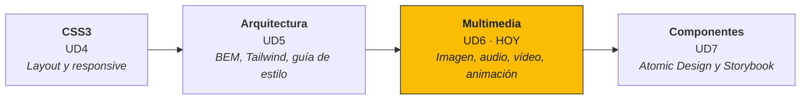
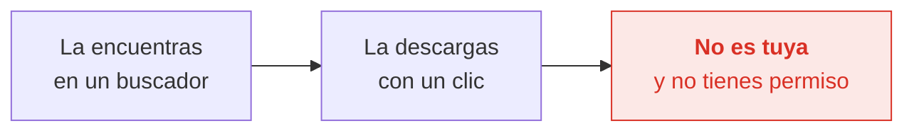
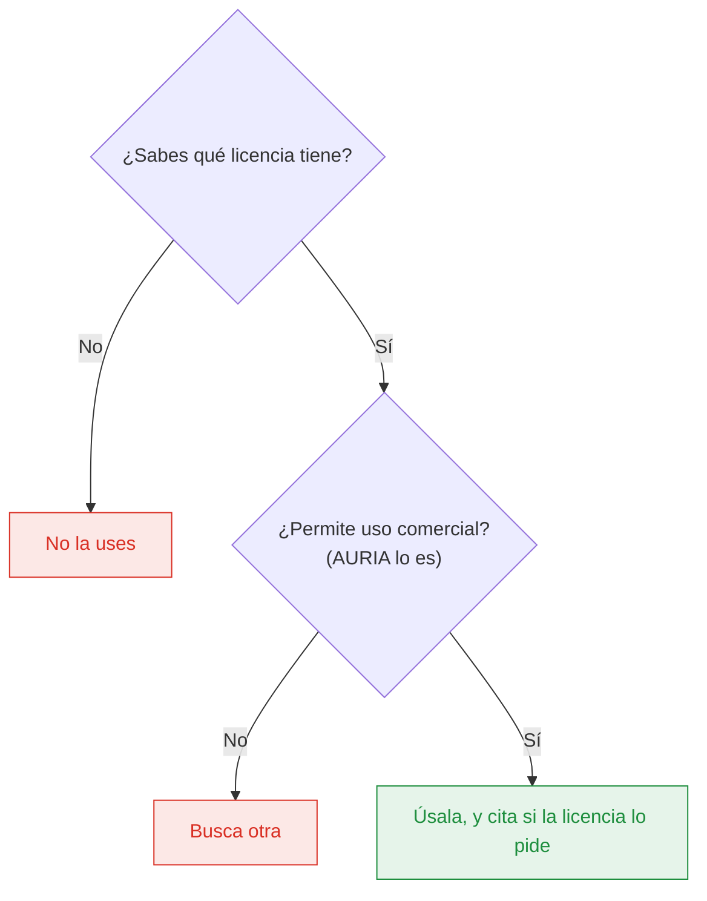
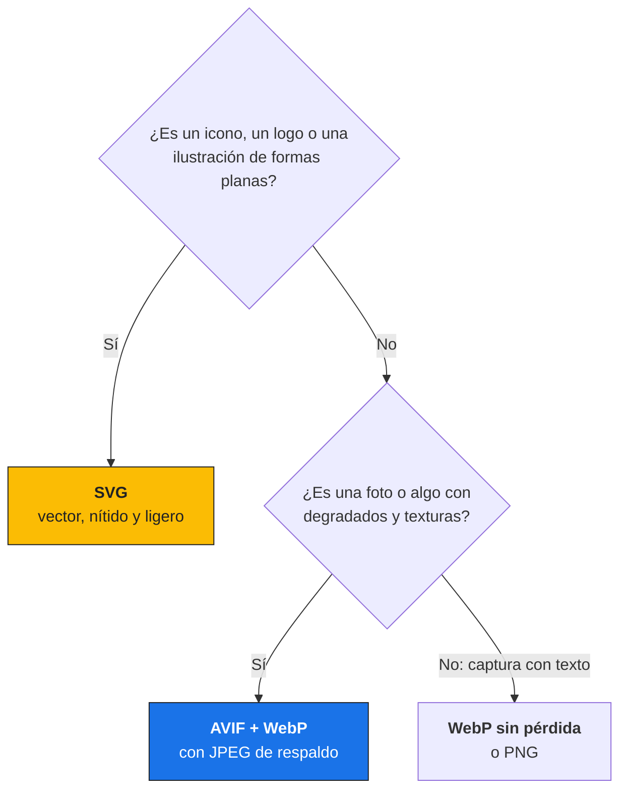
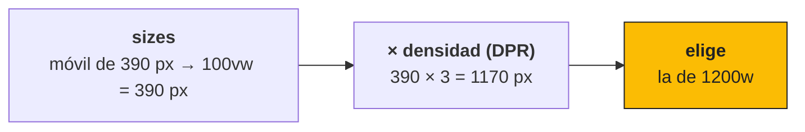
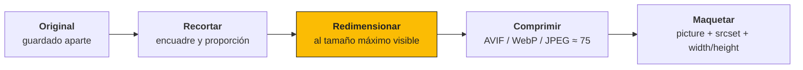
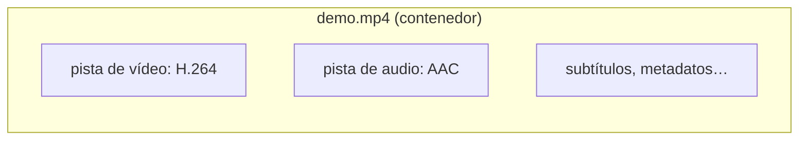
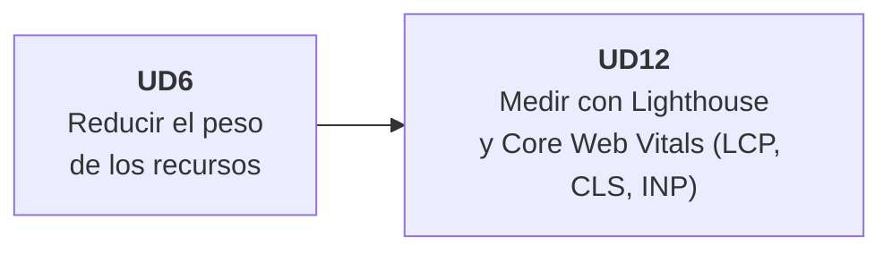
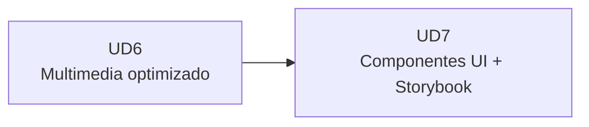

# UD6 · Optimización Multimedia (WebP/AVIF), SVG e Introducción a Performance :material-image-multiple-outline:

<div class="presentacion" markdown>
:material-presentation-play:{ .presentacion__icono } **Presentación de clase** · 56 diapositivas para seguir la unidad

[:material-file-pdf-box: Abrir o descargar el PDF](../assets/presentaciones/DIW-UD6.pdf){ .md-button .md-button--primary target="_blank" }
</div>

## Resultado de aprendizaje y criterios cubiertos :material-school:

Esta unidad aborda de forma integral el **RA3 — Integra elementos multimedia en páginas Web analizando su interactividad y usabilidad**.

| Criterio | Enunciado | Cobertura | Evaluación |
|---|---|---|---|
| **RA3.a** | Licencias y derechos de autor en material multimedia. | UD6 (§2) | **UD6 (1.ª Ev.)** |
| **RA3.b** | Formatos de imagen, audio y vídeo a utilizar. | UD6 (§3, §4, §6) | **UD6 (1.ª Ev.)** |
| **RA3.c** | Herramientas disponibles para generar contenido multimedia. | UD6 (§5) | **UD6 (1.ª Ev.)** |
| **RA3.d** | Herramientas para el tratamiento digital de la imagen. | UD6 (§5) | UD7 (2.ª Ev.) |
| **RA3.e** | Herramientas para manipular audio y vídeo. | UD6 (§6) | UD7 (2.ª Ev.) |
| **RA3.f** | Animaciones a partir de imágenes fijas. | UD6 (§7) | UD7 (2.ª Ev.) |
| **RA3.g** | Importar/exportar imagen, audio, vídeo en diversos formatos. | UD6 (§5, §6) | UD7 (2.ª Ev.) |
| **RA3.h** | Aplicación de la guía de estilo a contenido multimedia. | UD6 (§5.6) | UD7 (2.ª Ev.) |

!!! note "Planificación de evaluación"
    Aunque los criterios **RA3.d** a **RA3.h** se evalúan formalmente en la UD7 mediante componentes reales, el contenido teórico-práctico completo (tratamiento de imagen, vídeo, audio y animación) se imparte íntegramente en esta unidad.

---

## 1. Dónde estamos: AURIA ya está bien hecha, ahora que pese poco :material-map-marker-path:



!!! question "La pregunta de la unidad"
    **¿Cómo ponemos imágenes, audio y vídeo que podamos usar legalmente y que no hagan lenta la web?** Cada recurso multimedia responde a tres preguntas:

    1. **¿Puedo usarlo?** Licencias (sección 2).
    2. **¿En qué formato?** Imagen, SVG, audio y vídeo (secciones 3, 5 y 6).
    3. **¿Cuánto pesa?** Imágenes responsive, carga diferida, compresión y medición (secciones 4, 5 y 8).

### 1.1 Por qué importa en el mundo real

En una página típica, las **imágenes son lo que más pesa**: en torno a un 40 % de todo lo que se descarga, muy por encima del HTML (≈ 2 %) o del CSS (≈ 4 %) (datos orientativos del [Web Almanac de HTTP Archive](https://almanac.httparchive.org/)).

- **Velocidad:** cada segundo de espera hace que más gente abandone la página.
- **Datos móviles:** un móvil con tarifa limitada paga cada megabyte.
- **Derechos de autor:** una foto "cogida de Google" puede acabar en una reclamación.
- **Accesibilidad:** texto alternativo, subtítulos y nada que se mueva sin permiso.
- **Posicionamiento:** Google mide la carga (*Core Web Vitals*) para ordenar resultados.

!!! tip "Dato clave"
    Optimizar imágenes es casi siempre **la mejora de rendimiento más barata**: no hay que tocar el código de la web, solo preparar mejor los ficheros. La misma foto puede pesar 2,4 MB en PNG, 310 KB en JPEG y 95 KB en AVIF, y verse igual.

---

## 2. Derechos de autor y licencias (RA3.a) :material-copyright:

### 2.1 Por defecto, todo tiene dueño



- **El derecho de autor nace con la obra:** no hace falta registrarla ni poner ©. Si no dice nada, **todos los derechos están reservados**.
- **Encontrar no es poder usar:** que una imagen aparezca en un buscador no da ningún permiso.
- **Lo que manda es la licencia:** el permiso que da el autor, con sus condiciones.

En España, la **Ley de Propiedad Intelectual** protege fotos, ilustraciones, música, vídeos, tipografías y código. Citar al autor **no da permiso**: es una condición de algunas licencias.

!!! warning "AURIA es una tienda"
    Todo lo que se pone en su web es **uso comercial**.

### 2.2 Creative Commons: cuatro piezas que se combinan

| Pieza | Significado | Condición |
| --- | --- | --- |
| **BY** | Atribución | Hay que citar al autor. Está en **todas** las CC. |
| **SA** | Compartir igual | Lo que hagas a partir de la obra, con la misma licencia. |
| **NC** | No comercial | Prohibido usarla para ganar dinero. **No vale para AURIA.** |
| **ND** | Sin derivadas | Se usa tal cual: no se recorta, ni se edita, ni se retoca. |

Las seis licencias son combinaciones: **CC BY** (la más abierta), **CC BY-SA** (la de Wikipedia), **CC BY-NC**, **CC BY-NC-SA**, **CC BY-ND** y **CC BY-NC-ND** (la más cerrada). Aparte está **CC0**: el autor renuncia a todos sus derechos (dominio público), sin condiciones.

### 2.3 Qué licencia tiene lo que vas a usar

| Licencia | Uso comercial | Modificar | Citar | Dónde la encontrarás |
|---|---|---|---|---|
| **© Todos los derechos** | Solo con permiso | No | — | Casi todo internet, bancos de pago |
| **CC BY** | Sí | Sí | Sí | Wikimedia Commons, Flickr (filtrando) |
| **CC BY-SA** | Sí | Sí, misma licencia | Sí | Wikipedia |
| **CC BY-NC** | No | Sí | Sí | Material educativo |
| **CC0 / dominio público** | Sí | Sí | No | [Openverse](https://openverse.org), museos con colecciones abiertas |
| **Licencia propia del banco** | Sí (leer límites) | Sí | No obligatorio | Unsplash, Pexels, Pixabay |
| **SIL Open Font License** | Sí | Sí | — | Google Fonts |

!!! warning "Unsplash, Pexels y Pixabay no son CC0"
    Tienen **su propia licencia**, muy abierta (uso comercial, sin atribución obligatoria), pero con límites: por ejemplo, no se pueden revender las fotos tal cual ni usarlas para montar un servicio parecido. Hay que leer la licencia de cada sitio.

### 2.4 Decidir si se puede usar, y cómo citar



Para citar, **TALF**: **T**ítulo de la obra (si lo tiene), **A**utor (con enlace a su perfil), **L**icencia (con enlace a su texto) y **F**uente (dónde la encontraste).

```html
<p class="credito">
  «Auriculares» · <a href="…">Ana Ruiz</a> ·
  <a href="https://creativecommons.org/licenses/by/4.0/deed.es">CC BY 4.0</a> ·
  <a href="…">Wikimedia Commons</a>
</p>
```

Puede ir junto a la imagen o en una página de créditos (`/creditos`) que reúna todo el material de terceros.

!!! tip "Hábito"
    Apunta la licencia y la fuente **en el momento de descargar**. Una semana después nadie recuerda de dónde salió.

---

## 3. Formatos de imagen (RA3.b) :material-image-multiple-outline:

### 3.1 Raster o vectorial

| Tipo | Cómo se almacena | Al ampliar | Formatos | Para |
| --- | --- | --- | --- | --- |
| **Raster (mapa de bits)** | Rejilla de píxeles con un color cada uno | Se ven los cuadros | JPEG, PNG, GIF, WebP, AVIF | Fotos y todo lo "realista" |
| **Vectorial** | Formas descritas con números (`<circle cx="50" cy="50" r="40"/>`) | Siempre nítido | SVG | Iconos, logos, ilustraciones planas |

Un logo en SVG pesa lo mismo a 16 px que a 1600 px. Una foto no se puede pasar a vector: no son formas, son millones de puntos distintos.

### 3.2 Comprimir con pérdida o sin pérdida

- **Sin pérdida (lossless):** al descomprimir sale exactamente la misma imagen, píxel a píxel. PNG, WebP sin pérdida, GIF. Para capturas de pantalla, texto y bordes nítidos.
- **Con pérdida (lossy):** descarta detalles que el ojo casi no ve. JPEG, WebP, AVIF. Para fotografías.

El **control de calidad** (JPEG, WebP, AVIF) va de 0 a 100: a 100 pesa mucho sin verse mejor; entre **75 y 80** está el punto dulce para fotos; a 30 aparecen bloques.

!!! warning "Edita siempre desde el original"
    Cada vez que abres un JPEG, lo tocas y lo vuelves a guardar, pierde un poco más de calidad.

### 3.3 Los formatos, cara a cara

| Formato | Compresión | Transparencia | Animación | Soporte | Úsalo para |
| --- | --- | --- | --- | --- | --- |
| **JPEG** | Con pérdida | No | No | Universal | Fotos (formato de respaldo) |
| **PNG** | Sin pérdida | Sí | No | Universal | Capturas, gráficos con transparencia |
| **GIF** | Sin pérdida, 256 colores | Sí / no | Sí | Universal | Casi nada hoy |
| **WebP** | Las dos | Sí | Sí | Todos los actuales | Sustituto general de JPEG y PNG |
| **AVIF** | Las dos | Sí | Sí | Todos los actuales | Fotos: el que menos pesa |
| **SVG** | Es texto (vector) | Sí | Con CSS/JS | Universal | Iconos, logos, ilustraciones |

Misma foto y misma calidad visual, orientativamente: **JPEG 100 % · WebP ≈ 70 % · AVIF ≈ 50 %** del peso.

### 3.4 ¿Qué formato? Dos preguntas



En AURIA:

| Recurso | Formato |
| --- | --- |
| Logo | SVG |
| Iconos (carrito, usuario) | SVG en un sprite (sección 5.3) |
| Fotos de producto | AVIF + WebP + JPEG |
| Captura del panel de la app | WebP sin pérdida |
| Favicon | SVG (y un PNG de respaldo) |

```html
<link rel="icon" href="favicon.svg" type="image/svg+xml">
<link rel="icon" href="favicon.png" sizes="32x32">
<link rel="apple-touch-icon" href="apple-touch-icon.png">
```

!!! danger "Error típico"
    **PNG para una foto** (pesa muchísimo) o **JPEG para un logo** (bordes sucios y sin transparencia).

### 3.5 El mejor formato de hoy no lo será siempre

JPEG (1992), PNG (1996), WebP (2010), AVIF (2019)… y ya hay formatos nuevos como **JPEG XL**, con muy buena compresión pero soporte todavía desigual entre navegadores. Antes de usar un formato nuevo, consulta [caniuse.com](https://caniuse.com). El `<picture>` (sección 4) permite añadir un formato nuevo sin quitar los viejos: por eso la estrategia se **revisa de vez en cuando**.

---

## 4. Imágenes en HTML: cada pantalla, su imagen (RA3.b) :material-devices:

### 4.1 `<picture>`: el navegador elige el formato

```html
<picture>
  <source srcset="auria-pro.avif" type="image/avif">
  <source srcset="auria-pro.webp" type="image/webp">
  
</picture>
```

1. ¿Entiende AVIF? → descarga `auria-pro.avif`.
2. Si no, ¿entiende WebP? → descarga `auria-pro.webp`.
3. Si tampoco → usa el ``: `auria-pro.jpg`.

- **Descarga solo una:** la primera `<source>` que entiende.
- **El `` es obligatorio:** es el que se ve, el que lleva el `alt` y el respaldo para todos.
- **El orden importa:** del formato más moderno al más antiguo.
- **El CSS se pone al ``**, no al `<picture>`.

### 4.2 El problema: el móvil se descarga la foto del escritorio

Un móvil que muestra la foto a 390 px de ancho no necesita un fichero de 2400 × 2400 px y 1,1 MB. La solución es **ofrecer varios tamaños** (`auria-pro-400.webp`, `-800`, `-1200`) y que el navegador elija.

!!! info "No es el responsive de la UD4"
    Allí cambiaba **el CSS** según la pantalla. Aquí cambia **el fichero que se descarga**.

### 4.3 `srcset` y `sizes`

```html

```

| Atributo | Qué indica |
| --- | --- |
| `srcset` | Los ficheros disponibles y su **ancho real** en píxeles (`w` = *width*) |
| `sizes` | Lo que la imagen **va a ocupar en pantalla**: desde 48rem, un tercio de la ventana; si no, todo el ancho |
| `src` | El respaldo para navegadores que no entienden `srcset` |

**Cómo elige el navegador:**



Un portátil con densidad 1 y ventana de 1366 px, con `33vw`, necesita ≈ 450 px: coge la de 800w. La densidad (**DPR**, *device pixel ratio*) se ve en la consola con `window.devicePixelRatio`.

!!! warning "`sizes` no cambia el tamaño en pantalla"
    Eso lo hace el CSS. `sizes` le dice al navegador cuánto va a ocupar la imagen **antes de tener el CSS**, porque las imágenes empiezan a descargarse en cuanto se lee el HTML. Sin `sizes`, supone `100vw` y en escritorio descargará de más.

Formato y tamaño se combinan poniendo `srcset` y `sizes` en cada `<source>`:

```html
<picture>
  <source type="image/avif"
          srcset="auria-pro-400.avif 400w, auria-pro-800.avif 800w, auria-pro-1200.avif 1200w"
          sizes="(min-width: 48rem) 33vw, 100vw">
  <source type="image/webp"
          srcset="auria-pro-400.webp 400w, auria-pro-800.webp 800w, auria-pro-1200.webp 1200w"
          sizes="(min-width: 48rem) 33vw, 100vw">
  
</picture>
```

### 4.4 Dos casos más: densidad fija y dirección de arte

=== "Tamaño fijo: descriptores x"

    El logo siempre mide 160 px; solo cambia la densidad de la pantalla:

    ```html
    
    ```

    Pantalla normal → `logo-160`; pantalla retina (2x) → `logo-320`. Sin `sizes`. Si el logo es SVG, ni esto hace falta.

=== "Dirección de arte: `<picture>` con media"

    No es la misma foto más pequeña: es **otro encuadre** para el móvil.

    ```html
    <picture>
      <source media="(min-width: 48rem)" srcset="hero-ancho.webp">
      
    </picture>
    ```

| Necesitas… | Usa |
| --- | --- |
| El mismo encuadre a varios tamaños | `srcset` + `sizes` |
| Un encuadre distinto según la pantalla | `<picture>` + `<source media>` |
| Un formato distinto según el navegador | `<picture>` + `<source type>` |

### 4.5 `loading="lazy"`: no descargues lo que nadie ha visto

```html
<!-- La imagen principal: carga YA y con prioridad -->


<!-- Las de más abajo: cuando se acerquen -->

```

- **`loading="lazy"`:** el navegador espera a que la imagen se acerque a la pantalla. También vale para `<iframe>`.
- **Nunca en la primera imagen visible:** retrasarías justo lo que el usuario espera ver.
- **`fetchpriority="high"`:** marca la imagen más importante para que se pida antes.

!!! info "LCP"
    La imagen grande del principio suele ser el **LCP** (*Largest Contentful Paint*): lo que tarda en aparecer lo más grande de la pantalla. Se mide en la UD12.

### 4.6 `width` y `height`: reservar el hueco

Sin `width` ni `height`, el navegador no sabe cuánto medirá la imagen hasta descargarla: pinta el texto y, cuando llega la imagen, **el texto salta hacia abajo**. Ese salto se llama **CLS** (*Cumulative Layout Shift*). Con ellos, el navegador calcula la proporción y reserva el hueco desde el principio.

```html

```

```css
img { max-width: 100%; height: auto; }
```

!!! tip "No fijan el tamaño, dan la proporción"
    `width` y `height` son el tamaño real del fichero; el tamaño en pantalla lo decide el CSS. Si en CSS fijas los dos lados y no quieres deformar la imagen, usa `object-fit: cover`.

### 4.7 El `alt`: lo que la imagen dice a quien no la ve

| Tipo | Cuándo | Ejemplo | Regla |
| --- | --- | --- | --- |
| **Informativa** | Aporta contenido | `alt="Auriculares AURIA Pro en color negro"` | Describe lo que importa en ese contexto |
| **Decorativa** | Solo adorna | `alt=""` | `alt` vacío: el lector la salta. **Nunca** quitar el atributo |
| **Funcional** | Es un enlace o un botón | `alt="Ir al carrito"` | Describe la **acción**, no el dibujo |

Sin "imagen de…" ni "foto de…": el lector de pantalla ya anuncia que es una imagen.

---

## 5. SVG y tratamiento de imagen (RA3.c, RA3.d, RA3.g, RA3.h) :material-vector-curve:

### 5.1 Un SVG es HTML que dibuja

```html
<svg xmlns="http://www.w3.org/2000/svg"
     viewBox="0 0 24 24" width="24" height="24"
     fill="currentColor">
  <path d="M7 18a2 2 0 1 0 0 4 2 2 0 0 0 0-4z…"/>
</svg>
```

| Parte | Qué hace |
| --- | --- |
| `viewBox` | El lienzo: x, y, ancho y alto de las coordenadas internas. El dibujo se escala desde ahí |
| `path d="…"` | La forma: órdenes de dibujo (M mover, L línea, C curva, Z cerrar) |
| `fill="currentColor"` | Pinta con el color del texto: el icono cambia de color con `color` en CSS |

Es texto: se abre con VS Code, pesa bytes y Git ve los cambios.

### 5.2 Tres formas de poner un SVG en la página

| | `` | SVG en línea `<svg>…</svg>` | Sprite `<svg><use href>` |
| --- | --- | --- | --- |
| **Se cachea** | Sí | No (va dentro del HTML) | Sí (si el sprite es un fichero) |
| **Color con CSS** | No | Sí (`currentColor`) | Sí (`currentColor`) |
| **Repetido 20 veces** | 1 descarga | 20 copias del código | 1 definición, 20 `<use>` |
| **Animar sus piezas** | No | Sí | Limitado |
| **Úsalo para** | Logos e ilustraciones | Un icono suelto que anima | Sistemas de iconos |

### 5.3 Sprite SVG: los iconos, definidos una sola vez

=== "img/iconos.svg"

    ```html
    <svg xmlns="http://www.w3.org/2000/svg">
      <symbol id="carrito" viewBox="0 0 24 24">
        <path d="…"/>
      </symbol>
      <symbol id="usuario" viewBox="0 0 24 24">
        <path d="…"/>
      </symbol>
    </svg>
    ```

=== "index.html"

    ```html
    <button class="btn" aria-label="Ver carrito">
      <svg class="icono" aria-hidden="true">
        <use href="img/iconos.svg#carrito"/>
      </svg>
    </button>
    ```

=== "CSS"

    ```css
    .icono {
      width: 1.5rem;
      height: 1.5rem;
      fill: currentColor;
    }
    ```

- **`<symbol>`** define el icono pero no lo pinta. Cada uno con su `id`.
- **`<use href="…#id">`** lo pinta donde lo pongas.
- **`aria-hidden="true"`:** el icono es decoración; el nombre accesible lo pone el `aria-label` del botón.

!!! warning "Dos fallos típicos"
    - Un sprite **externo** no carga abriendo el HTML con doble clic (`file://`): usa **Live Server** o cualquier servidor local.
    - Si el icono no cambia de color, el `<path>` tiene un `fill` fijo: quítaselo (SVGO puede hacerlo).

### 5.4 Las herramientas: una para cada trabajo

| Herramienta | Para qué | Uso principal |
| --- | --- | --- |
| **Penpot** | Diseño (UD1-UD2) | Exportar iconos y logos a SVG, y piezas a PNG o JPEG |
| **GIMP · Photopea** | Edición raster | Recortar, reencuadrar, ajustar color, quitar fondos |
| **[Squoosh](https://squoosh.app)** | Comprimir y comparar | Ver lado a lado JPEG, WebP y AVIF con su peso |
| **SVGO · [SVGOMG](https://jakearchibald.github.io/svgomg/)** | Limpiar SVG | Quitar metadatos y decimales de sobra |
| **ImageMagick · sharp** | Por lotes | Convertir y redimensionar cien fotos con un comando |

Todas son gratuitas: Penpot, GIMP e ImageMagick son software libre; Squoosh, Photopea y SVGOMG funcionan en el navegador.

### 5.5 El flujo: del original a la página



!!! tip "Redimensionar es lo que más ahorra"
    Una foto de 4000 px mostrada a 400 px tiene **100 veces más píxeles** de los que se ven (10 × 10). Ningún formato compensa eso. Nombra los ficheros con su ancho (`auria-pro-800.webp`) para reconocerlos en el `srcset`.

**Squoosh:** arrastra la línea para comparar original y comprimida, cambia formato y calidad mirando el peso, y haz zoom en bordes y degradados. Baja la calidad hasta que notes la diferencia y sube un poco: no hay un número mágico.

**SVGO:**

```bash
npx svgo icono.svg -o icono.min.svg
```

Un icono exportado de 4,2 KB puede quedarse en 0,9 KB. Comprueba siempre que se sigue viendo igual.

**Por lotes con ImageMagick 7:**

```bash
# Una foto: redimensionar a 800 px de ancho y guardar en WebP
magick auria-pro.jpg -resize 800x -quality 75 auria-pro-800.webp

# Todas las fotos de la carpeta a 400, 800 y 1200 px
for f in *.jpg; do
  for w in 400 800 1200; do
    magick "$f" -resize ${w}x -quality 75 "${f%.jpg}-$w.webp"
  done
done
```

En proyectos reales esto se automatiza: herramientas de build (Vite, Astro, Next) que generan tamaños y formatos al compilar, o **CDN de imágenes** que generan la variante que pide cada dispositivo a partir de un original.

### 5.6 La guía de estilo también manda en la multimedia (RA3.h)

La guía de estilo de la UD5 tiene una sección de multimedia:

| Qué se acuerda | Ejemplo en AURIA |
| --- | --- |
| **Proporciones** | Producto 1:1 · cabecera 16:9 · miniatura de vídeo 16:9 |
| **Tamaños y formatos** | Fotos: 400 / 800 / 1200 px, AVIF + WebP + JPEG, calidad 75 |
| **Tratamiento** | Fondo blanco liso en producto, misma luz, sin sombras duras |
| **Iconos** | Un solo set (mismo grosor y estilo), sprite en `img/iconos.svg`, 24 × 24 |
| **Vídeo y audio** | MP4 H.264 + WebM, siempre con póster y subtítulos |
| **Licencias** | Solo CC0, CC BY o bancos con licencia comercial; atribución en `/creditos` |

Si una foto no cumple la guía, desentona aunque esté bien comprimida.

---

## 6. Audio y vídeo en la web (RA3.b, RA3.e, RA3.g) :material-video-film:

### 6.1 Contenedor y códec: la caja y lo que va dentro



- **Contenedor:** el fichero (`.mp4`, `.webm`, `.ogg`). Mete dentro una o varias pistas.
- **Códec:** cómo está comprimida cada pista (H.264, VP9, AV1, AAC, Opus…).
- El navegador necesita entender **las dos cosas**: un `.mp4` con un códec raro no se reproduce.

### 6.2 Los formatos que se usan hoy

| Vídeo | Contenedor | Soporte | Notas |
| --- | --- | --- | --- |
| **H.264** | `.mp4` | Universal | El respaldo: funciona en todo |
| **VP9** | `.webm` | Todos los actuales | Pesa menos que H.264 |
| **AV1** | `.mp4` / `.webm` | En expansión | El que menos pesa; cuesta más codificar |

| Audio | Contenedor | Soporte | Notas |
| --- | --- | --- | --- |
| **MP3** | `.mp3` | Universal | El de siempre |
| **AAC** | `.m4a` / `.mp4` | Universal | Mejor que MP3 al mismo peso |
| **Opus** | `.ogg` / `.webm` | Todos los actuales | El mejor para voz y música a poco peso |

!!! tip "Receta"
    Vídeo: **WebM (VP9) + MP4 (H.264)** de respaldo. Audio: **Opus + MP3** de respaldo. La misma idea que AVIF + JPEG en imagen.

### 6.3 `<video>` con varias fuentes, póster y subtítulos

```html
<video controls width="1280" height="720"
       poster="demo-poster.webp" preload="metadata">
  <source src="demo.webm" type="video/webm">
  <source src="demo.mp4" type="video/mp4">
  <track kind="subtitles" src="demo-es.vtt"
         srclang="es" label="Español" default>
  <p>Tu navegador no reproduce vídeo.
     <a href="demo.mp4">Descárgalo</a>.</p>
</video>
```

| Atributo / elemento | Función |
| --- | --- |
| `controls` | Los botones del navegador. Sin él, no hay forma de pararlo |
| `width` / `height` | Reservan el hueco, como en las imágenes |
| `poster` | La imagen antes de reproducir. Sin ella, a veces se ve negro |
| `<source>` | Como en `<picture>`: el primero que entienda |
| `<track>` | Subtítulos en WebVTT: accesibilidad y vídeos vistos sin sonido |

### 6.4 `autoplay` y `preload`: qué se descarga y cuándo

**`autoplay` solo en silencio:**

```html
<video autoplay muted loop playsinline …>
```

- Con sonido, los navegadores lo bloquean; con `muted`, lo permiten.
- `playsinline`: en iPhone no salta a pantalla completa.
- `loop`: vuelve a empezar (fondos, demos cortas).
- Si algo se mueve **más de 5 segundos**, debe haber un **control de pausa** (WCAG, UD9).

**`preload`: cuánto adelantar:**

| Valor | Qué descarga | Cuándo |
| --- | --- | --- |
| `none` | Nada hasta que le den a reproducir | Audio, vídeos que casi nadie ve |
| `metadata` | Solo duración y tamaño | Lo normal en vídeo |
| `auto` | El navegador puede bajarlo entero | Solo si es casi seguro que se va a ver |

!!! warning "Un vídeo de fondo pesa más que todas las imágenes juntas"
    Pregúntate si de verdad hace falta. Y si se queda, sin audio (`ffmpeg … -an`), `muted`, `playsinline` y botón de pausa.

### 6.5 `<audio>` y subtítulos WebVTT

```html
<audio controls preload="none">
  <source src="podcast.ogg" type="audio/ogg; codecs=opus">
  <source src="podcast.mp3" type="audio/mpeg">
</audio>
```

!!! info "El `type` de Opus"
    Es `audio/ogg; codecs=opus`: el contenedor es Ogg y el códec Opus. `audio/opus` no es un tipo válido para el contenedor.

El audio necesita además una **transcripción** en texto en la página: para quien no oye o no puede poner sonido.

**Subtítulos WebVTT** (`demo-es.vtt`):

```text
WEBVTT

00:00:01.000 --> 00:00:04.000
Estos son los AURIA Pro.

00:00:04.500 --> 00:00:08.000
Cancelación de ruido activa
y 30 horas de batería.
```

Texto plano: la palabra `WEBVTT`, una línea en blanco y bloques con tiempo de entrada `-->` tiempo de salida y el texto. Un `.srt` se convierte con `ffmpeg -i subs.srt subs.vtt`.

### 6.6 ¿Lo alojas tú o lo incrustas?

| En tu servidor (`<video>`) | Incrustado (`<iframe>`) |
| --- | --- |
| Control total del aspecto | La plataforma adapta la calidad a la conexión |
| Sin anuncios ni cookies de terceros | Gratis y sin preparar nada |
| Tú pagas el ancho de banda | Cookies de terceros y anuncios |
| Tú preparas formatos y tamaños | El reproductor es el suyo |

```html
<iframe src="https://www.youtube-nocookie.com/embed/ID"
        title="Presentación de AURIA Pro"
        width="560" height="315" loading="lazy" allowfullscreen></iframe>
```

`youtube-nocookie.com` no pone cookies hasta que se reproduce; el `title` es lo que anuncia el lector de pantalla; y `loading="lazy"` evita cargar el reproductor hasta que hace falta.

### 6.7 Herramientas para editar y convertir

| Herramienta | Tipo | Uso principal |
| --- | --- | --- |
| **Audacity** | Editor de audio libre | Cortar, quitar ruido, normalizar volumen, exportar MP3/Opus |
| **HandBrake** | Conversor de vídeo con interfaz | Convertir a MP4 o WebM con perfiles para web |
| **FFmpeg** | Línea de comandos | Lo hace todo y se puede automatizar |

```bash
# A WebM (VP9 + Opus)
ffmpeg -i demo.mov -c:v libvpx-vp9 -crf 32 -b:v 0 -c:a libopus demo.webm

# A MP4 (H.264 + AAC) que empieza a verse antes de descargarse entero
ffmpeg -i demo.mov -c:v libx264 -crf 23 -c:a aac -movflags +faststart demo.mp4

# El póster: un fotograma del segundo 2
ffmpeg -ss 2 -i demo.mov -frames:v 1 demo-poster.webp
```

`-crf` es la calidad: cuanto más alto, menos pesa y peor se ve. `-movflags +faststart` coloca el índice al principio del MP4 para que empiece a reproducirse antes de terminar la descarga. `-an` quita el audio; `-vf scale=1280:-2` baja la resolución a 1280 px de ancho.

---

## 7. Animaciones a partir de imágenes fijas (RA3.f) :material-animation:

### 7.1 Tres técnicas

| Técnica | Para | Ejemplo |
| --- | --- | --- |
| **`@keyframes`** | Mover, girar, escalar o hacer aparecer una imagen | Un logo que flota, un icono que late |
| **Sprite sheet** | Fotogramas en una sola imagen, mostrados uno a uno | Un personaje que anda, un icono dibujado a mano |
| **WebP animado / vídeo** | Animaciones complejas hechas en otra herramienta | Una ilustración animada larga |

Orden de preferencia: **primero CSS** (no pesa nada), luego sprite, y solo si hace falta un fichero animado.

!!! danger "¿Y el GIF?"
    256 colores y pesa muchísimo: un GIF de 3 MB es un MP4 o un WebP animado de 300 KB. Para sustituirlo con un vídeo que se comporte igual: `<video autoplay muted loop playsinline src="animacion.mp4"></video>`.

### 7.2 `@keyframes`: dar movimiento a una imagen fija

```scss
@keyframes flotar {
  0%, 100% { transform: translateY(0); }
  50%      { transform: translateY(-10px); }
}

.logo {
  animation: flotar 3s ease-in-out infinite;
}

@media (prefers-reduced-motion: reduce) {
  .logo { animation: none; }
}
```

| Pieza | Qué hace |
| --- | --- |
| `@keyframes` | Los momentos de la animación, en % |
| `animation` | Nombre · duración · ritmo · repeticiones |
| `transform` y `opacity` | Lo único que el navegador anima sin esfuerzo. No animes `width`, `top` ni `margin`: obligan a recalcular la página en cada fotograma |
| `prefers-reduced-motion` | La persona ha pedido menos movimiento en su sistema: se respeta |

!!! warning "Accesibilidad"
    El movimiento puede provocar mareo (trastornos vestibulares). La media query `prefers-reduced-motion` **no es opcional**. Se prueba en DevTools → Rendering → *Emulate CSS media feature prefers-reduced-motion*.

### 7.3 Sprite sheet: fotogramas en fila y `steps()`

`pasos.png`: 8 fotogramas de 64 × 64 px en fila = una tira de 512 × 64 px. El elemento mide 64 × 64 y enseña un fotograma cada vez.

```scss
.mascota {
  width: 64px;
  height: 64px;
  background: url("pasos.png") 0 0;
  animation: andar 0.8s steps(8) infinite;
}

@keyframes andar {
  to { background-position: -512px 0; }
}
```

- El fondo se desplaza de 0 a −512 px (la tira entera).
- `steps(8)` lo hace **a saltos**: 8 paradas de 64 px, sin transición entre ellas, y cada parada encaja con un fotograma. Con `linear` o `ease` se vería la tira deslizarse.
- Desplazamiento total = **ancho del fotograma × número de fotogramas**.

!!! warning "Usa píxeles"
    Con porcentajes en `background-position` el cálculo cambia (el % se aplica a la diferencia entre caja e imagen) y es fácil que los fotogramas no cuadren.

---

## 8. Medir antes y después (introducción a performance) :material-speedometer:

En DevTools, pestaña **Network**:

1. **Disable cache** marcado: para medir como la primera visita.
2. **Filtro Img** (o **Media** para audio y vídeo): solo ese tipo de recursos.
3. **transferred**, en la barra inferior: lo que se ha descargado de verdad.
4. **Throttling** (Fast 4G / Slow 4G): simula un móvil con mala cobertura.

Para ver qué fichero ha elegido el navegador en un `srcset`, selecciona el `` en Elements y busca `currentSrc` en Properties.

!!! tip "Presupuesto de peso"
    Un límite acordado por el equipo, por ejemplo "menos de 500 KB de imágenes en la portada". Si se supera, se optimiza antes de publicar.

| Estrategia | Impacto | Sección |
| --- | --- | --- |
| Formatos AVIF / WebP | Menos peso con la misma calidad visual | §3, §4.1 |
| Redimensionar + `srcset` / `sizes` | Cada pantalla descarga solo lo que necesita | §4.3, §5.5 |
| `loading="lazy"` | No se descarga lo que no se ve | §4.5 |
| `width` / `height` | Sin saltos al cargar (CLS) | §4.6 |
| `preload` adecuado | No se descargan vídeos que nadie ve | §6.4 |
| Animar con CSS | Sin ficheros animados pesados | §7 |



---

## 9. Caso real: multimedia a escala de producción :material-domain:

| Caso | Qué hacen |
| --- | --- |
| **CDN de imágenes** | Cloudinary, imgix o el de Vercel/Netlify: un original y el servidor genera formato y tamaño por dispositivo |
| **Imágenes en el build** | Astro, Next o Vite generan `srcset`, AVIF y WebP al compilar |
| **Presupuesto de peso** | Límites en KB por página que el equipo se compromete a no pasar |
| **Auditoría continua** | La integración continua falla si una imagen pesa más de lo permitido |
| **Impacto en ventas** | Las tiendas online documentan más conversión cuando la página carga antes |
| **Créditos y licencias** | Los medios guardan la licencia de cada foto: una reclamación cuesta más que la foto |

!!! example "Pruébalo"
    Abre una tienda online grande, F12 → Network → Img: mira qué formato y qué tamaño te sirve en tu pantalla.

---

## 10. Errores comunes :material-alert-circle-outline:

### 10.1 Trampas de imagen

| Error | Qué pasa | ❌ Incorrecto | ✅ Correcto |
| --- | --- | --- | --- |
| PNG para fotografías | Pesa varias veces más sin verse mejor | `foto-producto.png` (2,4 MB) | `<picture>` con AVIF + WebP + JPEG |
| Imagen sobredimensionada | Se descargan píxeles que nadie ve | 4000 px para un hueco de 400 | `srcset` 400w, 800w, 1200w + `sizes` |
| `srcset` con `w` sin `sizes` | Se supone `100vw` y se descarga de más | `srcset="… 400w, … 800w"` | Añadir `sizes="(min-width: 48rem) 33vw, 100vw"` |
| `lazy` en la imagen principal | Retrasa lo primero que se ve (LCP) | `` | `` |
| Sin `width` y `height` | La página salta al cargar (CLS) | `` | `` |
| Sin `alt` | El lector lee el nombre del fichero | `` | `` |

### 10.2 Trampas de vídeo, audio y licencias

| Error | Qué pasa | ❌ Incorrecto | ✅ Correcto |
| --- | --- | --- | --- |
| Autoplay con sonido | Molesta y el navegador lo bloquea | `<video autoplay>` | `<video autoplay muted playsinline>` |
| `preload="auto"` en todo | Se descargan vídeos que nadie verá | `<video preload="auto">` | `<video preload="metadata" poster="…">` |
| Vídeo sin subtítulos | Inaccesible para quien no oye | `<video><source …></video>` | `<track kind="subtitles" src="….vtt">` |
| Sprite abierto con doble clic | Los iconos no aparecen | `file:///…/index.html` | Live Server o servidor local |
| "La saqué de Google" | Sin licencia no hay permiso | Descargar de un buscador | CC0 / CC BY / banco + créditos TALF |

---

## 11. Ejercicio práctico guiado: la multimedia de AURIA, legal, ligera y medida :material-clipboard-check:

!!! info "Actividad de consolidación (no evaluable)"
    **Objetivo:** aplicar la estrategia multimedia completa a la página de AURIA de la UD4-UD5, midiendo el peso antes y después.

**Pasos, en este orden:**

1. **Medir el ANTES:** DevTools → Network → Img, con *Disable cache*. Apunta el peso total de imágenes.
2. **Licencias:** elige 3 fotos de producto CC0 o CC BY (por ejemplo, en [Openverse](https://openverse.org)) y crea una página `creditos.html` con su atribución TALF.
3. **Preparar:** con Squoosh o `magick`, cada foto a 400, 800 y 1200 px en AVIF y WebP, más un JPEG de respaldo. Nómbralas con su ancho.
4. **Maquetar:** `<picture>` con `srcset` y `sizes` en cada `<source>`, `width` y `height`, `alt` adecuado, `loading="lazy"` en todas menos la principal (que lleva `fetchpriority="high"`).
5. **Iconos:** exporta el carrito y el usuario de Penpot, límpialos con SVGO y crea un sprite `img/iconos.svg` con `currentColor`. Úsalos en botones con `aria-label`.
6. **Vídeo y audio:** un vídeo corto en WebM y MP4 con póster y subtítulos `.vtt`; un audio en Opus y MP3 con `preload="none"`.

Al final, **vuelve a medir (el DESPUÉS)** y apunta los dos números en el `README.md`, junto a la sección de multimedia de la guía de estilo.

!!! success "Criterio de éxito"
    El peso de imágenes baja de forma medible, **no hay saltos al cargar** (pruébalo con Fast 4G) y **cada recurso tiene su licencia apuntada**.

---

## 12. Comprueba lo aprendido :material-head-question-outline:

??? question "1. ¿Por qué SVG es mejor que PNG para el logo de AURIA? ¿Y por qué no sirve para una foto?"
    El logo son formas: en SVG se describe con instrucciones, se ve nítido a cualquier tamaño, pesa muy poco y se puede pintar con CSS. Una foto son millones de píxeles distintos: no se puede describir con formas.

??? question "2. En un `<picture>` con AVIF, WebP y JPEG, ¿cuántas imágenes descarga el navegador y cuál?"
    Una sola: la primera `<source>` cuyo formato entiende (AVIF en los navegadores actuales). El JPEG del `` solo si no entiende ninguna.

??? question "3. ¿Qué indica `sizes` y por qué el navegador lo necesita si el tamaño ya está en el CSS?"
    El ancho que ocupará la imagen en pantalla según las condiciones de media. Lo necesita porque empieza a descargar las imágenes al leer el HTML, antes de tener el CSS.

??? question "4. ¿Por qué la imagen principal no lleva `loading=\"lazy\"`? ¿Qué hacen `width` y `height`?"
    Porque se ve nada más cargar: retrasarla empeora lo que tarda en verse (LCP). `width` y `height` dan la proporción para que el navegador reserve el hueco y la página no salte (CLS).

??? question "5. Una foto es CC BY-NC. ¿Puede usarla AURIA? ¿Y una CC BY? ¿Qué hay que poner?"
    La NC no, porque AURIA es una tienda (uso comercial). La CC BY sí, citando: título, autor, licencia y fuente (TALF), con enlaces.

!!! example "Mini-reto (20 min, en parejas)"
    1. **Licencia:** una foto CC0 o CC BY y su crédito TALF.
    2. **Tres tamaños:** 400, 800 y 1200 px en AVIF y WebP.
    3. **picture:** con `srcset`, `sizes`, `width`/`height` y `alt`.
    4. **Medir:** peso antes y después en Network.
    5. **Romper:** intercambiad con otra pareja. Con DevTools y *Disable cache*: modo dispositivo a 390 px (¿qué fichero baja?), Fast 4G (¿la página salta?), y revisad el `alt` y el crédito.

    **Éxito:** la otra pareja no encuentra saltos de layout ni descargas más grandes de lo necesario.

---

## 13. Glosario :material-book-alphabet:

### Licencias, formatos e imágenes en HTML

| Término | Definición |
| --- | --- |
| **Derecho de autor** | Protege la obra desde que se crea, sin registro. |
| **Creative Commons** | Licencias que dan permisos con condiciones (BY, SA, NC, ND). |
| **CC0** | Renuncia a los derechos: uso libre sin citar. |
| **Raster** | Imagen hecha de píxeles: JPEG, PNG, WebP, AVIF. |
| **Vectorial** | Imagen hecha de formas: SVG. |
| **Con / sin pérdida** | Tira detalle para pesar menos / conserva cada píxel. |
| **WebP · AVIF** | Formatos modernos: mismo aspecto, menos peso. |
| **`<picture>`** | Contenedor que ofrece varias fuentes de una imagen. |
| **`srcset` · `sizes`** | Ficheros disponibles · espacio que ocupará. |
| **DPR** | Densidad de píxeles de la pantalla (1x, 2x, 3x). |
| **Lazy loading** | Cargar la imagen cuando se acerca a la pantalla. |
| **CLS** | Saltos del contenido mientras carga la página. |
| **LCP** | Lo que tarda en verse lo más grande de la pantalla. |

### SVG, audio, vídeo y animación

| Término | Definición |
| --- | --- |
| **`viewBox`** | Sistema de coordenadas interno de un SVG. |
| **`currentColor`** | El color del texto, usado como relleno del SVG. |
| **Sprite SVG** | Fichero con `<symbol>`s que se pintan con `<use>`. |
| **SVGO** | Optimizador que limpia ficheros SVG. |
| **Contenedor** | El fichero de vídeo o audio: `.mp4`, `.webm`, `.ogg`. |
| **Códec** | Cómo se comprime cada pista: H.264, VP9, AV1, Opus. |
| **`poster`** | Imagen que muestra el vídeo antes de reproducirse. |
| **`preload`** | Cuánto adelanta el navegador: `none`, `metadata`, `auto`. |
| **WebVTT** | Formato de texto de los subtítulos (`.vtt`). |
| **`@keyframes`** | Los pasos de una animación CSS. |
| **Sprite sheet** | Fotogramas en una imagen, mostrados con `steps()`. |
| **`prefers-reduced-motion`** | Preferencia del sistema de reducir el movimiento. |

---

## 14. Resumen y conexión con la siguiente unidad :material-link-variant:

**¿Cuánto le cuesta a quien visita tu web verla?** Tiempo, datos y batería. Tú pruebas con fibra y un portátil; quien compra en AURIA quizá lo hace en el autobús, con poca cobertura. Antes de poner cualquier recurso:

1. **¿Puedo usarlo?** Licencia comprobada y créditos apuntados.
2. **¿En qué formato?** SVG para formas, AVIF/WebP para fotos, WebM/MP4 para vídeo.
3. **¿Cuánto pesa?** El tamaño justo para cada pantalla, y medido.

- Todo tiene dueño: solo se usa con licencia, y se cita como pide.
- SVG para formas; AVIF y WebP (con JPEG de respaldo) para fotos.
- `<picture>` elige el formato; `srcset` + `sizes`, el tamaño justo.
- `width`/`height` evitan saltos; `lazy`, salvo en la imagen principal.
- Vídeo: WebM + MP4, póster, subtítulos y `autoplay` solo en silencio.
- Animar con CSS antes que con ficheros, y respetando `prefers-reduced-motion`.

Con la UD6 se cierra la **1.ª evaluación**. En la **UD7** todo lo construido (la tarjeta, los iconos, las imágenes) se convierte en **componentes reutilizables** con Atomic Design y un catálogo en **Storybook**.



---

## 15. Referencias y fuentes :material-book-open-page-variant:

* MDN Web Docs — [Guía de tipos y formatos de imagen](https://developer.mozilla.org/es/docs/Web/Media/Formats/Image_types).
* MDN Web Docs — [Imágenes adaptables (responsive)](https://developer.mozilla.org/es/docs/Learn/HTML/Multimedia_and_embedding/Responsive_images).
* MDN Web Docs — [Contenido de vídeo y audio](https://developer.mozilla.org/es/docs/Learn/HTML/Multimedia_and_embedding/Video_and_audio_content) y [WebVTT](https://developer.mozilla.org/es/docs/Web/API/WebVTT_API).
* web.dev — [Learn Images](https://web.dev/learn/images) y [Optimize Cumulative Layout Shift](https://web.dev/articles/optimize-cls).
* Creative Commons — [Sobre las licencias CC](https://creativecommons.org/share-your-work/cclicenses/) y [Buenas prácticas de atribución](https://wiki.creativecommons.org/wiki/Best_practices_for_attribution).
* Openverse — [openverse.org](https://openverse.org).
* Squoosh — [squoosh.app](https://squoosh.app/) · SVGOMG — [jakearchibald.github.io/svgomg](https://jakearchibald.github.io/svgomg/).
* ImageMagick — [Documentación de la línea de comandos](https://imagemagick.org/script/command-line-processing.php).
* FFmpeg — [Documentación oficial](https://ffmpeg.org/documentation.html).
* Can I use — [caniuse.com](https://caniuse.com/).
* Ruiz, M. — *Diseño de Interfaces Web*.
